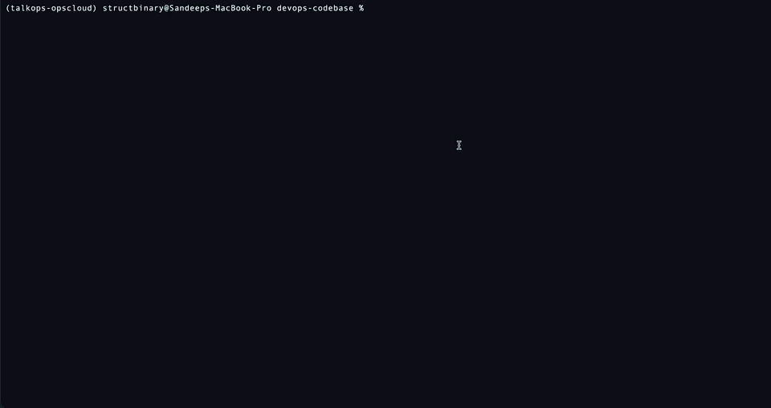

<p align="center">
  <picture>
    <source media="(prefers-color-scheme: dark)" srcset="docs/assets/talkops-logo-dark.svg">
    <source media="(prefers-color-scheme: light)" srcset="docs/assets/talkops-logo-light.svg">
    
  </picture>
</p>

<p align="center">
  <b>Ask for any DevOps operation in plain language. TalkOps plans it, runs it safely, and reports back.</b><br>
  Autonomous incident triage · Kubernetes · Terraform · Multi-Cloud · CI/CD — from a local terminal, a pipeline, or a shared server.
</p>

<p align="center">
  <a href="LICENSE"></a>
  <a href="https://www.python.org/downloads/"></a>
  <a href="https://github.com/langchain-ai/langgraph"></a>
  <a href="https://github.com/langchain-ai/deepagents"></a>
  <a href="docs/talkops-docs/approval-mode.md"></a>
  <a href="docs/talkops-docs/model-providers.md"></a>
  <a href="docs/talkops-docs/Configuration.md"></a>
</p>

<p align="center">
  <a href="#quickstart-in-60-seconds">Quickstart</a> ·
  <a href="#why-talkops">Why TalkOps</a> ·
  <a href="#how-jev-smart-mode-optimizes-cost-latency-and-safety">Smart Mode</a> ·
  <a href="#centralized-server--multi-client-architecture">Central Server</a> ·
  <a href="#event-driven-webhooks--autonomous-incident-triage">Webhooks</a> ·
  <a href="#cli--interactive-slash-command-reference">CLI Reference</a> ·
  <a href="#documentation-directory">Docs</a>
</p>

<p align="center">
  <video src="docs/assets/talkops-tui-finops-demo.mp4" controls autoplay loop muted playsinline width="100%">
    
  </video>
</p>
<p align="center">
  <sub><b>Autonomous AWS FinOps Audit in Jev Smart Mode:</b> Installing <code>aws-finops-engineer</code> via <code>/plugins</code>, auditing 17 AWS regions across 32 tool calls (<b>1.1M tokens · 77% cache hit · $0.36 total cost</b>), and generating an actionable remediation report (<a href="docs/assets/talkops-tui-finops-demo.mp4">watch HD MP4</a>).</sub>
</p>

---

## What is TalkOps?

**TalkOps** is an autonomous multi-agent Cloud Operations and DevOps framework built on **[DeepAgents](https://github.com/langchain-ai/deepagents)**, **[LangGraph](https://github.com/langchain-ai/langgraph)**, **[LangChain](https://github.com/langchain-ai/langchain)** (26+ built-in LLM providers), and the **[TypeSafe AI Jev](https://pypi.org/project/langchain-typesafe/)** System One engine. It runs interactively in a **[Textual](https://textual.textualize.io/)** terminal UI (TUI), headlessly inside CI/CD pipelines (`talkops -p`), over the **Agent Client Protocol** (`talkops --acp`), or centrally as a multi-tenant server (`talkops serve`) that ingests production webhooks and coordinates multiple connected operator clients.

Whether triaging a 3 AM PagerDuty or Prometheus alert storm, diagnosing Kubernetes `CrashLoopBackOff` pods, auditing multi-cloud AWS/Azure/GCP FinOps and IAM posture, refactoring Terraform modules, or repairing broken GitHub Actions workflows, TalkOps plans and executes end-to-end operational tasks across native **Model Context Protocol (MCP)** tools and isolated **Docker, Kubernetes, Daytona, Modal, and Runloop** sandboxes within deterministic safety guardrails.

<table>
  <tr>
    <td width="50%" valign="top">
      <h3>Jev Smart Mode (Cost, Speed &amp; Safety)</h3>
      <p>Automatically picks the right model tier and thinking depth for each prompt in under <code>70ms</code>—cutting token costs by 80–90% on simple checks—while inspecting every tool call for production risk in under <code>100ms</code> at zero prompt token cost.</p>
      <a href="docs/talkops-docs/approval-mode.md">Explore Smart Mode →</a>
    </td>
    <td width="50%" valign="top">
      <h3>Central Server &amp; Team Collaboration</h3>
      <p>Run <code>talkops serve</code> as a shared server so multiple engineers and CI/CD jobs can connect at the same time, resume or branch live investigations, and keep per-user data isolated.</p>
      <a href="docs/talkops-docs/central-server.md">Deploy Central Server →</a>
    </td>
  </tr>
  <tr>
    <td width="50%" valign="top">
      <h3>Event-Driven Webhooks &amp; Automated RCA</h3>
      <p>Receive live alerts from PagerDuty, Prometheus Alertmanager, Datadog, AWS SNS, CloudEvents, ServiceNow, Jenkins, and GitHub Actions—grouping duplicate alerts into a single investigation and posting root-cause reports back to tickets, PRs, and Slack.</p>
      <a href="docs/talkops-docs/webhooks.md">Configure Webhooks →</a>
    </td>
    <td width="50%" valign="top">
      <h3>Specialized DevOps Subagents &amp; Plugin Marketplaces</h3>
      <p>Install domain-focused subagents, skill packs, hooks, and MCP tool servers on demand from the default Plugin Marketplace or any custom GitHub, private Git, or team marketplace (<code>/plugins</code> or <code>talkops plugin install</code>)—covering SRE incident triage, FinOps cost audits, IaC/Terraform, Kubernetes, cloud security, and databases—or define your own in <code>.talkops/agents/</code>.</p>
      <a href="docs/talkops-docs/subagents.md">Explore Subagents →</a> · <a href="docs/talkops-docs/plugins.md">Plugin Marketplaces →</a>
    </td>
  </tr>
</table>

---

## Quickstart in 60 Seconds

### 1. Install TalkOps

```bash
curl -LsSf https://raw.githubusercontent.com/talkops-ai/talkops/main/scripts/install.sh | bash
```

<details>
<summary><b>Alternative installation methods (<code>uv</code>, <code>pipx</code>, <code>pip</code>, or pinned version)</b></summary>

```bash
# Using uv (recommended for Python 3.12+ environments)
uv tool install --prerelease=allow talkops-ai

# Using pipx
pipx install --pip-args="--pre" talkops-ai

# Using pip
pip install --pre -U talkops-ai

# Install a specific version via install.sh
curl -LsSf https://raw.githubusercontent.com/talkops-ai/talkops/main/scripts/install.sh | bash -s -- 0.3.0b12
```

</details>

### 2. Run TalkOps (TUI, Headless CLI, or Server Mode)

You can invoke TalkOps using either `talkops` or the `ops` shorthand alias:

```bash
# 1. Interactive Terminal UI (TUI)
talkops   # or: ops 

# 2. Headless CLI Mode (for shell scripts & CI/CD pipelines)
talkops -p "Audit AWS resources in ap-south-1 for unused volumes and cost savings" 

# 3. Central Server Mode (start the server, then connect from a terminal or CI client)
talkops serve --host 0.0.0.0 --port 2024
talkops --server-url http://localhost:2024 --api-key oc_live_... --user-id alice
```

For setting up LLM providers, cloud credentials, `config.toml`, and all other startup options, see the **[Quickstart Guide](docs/talkops-docs/quickstart.md)**, **[Configuration Guide](docs/talkops-docs/Configuration.md)**, and **[Credentials & Authentication Guide](docs/talkops-docs/credentials.md)**.

---

## Why TalkOps?

Modern engineering doesn't stop at writing code or clicking through a single cloud console. Building and running software spans writing application and infrastructure code, provisioning cloud resources, managing Kubernetes clusters and CI/CD pipelines, monitoring live telemetry, optimizing cloud spend, enforcing security policies, and resolving production incidents.

TalkOps brings **coding, cloud management, platform engineering, observability, FinOps, security, and SRE** together into a single framework:

| Capability Area | What TalkOps Handles |
| :--- | :--- |
| **Software & Infrastructure Coding** | Writes, refactors, debugs, and reviews application code, scripts, and infrastructure configs across repositories; runs tests; performs diff-aware `/review` checks; and connects to IDEs via the Agent Client Protocol (`--acp`). |
| **Multi-Cloud Architecture & Management** | Designs, provisions, and manages services across AWS, Azure, and GCP—covering compute, networking/VPCs, databases (RDS, Aurora, DynamoDB), serverless, storage, data lakes, AI/ML workloads, and cloud migrations. |
| **IaC, GitOps & CI/CD Automation** | Authors, validates, and refactors Terraform, OpenTofu, Terragrunt, AWS CDK, CloudFormation, Crossplane, and Ansible; builds and repairs GitHub Actions, GitLab CI, and Jenkins pipelines. |
| **Kubernetes, Containers & Platform Engineering** | Builds and optimizes Dockerfiles; manages EKS, AKS, and GKE clusters; configures Helm releases, Karpenter autoscaling, Ingress, and NetworkPolicies; and diagnoses `CrashLoopBackOff` or `OOMKilled` workloads. |
| **Observability, SRE & Incident Triage** | Queries metrics, logs, and traces across Prometheus, Loki, Datadog, and CloudWatch; receives live alerts from PagerDuty, Alertmanager, ServiceNow, and GitHub; finds root causes; and posts RCA reports back to tickets and Slack. |
| **FinOps Cost Optimization & Cloud Security** | Audits multi-region cloud billing, identifies idle or oversized resources, generates actionable savings reports, reviews IAM policies for least privilege, and checks KMS, GuardDuty, and compliance guardrails. |
| **Team Collaboration & Plugin Ecosystem** | Runs locally, headlessly in CI, or as a shared server (`talkops serve`) where engineers can join and branch threads (`/fork`), and extends on demand with marketplace plugins, custom subagents, `SKILL.md` runbooks, and MCP servers. |

---

## How Jev Smart Mode Optimizes Cost, Latency, and Safety

Calling a top-tier reasoning model (`claude-opus-5-5`, `gpt-6-astra`, `gemini-3.1-pro-preview`, `deepseek-v4-pro`, `grok-4.5`) with full thinking effort on every status check or webhook event is slow and expensive—yet using a small model on a complex outage investigation misses critical root causes.

Enabling **Smart Mode** (`talkops --smart`, `/smart`, or `Shift+Tab`) activates the **TypeSafe AI Jev** classification pipeline. It routes simple checks to fast models in **`<70ms`** (cutting token costs by **80–90%**), saves heavy reasoning models for deep troubleshooting, and blocks risky production changes in **`<100ms`** using **zero LLM prompt tokens**:

| Step | What Happens | Speed & Overhead | Outcome |
| :--- | :--- | :--- | :--- |
| **1. Read Context** | Captures the prompt or webhook event along with the active workspace context (cloud provider, Kubernetes, Terraform, and available subagents). | Instant | Understands both what is being asked and what environment the agent is operating in. |
| **2. Pick Model Tier** | Matches the task difficulty to the right model tier (**Fast**, **Standard**, or **Powerful**) and sets the thinking effort (`off` to `max`). | **`<70ms`** | Simple checks get instant, low-cost answers; complex investigations get deep reasoning. |
| **3. Check Tool Safety** | Inspects every proposed shell command, file edit, MCP tool call, or subagent action for state changes and potential impact. | **`<100ms`** (`0` LLM tokens) | Catches destructive or out-of-scope commands before they run. |
| **4. Run or Ask Approval** | Automatically runs safe read-only checks; pauses and asks for human confirmation before modifying production resources. | Immediate | Keeps routine workflows fast while protecting production environments. |
| **5. Verify Goal Criteria** | Grades `/goal` or `--criteria` completion checklists in parallel without slow LLM-judge calls. | **`<200ms`** | Confirms every requested requirement is satisfied before finishing. |

> [!IMPORTANT]
> **Fail-Closed Production Protection:** Smart Mode always pauses for explicit human approval if a command modifies a `production` environment, carries a high impact radius, has low safety confidence, or runs without `TYPESAFE_API_KEY` configured.

See the **[Approval Modes & Jev Smart Mode Guide](docs/talkops-docs/approval-mode.md)** for full details on 3-tier model pools (`/pool`) and safety thresholds.

---

## Supported Model Providers

TalkOps ships with **26+ built-in model providers** out of the box using the `provider:model` format (for example, `talkops -M anthropic:claude-sonnet-5` or `/model` inside the TUI). You can mix and match providers across your **Fast**, **Standard**, and **Powerful** Smart Mode pools (`/pool`) or configure custom endpoints in `config.toml`:

| Provider Category | Built-In Providers (`provider:model` Prefix) | Representative Supported Models |
| :--- | :--- | :--- |
| **Frontier Model Labs** | **Anthropic** (`anthropic`), **OpenAI** (`openai`), **OpenAI Codex** (`openai_codex`), **Google GenAI** (`google_genai` / `gemini`), **DeepSeek** (`deepseek`), **xAI** (`xai`), **Mistral AI** (`mistralai` / `mistral`), **Meta** (`meta`), **Cohere** (`cohere`), **Perplexity** (`perplexity`) | `claude-opus-5-5`, `claude-sonnet-5`, `claude-haiku-4-5`, `claude-fable-5-1`, `gpt-6-astra`, `gpt-5.6-luna`, `gpt-5.6-sol`, `gpt-5.3-codex`, `o3-pro`, `gemini-3.8-flash`, `gemini-3.1-pro-preview`, `deepseek-v4-pro`, `deepseek-v4.1-flash`, `grok-4.5`, `codestral-latest`, `devstral-latest`, `llama4-maverick-17b-instruct`, `command-r-plus`, `sonar-pro` |
| **Enterprise Cloud & Managed Platforms** | **AWS Bedrock** (`bedrock`), **Azure OpenAI** (`azure_openai` / `azure`), **Google Vertex AI** (`google_vertexai` / `vertex`), **Anthropic on Vertex AI** (`google_anthropic_vertex` / `anthropic_vertex`), **IBM watsonx** (`ibm` / `watsonx`), **NVIDIA NIM** (`nvidia`) | Cross-region Bedrock (`us.anthropic.claude-sonnet-5`, `us.anthropic.claude-opus-5`, `global.openai.gpt-6-astra`, `us.amazon.nova-2-lite-v1:0`, `meta.llama4-maverick-17b-instruct-v1:0`), Azure (`gpt-5.6-luna`, `gpt-5.4`, `o3`), Vertex (`gemini-3.8-flash`, `claude-sonnet-5@20250929`), IBM (`granite-3-20b-instruct`), NVIDIA (`nemotron-3-ultra-550b-a55b`) |
| **High-Speed & Open-Weight Cloud Inference** | **Groq** (`groq`), **Cerebras** (`cerebras`), **SambaNova** (`sambanova`), **Fireworks AI** (`fireworks`), **Together AI** (`together`), **Baseten** (`baseten`), **Hugging Face** (`huggingface`) | `llama-4-maverick-17b`, `llama-4-scout-17b`, `llama-3.3-70b-versatile`, `deepseek-r1-distill-llama-70b`, `qwen3-32b`, `gpt-oss-120b`, `glm-5p1`, `kimi-k2-thinking`, `minimax-m2p7`, `Qwen3.7-Plus`, `Kimi-K3`, `GLM-5.3` |
| **Unified Gateways, Local Models & System-1** | **OpenRouter** (`openrouter`), **LiteLLM** (`litellm`), **Ollama** (`ollama`), **TypeSafe AI Jev** (`typesafe`), plus custom `class_path` / `base_url` providers in `config.toml` | OpenRouter (`anthropic/claude-sonnet-5`, `openai/gpt-6-astra`, `deepseek/deepseek-v4-pro`, `moonshotai/kimi-k3`, `z-ai/glm-5.3`), LiteLLM proxy endpoints, local/cloud Ollama models (`llama3.3`, `qwen2.5-coder`, `deepseek-r1`, `deepseek-v4-pro:cloud`) with auto-discovery, and Jev System-1 routing/safety |

See the **[Model Providers Guide](docs/talkops-docs/model-providers.md)** and **`talkops auth list`** for credential environment variables, custom base URLs, and Smart Mode pool configuration.

---

## Centralized Server & Multi-Client Architecture

Instead of running isolated agents on individual laptops, platform teams can deploy `talkops serve` as a **shared TalkOps server** that centralizes cloud credentials, model routing, webhook ingestion, and team collaboration behind a single endpoint.

| Layer | What Connects or Runs | How It Works |
| :--- | :--- | :--- |
| **1. Operators, CI & Webhooks** | • **Terminal Users:** `talkops --server-url ...`<br>• **CI/CD Pipelines:** `talkops -p ... --server-url ...`<br>• **Live Alerts:** PagerDuty, Alertmanager, Datadog, SNS, ServiceNow, GitHub, Jenkins, CloudEvents | Connects interactive engineers, automated pipeline jobs, and monitoring alerts to a single shared server. |
| **2. Central Server & Addons (`talkops serve`)** | • **Client Gateway (`client-gateway`):** Remote thread streaming, `/fork`, and `/compact`<br>• **Authentication (`core-auth`):** API key to short-lived JWT login & OIDC discovery<br>• **Webhooks (`webhooks`) & Pluggable Addons:** `/webhooks/{provider}` + custom server addons | Authenticates users in under `1ms`, groups duplicate alerts into one investigation thread, runs multi-agent workflows in Smart Mode, and extends via server profiles (`default`, `api-only`, `webhook-worker`) or custom addons (`talkops addon`). |
| **3. Persistent State & Isolation** | • **Thread Checkpoints & Memory Store** | Saves full conversation history, lets teammates resume or branch investigations (`/fork`), and keeps each user's threads and personal memory isolated (`--user-id`). |

- **Shared Investigations & Thread Branching:** Multiple engineers can connect concurrently via `talkops --server-url http://talkops.internal:2024`, browse active or past investigations (`talkops threads list` or `/threads`), and branch a live thread (`/fork`) to test a fix without interrupting teammates.
- **Pluggable Server Profiles & Addons:** Run the full server (`--profile default`), isolate API traffic from webhook workers (`--profile api-only` or `--profile webhook-worker`, or bind a separate `--webhook-port`), and install external or custom server addons (`talkops addon install` or `--addons-config addons.json`).
- **Fast Login & Per-User Privacy:** Long-lived API keys (`oc_live_...`) are exchanged once (`talkops auth login`) for short-lived signed tokens cached locally with offline grace support, and every thread is automatically scoped to the signed-in user.

See the **[Central Server & Multi-Client Guide](docs/talkops-docs/central-server.md)** for deployment profiles, server addons, and authentication setup.

---

## Event-Driven Webhooks & Autonomous Incident Triage

When running `talkops serve`, TalkOps exposes `/webhooks/{provider}` to receive live production alerts, filter out duplicate alert storms, route follow-up events for the same incident into the same ongoing investigation thread, and automatically deliver Root Cause Analysis (RCA) reports back to your ticketing, source control, and chat platforms.

| Provider | Supported Alert Sources | Security Verification | Automated Write-Back & Notifications |
| :--- | :--- | :--- | :--- |
| **`pagerduty`** | PagerDuty v3 Incident Webhooks | PagerDuty HMAC signature check | Posts RCA report directly to **PagerDuty Incident Notes** + chat channels |
| **`servicenow`** | ServiceNow ITSM (`snow`, `itsm`) | Bearer token or shared secret | Adds RCA report to **ServiceNow Incident `work_notes`** + chat channels |
| **`github`** | GitHub Actions `workflow_run`, Issues, PRs | GitHub HMAC signature check + `ping` handshake | Posts RCA comment directly on the **GitHub PR or Issue** + chat channels |
| **`sns`** | AWS SNS & CloudWatch Alarms | Automatic AWS subscription confirmation | Sends RCA report to **Slack, Discord, Teams**, and custom **`callback_url`** |
| **`alertmanager`** | Prometheus Alertmanager groups | Shared secret or bearer token | Sends RCA report to **Slack, Discord, Teams**, and custom **`callback_url`** |
| **`datadog`** | Datadog Monitors & Synthetics (`dd`) | Shared secret or bearer token | Sends RCA report to **Slack, Discord, Teams**, and custom **`callback_url`** |
| **`cloudevents`** | CNCF CloudEvents 1.0 (Argo Events, Knative, Keptn) | Shared secret or bearer token | Sends RCA report to **Slack, Discord, Teams**, and custom **`callback_url`** |
| **`jenkins`** | Jenkins Pipeline & Build notifications | Jenkins webhook token | Sends RCA report to **Slack, Discord, Teams**, and custom **`callback_url`** |
| **`generic`** | `azure-monitor`, `opsgenie`, `jira`, `argocd`, `gitlab`, `custom` | GitLab token, shared secret, or URL token | Sends RCA report to **Slack, Discord, Teams**, and custom **`callback_url`** |

- **Alert Storm Deduplication & Thread Continuity:** Repeated alerts for the same incident ID are automatically grouped and routed into the existing investigation thread rather than triggering redundant runs.
- **Threaded Chat Updates (Slack, Discord & Microsoft Teams):** When an alert arrives, TalkOps can post an immediate `"Investigating..."` status card to configured **Slack, Discord, or Microsoft Teams** channels and reply inside that same thread with the completed RCA summary.
- **Lifecycle Hooks:** Fires `webhook.received` and `webhook.completed` events so teams can trigger custom downstream scripts or audit pipelines.

See the **[Webhooks & Event-Driven Automation Guide](docs/talkops-docs/webhooks.md)** for payload formats, signature setup, and write-back configuration.

---

## CLI & Interactive Slash Command Reference

Every TalkOps workflow can be run from the terminal (`talkops` or `ops`) or interactively inside the TUI using `/` slash commands. For the complete flag and command reference, see the **[CLI & Slash Command Reference](docs/talkops-docs/cli-reference.md)**.

### Core Execution & Server Commands

#### `talkops` (Interactive TUI & Headless Execution)
Launches the interactive terminal UI or runs a single task headlessly (`-p` or piped `stdin`) for scripts and CI/CD pipelines.

```bash
# Interactive TUI in Smart Mode with a specific model
talkops --smart -M claude-sonnet-5

# Interactive TUI in read-only mode (blocks all mutating cloud/K8s/Terraform calls)
talkops --smart --read-only --aws-profile prod-ro

# Headless non-interactive execution with acceptance criteria verification
talkops -p "Audit production EKS ingress controllers for TLS 1.3 compliance" \
  --smart --max-turns 15 --rubric "All ingresses listed with TLS version and remediation diff"

# Connect interactive TUI to a remote Central Server
talkops --server-url http://talkops.internal:2024 --api-key oc_live_... --user-id sre-oncall
```

#### `talkops serve` (Aliases: `talkops webhooks`, `talkops webhook`)
Starts the Central Server and inbound webhook listener, inspects active server addons, or lists registered webhook providers.

```bash
# Start central server + webhook listener on port 2024 with token auth and Smart Mode
talkops serve --host 0.0.0.0 --port 2024 --auth-mode token --approval-mode smart

# Run with a specific server profile and a dedicated webhook port (8080)
talkops serve --port 2024 --webhook-port 8080 --profile default

# List all 9 built-in webhook provider adapters and their endpoint paths
talkops serve list

# List all discovered built-in and external server addons
talkops serve addons
```

#### `talkops doctor` & `talkops help`
Checks your local environment (AWS STS identity, installed cloud and DevOps CLIs, Python runtime, and logging) or prints CLI help.

```bash
talkops doctor                             # Verify AWS identity, cloud/DevOps CLIs, Python & logs
talkops doctor --aws-profile prod-admin    # Run environment checks against a specific AWS profile
talkops help                               # Show general CLI reference (or `talkops help <subcommand>`)
```

### Environment, Auth & Extensibility Subcommands

<details>
<summary><b><code>talkops auth</code> — Manage Control Plane SSO/JWT sessions, provider API keys &amp; AWS identity</b></summary>

<br>

Manages Control Plane and Central Server sessions (Browser SSO or API key), encrypted LLM provider keys, and AWS STS identity checks.

```bash
talkops auth status                                                    # Inspect session lease, LLM providers & AWS STS status
talkops auth login --sso                                               # Authenticate via Browser SSO (PKCE)
talkops auth login --server-url http://host:2024 --api-key oc_live_... # Exchange an API key for a signed JWT session
talkops auth token --refresh                                           # Print or force-refresh the active bearer JWT
talkops auth list                                                      # List all LLM providers and credential status
talkops auth set anthropic sk-ant-...                                  # Store an encrypted provider API key
talkops auth remove anthropic                                          # Remove a stored provider credential
talkops auth aws --profile prod-admin --region us-east-1               # Verify AWS STS caller identity for a profile/region
talkops auth logout                                                    # Revoke stored session credentials (--all, --account, --provider)
```

</details>

<details>
<summary><b><code>talkops threads</code> — List or delete local and remote conversation threads</b></summary>

<br>

Lists or deletes saved conversation threads locally (`~/.talkops/sessions.db`) or on a remote Central Server (`--server-url`).

```bash
talkops threads list                                                   # List local saved conversation threads
talkops threads list --server-url http://talkops.internal:2024 --user-id alice
talkops threads delete 8f3a9c12-4b2e-4d1a-9e5b-123456789abc            # Delete a thread by ID
```

</details>

<details>
<summary><b><code>talkops mcp</code> — List, validate, and live-probe Model Context Protocol servers</b></summary>

<br>

Lists, validates, and live-probes configured Model Context Protocol (MCP) servers (`stdio`, `sse`, `http`).

```bash
talkops mcp list                           # List configured MCP servers
talkops mcp status                         # Probe servers and inspect connection health
talkops mcp probe                          # Connect to configured servers and enumerate live tools
talkops mcp probe --mcp-config ./mcp.json  # Probe servers from a specific MCP config file
```

</details>

<details>
<summary><b><code>talkops plugin</code> (Alias: <code>talkops plugins</code>) — Install and manage marketplace plugins</b></summary>

<br>

Installs and manages plugins (skills, subagents, hooks, and MCP configs) from the default marketplace, custom GitHub/Git repositories, or local paths across `user`, `project`, or `local` scopes.

```bash
talkops plugin list                        # List available and installed plugins
talkops plugin search kubernetes           # Search plugins across registered marketplaces
talkops plugin install eks-pack            # Install a plugin (--scope user|project|local)
talkops plugin enable eks-pack             # Enable an installed plugin
talkops plugin disable eks-pack            # Disable a plugin without uninstalling
talkops plugin uninstall eks-pack          # Remove an installed plugin
talkops plugin refresh                     # Refresh marketplace catalogs
talkops plugin marketplace list            # List, add, or remove plugin marketplace sources
```

</details>

<details>
<summary><b><code>talkops addon</code> (Alias: <code>talkops addons</code>) — Install and manage Central Server addons</b></summary>

<br>

Installs and manages external Server Mode addons (and their Python dependencies) from central or custom `.talkops/marketplace.json` repositories.

```bash
talkops addon list                         # List available and installed server addons (--installed)
talkops addon search pagerduty             # Search server addons across registered marketplaces
talkops addon install custom-ingestor      # Install a server addon and its dependencies
talkops addon enable custom-ingestor       # Enable an installed server addon
talkops addon disable custom-ingestor      # Disable a server addon
talkops addon uninstall custom-ingestor    # Uninstall a server addon
talkops addon refresh                      # Refresh addon marketplace catalogs
talkops addon marketplace list             # List, add, or remove addon marketplace sources
```

</details>

<details>
<summary><b><code>talkops skills</code> (Alias: <code>talkops skill</code>) — Create, inspect, and manage <code>SKILL.md</code> runbooks</b></summary>

<br>

Manages reusable `SKILL.md` operational runbooks across user (`~/.talkops/skills/`) and project (`.talkops/skills/`) scopes.

```bash
talkops skills list --project              # List discovered skills (omit --project for all scopes)
talkops skills create eks-node-drain       # Scaffold a new SKILL.md runbook (--project for repo scope)
talkops skills info eks-node-drain         # Inspect skill metadata, allowed tools, and path
talkops skills delete eks-node-drain       # Delete a skill directory
talkops skills trust list                  # List, revoke, or clear trusted skill directories
```

</details>

### Interactive TUI Slash Commands (`/`)

Inside the interactive terminal UI, type `/` to open the fuzzy-searchable command palette. In addition to the built-in commands below, discovered skills (`/<skill-name>`), plugin subagents (`/agent:<name>`), and custom commands in `.talkops/commands/` are automatically registered in the palette. Every command is documented in the **[CLI & Slash Command Reference](docs/talkops-docs/cli-reference.md#interactive-slash-commands)**.

<details>
<summary><b>Expand Interactive <code>/slash</code> Commands by Category</b></summary>

<br>

| Category | Available Slash Commands & Aliases |
| :--- | :--- |
| **Approval & Safety** | `/smart`, `/auto`, `/manual`, `/permissions` |
| **Models & Smart Pool** | `/model`, `/pool` (`/agent-pool`), `/effort`, `/fast` |
| **Cloud, Code & Goals** | `/cloud` (`/aws`, `/azure`, `/gcp`, `/k8s`), `/review` (`/code-review`), `/goal`, `/rubric` (`/criteria`), `/trace`, `/doctor` |
| **Sessions & Context** | `/threads` (`/resume`, `/continue`), `/fork` (`/branch`), `/compact` (`/offload`), `/context`, `/cost` (`/tokens`), `/clear`, `/force-clear`, `/copy`, `/btw` (`/aside`), `/tasks`, `/loop`, `/exit` (`/quit`, `/q`) |
| **Agents, Skills, Plugins & MCP** | `/agent` (`/agents`), `/agent:<name>`, `/skills` (`/tools`), `/skill:<name>`, `/skill-creator`, `/plugins`, `/mcp`, `/memory`, `/remember` |
| **Config, Auth & UI** | `/config`, `/login` (`/auth`, `/connect`), `/logout`, `/reload`, `/restart`, `/install`, `/update`, `/auto-update`, `/theme`, `/notifications`, `/timestamps`, `/scrollbar`, `/version`, `/bug` (`/feedback`), `/help` |

</details>

---

## Documentation Directory

Explore the complete documentation in [`docs/talkops-docs/`](docs/talkops-docs/):

| Category | Guide | What It Covers |
| :--- | :--- | :--- |
| **Getting Started** | **[Overview](docs/talkops-docs/overview.md)** | System architecture, Smart Mode, Central Server, Webhooks, and subagent coordination |
| | **[Quickstart](docs/talkops-docs/quickstart.md)** | Install TalkOps, run local or remote sessions, and complete your first DevOps task |
| | **[CLI & Slash Command Reference](docs/talkops-docs/cli-reference.md)** | Complete guide to every CLI subcommand, flag, and interactive `/slash` command |
| **Core Operations, Server & Safety** | **[Approval Modes & Jev Smart Mode](docs/talkops-docs/approval-mode.md)** | How 3-tier model routing (`<70ms`) and tool safety checks (`<100ms`) work |
| | **[Central Server & Multi-Client Architecture](docs/talkops-docs/central-server.md)** | Running `talkops serve`, persistent thread storage, user authentication, and team connections |
| | **[Webhooks & Event-Driven Automation](docs/talkops-docs/webhooks.md)** | Receiving PagerDuty, Alertmanager, Datadog, SNS, CloudEvents, ServiceNow, Jenkins, and GitHub alerts with automated RCA reports |
| | **[Goal Mode & Rubrics](docs/talkops-docs/goal-and-rubrics.md)** | Multi-step task completion with automatic checklist verification (`/goal`, `/rubric`, `--goal`, `--rubric`) |
| | **[Remote Sandboxes](docs/talkops-docs/remote-sandboxes.md)** | Running commands safely inside isolated Docker containers, Kubernetes pods, or cloud sandboxes |
| **Configuration & Credentials** | **[Configuration Guide](docs/talkops-docs/Configuration.md)** | How settings resolve across CLI flags, environment variables, `config.toml`, and `config.db` |
| | **[`config.toml` Reference](docs/talkops-docs/config.toml.md)** | Full reference for cloud, Kubernetes, DevOps, model, security, sandbox, and webhook settings |
| | **[Credentials & Authentication](docs/talkops-docs/credentials.md)** | Managing LLM API keys, server tokens, AWS/Azure/GCP credentials, and webhook secrets |
| | **[Model Providers](docs/talkops-docs/model-providers.md)** | Setting up all 26+ supported providers (Anthropic, OpenAI, Gemini, Bedrock, Azure, Vertex, DeepSeek, Groq, xAI, OpenRouter, Ollama, LiteLLM, and more) and Smart Mode pools |
| **Customization & Extensibility** | **[Subagents](docs/talkops-docs/subagents.md)** | Using built-in plugin subagents and creating custom `.talkops/agents/*.md` specialists |
| | **[Memory & Skills](docs/talkops-docs/memory-and-skills.md)** | Persistent `AGENTS.md` project memory and reusable `SKILL.md` operational runbooks |
| | **[Custom Commands](docs/talkops-docs/custom-commands.md)** | Creating custom project and personal slash commands in `.talkops/commands/` |
| | **[Plugins](docs/talkops-docs/plugins.md)** | Installing and packaging skills, subagents, hooks, and MCP servers |
| | **[MCP Tools](docs/talkops-docs/mcp-tools.md)** | Connecting external `stdio`, `sse`, and `http` Model Context Protocol tool servers |
| | **[Hooks](docs/talkops-docs/hooks.md)** | Running custom scripts automatically on session start, before/after tool calls, and on webhook events |

---

## Security, Contributing & License

### Operational Safety & Security Disclosure
- **Fail-Closed Guardrails:** TalkOps requires explicit human approval in `Smart Mode` and `Manual Mode` whenever an action modifies production resources or carries a high impact risk. Always test custom `.talkops/skills/` runbooks, plugins, and MCP servers in a non-production environment or isolated sandbox (`docs/talkops-docs/remote-sandboxes.md`) before enabling unattended execution in production.
- **Untrusted Webhook & Log Inputs:** Incoming webhook payloads, log streams, and external repository files enter the agent's context and should be treated as untrusted input. Always enable webhook signature/token verification on `talkops serve` and scope cloud IAM roles to least privilege.
- **Reporting Vulnerabilities:** Do not open public GitHub issues for security vulnerabilities. Please follow the private reporting instructions in **[SECURITY.md](SECURITY.md)**.

### Contributing
Contributions—including new webhook adapters, `SKILL.md` runbooks, subagent definitions, MCP integrations, and core framework improvements—are welcome. Review **[CONTRIBUTING.md](CONTRIBUTING.md)** and **[CODE_OF_CONDUCT.md](CODE_OF_CONDUCT.md)** for development environment setup, testing gates, and pull request guidelines.

### License
Distributed under the open-source license specified in **[LICENSE](LICENSE)**.
