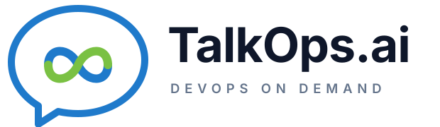

<h1 align="center">TalkOps — Open-Source AI Platform for DevOps</h1>

<p align="center">
  <picture>
    <source media="(prefers-color-scheme: dark)" srcset="docs/assets/talkops-logo-dark.svg">
    <source media="(prefers-color-scheme: light)" srcset="docs/assets/talkops-logo-light.svg">
    
  </picture>
</p>

<p align="center">
  <a href="https://pypi.org/project/talkops-ai/"></a>
  <a href="LICENSE"></a>
  <a href="https://www.python.org/downloads/"></a>
  <a href="docs/talkops-docs/approval-mode.md"></a>
  <a href="docs/talkops-docs/model-providers.md"></a>
</p>

<p align="center">
  <a href="#introduction"><b>Introduction</b></a> &nbsp;&bull;&nbsp;
  <a href="#features"><b>Features</b></a> &nbsp;&bull;&nbsp;
  <a href="#getting-started"><b>Getting Started</b></a> &nbsp;&bull;&nbsp;
  <a href="#github-action-cicd-rubric-pr-checks"><b>GitHub Action</b></a> &nbsp;&bull;&nbsp;
  <a href="docs/talkops-docs/overview.md"><b>Docs</b></a> &nbsp;&bull;&nbsp;
  <a href="CONTRIBUTING.md"><b>Contributing</b></a>
</p>

## Introduction

**TalkOps** is an open-source multi-agent platform for **DevOps, SRE, Cloud, and Platform Engineering** ([Overview](docs/talkops-docs/overview.md)) that works directly with your existing local cloud CLIs (`aws`, `kubectl`, `terraform`, `helm`, `az`, `gcloud`)—so your cloud credentials never leave your environment.

Run TalkOps interactively in your terminal (`talkops` / `ops`), headlessly in CI/CD pipelines (`talkops -p ...`), or as a shared team and webhook server (`talkops serve`) backed by SQLite or PostgreSQL.

### TalkOps in Action (65-Second Architecture & Incident Demo)

https://github.com/user-attachments/assets/a45d2675-6192-4ebe-b7a8-394470f7c655

> 🔊 *Unmute the player for studio narration, or watch muted with burned-in captions.*

## Features

**Multi-Cloud and Kubernetes Operations**
- **[Multi-Cloud Operations (`/cloud`, `/aws`, `/azure`, `/gcp`)](docs/talkops-docs/credentials.md#3-cloud--kubernetes-authentication):** Switch between AWS accounts, Azure subscriptions, and GCP projects in seconds—using your local profiles or attached cloud roles—to spin up services, fix broken configs, manage IAM and networking, or cut wasted cloud spend.
- **[Kubernetes Operations (`/k8s`)](docs/talkops-docs/credentials.md#3-cloud--kubernetes-authentication):** Jump across EKS, AKS, GKE, or in-cluster environments to deploy apps, scale workloads, debug failing pods and nodes, and manage Helm releases without leaving your terminal.
- **[Infrastructure Coding & GitOps](docs/talkops-docs/overview.md#what-you-can-do-with-talkops):** Gives you all the flexibility of a terminal coding agent—reading repos, editing files, running commands, and opening PRs—purpose-built for DevOps and Platform Engineering across Terraform, OpenTofu, CDK, Ansible, CI/CD pipelines, and GitOps (ArgoCD, Flux).

**Smart Routing, Human-in-the-Loop, Goal Verification & Sandboxes**
- **[Smart Model Routing (`--smart`, `/pool`)](docs/talkops-docs/approval-mode.md):** Automatically routes each turn to the right tier in your model pool (**Fast**, **Standard**, or **Powerful**) based on task complexity—cutting token costs by 80–90% while keeping frontier reasoning for hard problems.
- **[Human-in-the-Loop & Approval Modes (`/permissions`)](docs/talkops-docs/approval-mode.md):** Stay in control of production with `Smart`, `Manual`, `Auto`, and headless `YOLO` modes—auto-running safe read-only checks while pausing on destructive or state-changing cloud and Kubernetes commands for your approval.
- **[Goal Planning & Rubric Verification (`/goal`, `--rubric`)](docs/talkops-docs/goal-and-rubrics.md):** Drafts a step-by-step Implementation Plan, asks clarifying questions before acting, tracks live To-Dos, and verifies actual execution evidence against pass/fail rubrics before finishing.
- **[26+ Model Providers & Custom Endpoints (`/model`, `--base-url`)](docs/talkops-docs/model-providers.md):** Mix and match local **Ollama** models with Anthropic, OpenAI, Codex, Gemini, Bedrock, Vertex, Azure, DeepSeek, Groq, or your own self-hosted models via custom `--base-url` endpoints (vLLM, LiteLLM, LM Studio, or internal OpenAI-compatible gateways).
- **[6 Isolated Cloud Sandboxes (`--sandbox`)](docs/talkops-docs/remote-sandboxes.md):** Execute shell commands and file edits inside disposable **Modal, Daytona, Runloop, LangSmith, AWS Bedrock AgentCore, or Vercel** containers with automatic workspace sync.

**Central Server, Two-Way ChatOps & 24/7 Incident Webhooks**
- **[Shared Team Server (`talkops serve`)](docs/talkops-docs/central-server.md):** Centralize cloud access and save team threads in **PostgreSQL** or **SQLite**; teammates can attach to live investigations (`-r`) or branch threads (`/fork`) safely.
- **[9 Built-In Incident Webhooks (`/webhooks/{provider}`)](docs/talkops-docs/webhooks.md):** Ingest alerts from **PagerDuty, Prometheus Alertmanager, Grafana, Datadog, AWS SNS/CloudWatch, ServiceNow, Jenkins, CloudEvents (Argo/Flux), and GitHub**, deduplicate alert storms into one thread, and write RCA reports back to tickets and PRs.
- **[Slack, Microsoft Teams & Discord ChatOps (`channels` addon)](docs/talkops-docs/server-addons.md):** Install via `talkops addon install channels` for two-stage threaded incident cards and interactive button or 👍/👎 emoji tool approvals right in chat.

**Subagents, Plugin Marketplace, Skills & MCP**
- **[Specialist Subagents (`/agent`) & Open Plugin Marketplace (`/plugins`)](docs/talkops-docs/plugins.md):** Delegate parallel tasks to domain subagents ([Subagents Guide](docs/talkops-docs/subagents.md)), and install subagent, skill, command, and MCP bundles from the **TalkOps Plugin Marketplace** ([`talkops-ai/devops-plugins`](https://github.com/talkops-ai/devops-plugins)) or **any repository supporting the open plugin schema**.
- **[Memory (`AGENTS.md`), `SKILL.md` Runbooks & Custom `/commands`](docs/talkops-docs/memory-and-skills.md):** Capture team conventions with `/remember`, build 3-stage progressive `SKILL.md` runbooks (`/skills`), and define parameterized [`.talkops/commands/*.md`](docs/talkops-docs/custom-commands.md) shortcuts with live `` !`shell` `` injection and [Lifecycle Hooks](docs/talkops-docs/hooks.md).
- **[Model Context Protocol (`/mcp`, `talkops mcp`)](docs/talkops-docs/mcp-tools.md):** Connect any local or remote MCP server (`stdio`, `http`, `sse`)—across observability, GitOps, cloud providers, and internal tooling—with lazy tool loading and workspace trust verification.

## Getting Started

Full setup walkthroughs are in the **[Quickstart Guide](docs/talkops-docs/quickstart.md)** and **[CLI & Slash Command Reference](docs/talkops-docs/cli-reference.md)**.

### 1. Install TalkOps

```bash
curl -LsSf https://raw.githubusercontent.com/talkops-ai/talkops/main/scripts/install.sh | bash
# Or via uv / pipx:
uv tool install talkops-ai
```

### 2. Sign In & Configure Your Model (Local, Self-Hosted URL, or Cloud API Key)

```bash
# 1. Free one-click sign-in (opens browser SSO, or pass --api-key oc_live_...)
talkops auth login --sso

# 2. Run locally with Ollama, connect a self-hosted model URL (--base-url), or set a cloud API key
talkops -M ollama:qwen3:8b
talkops auth set openai --base-url https://llm.internal.example.com/v1  # self-hosted vLLM / LiteLLM / Ollama URL
talkops auth set anthropic        # or: openai, google_genai, groq, deepseek, openrouter...
talkops doctor                    # verify AWS STS identity & local CLIs (aws, kubectl, terraform)
```

> [!NOTE]
> **Why does TalkOps ask for a free sign-in?**
> We are a small engineering team building TalkOps in the open under the Apache-2.0 license. A lightweight, free sign-in helps us see which workflows are used, connect with early users for feedback, and make the framework stable. **We do nothing with your personal details—and your cloud credentials (`~/.aws`, `~/.kube`), source code, and LLM API keys never leave your machine.**

<details>
<summary><b>Optional: Enable Jev Smart Mode Routing &amp; Production Safety Gate</b></summary>

```bash
talkops auth set typesafe ts-...  # or: export TYPESAFE_API_KEY="ts-..."
talkops --smart
```

</details>

### 3. Run Your First Workflow

```bash
# 1. Interactive Terminal UI (add --smart if you configured Jev Smart Mode above)
talkops --read-only               # or: ops --read-only

# 2. Headless CLI with self-verified acceptance rubric (exits 0 on pass, 2 on unmet criteria)
talkops -p "Audit AWS resources in ap-south-1 for unattached EBS volumes and idle NAT gateways" \
  --read-only --rubric "All idle resources listed with monthly cost and CLI cleanup commands"

# 3. Shared Team Server + 24/7 Webhook Listener (SQLite default, or pass --postgres-uri)
talkops serve --host 0.0.0.0 --port 2024
```

## GitHub Action: CI/CD Rubric PR Checks

Enforce Kubernetes, Terraform, IAM, and FinOps rubrics on every Pull Request using [`action.yml`](action.yml) (full workflow in [`examples/github-actions/talkops-rubric-pr-check.yml`](examples/github-actions/talkops-rubric-pr-check.yml)). Add `TALKOPS_API_KEY` and your LLM provider key (or self-hosted `model-base-url`) to **GitHub Settings → Secrets and variables → Actions**, then add `.github/workflows/talkops-pr-check.yml`:

```yaml
- name: Run TalkOps Rubric PR Check
  uses: talkops-ai/talkops@main
  with:
    talkops-api-key: ${{ secrets.TALKOPS_API_KEY }}
    anthropic-api-key: ${{ secrets.ANTHROPIC_API_KEY }}  # or openai-api-key / google-api-key / model-api-key
    # model: "openai:Qwen/Qwen2.5-Coder-32B-Instruct"    # optional: custom / self-hosted model
    # model-base-url: ${{ secrets.LLM_BASE_URL }}        # optional: self-hosted Ollama / vLLM / LiteLLM URL
    prompt: "Review the PR diff for Kubernetes & Terraform security, IAM least-privilege, and cloud cost regressions."
    rubric: "No wildcard IAM permissions, no privileged containers, and all resource changes include cost/security impact." # or "@.talkops/rubric.md"
    read-only: "true"
    post-pr-comment: "true"
```

## Documentation & Contributing

- **Getting Started:** [Overview](docs/talkops-docs/overview.md) · [Quickstart](docs/talkops-docs/quickstart.md) · [CLI & `/slash` Reference](docs/talkops-docs/cli-reference.md)
- **Operations & Server:** [Approval Modes & Smart Routing](docs/talkops-docs/approval-mode.md) · [Goals & Rubrics](docs/talkops-docs/goal-and-rubrics.md) · [Central Server](docs/talkops-docs/central-server.md) · [Server Addons & ChatOps](docs/talkops-docs/server-addons.md) · [Webhooks & RCA](docs/talkops-docs/webhooks.md) · [Remote Sandboxes](docs/talkops-docs/remote-sandboxes.md)
- **Configuration & Auth:** [Configuration Guide](docs/talkops-docs/Configuration.md) · [`config.toml` Reference](docs/talkops-docs/config.toml.md) · [Credentials & Cloud Contexts](docs/talkops-docs/credentials.md) · [Model Providers](docs/talkops-docs/model-providers.md)
- **Extensibility:** [Specialist Subagents](docs/talkops-docs/subagents.md) · [Plugins & Marketplaces](docs/talkops-docs/plugins.md) · [Memory & Skills](docs/talkops-docs/memory-and-skills.md) · [Custom Commands](docs/talkops-docs/custom-commands.md) · [MCP Tools](docs/talkops-docs/mcp-tools.md) · [Hooks](docs/talkops-docs/hooks.md)
- **Community & Security:** [CONTRIBUTING.md](CONTRIBUTING.md) · [CODE_OF_CONDUCT.md](CODE_OF_CONDUCT.md) · [SECURITY.md](SECURITY.md) · [Apache-2.0 License](LICENSE)
