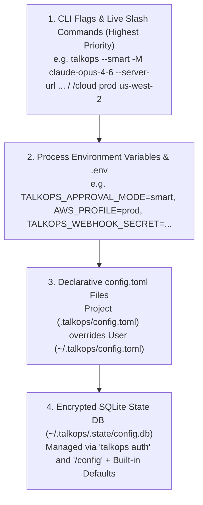

# Configuration Guide

TalkOps resolves its runtime settings across a deterministic **4-layer configuration hierarchy** (`src/talkops/config/manifest.py` and `src/talkops/config/settings.py`) spanning 85+ canonical options for LLMs, Jev Smart Mode routing, multi-cloud providers (AWS, Azure, GCP), Kubernetes, DevOps toolchains, Central Server persistence, and Webhooks.

> [!NOTE]
> 📸 **Image Placeholder — `docs/assets/config-hierarchy-modal.png`**
> **What to capture:** Screenshot of the `/config` modal inside the TalkOps TUI showing the active values for `Cloud`, `AWS`, `Kubernetes`, `Model`, `Security`, `Storage`, and `Webhooks` alongside source badges (`CLI`, `ENV`, `TOML`, `DB`).

---

## The 4-layer resolution precedence

Whenever TalkOps resolves a setting (such as `aws.region`, `security.approval_mode`, or `webhooks.port`), it evaluates sources from highest to lowest priority:



1. **CLI Flags & Session Slash Commands**: Flags passed on the command line (`--smart`, `-M`, `--server-url`, `--postgres-uri`) and in-session slash commands (`/smart`, `/model`, `/pool`, `/cloud`, `/effort`) take immediate precedence for the active process.
2. **Environment Variables (`.env` & Shell)**: Standard cloud variables (`AWS_PROFILE`, `AWS_REGION`, `AZURE_SUBSCRIPTION_ID`, `GCP_PROJECT_ID`, `KUBECONFIG`) and `TALKOPS_*` variables override static files.
3. **Declarative `config.toml` Files**: Project-scoped `.talkops/config.toml` merges on top of user-scoped `~/.talkops/config.toml`. Commit `.talkops/config.toml` to git to share non-secret team defaults (such as cluster contexts, Prometheus/Grafana URLs, and 3-tier model pools).
4. **Encrypted SQLite State Store (`~/.talkops/.state/config.db`)**: Stores secrets set via `talkops auth set` and persistent UI preferences modified via `/config`.

---

## Configuration option groups

TalkOps organizes all canonical configuration keys into 14 domain groups (`iter_groups()` in `src/talkops/config/manifest.py`):

| Group | Key Prefix | What It Controls |
| :--- | :--- | :--- |
| **Credentials** | `credentials.*` | Encrypted API keys for 20+ LLM providers, TypeSafe AI Jev (`TYPESAFE_API_KEY`), and LangSmith. |
| **Cloud** | `cloud.*` | Default cloud provider (`aws`, `azure`, `gcp`, `multi`). |
| **AWS** | `aws.*` | `aws.profile`, `aws.region`, `aws.access_key_id`, `aws.secret_access_key`, `aws.session_token`, `aws.endpoint_url`. |
| **Azure** | `azure.*` | `azure.subscription_id`, `azure.tenant_id`, `azure.client_id`, `azure.client_secret`, `azure.resource_group`, `azure.location`. |
| **GCP** | `gcp.*` | `gcp.project_id`, `gcp.region`, `gcp.zone`, `gcp.credentials_file`. |
| **Kubernetes** | `k8s.*` | `k8s.kubeconfig`, `k8s.context`, `k8s.namespace`, `k8s.helm_binary`. |
| **DevOps** | `devops.*` | Binaries (`terraform`, `terragrunt`, `ansible`) and platform endpoints (`prometheus_url`, `grafana_url`, `loki_url`, `argocd_server`, `datadog_site`, `pagerduty_url`, `servicenow_url`, `jenkins_url`, `jira_url`, `vault_addr`, `sonarqube_url`). |
| **Model** | `model.*` | `model.default`, `model.pool` (3-tier Smart Mode pool: `fast`, `standard`, `powerful`), and `model.reasoning_effort`. |
| **Security** | `security.*` | `security.approval_mode` (`manual`, `smart`, `auto`, `yolo`), `security.environment` (`development`, `staging`, `production`), `security.shell_allow_list`. |
| **Sandbox** | `sandbox.*` | `sandbox.type` (`none`, `local`, `docker`, `k8s`), `sandbox.image`, `sandbox.memory_limit`, `sandbox.cpu_limit`, `sandbox.network_enabled`. |
| **Interpreter** | `interpreter.*` | Programmatic Tool Call (PTC) timeout, memory limit, and permission level (`safe` vs `all`). |
| **Storage** | `checkpoint.*` | `checkpoint.backend` (`sqlite` or `postgres`) and `checkpoint.postgres_uri` (`POSTGRES_URI` / `TALKOPS_POSTGRES_URI`) for Central Server persistence. |
| **Webhooks** | `webhooks.*` | Listener `host`/`port`, HMAC/bearer verification secrets, storm deduplication TTL (`300s`), max concurrency (`5`), SNS auto-confirm, and outbound RCA write-back sinks (Slack, PagerDuty, ServiceNow, GitHub, callback URL). |
| **Display & Tracing** | `display.*`, `tracing.*` | TUI theme, timestamps, auto-scroll, notifications, auto-compaction, and LangSmith tracing (`LANGCHAIN_TRACING_V2`). |

---

## Managing configuration interactively

Inside the TUI, use `/config` to inspect or update any canonical key without editing files manually:

```text
/config                                     # Open the interactive configuration modal
/config security.approval_mode smart        # Set default approval mode to Jev Smart Mode
/config security.environment production     # Enforce fail-closed production guardrails
/config aws.region us-west-2                # Update default AWS region
/config webhooks.dedupe_ttl_seconds 600     # Set webhook deduplication window to 10 minutes
```

After editing `.talkops/config.toml` or `~/.talkops/config.toml` on disk, run **`/reload`** inside the TUI to apply changes immediately without restarting your session.

---

## Next steps

- **[`config.toml` Reference](config.toml.md)** — Copy-pasteable template and complete table of all TOML keys
- **[Credentials & Authentication](credentials.md)** — Configure encrypted LLM keys, Control Plane JWTs, and cloud credentials
- **[Central Server & Multi-Client Architecture](central-server.md)** — Configure PostgreSQL (`checkpoint.postgres_uri`) and multi-user server variables
