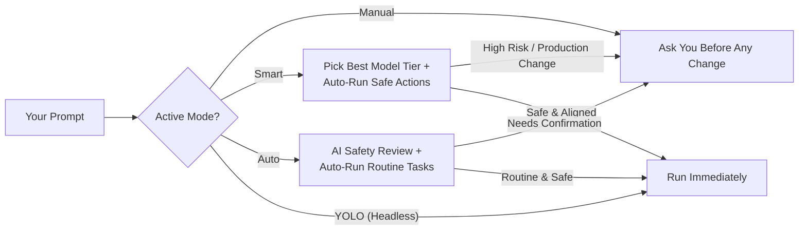
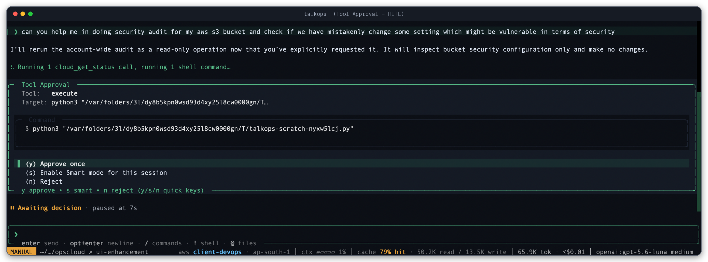
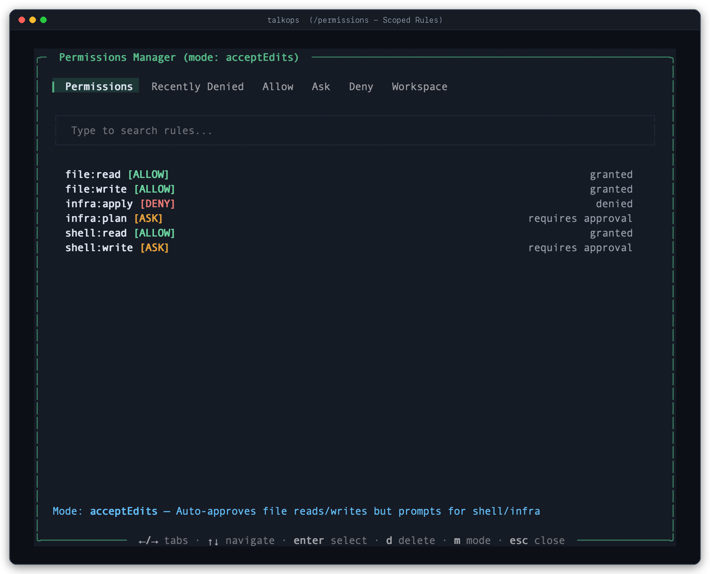

# Approval Modes & Smart Routing

When you are working with cloud infrastructure or local code, not every action carries the same risk—and not every question needs your slowest, most expensive AI model.

Checking pod status (`kubectl get pods`) or viewing `git diff` shouldn't interrupt your flow with confirmation prompts. On the other hand, deleting resources, changing production settings, or running destructive shell commands should never happen silently behind your back.

TalkOps gives you four approval modes—**Smart**, **Manual**, **Auto**, and **YOLO**—so you can choose how much autonomy the agent has in every session.

---

## Choosing a Mode at a Glance

| Mode | CLI Flag | TUI Command | Model Selection | How Tool Approvals Work | Best For |
| :--- | :--- | :--- | :--- | :--- | :--- |
| **Smart Mode** | `--smart` | `/smart` | **Automatic** (routes between Fast, Standard, and Powerful models) | Safe reads and routine edits run automatically; risky, destructive, or production changes pause for your confirmation | Daily cloud operations, troubleshooting, and coding |
| **Manual Mode** | `--manual` *(TUI default)* | `/manual` | **Fixed** (uses your selected model) | Read-only lookups run automatically; **every** file edit, shell command, or cloud change asks for your approval first | High-stakes production maintenance and step-by-step review |
| **Auto Mode** | `--auto` *(Headless `-p` default)* | `/auto` | **Fixed** (uses your selected model) | Uses your active AI model to review actions—approving routine work, blocking unsafe commands, and asking you when unsure | Hands-off coding and refactoring when Smart Mode isn't configured |
| **YOLO Mode** | `--auto-approve` | *Headless / Server only* | **Fixed** (uses your selected model) | **No prompts**—every tool call and command runs immediately without confirmation | Isolated sandboxes (`--sandbox daytona`), CI/CD jobs, and automated webhooks |

> [!NOTE]
> **Why isn't YOLO Mode available in the interactive TUI?**
> To protect your local machine and live cloud accounts, interactive terminal sessions only allow **Manual**, **Smart**, and **Auto**. YOLO Mode is restricted to non-interactive CLI runs (`talkops -p ... --auto-approve`) and background webhook servers (`talkops serve`).

---

## Switching Modes

You can switch modes at any time without restarting your session:

- **Keyboard Shortcut (`Shift+Tab`)**: Press `Shift+Tab` inside the TUI to cycle through the interactive modes:
  **Manual** $\rightarrow$ **Auto** $\rightarrow$ **Smart** $\rightarrow$ **Manual**
- **Slash Commands**: Type `/smart`, `/manual`, or `/auto` in the chat box.
- **From an Approval Prompt**: Whenever TalkOps pauses to ask for permission, press `s` to approve the action and switch to **Smart Mode** for the rest of the session.
- **From the Command Line**:
  ```bash
  # Start the interactive TUI in Smart Mode
  talkops --smart

  # Run a one-off prompt in Smart Mode
  talkops --smart -p "Audit our S3 buckets for public access"

  # Run a headless task in an isolated sandbox with no approval prompts
  talkops --sandbox daytona --auto-approve -p "Run the test suite and fix failing snapshots"
  ```

---

## How Each Mode Works



### 1. Smart Mode (Recommended)
Powered by **TypeSafe Jev**, Smart Mode does two things for you in the background with virtually zero delay:

- **Picks the Right Model for Each Turn**:
  - **Fast Tier**: Used for quick questions, reading files, or checking status. Turns off deep reasoning so you get instant replies at a fraction of the cost.
  - **Standard Tier**: Used for everyday coding, single-file edits, and standard cloud queries.
  - **Powerful Tier**: Used for complex root-cause analysis, multi-agent investigations, FinOps/security audits, and multi-file refactoring.
- **Guards Your Environment Automatically**:
  - Read-only commands, status checks, and routine project file edits run without interrupting you.
  - TalkOps **always pauses and asks you** if a command could delete data, modify a production environment, change IAM/security rules, or stray outside what you asked for.

### 2. Manual Mode
Manual Mode is the default when you launch `talkops`.
- The agent can read files, search your repo, and run read-only cloud status checks freely.
- The moment it wants to edit a file, run a shell command, or modify infrastructure, it pauses and shows you the exact command or diff so you have the final say.

### 3. Auto Mode
Auto Mode is great when you want a hands-off experience without setting up a separate TypeSafe API key.
- Routine file edits inside your project and read-only Git commands (`git status`, `git diff`, `git log`) run immediately.
- Other commands are checked by your active AI model against your prompt. Actions that match your request are approved; dangerous actions (like deleting resources, touching `.env` or `.ssh` files, or force-pushing) are blocked.
- If the agent gets blocked several times in a row or isn't sure whether an action is safe, it automatically falls back and asks you in the terminal.

---

## Approving or Rejecting Actions in the TUI

Whenever TalkOps pauses for your confirmation, it displays a **Tool Approval** card right in the chat stream:



You can respond with a single keystroke:
- **`y`** — **Approve once** (or approve the current batch of actions).
- **`s`** — **Enable Smart Mode** for this session so routine follow-up steps don't keep prompting you.
- **`n` or `Esc`** — **Reject** the action immediately.
- **`Tab`** — **Reject with a reason**: Type a quick note (for example, *"Use the staging profile instead"*) so the agent knows how to adjust its plan.
- **`e` / `f`** — Expand a long shell command (`e`) or view the full file diff (`f`).

---

## Customizing Scoped Permissions (`/permissions`)

If you want finer control over specific categories of actions—such as allowing all file edits while still requiring confirmation for shell commands—use the **Permissions Manager**.



Type `/permissions` in the TUI to open the interactive modal, or use slash commands to update rules on the fly:

```text
/permissions                              # Open the interactive Permissions Manager
/permissions mode acceptEdits             # Presets: default, acceptEdits, plan, auto, strict
/permissions grant file:write             # Auto-allow a scope (file:read, file:write, shell:read, shell:write, infra:plan, infra:apply)
/permissions grant Shell(kubectl get *)   # Auto-allow a specific command pattern
/permissions revoke shell:write           # Require approval for shell writes again
/permissions reset                        # Restore default permission rules
```

> [!TIP]
> **Need a strict read-only session?**
> Launch TalkOps with `talkops --read-only` (or run `/cloud mode read-only` in the TUI) to enforce a hard read-only lock across all cloud tools, regardless of which approval mode you are in.

---

## Setting Up Smart Mode & Your Model Pool

### Step 1: Add Your TypeSafe API Key
Smart Mode's automatic model routing and safety checks require a `TYPESAFE_API_KEY`:

1. **In the TUI**: Run `/auth`, choose **TypeSafe AI**, and paste your key.
2. **From the CLI**:
   ```bash
   talkops auth set typesafe ts-...
   ```
3. **Via Environment Variable**:
   ```bash
   export TYPESAFE_API_KEY="ts-..."
   ```

### Step 2: Configure Your Fast, Standard, and Powerful Models (`/pool`)
By default, TalkOps automatically picks the best **Fast**, **Standard**, and **Powerful** models from whichever AI provider you have connected.

If you want to choose the exact models for each tier—or mix providers (for example, OpenAI for Fast, Gemini for Standard, and Claude for Powerful)—run `/pool` in the TUI:


You can also inspect or set your model pool with commands or in `~/.talkops/config.toml`:

```text
/pool                  # Open the visual Model Pool Configuration modal
/pool status           # View the active models for Fast, Standard, and Powerful tiers
/pool clear            # Reset back to automatic model selection
```

```toml
# ~/.talkops/config.toml

[security]
# Default mode on startup: "manual", "smart", or "auto"
approval_mode = "smart"

[agent_pool]
provider = "multi"
fast = "openai:gpt-5.4-mini"
standard = "google_vertexai:gemini-3.8-flash"
powerful = "anthropic:claude-opus-4-6"
```
