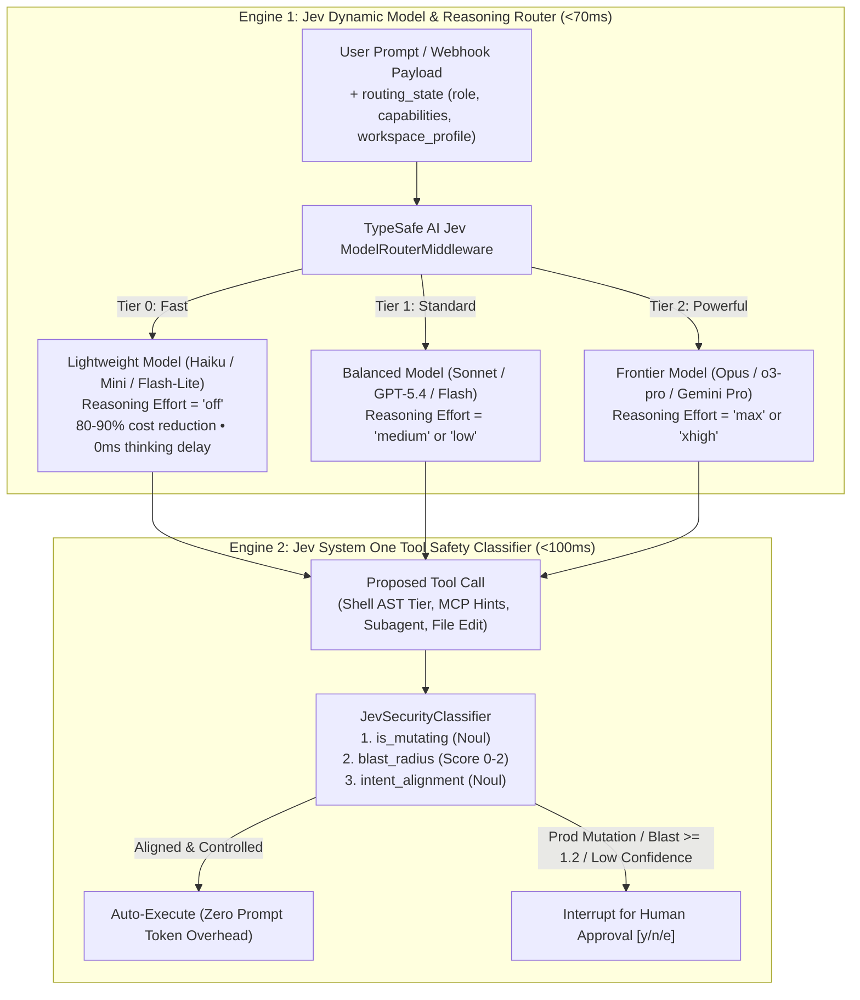

# Approval Modes & Jev Smart Mode

TalkOps controls how models are selected and how tool calls are authorized through four runtime modes: **Manual**, **Smart**, **Auto**, and **YOLO**.

While Manual, Auto, and YOLO apply static approval rules on a fixed model, **Smart Mode** (`talkops --smart`, `/smart`, or `Shift+Tab`) activates a dual-engine **TypeSafe AI Jev** pipeline that simultaneously optimizes **model cost and latency (`<70ms`)** and **tool execution safety (`<100ms`)**.

> [!NOTE]
> 📸 **Image Placeholder — `docs/assets/smart-mode-dual-engine.png`**
> **What to capture:** TUI screenshot showing a conversation in `Smart Mode` where a quick status check (`kubectl get nodes`) routes to `Tier 0 Fast [effort=off]` in `42ms` and auto-executes via Jev System One (`blast_radius=0.04`), followed by an incident RCA prompt that automatically escalates to `Tier 2 Powerful [effort=max]` and pauses for approval before applying a production Kubernetes patch.

---

## Compare the four modes

| Mode | CLI Flag | Slash Command | Model & Reasoning Selection | Tool Approval Policy | Best For |
| :--- | :--- | :--- | :--- | :--- | :--- |
| **Smart Mode** *(Recommended)* | `--smart` (`-s`) | `/smart` (`Shift+Tab`) | **Dynamic 3-Tier Jev Router (`<70ms`)**: Automatically routes across `fast` (`effort=off`), `standard` (`effort=medium`), and `powerful` (`effort=max`). | **Jev System One Safety Gate (`<100ms`)**: Auto-approves aligned read-only & controlled dev actions; pauses on production mutations or high blast radius. | Daily engineering, incident triage, and unattended `talkops serve` / webhook runs. |
| **Manual Mode** *(Default)* | *(none)* | `/manual` | Fixed to your selected baseline model (`/model`) and `/effort`. | Prompts `[y/n/e]` before every shell command, file write, or mutating cloud/MCP call. | High-scrutiny production changes where you want to inspect every command before execution. |
| **Auto Mode** | `--auto-approve` (`-y`) | `/auto` | Fixed to your selected baseline model (`/model`) and `/effort`. | Auto-approves all routine tools; still blocks hardcoded catastrophic destructors (`rm -rf /`, `mkfs`, fork bombs). | Rapid local iteration in non-production repositories. |
| **YOLO Mode** | `--yolo` | *(CLI flag only)* | Fixed to your selected baseline model (`/model`) and `/effort`. | Bypasses all interactive approval gates. | Ephemeral Docker or Kubernetes sandboxes (`--sandbox docker`). |

---

## Inside Smart Mode: Cost, Latency & Safety

Smart Mode solves two of the biggest operational bottlenecks in agentic DevOps:
1. **The Cost & Latency Trap**: Using a heavy frontier reasoning model (`claude-opus-4-6`, `o3-pro`, `gemini-3.1-pro`) with high thinking budgets on every turn wastes thousands of reasoning tokens and 5–15 seconds of latency on simple lookups—yet pinning a cheap model fails when an alert requires multi-service root-cause correlation.
2. **The Approval Fatigue Trap**: Prompting `[y/n]` on every read-only `kubectl get`, `aws describe-*`, or `terraform validate` slows investigations to a crawl—yet blind `--auto-approve` risks unreviewed production mutations.



---

## Engine 1: Dynamic Model & Reasoning Routing (`<70ms`)

Implemented in `src/talkops/middleware/jev_model_router.py` (`JevDynamicModelRouterMiddleware`) and `src/talkops/model/pool.py` (`DynamicModelPoolManager`), Smart Mode evaluates every incoming user message before invoking an LLM.

### How the 3-tier pool cuts token costs and latency

| Tier | Pool Slot | Reasoning Effort Applied | Routing Criteria (`ORCHESTRATOR_ROUTE_CRITERIA`) | Cost & Latency Impact |
| :--- | :--- | :--- | :--- | :--- |
| **Tier 0** | **`fast`** | **`effort = "off"`** | Greetings, acknowledgements (`ok`, `thanks`), status checks, single-item lookups (`kubectl get pods`, `git status`), reading a single file, or simple factual questions. | **Cuts token cost by 80–90%** and **eliminates reasoning latency** by disabling chain-of-thought thinking tokens completely. |
| **Tier 1** | **`standard`** | **`effort = "medium"`** *(or `"low"` for lighter models)* | Focused single-domain DevOps or coding tasks: writing a Dockerfile, modifying a single Terraform resource, explaining an error log, or running a standard CLI workflow. | Optimal price-to-performance balance with bounded thinking overhead. |
| **Tier 2** | **`powerful`** | **`effort = "max"`** / **`"xhigh"`** / **`"high"`** | Complex multi-step synthesis: delegating to multiple subagents, FinOps/cloud cost optimization, SRE incident root-cause correlation (`CrashLoopBackOff`, `OOMKilled`), cross-service refactoring, or IAM security audits. | Allocates deep reasoning strictly when high-stakes architectural or incident synthesis is required. |

### Context-aware `routing_state`

Unlike naive keyword routers, `JevDynamicModelRouterMiddleware` passes structured runtime telemetry into Jev on every turn:
- **`agent_role`**: Distinguishes between the top-level `orchestrator` (`ORCHESTRATOR_ROUTE_CRITERIA`) and specialized `subagent` workers (`SUBAGENT_ROUTE_CRITERIA`). A subagent tasked with fetching CloudWatch logs can execute on Tier 0/1 even when the parent orchestrator is synthesizing on Tier 2.
- **`workspace_profile`**: Automatically detects whether the current workspace contains Infrastructure as Code (`has_iac`: `.tf`, `terragrunt.hcl`, `Pulumi.yaml`), Kubernetes manifests (`has_kubernetes`), and the active `cloud_provider`.
- **`active_capabilities` & `available_subagents`**: Informs the router which domain tools and specialists are online.

### Confidence escalation safeguards

To guarantee that ambiguous operational prompts are never under-routed to a weaker model, `_apply_confidence_safeguards()` enforces two deterministic promotion rules:
1. **High-Complexity Marker Escalation**: If Jev classification confidence is `< 0.55` and the prompt contains operational complexity markers (`optimi`, `cost`, `finop`, `crashloop`, `oomkill`, `incident`, `outage`, `architect`, `refactor`, `secur`), the orchestrator automatically escalates to **Tier 2 (`powerful`)** (and subagents escalate to at least **Tier 1 (`standard`)**).
2. **Low-Confidence Fast Promotion**: If a turn is classified as `fast` (Tier 0) with confidence `< 0.55`, TalkOps automatically promotes it to **`standard` (Tier 1)** so nuanced edge cases are never missed.

### Automatic baseline model restoration

When you switch out of Smart Mode back to Manual (`/manual`) or Auto (`/auto`), TalkOps automatically restores your pre-Smart baseline model (and clears any sticky dynamic route in the LangGraph checkpoint) so manual sessions always run on the exact model you configured.

---

## Engine 2: System One Tool Safety Classifier (`<100ms`)

Implemented in `src/talkops/security/jev_classifier.py` (`JevSecurityClassifier`), Smart Mode evaluates every tool call proposed by the agent in `<100ms` **without making a secondary LLM call or consuming prompt tokens**.

### What context is evaluated?

Before scoring, TalkOps enriches the tool call with deterministic metadata:
- **Shell Commands (`execute`)**: Pre-parsed by TalkOps's AST shell analyzer into safety tiers (`SAFE`, `CAUTIOUS`, `DANGEROUS`, `CATASTROPHIC`), detecting subshells, pipes, redirects, and cloud CLI verbs.
- **MCP Tools**: Enriched with Model Context Protocol annotations (`readOnlyHint`, `destructiveHint`, `openWorldHint`).
- **Subagent Dispatches (`task`)**: Enriched with the target subagent's domain (`aws`, `k8s`, `iac`, `security`) and capability boundaries (`can_mutate_cloud`, `can_execute_shell`).
- **Environment Context**: Includes the active `environment` (`development`, `staging`, `production`) and recent user intent.

### The three calibrated Jev primitives

`JevSecurityClassifier` evaluates three calibrated primitives simultaneously:

1. **`is_mutating` (`Noul` binary probability)**:
   - Estimates the probability that the action alters files, infrastructure, or service state.
   - Treated as mutating when `p_yes >= 0.30`.
2. **`blast_radius` (`Score` 0–2 expected value)**:
   - `0` = **Negligible**: Read-only queries, local scratch files, ephemeral dry-runs (`terraform plan`, `kubectl diff`).
   - `1` = **Controlled**: Scoped, reversible changes in development or staging environments.
   - `2` = **Critical**: Production mutations, IAM/security policy modifications, database drops, or multi-resource deletions.
3. **`intent_alignment` (`Noul` binary probability)**:
   - Estimates whether the proposed tool call directly and proportionally serves the user's explicit request.
   - Immediately interrupts if `p_aligned < 0.60`.

### Deterministic fail-closed rules

Smart Mode **auto-approves** a tool call only when it is aligned (`>= 0.60`), classifier confidence is `>= 0.65`, and its blast radius is negligible or controlled outside production. It **always pauses for human approval (`[y/n/e]`)** if any of the following conditions hold:

- **Unaligned Intent**: `intent_alignment < 0.60`
- **Critical Blast Radius**: Expected `blast_radius >= 1.2` or probability of critical impact `p_2 >= 0.35`
- **Production Mutation**: `environment == "production"` and `is_mutating == True` (`p_yes >= 0.30`)
- **High-Risk Mutating Score**: `is_mutating == True` and `blast_radius >= 0.9`
- **Low Classifier Confidence**: Overall confidence `< 0.65`
- **Missing Credential**: `TYPESAFE_API_KEY` is not configured (fails closed to Manual approval)

---

## Configuring Smart Mode

### 1. Set your `TYPESAFE_API_KEY`

Smart Mode requires a TypeSafe AI API key for sub-100ms Jev routing and safety evaluation:

```bash
export TYPESAFE_API_KEY="ts-..."
# Or store it encrypted in ~/.talkops/.state/config.db:
talkops auth set typesafe ts-...
```

### 2. Configure the 3-tier model pool (`config.toml` or `/pool`)

TalkOps automatically builds a 3-tier pool (`fast`, `standard`, `powerful`) from your available provider credentials. You can customize the exact models assigned to each tier in `~/.talkops/config.toml` or `.talkops/config.toml`:

```toml
[models]
default = "anthropic:claude-sonnet-4-6"
pool = [
  "anthropic:claude-haiku-4-5",   # Tier 0 (fast)     -> effort = "off"
  "anthropic:claude-sonnet-4-6",  # Tier 1 (standard) -> effort = "medium"
  "anthropic:claude-opus-4-6"     # Tier 2 (powerful) -> effort = "max"
]

[security]
approval_mode = "smart"
environment = "production"        # Enforces strict fail-closed approval on any mutating action
```

Inside the TUI, run **`/pool`** at any time to inspect or override the active `fast`, `standard`, and `powerful` slots, or press **`Shift+Tab`** to cycle between Manual, Smart, and Auto modes.

---

## Next steps

- **[Model Providers](model-providers.md)** — Configure multi-provider pools across Anthropic, OpenAI, Gemini, Bedrock, and Azure
- **[`config.toml` Reference](config.toml.md)** — Layer deterministic `[security]` rules (`shell_allow_list`, `blocked_commands`) on top of Smart Mode
- **[Central Server & Multi-Client Architecture](central-server.md)** — Run `talkops serve --approval-mode smart` for governed team and webhook execution
