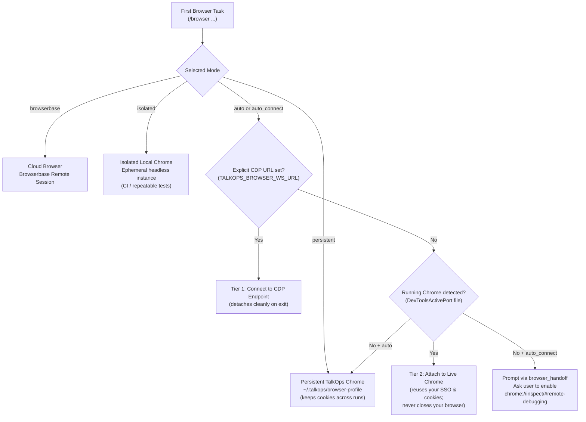

# Browser Automation Agent (`/browser`)

> Give TalkOps a real Chrome browser—so it can inspect dashboards, test web apps end to end, and navigate SaaS consoles that don't have a CLI or API.

Plenty of day-to-day engineering and operations work happens in a browser rather than a terminal. Maybe you want to check a Grafana alert panel, verify that a frontend change on `http://localhost:3000` actually renders cleanly without console errors, inspect a cloud console page with no public API, or walk through a multi-step SaaS webhook setup.

TalkOps includes a built-in **Browser Automation Agent (`/browser`)** powered by [Stagehand](https://docs.stagehand.dev/v4/first-steps/introduction) and LangChain Deep Agents' browser-use architecture. It runs inside a dedicated, isolated **`browser` subagent**—so sprawling web pages stay out of your main conversation while you get back a clear summary, extracted data, and saved screenshots.

<table>
  <tr>
    <td width="50%" valign="top">
      <h3>Works With Your Live Chrome Sessions</h3>
      <p>Attach directly to the Chrome browser already running on your laptop—reusing your existing SSO logins, cookies, and extensions—and detach cleanly without ever closing your tabs.</p>
    </td>
    <td width="50%" valign="top">
      <h3>Local Chrome or Cloud Browsers</h3>
      <p>Test apps on <code>localhost</code> with local Chrome (no extra account needed), keep a dedicated TalkOps Chrome profile, run headless isolated Chrome in CI, or connect to remote <b>Browserbase</b> cloud browsers.</p>
    </td>
  </tr>
  <tr>
    <td width="50%" valign="top">
      <h3>Built for Real SaaS Dashboards</h3>
      <p>Reads the page's accessibility tree instead of brittle CSS selectors, trims huge pages to a smart 8 KB window (keeping both top nav and bottom modals/logs), and prunes old snapshots automatically.</p>
    </td>
    <td width="50%" valign="top">
      <h3>Human Handoff &amp; Safety Gates</h3>
      <p>Never guesses passwords or tries to bypass CAPTCHAs—it pauses cleanly so you can finish SSO/2FA in Chrome, and always asks your approval before clicking destructive buttons or issuing HTTP <code>DELETE</code> calls.</p>
    </td>
  </tr>
</table>

---

## Understanding the Basics

Following the [LangChain Deep Agents browser-use model](https://docs.langchain.com/oss/python/deepagents/browser-use), giving an AI agent a browser comes down to two pieces:

| Component | What It Does | Your Options in TalkOps |
| :--- | :--- | :--- |
| **1. A Browser** | The actual Chrome instance rendering pages, holding cookies, and executing JavaScript. | **Local Chrome** (your running Chrome via `DevToolsActivePort`, a persistent TalkOps profile at `~/.talkops/browser-profile`, or an isolated headless Chrome—reaches `localhost` with zero cloud account) **or Remote Cloud** (**Browserbase**—isolated from your machine, ideal for headless servers or untrusted sites, cannot reach your local `localhost`). |
| **2. Browser Tools** | A compact toolset letting the agent observe a page, interact with elements, and hand control back to you when needed. | **Stagehand** (`snapshot`, `run`, `screenshot`) + TalkOps's **`browser_handoff`** pause/resume tool—using the exact same tools whether the browser runs locally or in Browserbase. |

### How the Agent Sees and Uses a Web Page (`Observe → Act → Verify`)

Instead of taking expensive screenshots on every click or guessing fragile CSS selectors, the browser agent works through a simple loop over one persistent browser session:

1. **Observe (`snapshot`)**: Reads the active page's accessibility tree and labels every interactive control (buttons, inputs, tabs, dropdowns, links) with a short bracketed ID like `[0-34]`.
2. **Act (`run`)**: Sends a batch of actions targeting those IDs—such as clicking a menu, filling a search box, and pressing Enter in a single turn—or runs Playwright JavaScript (`page`, `context`, `browser`) for custom editors, new tabs, or waiting on slow dashboards.
3. **Verify (`snapshot` or `screenshot`)**: Element IDs are only valid for the latest snapshot of the active page, so after navigating or opening a modal the agent takes a fresh `snapshot` (or captures a PNG/JPEG `screenshot` when visual layout or charts matter).
4. **Pause for Humans When Needed (`browser_handoff`)**: If the agent hits an Okta/SSO wall, 2FA prompt, or CAPTCHA, it pauses cleanly so you can complete that step right in the Chrome window, then captures a fresh snapshot and picks up where it left off.

### Why TalkOps Runs Browser Tasks in a Dedicated Subagent

Web page accessibility trees can easily exceed 50–100 KB on dashboards like Grafana, Datadog, or the AWS Console. Keeping browser tools inside a dedicated **`browser` subagent** (as recommended by LangChain Deep Agents) isolates all intermediate clicks, retries, and DOM snapshots from your main chat—and TalkOps adds two extra safeguards on top:
- **8 KB Smart Snapshot Truncation (Head + Tail)**: Snapshots larger than 8 KB are saved in full to disk (`~/.talkops/artifacts/browser/snapshots/snapshot_full_<ts>.txt`), while the in-context view keeps the **top 65%** (navigation bars and headers) and **bottom 35%** (React/Vue modal portals, dropdowns, and streaming log tails). The agent can still `grep` or `read_file` the full file whenever it needs elements in the middle.
- **Automatic Stale-Snapshot Pruning**: As soon as a newer page snapshot arrives, older snapshots in the conversation history are collapsed into one-line disk pointers so the context window never fills up.

*(If you ever want the main assistant to call browser tools directly instead of delegating to the subagent, set `TALKOPS_BROWSER_ON_MAIN_AGENT=true`.)*

---

## Quickstart (`/browser` & `/web`)

Inside the interactive TalkOps terminal UI, use `/browser` (or its shorter `/web` alias) to delegate a web task or manage your Chrome connection:

```text
# 1. Check whether TalkOps detects your running Chrome browser
/browser status

# 2. Ask the browser agent to inspect a local app or SaaS dashboard
/browser Open http://localhost:3000, sign in if needed, check for broken UI states, and take a screenshot
/browser Open our Grafana Alerts page and list every alert rule currently firing

# 3. Switch how TalkOps connects to Chrome
/browser mode auto          # Default: try live Chrome first, fall back to persistent profile
/browser mode auto_connect  # Strictly attach to your running Chrome (never launch a second window)
/browser mode persistent    # Always use TalkOps's own ~/.talkops/browser-profile
/browser mode isolated      # Ephemeral headless Chrome (clean slate for tests & CI)
/browser mode browserbase   # Remote Browserbase cloud browser

# 4. Detach cleanly when finished (never closes your personal Chrome window)
/browser disconnect
```

### Connecting to Your Running Chrome Profile (1-Minute Setup)

If you want TalkOps to reuse the sessions you are already signed in to (such as your company's SSO, Grafana, GitHub, or cloud consoles):

1. Open **Google Chrome** on your machine.
2. In the address bar, go to **`chrome://inspect/#remote-debugging`** and turn on **Remote Debugging**.
3. Run `/browser status` in TalkOps—you should see `Live Chrome DevToolsActivePort: Detected`.

When attached this way, TalkOps shares your active browser session without asking for passwords, and `/browser disconnect` simply detaches while leaving your Chrome window and tabs untouched.

---

## How TalkOps Connects to Chrome (3-Tier Cascade)

When you run your first browser task in default `auto` mode, TalkOps connects lazily using a 3-tier cascade—preferring your live browser when available and falling back gracefully when it isn't:



### Choosing the Right Mode & Browser Scope

Reusing a browser preserves cookies and website logins across turns—which is super convenient, but also determines who can act as those signed-in accounts:

| Mode | Where Chrome Runs | Reaches `localhost`? | Keeps Logins? | Best Used For |
| :--- | :--- | :--- | :--- | :--- |
| **`auto`** *(default)* | Live Chrome → falls back to `~/.talkops/browser-profile` | Yes | Yes | Everyday laptop workflows—works out of the box whether or not Chrome remote debugging is enabled. |
| **`auto_connect`** | Your running default Chrome only (`DevToolsActivePort`) | Yes | Yes (your live sessions) | Enterprise SSO workflows where you strictly want to use your authenticated Chrome window and be prompted if remote debugging is off. |
| **`persistent`** | Dedicated Chrome using `~/.talkops/browser-profile` | Yes | Yes (separate profile) | Keeping a dedicated TalkOps test/work browser persona separate from your personal tabs and bookmarks. |
| **`isolated`** | Fresh headless Chrome (`--no-sandbox`) | Yes | No (clean every run) | CI/CD pipelines, repeatable UI regression checks, and automated evals. |
| **`browserbase`** | Remote Browserbase cloud sandbox | No | Per Browserbase session | Headless servers (`talkops serve`), Docker containers, or stronger machine isolation for untrusted sites. |

> [!IMPORTANT]
> **Session Scope & Privacy:** Browser state lives inside Chrome, not in TalkOps conversation checkpoints. Never share a personal logged-in Chrome profile across unrelated users—anyone whose agent can drive that browser can act as its signed-in accounts. Use `isolated` or `browserbase` (with test accounts) for untrusted pages or multi-user servers.

---

## Security & Human-in-the-Loop Protections

Because browser actions can interact with real web applications and execute JavaScript inside a signed-in session, TalkOps wraps Stagehand with four built-in safety layers:

1. **Treat Web Content Safely & Validate URLs (SSRF Guard)**
   Every navigation checks the target URL before Chrome loads it—blocking non-HTTP schemes (`file://`, `javascript:`, `chrome://`) and cloud metadata / private SSRF endpoints (such as `169.254.169.254`), while still allowing `localhost` / `127.0.0.1` for local app testing.
2. **Never Bypass CAPTCHAs or Guess Credentials**
   Keep passwords out of your prompts. Whenever the agent encounters a login page, SSO/SAML redirect, 2FA/MFA prompt, Cloudflare Turnstile, reCAPTCHA, or anti-bot gate, it immediately stops and invokes **`browser_handoff`** so you can complete that step yourself in Chrome.
3. **Automatic Confirmation Before Destructive Web Actions**
   Before clicking or pressing Enter on UI controls whose labels indicate destructive or high-blast-radius actions (`Delete`, `Remove`, `Terminate`, `Destroy`, `Drop`, `Revoke`, `Rotate Secret`, `Invalidate Token`, `Uninstall`, `Purge`, `Wipe`, `Drain Node`, `Prune Resources`, `Force Sync`, `Close Account`, `Cancel Subscription`, `Factory Reset`, `Force Push`)—or running JavaScript that sends an HTTP `DELETE`—TalkOps automatically pauses and asks you to **Approve** or **Reject**.
   Harmless everyday UI buttons (`Remove Filter`, `Clear Filter`, `Clear Search`, `Clear Selection`, `Reset Zoom`, `Close Modal`, `Close Dialog`, `Dismiss`) pass through without interrupting you.
4. **Workspace File Access Without Unrestricted Shell**
   The `browser` subagent can read local workspace files (like YAML/JSON configs or offloaded `snapshot_full_*.txt` dumps) and save extracted reports or scraped configs back to your project, while screenshots and snapshots are stored cleanly under `~/.talkops/artifacts/browser/`.

---

## Reference

### `/browser` Slash Commands (Alias: `/web`)

| Command | What It Does |
| :--- | :--- |
| `/browser <task>` | Delegates `<task>` to the isolated `browser` subagent and returns a clean final report. |
| `/browser status` *(or bare `/browser`)* | Shows active session status, connection mode, whether `DevToolsActivePort` was detected, profile directory, and artifacts directory. |
| `/browser mode <mode>` | Switches between `auto`, `auto_connect`, `persistent`, `isolated`, and `browserbase` (detaching any active session first). |
| `/browser disconnect` *(or `close`)* | Detaches from your running Chrome (or closes a TalkOps-launched browser). |

<details>
<summary><b>The 4 Browser Tools, Default Chrome Lookup Paths &amp; Environment Variables</b></summary>

#### Browser Tools Exposed Inside the `browser` Subagent
| Tool | Inputs | Description |
| :--- | :--- | :--- |
| **`snapshot`** | `includeIframes=True` | Captures the active page's Stagehand accessibility tree with `[frame-node]` IDs, truncates over 8 KB (65% head + 35% tail), and saves full dumps to `~/.talkops/artifacts/browser/snapshots/`. |
| **`run`** | `actions=[...]` **or** `code="..."` | Runs batched snapshot actions (`click`, `hover`, `fill`, `type`, `press`, `select`) or Playwright JavaScript (`page`, `context`, `browser`) with URL/SSRF and destructive-action checks. |
| **`screenshot`** | `fullPage`, `type="png"\|"jpeg"`, `quality` | Saves screenshots to `~/.talkops/artifacts/browser/screenshots/` and returns multimodal image blocks for visual inspection. |
| **`browser_handoff`** | `reason`, `url` *(optional)* | Pauses via LangGraph `interrupt()` for manual SSO/2FA/CAPTCHA completion, then automatically captures a fresh post-handoff `snapshot()` on resume. |

#### Default `DevToolsActivePort` Lookup Directories
TalkOps checks `TALKOPS_CHROME_USER_DATA_DIR` / `CHROME_USER_DATA_DIR` first, then standard OS locations:
- **macOS**: `~/Library/Application Support/Google/Chrome` *(plus Canary, Beta, Chromium)*
- **Windows**: `%LOCALAPPDATA%\Google\Chrome\User Data` *(plus SxS, Chromium)*
- **Linux**: `${XDG_CONFIG_HOME:-~/.config}/google-chrome` *(plus Beta, Unstable, Chromium)*

#### Environment Variables
| Variable | Default | Purpose |
| :--- | :--- | :--- |
| `TALKOPS_BROWSER_MODE` *(or `TALKOPS_BROWSER_PROVIDER`)* | `"auto"` | Connection mode: `auto`, `auto_connect`, `persistent`, `isolated`, or `browserbase`. |
| `TALKOPS_BROWSER_WS_URL` *(or `TALKOPS_BROWSER_CDP_URL`)* | *(unset)* | Explicit Tier 1 Chrome DevTools Protocol (CDP) WebSocket or HTTP endpoint. |
| `TALKOPS_BROWSER_USER_DATA_DIR` | `~/.talkops/browser-profile` | Custom profile directory for `persistent` or `auto_connect` mode. |
| `TALKOPS_CHROME_USER_DATA_DIR` *(or `CHROME_USER_DATA_DIR`)* | *(OS default)* | Explicit Chrome User Data directory checked first for `DevToolsActivePort`. |
| `TALKOPS_CHROME_PATH` *(or `CHROME_PATH`)* | *(auto-detected)* | Explicit path to the Chrome or Chromium binary. |
| `TALKOPS_BROWSER_HEADLESS` | `"0"` *(auto `"1"` in `isolated`)* | Set `"1"` or `"true"` to run local Chrome headlessly. |
| `TALKOPS_BROWSER_PORT` | *(auto)* | Optional fixed remote-debugging port when launching Chrome locally. |
| `TALKOPS_BROWSER_ON_MAIN_AGENT` | `"0"` | Set `"1"` or `"true"` to bind the 4 browser tools directly on the main agent instead of the `browser` subagent. |
| `TALKOPS_BROWSER_PREFER_CLOUD` | `"0"` | When `"1"` and `BROWSERBASE_API_KEY` is set in `auto` mode, prefer `browserbase`. |
| `BROWSERBASE_API_KEY` | *(unset)* | API key for remote Browserbase cloud sessions. |
| `BROWSERBASE_PROJECT_ID` | *(unset)* | Optional Browserbase project ID. |
| `BROWSERBASE_SESSION_ID` | *(unset)* | Optional existing Browserbase session ID to attach to. |

</details>

---

## Troubleshooting

| Symptom | Why It Happens | How to Fix It |
| :--- | :--- | :--- |
| `/browser status` says `DevToolsActivePort: Not detected` | Chrome isn't running or remote debugging isn't turned on yet. | Open Chrome, visit `chrome://inspect/#remote-debugging`, enable remote debugging, and re-run `/browser status`—or stay in `auto` mode to use `~/.talkops/browser-profile`. |
| Connection fails in `auto_connect` mode | Strict `auto_connect` only attaches to an already-running Chrome with remote debugging enabled. | Enable remote debugging in Chrome, or switch to `/browser mode auto` or `/browser mode persistent`. |
| Agent pauses on a login or Cloudflare screen | Expected safety handoff (`browser_handoff`). | Finish logging in or completing the verification in Chrome, then choose **Completed** in TalkOps to resume. |
| Agent pauses and asks before clicking a button | The button's label matched a destructive action (for example, `Delete`, `Revoke`, or `Terminate`). | Confirm the target element in the prompt and select **Approve** or **Reject**. |
| Headless Linux server or Docker fails to launch Chrome | No display server (`DISPLAY`) is available for a visible window. | Use `TALKOPS_BROWSER_MODE=isolated` (headless with `--no-sandbox`) or `browserbase`. |
| Disk space grows from saved browser captures | Snapshots and screenshots are kept in `~/.talkops/artifacts/browser/`. | Periodically clean out older files in `snapshots/` and `screenshots/`. |

---

## See Also

- **[Specialist Subagents](subagents.md)** — How TalkOps delegates isolated work to built-in and plugin subagents.
- **[Approval Modes & Smart Mode](approval-mode.md)** — How TalkOps handles human-in-the-loop approvals across terminal and web tasks.
- **[Remote Sandboxes](remote-sandboxes.md)** — Running isolated terminal and container workloads alongside browser automation.
- **[CLI & Slash Command Reference](cli-reference.md)** — Complete directory of TalkOps commands.
