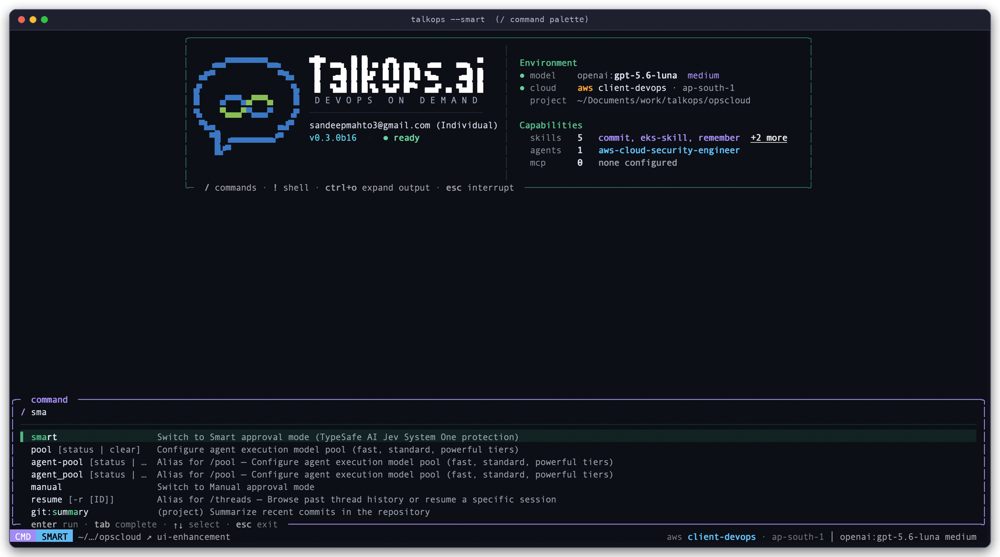
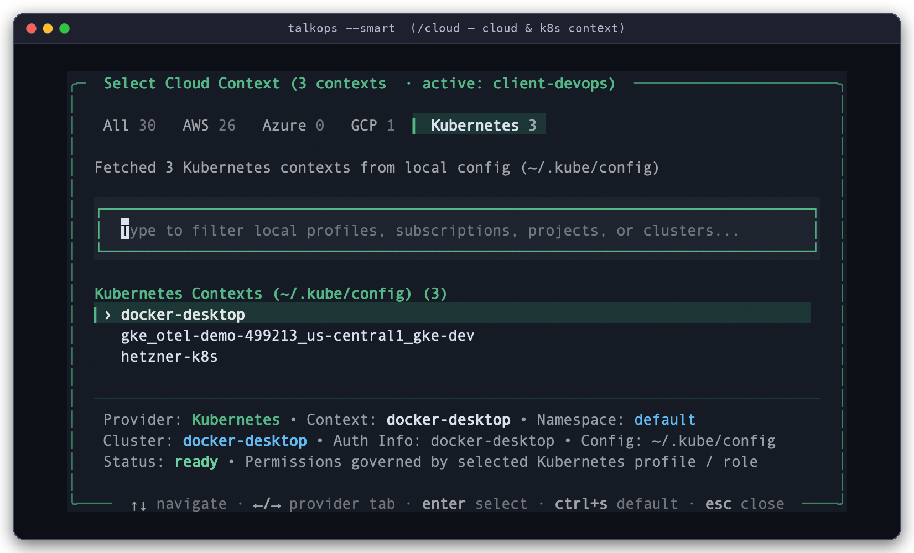
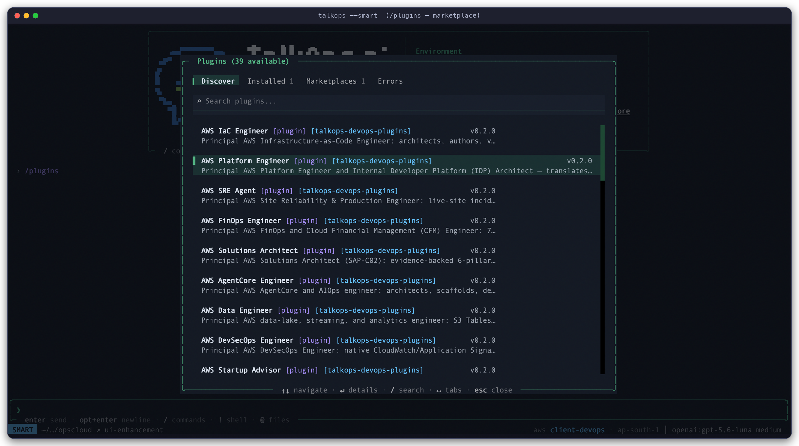

# CLI & Slash Command Reference

> Easy lookup guide for every `talkops` (and `ops`) terminal command, keyboard shortcut, and in-chat `/slash` command.

You can control TalkOps in two ways:

1. **From your terminal (`talkops` / `ops`)** — Start an interactive chat, run a one-off question (`-p`), launch a shared team server (`talkops serve`), sign in (`talkops auth`), or manage plugins, skills, and tools.
2. **Inside the chat window (`/`, `!`, `@`)** — Type `/` in the chat box to switch modes (`/smart`), pick AI models (`/model`, `/pool`), switch cloud accounts (`/cloud`), install plugins (`/plugins`), or review code (`/review`).

**Quick Jump:**
[Main `talkops` Flags](#starting-talkops-main-flags) ·
[`serve`](#talkops-serve-aliases-webhook-webhooks) ·
[`auth`](#talkops-auth) ·
[`threads`](#talkops-threads) ·
[`mcp`](#talkops-mcp) ·
[`plugin`](#talkops-plugin-alias-plugins) ·
[`addon`](#talkops-addon-alias-addons) ·
[`skills`](#talkops-skills-alias-skill) ·
[`agents`](#talkops-agents-alias-agent) ·
[`doctor`](#talkops-doctor) ·
[`benchmark`](#talkops-benchmark-alias-benchmarks) ·
[Chat Shortcuts](#chat-shortcuts--input-prefixes) ·
[Slash Commands](#in-chat-slash-commands)

---

## Starting TalkOps (Main Flags)

Running `talkops` (or the shorter `ops` alias) opens the interactive chat window in your terminal. If you want to ask a single question and exit—for example, inside a script or CI/CD pipeline—pass `-p "your question"`.

```bash
# Open the interactive chat window
talkops                           # or: ops

# Open the chat window in Smart Mode and send an initial question
talkops --smart -m "Check if any pods in kube-system are failing"

# Run a single question and exit (great for scripts and CI/CD)
talkops -p "Check security groups in ap-south-1 for open SSH ports"

# Pipe error logs directly into TalkOps
kubectl logs deploy/checkout-api -n prod --tail=100 | talkops -p "Why is this service returning 502 errors?"
```

### Everyday Options (Prompts, Safety & Cloud)

| Flag | Short / Alias | What It Does |
| :--- | :--- | :--- |
| `--prompt <text>` | `-p`, `-n` | Run a single question without opening the interactive chat window, print the answer, and exit. |
| `--message <text>` | `-m` | Open the interactive chat window and immediately send `<text>` as your first message. |
| `--smart` | — | Turn on **Smart Mode**: automatically picks a fast, low-cost AI model for simple checks and a stronger model for hard problems, while checking commands for safety. |
| `--auto-approve` | `-y` | Automatically run routine commands without asking `[y/n]`, while still blocking dangerous commands. |
| `--approval-mode <mode>` | — | Choose how commands are approved: `manual`, `smart`, `auto`, or `yolo` (`yolo` is only for `-p` or `talkops serve`). |
| `--read-only` | `--dry-run` | Safe mode—allows TalkOps to read and inspect your cloud or cluster, but blocks any changes or deletions. |
| `--aws-profile <name>` | — | Use a specific AWS profile for this session (for example, `staging` or `prod-readonly`). |
| `--aws-region <region>` | — | Use a specific AWS region for this session (for example, `us-east-1` or `ap-south-1`). |
| `--model <spec>` | `-M` | Pick which AI model to use (for example, `anthropic:claude-sonnet-4-5` or `openai:gpt-5.6-luna`). |
| `--agent <name>` | `-a` | Start with a specific specialist agent (for example, `-a aws-cloud-security-engineer`). |
| `--skill <name>` | `-s` | Run a saved `SKILL.md` runbook right when the session starts. |
| `--resume <thread_id>` | `-r` | Continue a previous conversation by its ID. |
| `--sandbox [provider]` | — | Run commands and file edits inside an isolated cloud sandbox (`modal`, `daytona`, `runloop`, `langsmith`, `agentcore`, or `vercel`). |
| `--server-url <url>` | — | Connect to a shared team server (`talkops serve`) instead of running locally. |
| `--cwd <path>` | `--workspace` | Run TalkOps inside a specific folder. |
| `--version` / `--help` | `-v` / `-h` | Show the installed version or help text. |

<details>
<summary><b>Advanced CLI Flags (Scripting, JSON Output, Goals &amp; Debugging)</b></summary>

| Flag | Short | What It Does |
| :--- | :--- | :--- |
| `--quiet` | `-q` | Only print the final answer in `-p` mode (hides step-by-step progress). |
| `--no-stream` | — | Wait until the answer is finished before printing it in `-p` mode. |
| `--json` | `--output-format json` | Output results as JSON so other scripts can read them easily. |
| `--stdin` | — | Read piped input from `stdin` and attach it to your prompt. |
| `--max-turns <int>` | — | Stop after at most `<int>` steps in `-p` mode. |
| `--timeout <sec>` | — | Stop if a `-p` run takes longer than `<sec>` seconds (exits with code `124`). |
| `--goal <objective>` | — | Start the interactive chat with a multi-step goal that TalkOps works toward until finished. |
| `--rubric <text\|@file>` | — | Give `-p` mode a checklist of requirements (or a `@file.md`). TalkOps keeps working until every item passes. |
| `--rubric-model <spec>` | — | Choose which AI model grades your `--rubric` checklist. |
| `--rubric-max-iterations <n>` | — | Maximum number of retries when checking `--rubric`. |
| `--default-model [spec]` | — | Show your saved default model, or save `<spec>` as your new default. |
| `--clear-default-model` | — | Reset your saved default model. |
| `--model-params <json>` | — | Pass extra model settings as JSON (for example, `'{"temperature": 0.0}'`). |
| `--no-subagents` | — | Turn off specialist subagents and do everything in the main chat. |
| `--shell-allow-list <list>` | `-S` | Comma-separated list of allowed shell commands (`recommended`, `all`, or specific command names). |
| `--tnr` | — | Enable automatic rollback if a change fails verification. |
| `--api-key <key>` | — | API key (`TALKOPS_API_KEY`) for signing in to a Central Server or Control Plane. |
| `--user-id <id>` | — | Your user ID (`TALKOPS_USER_ID`) when sharing a Central Server with teammates. |
| `--mcp-config <path>` | — | Load an extra `.mcp.json` tool configuration file. |
| `--no-mcp` | — | Disable external MCP tool servers for this session. |
| `--trust-project-mcp` | — | Trust project `.mcp.json` servers without asking for confirmation. |
| `--sandbox-id <id>` | — | Connect to an already-running cloud sandbox container by its ID instead of creating a new one. |
| `--sandbox-snapshot-name <name>` | — | Pre-built container snapshot or blueprint name for `--sandbox langsmith` or `--sandbox runloop`. |
| `--sandbox-setup <path>` | — | Run a local `.sh` setup script inside the remote sandbox right after it starts. |
| `--startup-cmd <cmd>` | — | Run a local shell command before the first prompt starts. |
| `--trajectory-file <path>` | — | Save a detailed step-by-step log (JSONL) of the run to `<path>`. |
| `--verbose` / `--log-level` | `-V` | Show detailed debug logs (`debug`, `info`, `warning`, `error`). |
| `--log-dir` / `--log-file` | — | Customize where log files are saved (default: `/tmp/talkops_logs/talkops.log`). |

</details>

---

## CLI Subcommands

### `talkops serve` (Aliases: `webhook`, `webhooks`)

Starts the shared **Central Server** so teammates can connect from their terminals (`--server-url`) and monitoring tools (like PagerDuty, Datadog, Prometheus, and GitHub) can send live alerts for automated investigation.

```bash
# Start the Central Server on port 2024
talkops serve --host 0.0.0.0 --port 2024

# See all built-in webhook URLs for PagerDuty, Datadog, GitHub, etc.
talkops serve list

# See which server features (addons) are enabled
talkops serve addons
```

| Action / Flag | Default | What It Does |
| :--- | :--- | :--- |
| `talkops serve [start]` | *(default)* | Starts the Central Server and webhook listener. |
| `talkops serve list` (`ls`) | — | Prints a table of all 9 built-in webhook integrations and their URLs. |
| `talkops serve addons` | — | Lists the active server features (`client-gateway`, `core-auth`, `webhooks`, plus any custom addons). |
| `--host <addr>` / `--port <int>` | `0.0.0.0:2024` | Address and port where the server listens. |
| `--webhook-port <int>` | Same as `--port` | Optional separate port just for incoming webhooks. |
| `--postgres-uri <uri>` | SQLite | PostgreSQL database URL for saving team conversations (uses local SQLite if omitted). |
| `--profile <name>` | `default` | Server mode: `default` (all features), `api-only` (team terminals only), `webhook-worker` (alerts only), or `enterprise-full`. |
| `--approval-mode <mode>` | `smart` | How server runs approve commands (`smart`, `auto`, `yolo`, or `manual`). |
| `--read-only` / `--dry-run` | `False` | Safe mode—allows the server to inspect resources but blocks changes or deletions. |
| `--aws-profile` / `--aws-region` | Default | Default AWS profile and region for server runs. |
| `-V` / `-q` / `--json` | — | `-V` for debug logs, `-q` to hide live log streaming, `--json` for JSON output on `list`/`addons`. |

<p align="center">
  
</p>
<p align="center">
  <sub><b>Viewing Webhook URLs (<code>talkops serve list</code>):</b> Checking all 9 built-in webhook endpoints, shorthand aliases, and supported monitoring/CI tools.</sub>
</p>

---

### `talkops auth`

Manages your AI model API keys, your sign-in to a Central Server or Control Plane, and checks your active AWS login.

```bash
# Sign in via your browser or save a Central Server login
talkops auth login --sso
talkops auth login --server-url http://talkops.internal:2024 --api-key oc_live_... --user-id alice

# Save an AI provider API key (stored securely in your system keyring)
talkops auth set anthropic sk-ant-...
talkops auth set openai sk-proj-...

# Check which AI providers and cloud accounts are connected
talkops auth status
talkops auth aws --profile prod-admin --region us-east-1
```

| Subcommand | Example | What It Does |
| :--- | :--- | :--- |
| **`status`** | `talkops auth status` | Shows your sign-in status, which AI providers have keys configured, and your active AWS account. |
| **`login`** | `talkops auth login [--sso] [--server-url <url>] [--api-key <key>]` | Signs in through your browser (`--sso`) or saves your API key and server URL so you don't have to type them every time. |
| **`logout`** | `talkops auth logout [--all \| --account \| --provider <name>]` | Signs out of your account or removes saved keys. |
| **`set`** | `talkops auth set <provider> [api_key]` | Saves an API key for any AI provider (prompts securely if you omit the key on the command line). |
| **`list`** (`ls`) | `talkops auth list` | Lists all 26+ supported AI model providers and shows which ones are ready to use. |
| **`remove`** (`rm`) | `talkops auth remove <provider\|all>` | Deletes a saved API key. |
| **`aws`** | `talkops auth aws [--profile <name>]` | Checks which AWS account and IAM role your terminal is currently using. |
| **`token`** | `talkops auth token [--refresh]` | Prints your current session token for use in custom scripts. |

<p align="center">
  
</p>
<p align="center">
  <sub><b>Checking Your Setup (<code>talkops auth status</code> &amp; <code>talkops doctor</code>):</b> Verifying your sign-in status, AI provider keys, AWS account identity, and installed DevOps tools (<code>aws</code>, <code>kubectl</code>, <code>terraform</code>, <code>helm</code>, <code>docker</code>, <code>git</code>).</sub>
</p>

---

### `talkops threads`

Lists or deletes saved conversations from your computer (`~/.talkops/sessions.db`) or from a shared Central Server (`--server-url`).

```bash
# List your saved conversations
talkops threads list

# List your conversations on a shared Central Server
talkops threads list --server-url http://talkops.internal:2024 --user-id alice

# Resume or delete a conversation by its ID
talkops -r 8f3a9c12
talkops threads delete 8f3a9c12-4b2e-4d1a-9e5b-123456789abc
```

---

### `talkops plugin` (Alias: `plugins`)

Finds and installs ready-made specialist plugins (like AWS FinOps, SRE, Kubernetes, Terraform, and Security agents) from the TalkOps Marketplace or your team's Git repository.

```bash
# Search for and install specialist plugins
talkops plugin search finops
talkops plugin install aws-finops-agent
talkops plugin install aws-cloud-security-engineer --scope project

# List all available and installed plugins
talkops plugin list
```

| Subcommand | Syntax | What It Does |
| :--- | :--- | :--- |
| **`list`** (`ls`) | `talkops plugin list` | Shows all installed and available plugins. |
| **`search`** | `talkops plugin search <keyword>` | Searches plugins by topic (such as `finops`, `security`, `eks`, or `terraform`). |
| **`install`** | `talkops plugin install <name> [--scope {user,project,local}]` | Installs a plugin for yourself (`user`) or for your current repository (`project`). |
| **`uninstall`** | `talkops plugin uninstall <name>` | Removes an installed plugin. |
| **`enable` / `disable`** | `talkops plugin <enable\|disable> <name>` | Turns an installed plugin on or off without deleting it. |
| **`refresh`** | `talkops plugin refresh` | Fetches the latest plugin list from the marketplace. |
| **`marketplace`** | `talkops plugin marketplace <list\|add <repo>\|remove <name>>` | Adds or manages custom GitHub/Git plugin catalogs for your team. |

<p align="center">
  
</p>
<p align="center">
  <sub><b>Browsing Plugins from the Terminal (<code>talkops plugin list</code>):</b> Viewing installed plugins alongside available Infrastructure, Platform, Observability, Security, and FinOps specialists.</sub>
</p>

---

### `talkops skills`, `talkops agents`, `talkops mcp`, `talkops addon` & `talkops doctor`

| Command | Common Usage | What It Does |
| :--- | :--- | :--- |
| **`talkops skills`** | `talkops skills list`<br>`talkops skills create <name> --project`<br>`talkops skills info <name>`<br>`talkops skills delete <name>` | Lists, creates, or inspects reusable `SKILL.md` troubleshooting runbooks. |
| **`talkops agents`** | `talkops agents list` | Lists all specialist agents available in your workspace and installed plugins. |
| **`talkops mcp`** | `talkops mcp list`<br>`talkops mcp probe` | Lists external MCP tool servers configured in `.mcp.json` or `config.toml`, and tests whether they are online (`probe`). |
| **`talkops addon`** | `talkops addon list`<br>`talkops addon install <name>` | Lists or installs extra server features (addons) for `talkops serve`. |
| **`talkops doctor`** | `talkops doctor` | Checks that your AWS login and local DevOps tools (`aws`, `kubectl`, `terraform`, `helm`, `docker`, `git`) are installed and working. |
| **`talkops benchmark`** | `talkops benchmark run --suite sregym` | Runs automated SRE and DevOps evaluation suites (when optional benchmark packages are installed). |

---

## Chat Shortcuts & Input Prefixes

When you are inside the interactive `talkops` chat window, you can use these prefixes and keyboard shortcuts at any time:

| Shortcut / Prefix | What It Does |
| :--- | :--- |
| **`/`** | Opens the command menu—type a few letters to filter commands, skills, or agents. |
| **`!<command>`** | Runs a shell command directly in your terminal and shows the output in chat (for example, `!kubectl get nodes` or `!git status`). |
| **`@<filename>`** | Searches files in your project so you can attach them to your message. |
| **`Shift+Tab`** | Switches between **Manual**, **Smart**, and **Auto** approval modes. |
| **`Ctrl+O`** | Expands or collapses detailed command outputs and specialist agent steps. |
| **`Ctrl+X`** | Opens your text editor (`$EDITOR`) to write a longer, multi-line prompt. |
| **`Ctrl+N`** | Opens the notifications panel. |
| **`Ctrl+L`** | Clears the screen. |
| **`Esc`** | Stops the current AI response or running command. |
| **`Ctrl+D`** / **`Ctrl+C`** | Exits TalkOps. |

<p align="center">
  
</p>
<p align="center">
  <sub><b>In-Chat <code>/</code> Command Menu:</b> Type <code>/</code> and start typing (like <code>/ sma</code>) to quickly jump to any command, skill, or specialist agent.</sub>
</p>

---

## In-Chat Slash Commands

Every `/slash` command below works both when running locally and when connected to a Central Server (`--server-url`).

### 1. Approval Mode & Safety

| Command | How to Use It | What It Does |
| :--- | :--- | :--- |
| **`/smart`** | `/smart` *(or `Shift+Tab`)* | Turns on **Smart Mode**: automatically picks the best AI model for each question and runs safe read-only commands while asking before making risky changes. |
| **`/auto`** | `/auto` | Automatically runs routine commands without asking, while still blocking destructive commands. |
| **`/manual`** | `/manual` | Asks for your confirmation (`[y/n/e]`) before running any command or editing any file. |
| **`/permissions`** | `/permissions` | Opens a window to view or change which tools are allowed to run automatically. |

---

### 2. Choosing AI Models & Smart Mode Pools

| Command | How to Use It | What It Does |
| :--- | :--- | :--- |
| **`/model`** | `/model` or `/model <provider:model>` | Opens a menu to switch AI models, or switches directly to the model you specify (add `--default` to save it as your default). |
| **`/pool`** | `/pool` | Opens the **Model Pool** window so you can choose which AI models Smart Mode uses for **Fast**, **Standard**, and **Powerful** tasks. |
| **`/effort`** | `/effort [low\|medium\|high\|max]` | Adjusts how much "thinking time" reasoning models spend before answering. |
| **`/fast`** | `/fast` | Pins the chat to your fastest model for quick back-and-forth questions. |

<p align="center">
  
</p>
<p align="center">
  <sub><b>Configuring Your Smart Mode Model Pool (<code>/pool</code>):</b> Pick which models handle simple checks (<b>Fast</b>), everyday work (<b>Standard</b>), and deep investigations (<b>Powerful</b>).</sub>
</p>

---

### 3. Cloud Accounts, Code Review & Multi-Step Goals

| Command | How to Use It | What It Does |
| :--- | :--- | :--- |
| **`/cloud`** | `/cloud` *(aliases: `/aws`, `/azure`, `/gcp`, `/k8s`)* | Opens a window to switch between your **AWS** profiles, **Azure** subscriptions, **GCP** projects, and **Kubernetes** clusters (`~/.kube/config`). |
| **`/review`** | `/review` | Reviews your uncommitted `git diff` changes for bugs, security risks, and infrastructure issues. |
| **`/goal`** | `/goal <what you want to achieve>` | Gives TalkOps a multi-step goal to work on until every requirement is met (use `/goal pause`, `/goal resume`, or `/goal clear` to manage it). |
| **`/rubric`** | `/rubric set <checklist>` | Sets a success checklist that TalkOps verifies before finishing a task. |
| **`/doctor`** | `/doctor` | Checks your cloud login and local DevOps tools right inside the chat window. |
| **`/trace`** | `/trace` | Shows the LangSmith trace link for debugging the current conversation. |

<p align="center">
  
</p>
<p align="center">
  <sub><b>Switching Cloud &amp; Kubernetes Accounts (<code>/cloud</code>):</b> Easily switch between AWS profiles, Azure subscriptions, GCP projects, and Kubernetes clusters without leaving the chat.</sub>
</p>

---

### 4. Managing Conversations & Context

| Command | How to Use It | What It Does |
| :--- | :--- | :--- |
| **`/threads`** | `/threads` *(or `/resume`)* | Opens a list of your saved conversations (and shared alert threads on a Central Server) so you can search, resume, or delete them. |
| **`/fork`** | `/fork` *(or `/branch`)* | Makes a copy of the current conversation so you can test a fix or try another idea without changing the original thread. |
| **`/compact`** | `/compact` | Summarizes older messages in a long chat to free up memory and keep responses fast. |
| **`/btw`** | `/btw <quick question>` | Asks a quick side question without interrupting a running task or cluttering the main conversation. |
| **`/context`** | `/context` | Shows how much conversation memory is currently in use. |
| **`/cost`** | `/cost` *(or `/tokens`)* | Shows total token usage, cache savings, and estimated AI cost for the session. |
| **`/tasks`** | `/tasks` | Views or stops background commands and manages the session to-do list. |
| **`/loop`** | `/loop 5m <prompt>` | Repeats a check automatically on a schedule (for example, `/loop 5m Check rollout status of checkout-api`). |
| **`/copy`** | `/copy` | Copies the last AI reply to your clipboard. |
| **`/clear`** | `/clear` *(or `/force-clear`)* | Clears the screen and starts a new conversation (`/force-clear` also stops any running background work). |
| **`/exit`** | `/exit` *(or `/quit`, `/q`)* | Saves your session and closes TalkOps. |

---

### 5. Specialist Agents, Plugins, Skills & Memory

| Command | How to Use It | What It Does |
| :--- | :--- | :--- |
| **`/agent`** | `/agent` or `/agent:<name> [prompt]` | Opens a menu to pick a specialist agent (or switches directly with `/agent:<name>`). Type `/agent clear` to switch back to the main assistant. |
| **`/plugins`** | `/plugins` | Opens the **Plugins** window to browse, install, enable, or uninstall specialist DevOps plugins without leaving the chat. |
| **`/skills`** | `/skills` or `/skill:<name>` | Lists all available tools and `SKILL.md` runbooks, or runs a specific runbook. |
| **`/skill-creator`** | `/skill-creator [topic]` | Helps you turn a troubleshooting workflow you just did into a reusable `SKILL.md` runbook. |
| **`/mcp`** | `/mcp` | Opens the MCP Tool Server manager to check tool health or reconnect external servers. |
| **`/remember`** | `/remember <note>` | Saves a rule or project detail (for example, `/remember Our prod EKS cluster is in ap-south-1`) so TalkOps remembers it in future sessions. |
| **`/memory`** | `/memory` | Views or edits what TalkOps has saved in project and personal memory. |

<p align="center">
  
</p>
<p align="center">
  <sub><b>Switching to a Specialist Agent (<code>/agent:aws-cloud-security-engineer</code>):</b> Loads the specialist's dedicated skills and tools and shows <code>▶ Agent: aws-cloud-security-engineer</code> in the bottom bar.</sub>
</p>

<p align="center">
  
</p>
<p align="center">
  <sub><b>Installing Plugins Inside the Chat (<code>/plugins</code>):</b> Browse and install AWS, Kubernetes, Terraform, SRE, FinOps, and Security plugins with a single keystroke.</sub>
</p>

---

### 6. Settings, Login, Updates & Appearance

| Command | How to Use It | What It Does |
| :--- | :--- | :--- |
| **`/login` & `/logout`** | `/login` *(or `/auth`)* and `/logout` | Opens the sign-in window to add AI provider keys or log in to a server, or signs out. |
| **`/config`** | `/config` | Opens the settings window to view or change TalkOps preferences. |
| **`/reload` & `/restart`** | `/reload` and `/restart` | `/reload` refreshes your config files, plugins, skills, and MCP tools; `/restart` restarts the background engine. |
| **`/update` & `/install`** | `/update` and `/install <package>` | Checks for new TalkOps versions (`/update`) or installs optional add-on packages (`/install`). |
| **`/theme`** | `/theme` | Switches between dark, light, and custom color themes. |
| **`/notifications`, `/timestamps`, `/scrollbar`** | `/notifications`, `/timestamps`, `/scrollbar` | Customizes notifications, toggles message timestamps, or shows/hides the scrollbar. |
| **`/version`, `/bug`, `/help`** | `/version`, `/bug`, `/help` | Shows version info, reports an issue, or displays the help guide. |
