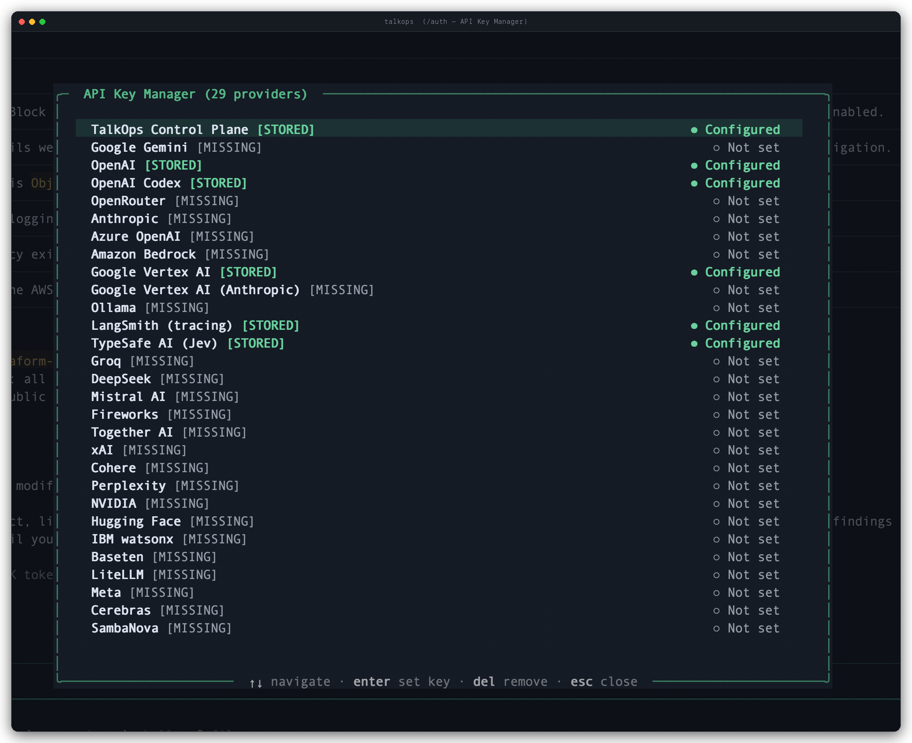

# Credentials & Authentication

TalkOps connects to LLM providers, cloud environments (AWS, Azure, GCP, Kubernetes), and the TalkOps Control Plane. This guide covers how to configure and manage your credentials across the TUI and CLI.

---

## How TalkOps Stores Credentials Safely

When you save an API key or sign in through TalkOps, your credentials are stored locally on your machine using a layered approach:

- **OS Keychain / Keyring** — On desktop macOS and Linux systems, TalkOps stores secrets in your native OS keychain when available.
- **Restricted Local Files (`0600`)** — TalkOps also maintains an access-restricted credential store at `~/.talkops/.state/auth.json` (and syncs provider keys to `~/.talkops/.env`) with `0600` file permissions so only your OS user account can read them.
- **Headless & Remote-Friendly** — When running over SSH, inside Docker/Kubernetes containers, or in WSL where no desktop keyring is available, TalkOps automatically bypasses the OS keyring so commands never hang waiting for a GUI prompt.

---

## 1. Model Provider & TypeSafe AI Keys

To run an agent, you need an API key for at least one model provider (such as Anthropic, OpenAI, or Google Gemini)—or a local Ollama server. If you use **Smart Mode** (`/approval smart`), you can also configure a **TypeSafe AI** key (`TYPESAFE_API_KEY`) for automatic risk evaluation and model routing.

### In the TUI (`/auth` or `/login`)

Run `/auth` (or `/login`) inside the TUI to open the interactive **API Key Manager**:

- Browse all 29 supported providers and integrations (including **TalkOps Control Plane**, **TypeSafe AI (Jev)**, and **LangSmith**) and see at a glance which ones are `● Configured` (`[STORED]`) or `○ Not set` (`[MISSING]`).
- Use `↑`/`↓` to highlight a provider, press `Enter` to set or update its key, or press `Del` to remove a stored key.



### From the CLI (`talkops auth`)

You can also manage provider keys directly from your terminal:

```bash
# List all model providers and see which keys are configured
talkops auth list

# Save an API key (omit the key on the command line to be prompted securely)
talkops auth set anthropic
talkops auth set openai sk-proj-...
talkops auth set google_genai AIza...

# Remove a stored API key for a provider
talkops auth remove openai

# View a complete summary of your TalkOps account, model providers, and AWS status
talkops auth status
```

### Via Environment Variables

If you prefer managing keys in your shell profile (`~/.zshrc`, `~/.bashrc`) or a `.env` file, export the standard environment variable for your provider:

```bash
export ANTHROPIC_API_KEY="sk-ant-..."
export OPENAI_API_KEY="sk-proj-..."
export GOOGLE_API_KEY="AIza..."
export TYPESAFE_API_KEY="ts-..."
```

See **[Model Providers](./model-providers.md)** for the full list of environment variables across all 25+ providers.

---

## 2. TalkOps Control Plane & Central Server Login

You can run TalkOps completely standalone on your laptop, or sign in to the **TalkOps Control Plane** (or a self-hosted **Central Server**) for team authentication, shared background agents, and centralized audit logs.

### Signing In

```bash
# Sign in interactively with your browser via SSO
talkops auth login --sso

# Or sign in on a headless server (prints a URL and lets you paste the verification code)
talkops auth login --sso --no-browser

# Or authenticate directly with a TalkOps API key
talkops auth login --api-key oc_live_...

# Connect to a self-hosted Central Server
talkops auth login --server-url http://talkops-server:2024 --api-key oc_live_...
```

Inside the TUI, you can also run `/login`, select **TalkOps Control Plane**, and enter your `oc_live_...` API key or launch browser SSO.

### Checking Session Status & Logging Out

| Action | TUI Slash Command | CLI Command |
| :--- | :--- | :--- |
| **Check overall auth status** | `/auth` | `talkops auth status` |
| **Print or refresh active session token** | — | `talkops auth token` *(add `--refresh` to force renewal)* |
| **Log out of TalkOps Control Plane** | `/logout` | `talkops auth logout` |
| **Clear a specific model provider key** | `/logout <provider>` | `talkops auth logout --provider <provider>` |
| **Clear all sessions and provider keys** | `/logout all` | `talkops auth logout --all` |

---

## 3. Cloud & Kubernetes Authentication

TalkOps does **not** copy or store your raw cloud credentials in its own database. Instead, it works directly with the standard cloud CLI tools and profiles you already use on your machine (`~/.aws`, `az login`, `gcloud auth`, and `~/.kube/config`), as well as ambient IAM roles when running inside EC2, ECS, EKS, GKE, or AKS.

### Switching Cloud Contexts in the TUI (`/cloud`)

Use the `/cloud` command (or provider shortcuts `/aws`, `/azure`, `/gcp`, `/k8s`) to inspect and switch your active cloud target at any time:

| Command | Description |
| :--- | :--- |
| `/cloud` | Opens the interactive **Cloud Context Selector** modal to switch providers, profiles, and regions. |
| `/cloud status` | Shows your active cloud provider, profile/project/context, region, and execution mode. |
| `/cloud auth` | Verifies your live cloud credentials (e.g., via AWS STS, `az account show`, `gcloud`, or Kubernetes API) and offers troubleshooting hints if expired. |
| `/cloud list` | Lists all discovered AWS profiles, Azure subscriptions, GCP projects, and Kubernetes contexts. |
| `/cloud use <provider> <target>` | Switches to a specific provider and target (for example, `/cloud use aws prod-admin` or `/cloud use k8s prod-eks`). |
| `/cloud mode <read-only\|elevated>` | Switches between **Read-Only** mode (prompts before any cloud mutation) and **Elevated** mode. |
| `/cloud --default <profile>` | Saves a default AWS profile to `~/.talkops/config.toml` (use `/cloud --default --clear` to reset). |

### How Each Cloud Provider Authenticates

#### Amazon Web Services (AWS)
- Reads named profiles from `~/.aws/credentials` and `~/.aws/config`, or standard environment variables (`AWS_PROFILE`, `AWS_REGION`, `AWS_ACCESS_KEY_ID`, `AWS_SECRET_ACCESS_KEY`, `AWS_SESSION_TOKEN`).
- Supports AWS SSO (`aws sso login --profile <name>`) and attached instance/pod IAM roles (`@ambient`).
- Quick CLI check: run `talkops auth aws` (or `talkops auth --profile <name>`) to verify your active AWS STS caller identity.

#### Microsoft Azure
- Uses your active Azure CLI session (`az login`) or Service Principal environment variables (`AZURE_SUBSCRIPTION_ID`, `AZURE_TENANT_ID`, `AZURE_CLIENT_ID`, `AZURE_CLIENT_SECRET`).
- Switch subscriptions in the TUI with `/azure` or `/cloud use azure <subscription-id>`.

#### Google Cloud (GCP)
- Uses your active `gcloud` CLI configuration (`gcloud auth login` / `gcloud auth application-default login`) or a Service Account key pointed to by `GOOGLE_APPLICATION_CREDENTIALS`.
- Switch projects or configurations in the TUI with `/gcp` or `/cloud use gcp <project-id>`.

#### Kubernetes (`k8s`)
- Reads contexts and namespaces from `~/.kube/config` (or the path in `KUBECONFIG`), plus in-cluster service account tokens when running inside a Kubernetes pod.
- Switch clusters in the TUI with `/k8s` or `/cloud use k8s <context-name>`.

---

## 4. Webhook Verification Secrets

When running TalkOps as a background server (`talkops serve`) to handle incoming incident alerts or CI/CD events, configure signing secrets so TalkOps can verify every incoming webhook payload:

| Integration | `/config` Key | Environment Variable | Verification Header |
| :--- | :--- | :--- | :--- |
| **GitHub** | `webhooks.github_secret` | `GITHUB_WEBHOOK_SECRET` | `X-Hub-Signature-256` |
| **PagerDuty** | `webhooks.pagerduty_secret` | `PAGERDUTY_WEBHOOK_SECRET` | `X-PagerDuty-Signature` |
| **Alertmanager** | `webhooks.alertmanager_secret` | `ALERTMANAGER_WEBHOOK_SECRET` | `Authorization: Bearer <secret>` |
| **Slack** | `webhooks.slack_signing_secret` | `SLACK_SIGNING_SECRET` | `X-Slack-Signature` |
