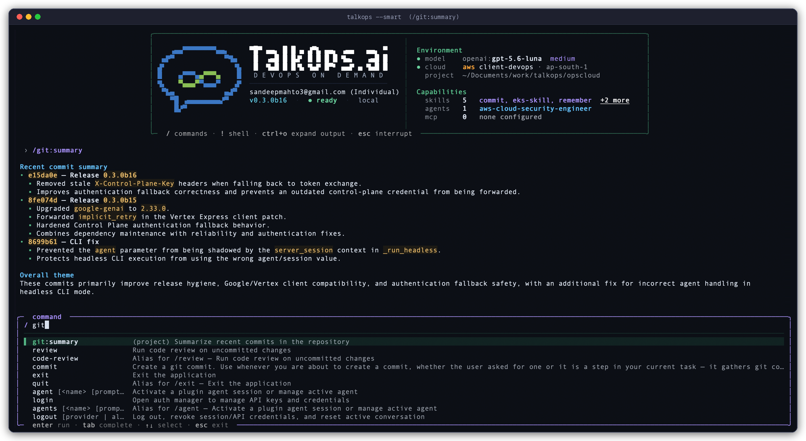
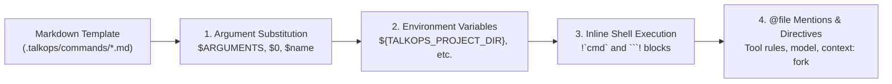

# Custom Commands

> Define reusable `/command` workflows as Markdown files with YAML frontmatter, live shell context, and scoped tool permissions

Custom commands let you turn repeatable engineering workflows—such as pre-deploy checks, incident triage templates, git summaries, or Terraform reviews—into slash commands by dropping a `.md` file into `.talkops/commands/` or `~/.talkops/commands/`.

You don't need to write any Python code. Each command is a Markdown prompt template with optional YAML frontmatter that supports:

* **Positional and named arguments** (`$ARGUMENTS`, `$0`, `$1`, or custom `$env` / `$namespace` parameters)
* **Inline shell execution** (`` !`git status` `` and ```` ```! ````) to inject live cluster or repository state before the model runs
* **Scoped tool permissions** (`allowed-tools` with brace expansion and `disallowed-tools`)
* **Model, effort, and subagent overrides** (`model`, `effort`, and `context: fork`)
* **Automatic hot-reloading** whenever you edit or add command files on disk

---

## Quick Start: Create Your First Command

### 1. Create a Markdown file in `.talkops/commands/`

Create `.talkops/commands/git/summary.md` in your repository:

```markdown
---
description: "Summarize recent commits in the repository"
argument-hint: "[commit-range]"
allowed-tools:
  - "Bash(git:{log,diff,status} *)"
  - read_file
effort: medium
---

## Working Tree Status
!`git status --short`

## Recent Commits
!`git log -n 10 --oneline`

Summarize the recent changes above, grouping them into:
1. Features and infrastructure updates
2. Bug fixes and reliability improvements
3. Any potential operational or migration risks

Additional focus or commit range: $ARGUMENTS
```

### 2. Invoke it from the `/` prompt

Because TalkOps watches your `commands/` directories for file changes, new and edited commands are picked up automatically (or you can run `/reload` at any time).

Type `/` in the prompt bar to see your custom command in the autocomplete menu with its `(project)` scope badge, and press `Enter` to run it:

<p align="center">
  
</p>

Run the command with or without arguments:

```text
/git:summary
/git:summary Focus on database and IAM changes
```

---

## Discovery Scopes, Precedence, and Namespaces

TalkOps discovers `.md` command files across four scopes. If two scopes define a command with the same name, the higher-priority scope wins:

| Priority | Scope | Directory Location | UI Badge | When to Use |
| :--- | :--- | :--- | :--- | :--- |
| **1 (Highest)** | **Managed Policy** | `$TALKOPS_MANAGED_COMMANDS_DIR` (or `$CLAUDE_MANAGED_COMMANDS_DIR`) | `(policy)` | Organization-wide standard commands enforced across all workstations |
| **2** | **Project** | `.talkops/commands/` and `.claude/commands/` *(walked from current directory up to the Git root)* | `(project)` or `(project:<folder>)` | Team workflows committed to version control for a specific repository |
| **3** | **User** | `~/.talkops/commands/` and `~/.claude/commands/` | `(user)` | Personal shortcuts available across all your projects |
| **4 (Lowest)** | **Plugin** | `<plugin_root>/commands/` | `(plugin:<name>)` | Commands bundled inside an installed [plugin](./plugins.md) |

### Subdirectory Namespacing (`:` and Space Aliases)

You can organize commands into nested folders inside `commands/`. Directory names become colon-separated namespaces, and TalkOps also accepts space-separated invocation automatically:

| File Path | Canonical Slash Command | Space-Separated Alias |
| :--- | :--- | :--- |
| `.talkops/commands/review.md` | `/review` | — |
| `.talkops/commands/git/summary.md` | `/git:summary` | `/git summary <args>` |
| `.talkops/commands/aws/audit.md` | `/aws:audit` | `/aws audit <args>` |
| `.talkops/commands/k8s/rollout/status.md` | `/k8s:rollout:status` | `/k8s rollout status <args>` |
| `.talkops/commands/terraform/SKILL.md` | `/terraform` | — |

> [!TIP]
> **Smart Autocomplete Ranking:** As you run custom commands, TalkOps tracks usage frequency with a 7-day recency half-life (`~/.talkops/.state/command_usage.json`) so your most frequently used commands float to the top of the `/` autocomplete list.

---

## Frontmatter Reference

All YAML frontmatter fields are optional. If a file has no frontmatter at all, TalkOps derives the command name from the file path and uses the first non-heading paragraph of the Markdown body as the description.

```yaml
---
name: k8s:preflight
description: "Verify Kubernetes cluster health and pending rollouts before deployment"
when_to_use: "Use before rolling out a release or applying Helm/Kustomize changes"
argument-hint: "<namespace> [deployment]"
arguments:
  - namespace
  - deployment
allowed-tools:
  - "Bash(kubectl:{get,describe,logs,rollout} *)"
  - read_file
disallowed-tools:
  - write_file
  - edit_file
model: sonnet
effort: high
context: inline
agent: general-purpose
disable-model-invocation: false
user-invocable: true
paths:
  - "k8s/**/*.yaml"
  - "charts/**"
shell: bash
version: "1.0.0"
---
```

| Field | Type | Default | Description |
| :--- | :--- | :--- | :--- |
| `name` | `string` | Derived from file path | Explicit command name override. |
| `description` | `string` | First body paragraph | Short summary displayed in `/` autocomplete and the model's skill catalog. |
| `when_to_use` | `string` | `null` | Guidance telling the agent when to invoke this command autonomously via the `Skill` tool. |
| `argument-hint` | `string` | `null` | Placeholder hint shown next to the command name in `/` autocomplete (for example, `<env> [service]`). |
| `arguments` | `list[str]` | `[]` | Named positional parameters (for example, `[namespace, deployment]`), enabling `$namespace` and `$deployment` placeholders in the body. |
| `allowed-tools` | `list[str]` | `[]` | Tool patterns pre-approved for this command without prompting; supports brace expansion (such as `Bash(git:{diff,status} *)`). Also accepts `allowed_tools`. |
| `disallowed-tools` | `list[str]` | `[]` | Tool patterns blocked for the duration of this command turn. Also accepts `disallowed_tools`. |
| `model` | `string` | `inherit` | Model override for the command turn: `haiku`, `sonnet`, `opus`, `inherit`, or a full `provider:model` identifier. |
| `effort` | `string \| int` | `null` | Reasoning effort for the command turn: `low`, `medium`, `high`, `max`, or an integer token budget. |
| `context` | `string` | `"inline"` | Execution mode: `"inline"` (runs in the main conversation) or `"fork"` (delegates to an isolated subagent). |
| `agent` | `string` | `"general-purpose"` | Target subagent type when `context: fork` is set (for example, `aws-sre-agent` or `general-purpose`). |
| `disable-model-invocation` | `bool` | `false` | When `true`, only the user can run `/command` manually; the model will not invoke it automatically. |
| `user-invocable` | `bool` | `true` | When `false`, hides the command from the `/` autocomplete menu so it acts purely as a background model skill. |
| `paths` | `list[str]` | `[]` | Glob patterns (such as `"**/*.tf"`). Keeps the command dormant in the model catalog until a matching file path is referenced. |
| `shell` | `string` | `"bash"` | Shell interpreter used for inline `!` commands (`"bash"` or `"powershell"`). |
| `version` | `string` | `null` | Optional semantic version string for documentation and tracking. |

---

## Dynamic Prompt Expansion

When you run a custom command, TalkOps runs a four-stage expansion pipeline before sending the prompt to the model:



### 1. Positional and Named Arguments

Arguments passed after `/command` are parsed using shell-style quoting (so `"my multi-word arg"` is treated as a single positional argument):

| Placeholder | Behavior |
| :--- | :--- |
| `$ARGUMENTS` | Replaced with the entire raw argument string passed after `/command`. |
| `$0`, `$1`, `$2` | Replaced with the Nth positional argument (0-indexed). Out-of-range indices expand cleanly to an empty string. |
| `$ARGUMENTS[0]`, `$ARGUMENTS[1]` | Alternative bracketed syntax for positional arguments. |
| `$<name>` | Replaced with the corresponding positional argument declared in `arguments: [name1, name2]` in the frontmatter. |
| `\$ARGUMENTS`, `\$0`, `\$name` | Escaped dollar sign—renders literally without substitution. |

> [!NOTE]
> **Automatic Fallback When No Placeholder Is Present:** If your Markdown template doesn't include `$ARGUMENTS`, `$0`, or any named `$param` placeholder and you pass arguments when running `/command <args>`, TalkOps automatically appends `ARGUMENTS: <args>` to the end of the expanded prompt so your input is never lost.

### 2. Built-in Environment Variables and `@file` Mentions

You can reference workspace and session paths inside any custom command body:

* `${TALKOPS_SKILL_DIR}` / `${CLAUDE_SKILL_DIR}` — Absolute path to the directory containing the command's `.md` file (useful for referencing helper scripts next to the command).
* `${TALKOPS_PROJECT_DIR}` / `${CLAUDE_PROJECT_DIR}` — Absolute path to the current project root.
* `${TALKOPS_SESSION_ID}` / `${CLAUDE_SESSION_ID}` — Active conversation thread ID.
* `${TALKOPS_EFFORT}` — Active reasoning effort level.
* `${TALKOPS_PLUGIN_ROOT}` / `${CLAUDE_PLUGIN_ROOT}` — Root directory of the owning plugin (for plugin-bundled commands).
* `${TALKOPS_PLUGIN_DATA}` / `${CLAUDE_PLUGIN_DATA}` — Persistent data directory of the owning plugin.
* `@path/to/file` — Automatically extracted and attached as referenced file context (and unlocks any `paths:`-scoped commands matching that file).

### 3. Inline Shell Execution (`` !`cmd` `` and ```` ```! ````)

Embed live diagnostic output directly into the prompt before the model begins reasoning:

* **Inline backtick syntax** (`` !`command` ``) replaces the expression in-place with stdout.
* **Fenced code block syntax** (```` ```! ````) executes multi-line shell commands and replaces the block with the combined output.

````markdown
Current Git branch: !`git branch --show-current`
Active Kubernetes context: !`kubectl config current-context`

### Recent Pod Events
```!
kubectl get events --sort-by='.lastTimestamp' | tail -n 15
```
````

> [!IMPORTANT]
> **Argument Sanitization & Timeouts:**
> * Each inline shell block runs in your project root with a **30-second timeout**. If a command fails or times out, TalkOps inserts an `[Error: ...]` marker into the expanded prompt rather than crashing your session.
> * User-supplied command arguments are substituted **before** shell blocks run, and TalkOps automatically neutralizes `!` shell-execution triggers inside user arguments so untrusted argument text cannot inject additional `` !`...` `` blocks.

---

## Controlling Execution, Permissions, and Chaining

### Tool Allowlists and Brace Expansion (`allowed-tools` & `disallowed-tools`)

Custom commands can pre-authorize specific read-only or diagnostic commands so TalkOps doesn't have to pause for manual approval on every step:

```yaml
allowed-tools:
  - "Bash(kubectl:{get,describe,logs} *)"
  - "Bash(aws:{sts,cloudwatch,ecs} *)"
  - read_file
disallowed-tools:
  - write_file
  - edit_file
```

* **Brace expansion**: `"Bash(kubectl:{get,describe,logs} *)"` expands automatically into `Bash(kubectl get *)`, `Bash(kubectl describe *)`, and `Bash(kubectl logs *)`.
* **Permission lifetime**:
  * `allowed-tools` grants are registered in the active session's command permissions so multi-step follow-ups in the workflow don't repeatedly re-prompt.
  * `disallowed-tools`, `model`, and `effort` overrides are **turn-scoped**—they apply strictly to the command execution turn and reset automatically on your next normal message.

### Isolated Subagent Execution (`context: fork`)

For heavy audits or verbose multi-file investigations that would otherwise fill up your main conversation context, set `context: fork` in the frontmatter:

```yaml
---
description: "Run a deep security & IAM audit in an isolated subagent"
context: fork
agent: aws-cloud-security-engineer
model: sonnet
effort: high
---

Audit all Terraform IAM policies in `$0` for wildcard actions or missing resource constraints, and return a prioritized remediation table.
```

When invoked, TalkOps dispatches the expanded prompt to the specified `agent` (defaulting to `general-purpose`) via an isolated `task` subagent call and returns the concise summary to your main chat.

### Chaining Multiple Custom Commands

You can stack up to **5 custom commands** in a single prompt line:

```text
/k8s:preflight /security-checklist production
```

When you chain commands:
1. Shared trailing arguments (`production`) are passed to each command in the chain.
2. Each command's template is expanded in order and combined with a `---` separator.
3. `allowed-tools` and `disallowed-tools` are merged across the chain (and if any command in the chain requests `context: fork`, the combined workflow runs in a forked subagent).

---

## Practical Examples

<details>
<summary><b>1. Minimal Zero-Frontmatter Command (<code>.talkops/commands/explain.md</code>)</b></summary>

```markdown
Explain the architecture, key classes, and request flow of the specified module in clear, concise terms.

Target module or file: $ARGUMENTS
```

Invoke with:
```text
/explain src/talkops/plugins/discovery.py
```

</details>

<details>
<summary><b>2. Parameterized Kubernetes Namespace Drift Check (<code>.talkops/commands/k8s/drift.md</code>)</b></summary>

```markdown
---
description: "Compare workloads and ConfigMaps between two Kubernetes namespaces"
argument-hint: "<source-namespace> <target-namespace>"
arguments:
  - source_ns
  - target_ns
allowed-tools:
  - "Bash(kubectl:{get,diff,describe} *)"
---

## Workloads in `$source_ns`
!`kubectl get deploy,sts,daemonset -n $source_ns -o wide`

## Workloads in `$target_ns`
!`kubectl get deploy,sts,daemonset -n $target_ns -o wide`

Compare the deployments, image tags, replica counts, and ConfigMaps between `$source_ns` and `$target_ns` and highlight any configuration drift.
```

Invoke with either colon or space syntax:
```text
/k8s:drift staging production
/k8s drift staging production
```

</details>

<details>
<summary><b>3. Path-Scoped Terraform Review (<code>.talkops/commands/tf/validate.md</code>)</b></summary>

```markdown
---
description: "Validate Terraform formatting, providers, and module changes"
paths:
  - "**/*.tf"
  - "**/*.tfvars"
allowed-tools:
  - "Bash(terraform:{fmt,validate,version} *)"
  - read_file
---

!`terraform version`

Review the referenced Terraform files for state hazards, unpinned provider versions, and security group exposure.
```

Because `paths:` is set, this command stays dormant in the model's autonomous skill catalog until you reference a `.tf` or `.tfvars` file (or invoke `/tf:validate` directly).

</details>

---

## Related Documentation

* [Memory and Skills](./memory-and-skills.md) — Persistent `TALKOPS.md` instructions and multi-file `SKILL.md` domain packages.
* [Subagents](./subagents.md) — Defining custom subagents and using `context: fork` delegation.
* [Plugins and Marketplaces](./plugins.md) — Packaging custom commands, skills, and subagents for your team.
* [Approval Modes and Safety](./approval-mode.md) — How tool permissions, HITL modes, and allowlists work.
* [CLI & TUI Reference](./cli-reference.md) — Built-in slash commands and keyboard shortcuts.
