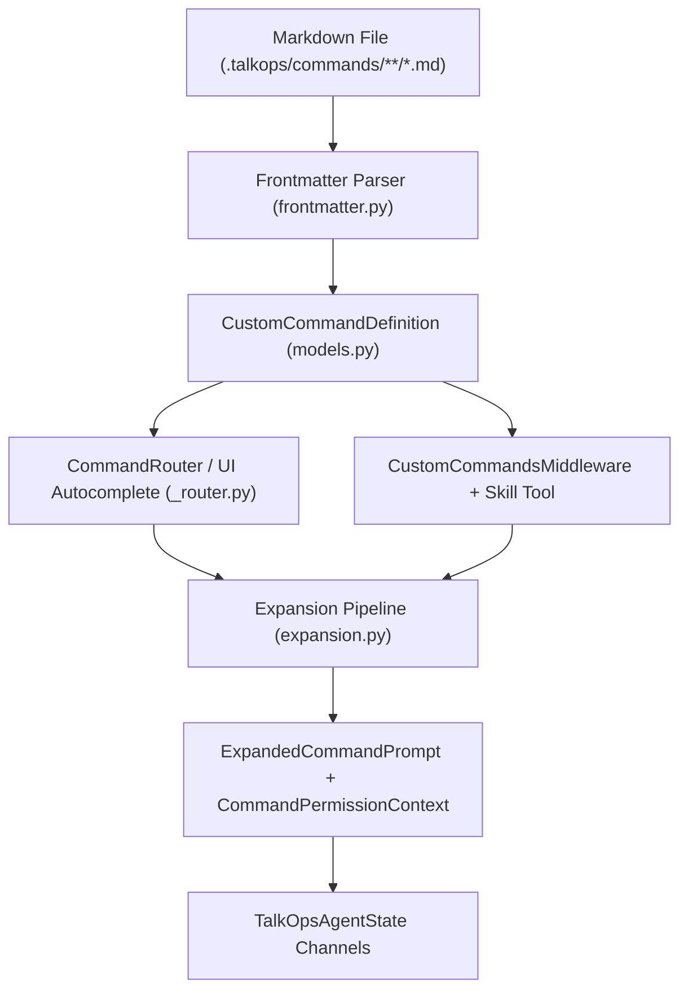

# Custom commands

> Define reusable slash commands as Markdown files with YAML frontmatter

Custom commands let you add reusable `/command` workflows to TalkOps (`talkops`) by dropping a Markdown file into `.talkops/commands/` or `~/.talkops/commands/`. Commands support positional and named argument substitution, inline shell execution, tool allowlists with brace expansion, model and reasoning-effort overrides, and isolated subagent execution (`context: fork`) without writing Python code. For persistent instructions and domain skills, see [Memory and skills](./memory-and-skills.md).

## Create your first command

### 1. Create a command file

Create `.talkops/commands/review.md` in your project:

```markdown
---
description: "Review recent git changes for security, infrastructure, and reliability issues"
argument-hint: "[target-branch]"
allowed-tools:
  - "Bash(git diff *, git status *)"
  - read_file
effort: high
---

## Current Repository Status
!`git status --short`

## Recent Diff Against ${0:-HEAD}
!`git diff $0`

Please review the changes above focusing on:
1. Security vulnerabilities or leaked credentials
2. Breaking infrastructure or API changes
3. Missing error handling or edge cases

Additional user instructions: $ARGUMENTS
```

### 2. Reload and run the command

In an active TalkOps session, run `/reload` (or launch `talkops`), then invoke `/review`:

```text
/reload
/review main Focus on IAM policy changes
```

Typing `/` in the prompt bar shows `/review [target-branch]` in the autocomplete menu with a `(project)` scope badge.

<p align="center">
  
</p>

> [!IMPORTANT]
> **Image Placeholder (`docs/talkops-docs/images/talkops-custom-commands-autocomplete.png`):**
> Capture a screenshot of the `talkops` chat input when typing `/`, showing the autocomplete popup with custom commands (such as `/review [target-branch]`, `/aws:audit`, `/git:summary`) alongside their `(project)` or `(user)` scope badges and descriptions.

---

## Discovery locations and precedence

TalkOps discovers `.md` command files across four scopes. When two commands share the same resolved name, the higher-priority scope wins:

| Priority | Scope | Directory path | UI badge |
| - | - | - | - |
| **1 (highest)** | **Managed / Policy** | `$TALKOPS_MANAGED_COMMANDS_DIR` or `$CLAUDE_MANAGED_COMMANDS_DIR` | `(policy)` |
| **2** | **Project** | `.talkops/commands/` and `.claude/commands/` (walks up from `cwd` to Git root) | `(project)` or `(project:<folder>)` |
| **3** | **User** | `~/.talkops/commands/` and `~/.claude/commands/` | `(user)` |
| **4 (lowest)** | **Plugins** | `<plugin_root>/commands/` | `(plugin:<name>)` |

### Subdirectory namespacing

Organize related commands into subdirectories inside `commands/`. Relative directory paths map automatically to colon-separated namespaces and also accept space-separated invocation:

| File path | Canonical command | Space-separated alias |
| - | - | - |
| `.talkops/commands/deploy.md` | `/deploy` | — |
| `.talkops/commands/aws/audit.md` | `/aws:audit` | `/aws audit <args>` |
| `.talkops/commands/k8s/rollout/status.md` | `/k8s:rollout:status` | `/k8s rollout status <args>` |
| `.talkops/commands/terraform/SKILL.md` | `/terraform` | — |

---

## Frontmatter reference

All YAML frontmatter fields are optional. When omitted, TalkOps uses the filename as the command name and the first non-heading paragraph of the Markdown body as the description.

```yaml
---
name: deploy-check
description: "Verify cluster readiness before deployment"
when_to_use: "Use before rolling out a new release or applying Helm charts"
argument-hint: "<environment> [namespace]"
arguments:
  - env
  - namespace
allowed-tools:
  - "Bash(kubectl:{get,describe,logs} *)"
  - read_file
disallowed-tools:
  - write_file
model: sonnet
effort: high
context: inline
agent: general-purpose
background: false
disable-model-invocation: false
user-invocable: true
paths:
  - "k8s/**/*.yaml"
  - "charts/**"
shell: bash
version: "1.0.0"
---
```

| Field | Type | Default | Description |
| - | - | - | - |
| `name` | `string` | Derived from path | Explicit command name override |
| `description` | `string` | First body paragraph | Short description shown in `/` autocomplete and the model catalog |
| `when_to_use` | `string` | `null` | Guidance telling the model when to invoke this command automatically via the `Skill` tool |
| `argument-hint` | `string` | `null` | Placeholder hint shown next to the command in `/` autocomplete (e.g., `<env> [service]`) |
| `arguments` | `list[str]` | `[]` | Named positional parameters (e.g., `[env, service]`) enabling `$env` and `$service` substitution |
| `allowed-tools` | `list[str]` | `[]` | Allowlist of tools permitted during execution; supports brace expansion (`Bash(git:{diff,status} *)`) |
| `disallowed-tools` | `list[str]` | `[]` | Denylist of tools blocked during execution |
| `model` | `string` | `inherit` | Model override: `haiku`, `sonnet`, `opus`, `inherit`, or full `provider:model` spec |
| `effort` | `string` / `int` | `null` | Reasoning effort override: `low`, `medium`, `high`, `max`, or integer token budget |
| `context` | `string` | `"inline"` | Execution mode: `"inline"` (runs in main thread) or `"fork"` (spawns an isolated subagent) |
| `agent` | `string` | `"general-purpose"` | Target subagent name when `context: fork` is set |
| `background` | `bool` | `false` | Whether the command can run asynchronously in the background |
| `disable-model-invocation` | `bool` | `false` | Hide the command from the model's autonomous `Skill` tool catalog (manual `/cmd` only) |
| `user-invocable` | `bool` | `true` | Show the command in the `/` autocomplete menu (`false` makes it model-only) |
| `paths` | `list[str]` | `[]` | Glob patterns (e.g., `"**/*.tf"`). Keeps the command dormant until a matching file is referenced |
| `shell` | `string` | `"bash"` | Shell interpreter for inline `!` commands (`"bash"` or `"powershell"`) |
| `hooks` | `dict` | `{}` | Command-scoped lifecycle hooks (`PreToolUse`, `PostToolUse`, `Stop`) |
| `version` | `string` | `null` | Semantic version tag |

---

## Dynamic prompt expansion

When you invoke a custom command, TalkOps expands variables and inline shell commands before sending the prompt to the agent.

### 1. Positional and named arguments

| Syntax | Behavior |
| - | - |
| `$ARGUMENTS` | Replaced with the entire argument string passed after `/command` |
| `$0`, `$1`, `$2` | Replaced with the Nth positional argument (supports quoted strings) |
| `$ARGUMENTS[0]`, `$ARGUMENTS[1]` | Indexed positional argument syntax |
| `$<name>` or `${<name>}` | Replaced with the named argument declared in `arguments: [name1, name2]` |
| `${0:-default}` | Positional or named argument with a fallback default value |
| `\$ARGUMENTS`, `\$0` | Escaped literal dollar sign (no substitution) |

If the Markdown body contains no argument placeholders and you pass arguments after `/command`, TalkOps appends `ARGUMENTS: <your args>` to the end of the expanded prompt.

### 2. Environment variables and `@file` mentions

* `${TALKOPS_SKILL_DIR}` / `${CLAUDE_SKILL_DIR}`: Absolute path to the directory containing the command's `.md` file.
* `${TALKOPS_PROJECT_DIR}` / `${CLAUDE_PROJECT_DIR}`: Absolute path to the current project root.
* `${TALKOPS_SESSION_ID}` / `${CLAUDE_SESSION_ID}`: Active session thread ID.
* `${TALKOPS_EFFORT}`: Active reasoning effort level.
* `@path/to/file`: Extracted automatically into `mentioned_files` to attach file context and unlock path-scoped commands.

### 3. Inline shell execution (`` !`cmd` `` and ```` ```! ````)

Embed live command output directly into the prompt at expansion time:

````markdown
Current git branch: !`git branch --show-current`
Active Kubernetes context: !`kubectl config current-context`

```!
git log -n 5 --oneline
```
````

> [!NOTE]
> When user arguments are interpolated into a command that uses inline shell execution, TalkOps sanitizes shell metacharacters (`;`, `|`, `&`, `` ` ``, `$()`, `>`, `<`) in the user arguments to prevent accidental command injection.

---

## Control execution and permissions

* **Brace expansion in `allowed-tools`**: `"Bash(kubectl:{get,describe,logs} *)"` expands automatically to allow `kubectl get`, `kubectl describe`, and `kubectl logs` while blocking other `kubectl` subcommands.
* **Isolated subagent execution (`context: fork`)**: Set `context: fork` (and optionally `agent: <name>`) to run heavy audits or verbose multi-step checks inside a forked subagent without cluttering the main conversation.
* **Path-scoped activation (`paths:`)**: Commands with a `paths:` glob list remain dormant at startup to save system-prompt tokens and activate automatically as soon as a matching file path is referenced.
* **Stacked slash commands**: Chain multiple custom commands in a single input line (for example, `/lint-rules /security-checklist src/talkops/agent/factory.py`). TalkOps merges their tool permissions and expands them in order.

<details>
<summary><b>Authoring recipes</b></summary>

### Minimal zero-frontmatter command (`.talkops/commands/explain.md`)

```markdown
Explain the architecture and data flow of the specified module in plain English.

Target to explain: $ARGUMENTS
```

### Parameterized command with named arguments (`.talkops/commands/k8s-drift.md`)

```markdown
---
description: "Compare two Kubernetes namespaces for configuration drift"
argument-hint: "<source-ns> <target-ns>"
arguments:
  - source_ns
  - target_ns
allowed-tools:
  - "Bash(kubectl:{get,diff} *)"
---

Compare workloads and ConfigMaps between namespace `$source_ns` and `$target_ns`.
```

### Forked subagent audit command (`.talkops/commands/tf-audit.md`)

```markdown
---
description: "Deep audit of Terraform modules in an isolated subagent"
context: fork
agent: general-purpose
model: sonnet
effort: high
---

Audit all `.tf` files in ${0:-.} and return a summary table of findings.
```

</details>

<details>
<summary><b>Internal architecture and verification</b></summary>



To verify discovered commands and prompt expansion from the shell:

```bash
uv run pytest tests/unit_tests/test_custom_commands.py -v

uv run python -c "
from pathlib import Path
from talkops.commands.custom import discover_custom_commands
for cmd in discover_custom_commands(Path.cwd()):
    print(f'Discovered: /{cmd.name} {cmd.source_label} -> {cmd.description}')
"
```

</details>

---

## See also

* [Memory and skills](./memory-and-skills.md)
* [Subagents](./subagents.md)
* [Plugins and marketplaces](./plugins.md)
* [Command reference](./cli-reference.md)
* [Hooks](./hooks.md)
