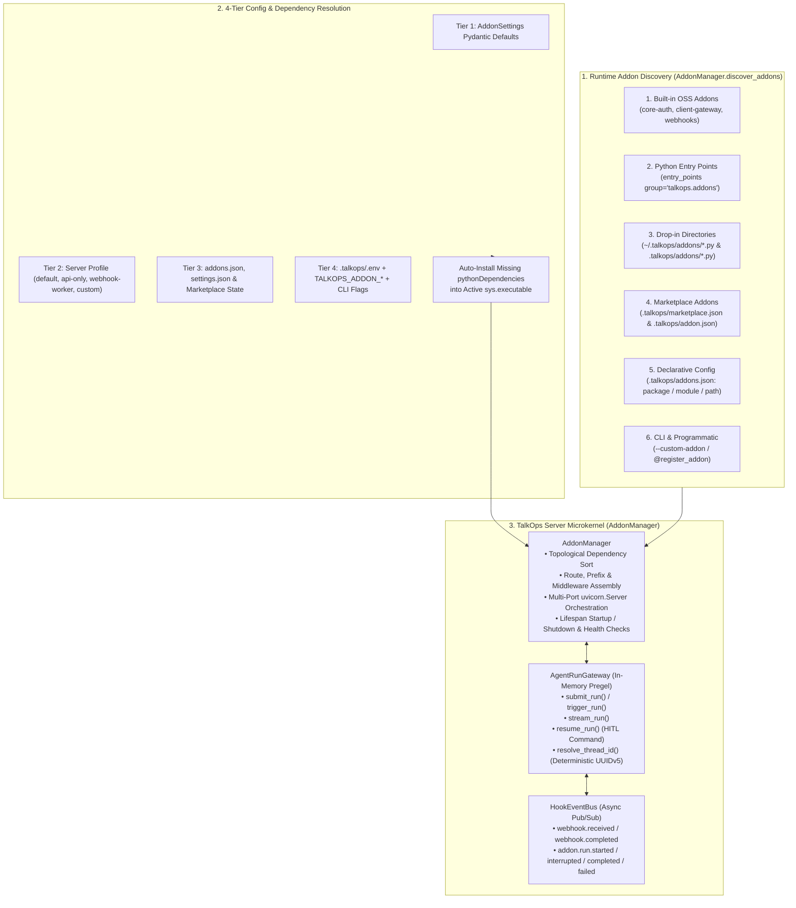

# TalkOps Server Addon Developer Guide

This guide explains how the **TalkOps Server Addon Framework** ([`src/talkops/addons/`](../../../src/talkops/addons/__init__.py)) works under the hood, how the default built-in addons are implemented and configured, and how to build, package, configure, and test custom Server Addons in an external repository—citing the official **[`talkops-ai/talkops-addons`](https://github.com/talkops-ai/talkops-addons)** repository (`channels` and `webhooks`) as a reference implementation.

---

## Table of Contents

1. [Architecture Overview](#1-architecture-overview)
2. [Default Built-In Addons & Step-by-Step Configuration](#2-default-built-in-addons--step-by-step-configuration)
3. [Addon Protocol, Capabilities & Lifecycle Reference](#3-addon-protocol-capabilities--lifecycle-reference)
4. [Reference Case Study: The Official `talkops-addons` Repository](#4-reference-case-study-the-official-talkops-addons-repository)
5. [Step-by-Step: Writing a Custom Server Addon](#5-step-by-step-writing-a-custom-server-addon)
6. [Interacting with the Agent Runtime (`AgentRunGateway` & `HookEventBus`)](#6-interacting-with-the-agent-runtime-agentrungateway--hookeventbus)
7. [Hooking & Configuring Your Addon at Runtime (6 Discovery Channels)](#7-hooking--configuring-your-addon-at-runtime-6-discovery-channels)
8. [Testing Your Addon End-to-End](#8-testing-your-addon-end-to-end)
9. [Developer Checklist](#9-developer-checklist)

---

## 1. Architecture Overview

TalkOps Server Mode (`talkops serve`) is built around a pluggable **Server Addon Microkernel** ([`AddonManager`](../../../src/talkops/addons/manager.py)). Every HTTP route, authentication provider, webhook listener, background task consumer, and ChatOps integration in `talkops serve` is a modular [`ServerAddon`](../../../src/talkops/addons/protocol.py).



> [!IMPORTANT]
> **Key Design Guarantees**
> - **Zero Disturbance to Default Flow**: Running `talkops serve` with no flags starts `core-auth`, `client-gateway`, and `webhooks` out of the box.
> - **Zero HTTP Loopback**: Addons never make HTTP requests back to `127.0.0.1:2024`. Every addon receives an [`AddonContext`](../../../src/talkops/addons/protocol.py) containing [`ctx.gateway`](../../../src/talkops/addons/gateway.py) (`AgentRunGateway`) and [`ctx.event_bus`](../../../src/talkops/addons/gateway.py) (`HookEventBus`), which execute directly against the in-memory compiled LangGraph `Pregel` graph.
> - **Unified `.talkops/` Convention & Auto-Installed Dependencies**: External addon repositories use `.talkops/marketplace.json` at the repo root and `.talkops/addon.json` inside each addon folder. When an addon declares `pythonDependencies` in `.talkops/addon.json`, TalkOps verifies the active Python interpreter (`sys.executable`) and auto-installs any missing packages via `pip` or `uv pip`.
> - **No Hardcoded Secrets**: Users supply secrets via `.talkops/.env`, `~/.talkops/.env`, or OS environment variables and reference them in `.talkops/addons.json` via `${ENV_VAR}`, `env://ENV_VAR`, or `<field>_env`.

---

## 2. Default Built-In Addons & Step-by-Step Configuration

TalkOps ships three built-in Open-Source (`oss`) addons in [`src/talkops/addons/builtin/`](../../../src/talkops/addons/builtin/__init__.py) returned by `get_builtin_addons()`. All three have `enabled_by_default = True` and are active in the `default` server profile.

### 2.1 Summary of Default Built-In Addons

| Addon Name | Implementation Class | Settings Schema | Capabilities | Mounted Routes | Purpose |
| :--- | :--- | :--- | :--- | :--- | :--- |
| **`core-auth`** | [`CoreAuthAddon`](../../../src/talkops/addons/builtin/core_auth.py) | `CoreAuthSettings` | `routes=True`, `auth_provider=True` | `POST /api/v1/auth/token`<br>`GET /.well-known/openid-configuration`<br>`GET /.well-known/jwks.json` | Registers as `ctx.identity_mapper`. Authenticates API keys (`TALKOPS_SERVER_API_KEYS`), Control Plane tokens, and OIDC/HS256/RS256 JWTs; enforces per-user thread owner isolation. |
| **`client-gateway`** | [`ClientGatewayAddon`](../../../src/talkops/addons/builtin/client_gateway.py) | `ClientGatewaySettings` | `routes=True`<br>*(depends on `core-auth`)* | `GET /api/v1/server/info`<br>`GET /api/v1/threads` (`recent`, `similar`, `{thread_id}`, `title`, `fork`, `prune`, `DELETE`)<br>`GET /api/v1/threads/{thread_id}/tasks` (`stream`, `logs`, `action`) | Multi-user session API for `talkops --server-url ...` clients and real-time SSE streaming of background shell tasks. |
| **`webhooks`** | [`WebhookAddon`](../../../src/talkops/addons/builtin/webhooks.py) | `WebhookAddonSettings` | `routes=True`, `background_workers=True`, `event_sinks=True` | `GET /webhooks`<br>`GET /webhooks/health`<br>`GET /webhooks/deliveries`<br>`POST /webhooks/{provider}` | Ingests webhooks from 9+ DevOps/Cloud providers (SNS/CloudWatch/EventBridge, PagerDuty v3, Alertmanager/Grafana, CloudEvents, Jenkins, GitHub, Datadog, ServiceNow, Azure Monitor/Generic), runs background RCA via `ctx.gateway`, and emits `webhook.received` and `webhook.completed` on `ctx.event_bus`. |

### 2.2 Step-by-Step: Configuring the Default Addons

#### Step 1: Set Secrets in `.talkops/.env`

```dotenv
# Static API keys mapped to user identities (<key>:<user_id>)
TALKOPS_SERVER_API_KEYS=oc_live_alice_key:alice,oc_live_bob_key:bob

# Default & provider-specific webhook secrets
TALKOPS_WEBHOOK_SECRET=whsec_default_hmac_secret
TALKOPS_WEBHOOK_PAGERDUTY_SECRET=pd_v3_webhook_secret
TALKOPS_WEBHOOK_GITHUB_SECRET=gh_webhook_secret

# Optional write-back credentials for PagerDuty & GitHub
TALKOPS_WEBHOOK_PAGERDUTY_API_KEY=pd_rest_api_key
TALKOPS_WEBHOOK_PAGERDUTY_FROM_EMAIL=sre-bot@acme.io
TALKOPS_WEBHOOK_GITHUB_TOKEN=ghp_token
```

#### Step 2: Configure `.talkops/addons.json`

Create `<project_root>/.talkops/addons.json` (or `~/.talkops/addons.json`):

```json
{
  "profile": "default",
  "addons": {
    "core-auth": {
      "enabled": true,
      "default_token_ttl_seconds": 3600
    },
    "client-gateway": {
      "enabled": true,
      "max_threads_page_size": 500,
      "sse_keepalive_seconds": 15.0
    },
    "webhooks": {
      "enabled": true,
      "port": 8080,
      "max_concurrent_runs": 5,
      "dedup_ttl_seconds": 300.0,
      "default_secret": "${TALKOPS_WEBHOOK_SECRET}",
      "auto_confirm_sns": true,
      "outbound_channels": [
        {
          "channel": "slack",
          "conversation_id": "C0123456789",
          "providers": ["pagerduty", "alertmanager", "sns", "datadog"],
          "severities": ["critical", "high", "warning"],
          "notify_on": ["received", "completed"],
          "bind_thread": true
        }
      ]
    }
  }
}
```

#### Step 3: Verify & Start the Server

```bash
# 1. Verify resolved addon configuration, ports, and sources
talkops serve addons --addons-config ./.talkops/addons.json

# 2. Start talkops serve (main API on 2024, webhooks listener on 8080)
talkops serve --port 2024 --addons-config ./.talkops/addons.json --smart
```

---

## 3. Addon Protocol, Capabilities & Lifecycle Reference

### 3.1 Class Attributes on [`BaseServerAddon`](../../../src/talkops/addons/protocol.py)

Every addon subclasses [`BaseServerAddon`](../../../src/talkops/addons/protocol.py) (or satisfies the `@runtime_checkable` [`ServerAddon`](../../../src/talkops/addons/protocol.py) protocol) and defines:

| Attribute | Type | Default | Requirement & Convention |
| :--- | :--- | :--- | :--- |
| `name` | `str` | `"unnamed-addon"` | **Required.** Unique, lowercase `kebab-case` identifier (e.g. `"channels"`, `"jira-itsm"`). Env var overrides map `<NAME>` by uppercasing and replacing `-` with `_`. |
| `api_version` | `int` | `1` (`ADDON_API_VERSION`) | Checked by `AddonManager` during discovery; mismatched versions are skipped. |
| `tier` | `Literal["oss", "enterprise", "custom"]` | `"custom"` | `"oss"` for open-source addons, `"enterprise"` for commercial packages, `"custom"` for user-authored addons. |
| `version` | `str` | `"0.1.0"` | Semantic version string (`MAJOR.MINOR.PATCH`). |
| `description` | `str` | `""` | Concise summary displayed in `talkops serve addons`, `talkops addon list`, and `GET /api/v1/addons`. |
| `dependencies` | `tuple[str, ...]` | `()` | Names of addons that must start *before* this addon (e.g. `("core-auth",)`). `AddonManager` topologically sorts enabled addons and shuts them down in reverse order. |
| `capabilities` | `AddonCapabilities` | `AddonCapabilities()` | Declares which extension surfaces the addon uses. |
| `settings_schema` | `type[BaseModel] \| None` | `None` *(falls back to `AddonSettings`)* | Pydantic v2 model subclassing [`AddonSettings`](../../../src/talkops/addons/config.py) used to validate configuration. |
| `enabled_by_default` | `bool` | `False` | `True` for built-in default addons; `False` for external packages that should be enabled via `talkops addon install`, `addons.json`, or `--addons`. |
| `source` | `str` | `"custom"` | Automatically populated by `AddonManager` (`"builtin"`, `"marketplace:<id>"`, `"entrypoint:<ep>"`, `"file:<path>"`, `"package:<spec>"`). |

### 3.2 `AddonCapabilities` Flags

Declare which hooks your addon uses via [`AddonCapabilities`](../../../src/talkops/addons/protocol.py):

```python
from talkops.addons import AddonCapabilities

capabilities = AddonCapabilities(
    routes=True,               # Contributes Starlette Route / Mount / WebSocketRoute via get_routes()
    middleware=False,          # Contributes Starlette Middleware via get_middleware()
    background_workers=True,   # Spawns async background tasks on startup
    companion_processes=False, # Returns OS sidecar specs via get_companion_specs(ctx)
    auth_provider=False,       # Implements IdentityMapper (authenticate_request / authorize_action)
    event_sinks=True,          # Dispatches outbound notifications (e.g. Slack/PagerDuty write-back)
    mcp_provider=False,        # Registers or proxies MCP tool servers
    gateway_runner=True,       # Triggers, streams, or resumes agent runs via ctx.gateway
    event_subscriber=True,     # Subscribes to HookEventBus events via ctx.event_bus.subscribe(...)
)
```

### 3.3 Typed Configuration Schema (`AddonSettings`)

Subclass [`AddonSettings`](../../../src/talkops/addons/config.py) to define your addon's configuration schema. `AddonSettings` uses `ConfigDict(extra="allow")` and includes common base fields (`enabled`, `port`, `mount_prefix`, `package`, `module`, `path`, `python_path`, `config`):

```python
from typing import Any
from pydantic import Field
from talkops.addons import AddonSettings


class ChannelsAddonSettings(AddonSettings):
    """Configuration schema for `ChannelsAddon` (`channels`)."""

    enabled: bool = True
    verbosity: int = Field(default=2, ge=1, le=3)
    pairing_enabled: bool = True
    default_approval_mode: str = "smart"
    edit_debounce_seconds: float = 1.0
    slack: dict[str, Any] = Field(default_factory=dict)
    teams: dict[str, Any] = Field(default_factory=dict)
    discord: dict[str, Any] = Field(default_factory=dict)
    outbound_channels: list[dict[str, Any]] | str | None = None
```

> [!NOTE]
> When `AddonManager` loads `.talkops/addons.json`, any keys placed inside an addon's nested `"config": { ... }` object are automatically merged onto the top level before `settings_schema.model_validate(...)` is called. This means users can write fields either directly under `"addons": { "my-addon": { ... } }` or nested under `"addons": { "my-addon": { "config": { ... } } }`.

### 3.4 Lifecycle Hooks on `BaseServerAddon`

`AddonManager` orchestrates every enabled addon through the following methods (defined in [`src/talkops/addons/protocol.py`](../../../src/talkops/addons/protocol.py)):

1. **`addon.bind_config(config: Any) -> None`**
   Called during `AddonManager.resolve_and_validate()` with the validated `settings_schema` instance. Stores `self._config = config`.
2. **`addon.is_enabled(addon_config: Any) -> bool`**
   Returns `True` if the addon should be activated given its resolved config (`getattr(addon_config, "enabled", self.enabled_by_default)`).
3. **`addon.get_routes() -> list[BaseRoute]`**
   Returns Starlette `Route`, `Mount`, or `WebSocketRoute` objects.
   - If `self._config.mount_prefix` is set (e.g. `"/v2"`), `AddonManager` automatically wraps your routes in `Mount("/v2", routes=...)`.
   - If `self._config.port` is set to a port different from the main server port (e.g. `port=8090`), `AddonManager` automatically binds a dedicated `uvicorn.Server` on port `8090` sharing the same `asyncio` event loop.
4. **`addon.get_middleware() -> list[Middleware]`**
   Returns Starlette `Middleware(MyMiddlewareClass, ...)` definitions to wrap the main ASGI app.
5. **`addon.get_companion_specs(ctx: AddonContext) -> list[CompanionProcessSpec]`**
   Returns optional OS subprocess specifications (`CompanionProcessSpec(name=..., command=[...], restart_policy="on-failure")`).
6. **`await addon.on_startup(ctx: AddonContext) -> None`**
   Called in topological dependency order when the server starts.
   - Saves `self._ctx = ctx`.
   - Subscribe to `ctx.event_bus.subscribe(event_type, callback)`.
   - Spawn supervised background tasks via `ctx.spawn_background_task(coro, name="...")`.
   - If the addon implements `IdentityMapper` (`authenticate_request` and `authorize_action`), `AddonManager` binds `ctx.identity_mapper = addon`.
7. **`await addon.health_check() -> AddonHealthStatus`**
   Called by `GET /api/v1/addons` to report live addon health (`status="ok" | "degraded" | "error" | "disabled"`, `details={...}`).
8. **`await addon.on_shutdown(ctx: AddonContext) -> None`**
   Called in **reverse dependency order** during server shutdown. Unsubscribe event listeners, drain queues, and close HTTP clients here (`ctx.cancel_background_tasks()` is also called automatically by `AddonManager`).

---

## 4. Reference Case Study: The Official `talkops-addons` Repository

The official **[`talkops-ai/talkops-addons`](https://github.com/talkops-ai/talkops-addons)** repository is the canonical template for multi-addon marketplace repositories.

### 4.1 Repository Directory Structure

```text
talkops-addons/
├── .talkops/
│   └── marketplace.json                     # Central catalog of all addons in this repository
├── pyproject.toml                           # uv workspace root (members = ["addons/*"])
├── addons/
│   ├── channels/                            # Multi-Channel ChatOps Hub (Slack, Teams, Discord)
│   │   ├── .talkops/
│   │   │   └── addon.json                   # Addon manifest, pythonDependencies, webhookSink, routes
│   │   ├── pyproject.toml                   # Package metadata + [project.entry-points."talkops.addons"]
│   │   ├── talkops_channels/
│   │   │   ├── __init__.py
│   │   │   ├── addon.py                     # ChannelsAddon (BaseServerAddon subclass)
│   │   │   ├── hub.py                       # ChannelHub conversation & turn orchestrator
│   │   │   ├── approvals.py                 # Multi-modal HITL approval manager
│   │   │   ├── pairing.py                   # One-time DM sender pairing store
│   │   │   └── providers/                   # slack.py, teams.py, discord.py
│   │   └── tests/
│   └── webhooks/                            # Autonomous Webhook & Alert Ingestion Addon
│       ├── .talkops/
│       │   └── addon.json                   # Addon manifest, pythonDependencies, routes, envVars
│       ├── pyproject.toml                   # Package metadata + [project.entry-points."talkops.addons"]
│       ├── talkops_webhooks/
│       │   ├── __init__.py
│       │   ├── addon.py                     # WebhookAddon (BaseServerAddon subclass)
│       │   ├── dispatcher.py                # WebhookDispatcher, dedup, HMAC & sinks
│       │   └── providers/                   # sns, pagerduty, alertmanager, cloudevents, github, etc.
│       └── tests/
└── tests/
    └── test_marketplace_catalog.py          # Catalog validation & cross-addon integration suite
```

### 4.2 Root Marketplace Catalog (`.talkops/marketplace.json`)

At the root of [`.talkops/marketplace.json`](https://github.com/talkops-ai/talkops-addons/blob/main/.talkops/marketplace.json), the repository declares its catalog metadata and each addon's source path, entry point, and Python dependencies:

```json
{
  "$schema": "https://talkops.ai/schemas/addon-marketplace-v1.json",
  "name": "talkops-addons",
  "displayName": "TalkOps Official Server Addons",
  "description": "Official and enterprise server addons for TalkOps Server Mode (talkops serve)",
  "owner": {
    "name": "TalkOps AI",
    "url": "https://github.com/talkops-ai"
  },
  "addons": [
    {
      "name": "channels",
      "displayName": "Multi-Channel ChatOps Hub (Slack, Teams, Discord)",
      "description": "Central HTTP webhook integration for Slack, Microsoft Teams, and Discord with interactive HITL approvals, thread binding, and outbound webhook alert notifications.",
      "version": "0.1.0",
      "tier": "oss",
      "category": "chatops",
      "source": "./addons/channels",
      "entryPoint": "talkops_channels.addon:ChannelsAddon",
      "pythonPath": ["."],
      "pythonDependencies": [
        "httpx>=0.27.0",
        "pydantic>=2.6.0",
        "starlette>=0.37.0",
        "cryptography>=42.0.0",
        "PyJWT>=2.8.0",
        "filelock>=3.13.0"
      ],
      "keywords": ["slack", "teams", "discord", "chatops", "hitl", "webhooks", "notifications"]
    },
    {
      "name": "webhooks",
      "displayName": "Autonomous Webhook & Alert Ingestion Server",
      "description": "Central webhook receiver for AWS SNS/CloudWatch/EventBridge, PagerDuty v3, Prometheus Alertmanager, Grafana, CNCF CloudEvents, Jenkins, GitHub, Datadog, ServiceNow, Azure Monitor, and generic JSON alerts with autonomous RCA and outbound write-back sinks.",
      "version": "0.1.0",
      "tier": "oss",
      "category": "observability",
      "source": "./addons/webhooks",
      "entryPoint": "talkops_webhooks.addon:WebhookAddon",
      "pythonPath": ["."],
      "pythonDependencies": [
        "httpx>=0.27.0",
        "pydantic>=2.6.0",
        "starlette>=0.37.0"
      ],
      "keywords": ["webhooks", "sns", "pagerduty", "alertmanager", "grafana", "cloudevents", "github", "datadog", "servicenow", "rca"]
    }
  ]
}
```

> [!TIP]
> **Flexible `source` Specifiers in `.talkops/marketplace.json`:**
> In addition to relative repository paths (`"./addons/channels"`), an entry's `"source"` field can point to an external GitHub repository (`{"source": "github", "repo": "my-org/addon-repo", "ref": "main", "path": "addons/custom"}`), a Git URL (`{"source": "git-subdir", "url": "https://gitlab.internal/devops/addons.git", "ref": "v1.0.0", "path": "custom"}`), or a direct URL (`{"source": "url", "url": "https://..."}`).

### 4.3 Per-Addon Manifest (`addons/channels/.talkops/addon.json`)

Inside each addon folder, [`addons/channels/.talkops/addon.json`](https://github.com/talkops-ai/talkops-addons/blob/main/addons/channels/.talkops/addon.json) declares the addon's runtime contract:

```json
{
  "$schema": "https://talkops.ai/schemas/addon-v1.json",
  "name": "channels",
  "displayName": "Multi-Channel ChatOps Hub (Slack, Teams, Discord)",
  "version": "0.1.0",
  "description": "Central HTTP webhook integration for Slack, Microsoft Teams, and Discord with interactive HITL tool approvals, DM pairing, and outbound webhook alert notifications.",
  "author": {
    "name": "TalkOps AI"
  },
  "tier": "oss",
  "apiVersion": 1,
  "entryPoint": "talkops_channels.addon:ChannelsAddon",
  "pythonPath": ["."],
  "pythonDependencies": [
    "httpx>=0.27.0",
    "pydantic>=2.6.0",
    "starlette>=0.37.0",
    "cryptography>=42.0.0",
    "PyJWT>=2.8.0",
    "filelock>=3.13.0"
  ],
  "dependencies": [],
  "enabledByDefault": false,
  "capabilities": {
    "routes": true,
    "middleware": false,
    "background_workers": true,
    "companion_processes": false,
    "auth_provider": false,
    "event_sinks": true,
    "mcp_provider": false,
    "gateway_runner": true,
    "event_subscriber": true
  },
  "webhookSink": {
    "supportedChannels": ["slack", "teams", "discord"],
    "subscribesTo": ["webhook.received", "webhook.completed", "addon.run.interrupted"],
    "bindsIncidentThread": true
  },
  "routes": [
    {
      "path": "/channels/{provider}/events",
      "methods": ["POST"],
      "description": "Inbound message & reaction events from Slack, Microsoft Teams, or Discord"
    },
    {
      "path": "/channels/{provider}/interactions",
      "methods": ["POST"],
      "description": "Interactive button clicks, Adaptive Cards, and Discord Ed25519 interactions"
    },
    {
      "path": "/channels/{provider}/commands",
      "methods": ["POST"],
      "description": "Native slash command webhook callbacks"
    },
    {
      "path": "/channels/status",
      "methods": ["GET"],
      "description": "Adapter health, active conversation tasks, and pending HITL approvals"
    },
    {
      "path": "/channels/notify",
      "methods": ["POST"],
      "description": "Proactive outbound notification & incident thread binding endpoint"
    }
  ],
  "agentTools": [
    {
      "factory": "talkops_channels.messaging:create_send_message_tool",
      "name": "send_channel_message",
      "description": "Send intermediate text or file attachments to the active Slack/Teams/Discord conversation"
    }
  ],
  "envVars": [
    "TALKOPS_SLACK_BOT_TOKEN",
    "TALKOPS_SLACK_SIGNING_SECRET",
    "TALKOPS_TEAMS_APP_ID",
    "TALKOPS_TEAMS_APP_PASSWORD",
    "TALKOPS_DISCORD_BOT_TOKEN",
    "TALKOPS_DISCORD_PUBLIC_KEY",
    "TALKOPS_WEBHOOK_NOTIFY_CHANNELS"
  ]
}
```

### 4.4 Standalone-Testable Pattern Used in `talkops-addons`

In [`addons/channels/talkops_channels/addon.py`](https://github.com/talkops-ai/talkops-addons/blob/main/addons/channels/talkops_channels/addon.py) and [`addons/webhooks/talkops_webhooks/addon.py`](https://github.com/talkops-ai/talkops-addons/blob/main/addons/webhooks/talkops_webhooks/addon.py), notice how the addon imports `talkops.addons` with lightweight fallback classes when running in an isolated CI/test environment where `talkops` core is not installed:

```python
try:
    from talkops.addons.config import AddonSettings
    from talkops.addons.protocol import (
        AddonCapabilities,
        AddonContext,
        AddonHealthStatus,
        BaseServerAddon,
    )
except ImportError:
    AddonSettings = _FallbackAddonSettings
    AddonCapabilities = _FallbackAddonCapabilities
    AddonHealthStatus = _FallbackAddonHealthStatus
    BaseServerAddon = _FallbackBaseServerAddon
    AddonContext = Any
```

This allows `uv run pytest` inside `talkops-addons` to test every route, signature verifier, and event-bus handler in isolation while seamlessly inheriting from the real `talkops.addons` classes when loaded by `talkops serve`.

---

## 5. Step-by-Step: Writing a Custom Server Addon

Suppose you want to write a custom **`pagerduty-custom-sink`** (or **`jira-incident-bridge`**) addon in your own repository `acme-talkops-addons` that:
1. Exposes an inbound HTTP webhook (`POST /jira/events`) and status route (`GET /jira/status`).
2. Triggers background TalkOps investigations via `ctx.gateway.submit_run(...)` using a deterministic thread key (`jira:{issue_key}`).
3. Subscribes to `"addon.run.interrupted"` and `"webhook.completed"` on `ctx.event_bus`.
4. Can be installed via `talkops addon install jira-bridge` or configured via `.talkops/addons.json`.

### Step 1: Create the Repository Structure

```text
acme-talkops-addons/
├── .talkops/
│   └── marketplace.json
└── addons/
    └── jira-bridge/
        ├── .talkops/
        │   └── addon.json
        ├── pyproject.toml
        └── talkops_jira_bridge/
            ├── __init__.py
            └── addon.py
```

### Step 2: Create `addons/jira-bridge/.talkops/addon.json`

```json
{
  "$schema": "https://talkops.ai/schemas/addon-v1.json",
  "name": "jira-bridge",
  "displayName": "Acme Jira ITSM Incident Bridge",
  "version": "0.1.0",
  "description": "Bidirectional Jira Service Management webhook receiver and RCA comment sink.",
  "author": { "name": "Acme Platform Engineering" },
  "tier": "custom",
  "apiVersion": 1,
  "entryPoint": "talkops_jira_bridge.addon:JiraBridgeAddon",
  "pythonPath": ["."],
  "pythonDependencies": [
    "httpx>=0.27.0",
    "pydantic>=2.6.0",
    "starlette>=0.37.0"
  ],
  "dependencies": ["core-auth"],
  "enabledByDefault": false,
  "capabilities": {
    "routes": true,
    "background_workers": false,
    "event_sinks": true,
    "gateway_runner": true,
    "event_subscriber": true
  },
  "routes": [
    {
      "path": "/jira/events",
      "methods": ["POST"],
      "description": "Inbound Jira issue webhook endpoint"
    },
    {
      "path": "/jira/status",
      "methods": ["GET"],
      "description": "Addon health and processed ticket count"
    }
  ],
  "envVars": [
    "ACME_JIRA_BASE_URL",
    "ACME_JIRA_API_TOKEN",
    "ACME_JIRA_WEBHOOK_SECRET"
  ]
}
```

### Step 3: Create `addons/jira-bridge/pyproject.toml`

Declare the `[project.entry-points."talkops.addons"]` group so standard `pip` / `uv pip` installations are also discovered automatically:

```toml
[project]
name = "talkops-jira-bridge"
version = "0.1.0"
description = "Acme Jira ITSM Incident Bridge Addon for TalkOps Server Mode"
requires-python = ">=3.12"
dependencies = [
    "httpx>=0.28.1",
    "pydantic>=2.10.0",
    "starlette>=0.40.0",
]

[project.entry-points."talkops.addons"]
jira-bridge = "talkops_jira_bridge.addon:JiraBridgeAddon"

[build-system]
requires = ["hatchling"]
build-backend = "hatchling.build"

[tool.hatch.build.targets.wheel]
packages = ["talkops_jira_bridge"]
```

### Step 4: Implement the Addon (`talkops_jira_bridge/addon.py`)

```python
"""Acme Jira ITSM Incident Bridge Addon for TalkOps Server Mode."""

from __future__ import annotations

import hashlib
import hmac
from typing import Any

from pydantic import Field
from starlette.requests import Request
from starlette.responses import JSONResponse
from starlette.routing import BaseRoute, Route

from talkops.addons import (
    AddonCapabilities,
    AddonContext,
    AddonEvent,
    AddonHealthStatus,
    AddonSettings,
    BaseServerAddon,
)


class JiraBridgeSettings(AddonSettings):
    """Typed configuration schema for `jira-bridge`."""

    enabled: bool = True
    jira_base_url: str = Field(default="", description="Jira Cloud/Data Center base URL")
    api_token: str = Field(default="", description="Jira API token for comment write-back")
    webhook_secret: str = Field(default="", description="Shared HMAC secret for inbound webhooks")
    verify_signatures: bool = Field(default=True, description="Enforce X-Hub-Signature HMAC check")


class JiraBridgeAddon(BaseServerAddon):
    """Custom Server Addon connecting Jira Service Management to TalkOps."""

    name = "jira-bridge"
    version = "0.1.0"
    api_version = 1
    tier = "custom"
    description = "Bidirectional Jira ITSM webhook receiver and RCA comment sink"
    enabled_by_default = False
    dependencies = ("core-auth",)
    settings_schema = JiraBridgeSettings
    capabilities = AddonCapabilities(
        routes=True,
        event_sinks=True,
        gateway_runner=True,
        event_subscriber=True,
    )

    def __init__(self) -> None:
        super().__init__()
        self._unsubscribe_callbacks: list[Any] = []
        self._processed_issues: list[str] = []
        self._pending_approvals: dict[str, dict[str, Any]] = {}

    @property
    def settings(self) -> JiraBridgeSettings:
        """Return the bound `JiraBridgeSettings` instance."""
        if isinstance(self._config, JiraBridgeSettings):
            return self._config
        return JiraBridgeSettings()

    async def on_startup(self, ctx: AddonContext) -> None:
        """Initialize event-bus subscriptions when `talkops serve` starts."""
        await super().on_startup(ctx)
        self._unsubscribe_callbacks.append(
            ctx.event_bus.subscribe("addon.run.interrupted", self._on_run_interrupted)
        )
        self._unsubscribe_callbacks.append(
            ctx.event_bus.subscribe("addon.run.completed", self._on_run_completed)
        )

    async def on_shutdown(self, ctx: AddonContext) -> None:
        """Cleanly unsubscribe event listeners on server shutdown."""
        for unsub in self._unsubscribe_callbacks:
            try:
                unsub()
            except Exception:
                pass
        self._unsubscribe_callbacks.clear()
        await super().on_shutdown(ctx)

    async def _on_run_interrupted(self, event: AddonEvent) -> None:
        """Record HITL interrupts so operators can approve/reject via `/jira/approve`."""
        if not event.thread_id:
            return
        self._pending_approvals[event.thread_id] = {
            "thread_id": event.thread_id,
            "run_id": event.run_id,
            "interrupts": event.payload.get("interrupts", []),
        }

    async def _on_run_completed(self, event: AddonEvent) -> None:
        """Clear pending approval state when a run finishes."""
        if event.thread_id:
            self._pending_approvals.pop(event.thread_id, None)

    def _verify_signature(self, headers: dict[str, str], raw_body: bytes) -> bool:
        cfg = self.settings
        if not cfg.verify_signatures or not cfg.webhook_secret:
            return True
        sig_header = headers.get("x-hub-signature-256", "").strip()
        if not sig_header.startswith("sha256="):
            return False
        expected = "sha256=" + hmac.new(
            cfg.webhook_secret.encode("utf-8"),
            raw_body,
            hashlib.sha256,
        ).hexdigest()
        return hmac.compare_digest(expected, sig_header)

    def get_routes(self) -> list[BaseRoute]:
        return [
            Route("/jira/events", self._handle_jira_event, methods=["POST"]),
            Route("/jira/approve", self._handle_jira_approval, methods=["POST"]),
            Route("/jira/status", self._handle_status, methods=["GET"]),
        ]

    async def _handle_jira_event(self, request: Request) -> JSONResponse:
        raw_body = await request.body()
        headers = {k.lower(): v for k, v in request.headers.items()}
        if not self._verify_signature(headers, raw_body):
            return JSONResponse({"error": "Invalid webhook signature"}, status_code=401)

        payload = await request.json()
        issue = payload.get("issue") or {}
        issue_key = str(issue.get("key") or "UNKNOWN-1").strip()
        fields = issue.get("fields") or {}
        summary = str(fields.get("summary") or "Investigate Jira incident").strip()
        description = str(fields.get("description") or "").strip()

        if self._ctx is None:
            return JSONResponse({"error": "Addon context not initialized"}, status_code=503)

        # Deterministic `source_key` ensures all updates to the same Jira ticket
        # continue in the same LangGraph conversation thread!
        source_key = f"jira:{issue_key}"
        prompt = f"[Jira {issue_key}] {summary}\n\n{description}".strip()

        handle = await self._ctx.gateway.submit_run(
            prompt=prompt,
            addon_name=self.name,
            source_key=source_key,
            metadata={"jira_issue_key": issue_key},
            wait=False,
        )
        self._processed_issues.append(issue_key)
        return JSONResponse(
            {
                "status": "accepted",
                "issue_key": issue_key,
                "run_id": handle.run_id,
                "thread_id": handle.thread_id,
            },
            status_code=202,
        )

    async def _handle_jira_approval(self, request: Request) -> JSONResponse:
        """Resume a paused HITL tool call (`approve` or `reject`)."""
        if self._ctx is None:
            return JSONResponse({"error": "Addon context not initialized"}, status_code=503)

        body = await request.json()
        thread_id = str(body.get("thread_id") or "").strip()
        decision = str(body.get("decision") or "approve").strip().lower()
        if not thread_id:
            return JSONResponse({"error": "thread_id is required"}, status_code=400)

        handle = await self._ctx.gateway.resume_run(
            thread_id=thread_id,
            decision=decision,
            addon_name=self.name,
            wait=False,
        )
        return JSONResponse(
            {
                "status": "resumed",
                "decision": decision,
                "run_id": handle.run_id,
                "thread_id": handle.thread_id,
            },
            status_code=200,
        )

    async def _handle_status(self, _request: Request) -> JSONResponse:
        cfg = self.settings
        return JSONResponse(
            {
                "addon": self.name,
                "jira_base_url": cfg.jira_base_url,
                "api_token_configured": bool(cfg.api_token),
                "processed_issues_count": len(self._processed_issues),
                "pending_approvals": list(self._pending_approvals.values()),
            }
        )

    async def health_check(self) -> AddonHealthStatus:
        cfg = self.settings
        return AddonHealthStatus(
            name=self.name,
            status="ok" if cfg.api_token else "degraded",
            tier=self.tier,
            version=self.version,
            port=cfg.port,
            source=self.source,
            details={
                "jira_base_url": cfg.jira_base_url,
                "api_token_configured": bool(cfg.api_token),
                "processed_issues_count": len(self._processed_issues),
                "pending_approvals": len(self._pending_approvals),
            },
        )


# Module-level alias for automatic discovery
addon = JiraBridgeAddon
```

### Step 5: Register in `.talkops/marketplace.json` (Optional for Multi-Addon Repos)

```json
{
  "$schema": "https://talkops.ai/schemas/addon-marketplace-v1.json",
  "name": "acme-talkops-addons",
  "displayName": "Acme Internal TalkOps Addons",
  "description": "Internal TalkOps Server Addons for Acme Corp",
  "addons": [
    {
      "name": "jira-bridge",
      "displayName": "Acme Jira ITSM Incident Bridge",
      "description": "Bidirectional Jira Service Management webhook receiver and RCA comment sink.",
      "version": "0.1.0",
      "tier": "custom",
      "category": "itsm",
      "source": "./addons/jira-bridge",
      "entryPoint": "talkops_jira_bridge.addon:JiraBridgeAddon",
      "pythonPath": ["."],
      "pythonDependencies": [
        "httpx>=0.27.0",
        "pydantic>=2.6.0",
        "starlette>=0.37.0"
      ]
    }
  ]
}
```

---

## 6. Interacting with the Agent Runtime (`AgentRunGateway` & `HookEventBus`)

Every addon receives `ctx: AddonContext` in `on_startup(ctx)`. Its two core runtime services are `ctx.gateway` ([`AgentRunGateway`](../../../src/talkops/addons/gateway.py)) and `ctx.event_bus` ([`HookEventBus`](../../../src/talkops/addons/gateway.py)).

### 6.1 `AgentRunGateway` Method Reference

| Method | Signature | Description |
| :--- | :--- | :--- |
| `resolve_thread_id` | `resolve_thread_id(thread_id=None, *, source_key=None) -> str` | Deterministically hashes an external correlation key (e.g. `"pagerduty:INC-123"`, `"slack:C123:1700.01"`, or `"jira:OPS-42"`) into a UUIDv5 `thread_id` using `ADDON_THREAD_NAMESPACE`. |
| `submit_run` | `await submit_run(prompt, *, thread_id=None, source_key=None, addon_name="custom", context=None, metadata=None, wait=False) -> RunHandle` | Starts an in-memory agent run in the background (`wait=False`) or foreground (`wait=True`). Returns a `RunHandle` (`run_id`, `thread_id`, `status`, `analysis_text`, `interrupts`, `task`). |
| `trigger_run` | `await trigger_run(prompt_or_input, *, thread_id=None, source_key=None, source_addon="webhooks", context=None, metadata=None, wait=True) -> RunHandle` | Same as `submit_run`, but defaults to `wait=True` (awaits completion before returning) and accepts either a string prompt or a raw LangGraph input dict. |
| `stream_run` | `stream_run(input_payload, *, thread_id, run_id=None, source_addon="client-gateway", config_extra=None, stream_mode=None, subgraphs=True)` | Async generator yielding `(namespace, mode, chunk)` tuples directly from `graph.astream()` for real-time token and tool-call streaming (used by `talkops-channels` `GraphStreamBridge`). |
| `resume_run` | `await resume_run(thread_id, resume_payload=None, *, decision=None, addon_name="chatops", wait=True) -> RunHandle` | Resumes a paused Human-in-the-Loop interrupt using `langgraph.types.Command(resume=...)`. Pass `decision="approve"` or `decision="reject"`, or a full `{"decisions": [{"type": "approve"}]}` payload. |
| `get_thread_state` | `await get_thread_state(thread_id) -> Any` | Reads the current LangGraph checkpoint state via `graph.aget_state()`. |
| `update_thread_state` | `await update_thread_state(thread_id, values, *, as_node=None) -> Any` | Updates checkpoint state via `graph.aupdate_state()`. |
| `cancel_run` | `await cancel_run(thread_id, run_id=None) -> int` | Cancels in-flight background `asyncio.Task`(s) for `thread_id` (or specific `run_id`) and returns the number of tasks cancelled. |

### 6.2 `HookEventBus` Standard Events

Subscribe to any event type (or `"*"` for all events) via `unsub = ctx.event_bus.subscribe(event_type, callback)`, and publish custom addon events via `await ctx.event_bus.publish(AddonEvent(...))` or `await ctx.event_bus.emit(event_type, source_addon=..., thread_id=..., payload={...})`:

| Event Type | Emitter | When Published | `event.payload` Fields |
| :--- | :--- | :--- | :--- |
| `addon.run.started` | `AgentRunGateway` | When `stream_run` / `trigger_run` / `submit_run` begins executing a turn | `input_preview` |
| `addon.run.interrupted` | `AgentRunGateway` | When a tool call hits a Human-in-the-Loop approval gate (`__interrupt__`) | `interrupts` (list of action request dicts) |
| `addon.run.completed` | `AgentRunGateway` | When a run finishes normally without pending interrupts | `analysis_text`, `interrupted` (`False`) |
| `addon.run.failed` | `AgentRunGateway` | When a run raises an unhandled exception | `error` |
| `addon.run.cancelled` | `AgentRunGateway` | When a run is cancelled via `cancel_run()` | `cancelled_count` |
| `webhook.received` | `WebhookAddon` (`WebhookDispatcher`) | Immediately when an actionable webhook is accepted (`POST /webhooks/{provider}`) | `provider`, `event_type`, `incident_id`, `thread_id`, `delivery_id`, `title`, `severity`, `service_name`, `source_url`, `summary`, `outbound_channels` |
| `webhook.completed` | `WebhookAddon` (`WebhookDispatcher`) | When a background webhook RCA investigation finishes | `provider`, `event_type`, `incident_id`, `thread_id`, `delivery_id`, `title`, `severity`, `service_name`, `source_url`, `summary`, `status`, `analysis`, `run_id`, `error`, `outbound_channels` |

---

## 7. Hooking & Configuring Your Addon at Runtime (6 Discovery Channels)

You never need to modify the core `talkops` repository to load an addon from an external repository. `AddonManager.discover_addons()` supports six runtime discovery channels:

### Channel 1: Addon Marketplace CLI (`talkops addon marketplace add` + `talkops addon install`)

Recommended for multi-addon repositories like [`talkops-ai/talkops-addons`](https://github.com/talkops-ai/talkops-addons) or `acme-org/acme-talkops-addons`:

```bash
# 1. Register your repository (GitHub owner/repo, Git URL, or local directory)
talkops addon marketplace add talkops-ai/talkops-addons
# or: talkops addon marketplace add acme-org/acme-talkops-addons

# 2. Install and enable the addon (auto-installs missing pythonDependencies!)
talkops addon install channels@talkops-addons

# 3. Verify and run
talkops serve addons
talkops serve --smart
```

### Channel 2: Declarative `.talkops/addons.json` (`path` or `package` + `python_path`)

Ideal for Docker Compose, Kubernetes ConfigMaps, or local development across two sibling repositories without reinstalling wheels:

```json
{
  "profile": "default",
  "addons": {
    "channels": {
      "enabled": true,
      "path": "../talkops-addons/addons/channels",
      "config": {
        "slack": {
          "bot_token": "${TALKOPS_SLACK_BOT_TOKEN}",
          "signing_secret": "${TALKOPS_SLACK_SIGNING_SECRET}"
        }
      }
    },
    "jira-bridge": {
      "enabled": true,
      "package": "talkops_jira_bridge.addon:JiraBridgeAddon",
      "python_path": [
        "/opt/acme-talkops-addons/addons/jira-bridge"
      ],
      "port": 8091,
      "config": {
        "jira_base_url": "https://acme.atlassian.net",
        "api_token": "${ACME_JIRA_API_TOKEN}",
        "webhook_secret_env": "ACME_JIRA_WEBHOOK_SECRET"
      }
    }
  }
}
```

> [!NOTE]
> When `"path"` points to an addon directory containing `.talkops/addon.json` (such as `../talkops-addons/addons/channels`), `load_addon_from_spec()` automatically reads `.talkops/addon.json`, installs any missing `pythonDependencies`, prepends `pythonPath` to `sys.path`, and imports `entryPoint`!

### Channel 3: Python Package `entry_points` (`pip` / `uv pip install`)

If the addon package is installed into the Python environment:

```bash
uv pip install "git+https://github.com/talkops-ai/talkops-addons.git#subdirectory=addons/channels"
# or for local editable development:
uv pip install -e ../talkops-addons/addons/channels
```

Because `pyproject.toml` declares `[project.entry-points."talkops.addons"]`, `AddonManager` discovers `channels` automatically. Enable it via CLI flag, environment variable, or `.talkops/addons.json`:

```bash
talkops serve --addons channels
# or
TALKOPS_ADDONS=channels talkops serve
```

### Channel 4: Drop-In Directory (`.talkops/addons/*.py` or `~/.talkops/addons/*.py`)

Drop any single-file `.py` addon containing a `BaseServerAddon` subclass into `<project_root>/.talkops/addons/` or `~/.talkops/addons/`.

### Channel 5: CLI `--custom-addon` Flag (`TALKOPS_CUSTOM_ADDONS`)

Load and enable a custom addon file, directory, or dotted module directly from the CLI:

```bash
talkops serve \
  --custom-addon ../talkops-addons/addons/channels \
  --smart
```

### Channel 6: Programmatic Registration (`@register_addon`)

When embedding TalkOps in a custom Python entrypoint or test suite:

```python
from talkops.addons import BaseServerAddon, register_addon


@register_addon
class EmbeddedMetricsAddon(BaseServerAddon):
    name = "embedded-metrics"
    enabled_by_default = True
```

---

## 8. Testing Your Addon End-to-End

### 8.1 Testing with `create_webhooks_app` and `httpx.ASGITransport`

You can test your custom addon in-memory—including `/api/v1/addons` discovery, route handling, `AgentRunGateway` runs, and `HookEventBus` interrupts—using `httpx.ASGITransport` and `create_webhooks_app`:

```python
import httpx
import pytest
from talkops.addons import AgentRunGateway, HookEventBus
from talkops.server import create_webhooks_app
from talkops_jira_bridge.addon import JiraBridgeAddon


@pytest.mark.asyncio
async def test_jira_bridge_addon_end_to_end(monkeypatch: pytest.MonkeyPatch) -> None:
    monkeypatch.setenv("TALKOPS_ADDON_JIRA_BRIDGE_API_TOKEN", "jira-test-token")
    monkeypatch.setenv("TALKOPS_ADDON_JIRA_BRIDGE_VERIFY_SIGNATURES", "false")

    bus = HookEventBus()
    gateway = AgentRunGateway(event_bus=bus)

    app = create_webhooks_app(
        extra_addons=[JiraBridgeAddon()],
        addons=["jira-bridge"],
        gateway=gateway,
    )
    mgr = app.state.addon_manager
    await mgr.startup()
    try:
        async with httpx.AsyncClient(
            transport=httpx.ASGITransport(app=app),
            base_url="http://testserver",
        ) as client:
            # 1. Verify /api/v1/addons reports jira-bridge as active and healthy
            addons_resp = await client.get("/api/v1/addons")
            assert addons_resp.status_code == 200
            assert "jira-bridge" in addons_resp.json()["active_addons"]

            # 2. Verify addon status endpoint reflects secret from environment
            status_resp = await client.get("/jira/status")
            assert status_resp.status_code == 200
            assert status_resp.json()["api_token_configured"] is True
    finally:
        await mgr.shutdown()
```

### 8.2 Validating `.talkops/marketplace.json` & `.talkops/addon.json`

Follow the pattern in [`tests/test_marketplace_catalog.py`](https://github.com/talkops-ai/talkops-addons/blob/main/tests/test_marketplace_catalog.py) inside [`talkops-ai/talkops-addons`](https://github.com/talkops-ai/talkops-addons) to validate your marketplace catalog and addon manifests in CI:

```python
from pathlib import Path
from talkops.addons.manifest import load_addon_manifest
from talkops.addons.marketplace import load_addon_marketplace_location


def test_marketplace_and_addon_manifests() -> None:
    repo_root = Path(__file__).resolve().parents[1]
    marketplace = load_addon_marketplace_location(repo_root)
    assert marketplace.name == "talkops-addons"

    for entry in marketplace.addons:
        addon_dir = repo_root / "addons" / entry.name
        manifest = load_addon_manifest(addon_dir)
        assert manifest.name == entry.name
        assert manifest.entry_point == entry.entry_point
        assert manifest.api_version == 1
```

---

## 9. Developer Checklist

When building a new TalkOps Server Addon or organization marketplace repository, verify each item below:

- [ ] **Subclass `BaseServerAddon`** from `talkops.addons` and set a unique lowercase `kebab-case` `name`, `version`, `tier` (`"oss"`, `"enterprise"`, or `"custom"`), `description`, and `capabilities`.
- [ ] **Define a Pydantic `AddonSettings` subclass** as `settings_schema` so all configuration fields and environment overrides (`TALKOPS_ADDON_<NAME>_<FIELD>`) are validated automatically.
- [ ] **Implement the exact `BaseServerAddon` lifecycle methods**:
  - `get_routes(self) -> list[BaseRoute]`
  - `async def on_startup(self, ctx: AddonContext) -> None`
  - `async def on_shutdown(self, ctx: AddonContext) -> None`
  - `async def health_check(self) -> AddonHealthStatus`
- [ ] **Add `.talkops/addon.json`** inside the addon directory with `name`, `version`, `entryPoint`, `pythonPath`, and `pythonDependencies` so TalkOps can auto-install missing Python packages into the active environment.
- [ ] **Add `.talkops/marketplace.json`** at the repository root if hosting one or more addons in a central Git repository.
- [ ] **Never hardcode secrets**: Document the environment variables in `envVars` inside `.talkops/addon.json` and load them via `.talkops/.env` and `${ENV_VAR}` or `<field>_env` in `.talkops/addons.json`.
- [ ] **Use `self._ctx.gateway` (`AgentRunGateway`)** with a deterministic `source_key` (e.g. `f"slack:{channel}:{thread_ts}"`) so follow-up events map to the same LangGraph conversation thread without HTTP loopback.
