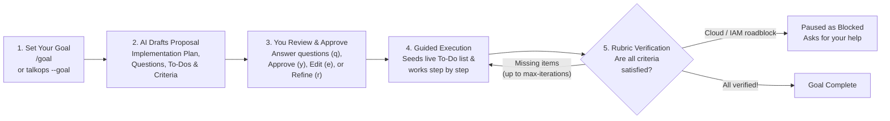
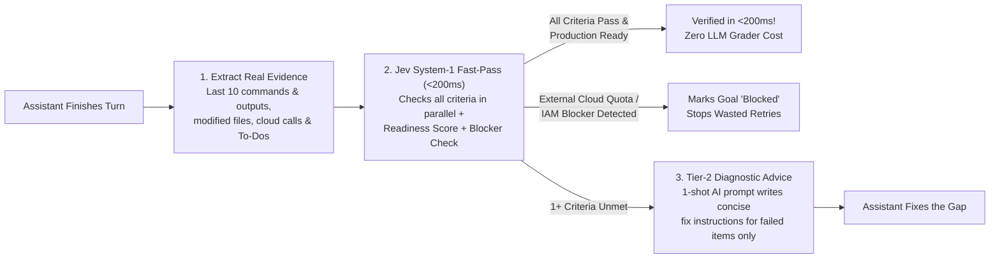

# Goals & Acceptance Rubrics

> Give TalkOps a plain-English goal or a pass/fail checklist. TalkOps plans the work, checks its own results after every step, and keeps going until every requirement is verified.

When you ask an AI assistant to handle a large multi-step project—like setting up a new Kubernetes service, refactoring a Terraform module, or auditing cloud security—two things often go wrong with ordinary chatbots:
1. **They jump straight into making changes** before aligning with you on the plan or asking clarifying questions.
2. **They stop too early**, claiming the job is "done" before verifying that tests pass, configurations are valid, or cloud resources are actually healthy.

TalkOps solves both problems with **Goals (`/goal`)** and **Rubrics (`/rubric` / `--rubric`)**:

<table>
  <tr>
    <td width="50%" valign="top">
      <h3>Plan &amp; Align Before Executing</h3>
      <p>Give TalkOps a high-level objective with <code>/goal</code>. Before changing anything, TalkOps drafts an <b>Implementation Plan</b>, asks any <b>Clarifying Questions</b>, builds a <b>Step-by-Step To-Do List</b>, and proposes a <b>Success Checklist</b> for your approval.</p>
    </td>
    <td width="50%" valign="top">
      <h3>Self-Checks Every Result</h3>
      <p>TalkOps doesn't just take the AI's word that a task is finished. At the end of a turn, an independent <b>Rubric Grader</b> inspects the commands run, files changed, and cloud outputs—automatically sending the agent back to fix anything it missed.</p>
    </td>
  </tr>
  <tr>
    <td width="50%" valign="top">
      <h3>Instant Verification in Smart Mode</h3>
      <p>When running in <b>Smart Mode</b> (<code>--smart</code>), <b>TypeSafe Jev</b> grades all of your acceptance criteria in parallel in <b>under 200ms</b>—cutting out slow, expensive AI-judge calls while catching cloud blockers automatically.</p>
    </td>
    <td width="50%" valign="top">
      <h3>CI/CD Quality Gates</h3>
      <p>In automated pipelines (<code>talkops -p ... --rubric</code>), TalkOps returns exit code <code>0</code> only when every checklist item passes, and exits with code <code>2</code> if any requirement is unmet—stopping broken changes before they merge.</p>
    </td>
  </tr>
</table>

---

## Goals vs. Rubrics: Which One Should You Use?

Both features use the same underlying verification engine, but they are designed for different workflows:

| Feature | How You Start It | Who Writes the Checklist? | Best For |
| :--- | :--- | :--- | :--- |
| **Goal Mode** | `/goal <objective>` in TUI<br>*(or `talkops --goal "<objective>"`)* | **TalkOps drafts it for you** (along with an Implementation Plan, To-Do steps, and Clarifying Questions) and asks for your approval | Multi-step interactive projects, infrastructure rollouts, and complex troubleshooting where you want to align on a plan first |
| **Persistent Rubric** | `/rubric set <criteria>`<br>or `/rubric file <path>` | **You provide it** (inline text or a Markdown file) | Enforcing standing team rules across a whole session (for example, *"Always run `terraform validate` and never open port 0.0.0.0/0"*) |
| **Next-Turn Rubric** | `/rubric next <criteria>` | **You provide it** for the next prompt only | Adding a quick, one-time quality check to your very next instruction |
| **Headless CI/CD Rubric** | `talkops -p "..." --rubric @checks.md` | **You provide it** in your CI script or repo | Automated pull-request checks, deployment verification, and nightly compliance audits in GitHub Actions, GitLab CI, or Jenkins |

---

## How Goal Mode (`/goal`) Works Step by Step

When you start a goal in the terminal, TalkOps guides the task from initial planning all the way to verified completion:



### 1. State your objective in plain English
Start a goal at launch or at any point during a conversation:

```bash
# Launch TalkOps with an initial goal
talkops --smart --goal "Audit our staging EKS cluster for crashing pods and fix any memory limit issues"
```

Or inside the interactive TUI:
```text
/goal Create a least-privilege IAM role for checkout-service to read from the prod-orders S3 bucket
```

### 2. Review the proposed Plan, Questions, To-Dos, and Criteria
Before the main assistant runs a single command that changes your environment, TalkOps's planning architect prepares a complete **Goal Proposal** and opens an interactive review card right in your terminal:

- **Implementation Plan**: A clear Markdown overview with a **Summary**, **Proposed Changes** (which files or cloud resources will be created, modified, or deleted), and a **Verification Plan**.
- **Clarifying Questions *(when needed)***: If your request has genuine trade-offs or missing details, TalkOps presents up to 3 multiple-choice questions (with the recommended choice listed first) so you can resolve them before work begins.
- **Tactical Execution Checklist (`write_todos`)**: 2 to 6 ordered steps that will populate TalkOps's live To-Do tracker once you approve.
- **Proposed Criteria (Verification Rubric)**: 2 to 5 concrete, observable outcomes that must be true before the goal can be marked complete.

From the review card, you can respond with a single keystroke:
- **`q` — Answer clarifying questions & refine plan**: Select your answers using the arrow keys (or choose *Other* to type a custom answer). TalkOps immediately updates the plan and checklist to reflect your choices.
- **`y` — Approve plan & start execution**: Locks in the goal, populates the live To-Do list, and starts executing Step 1 right away.
- **`e` — Edit plan / criteria**: Open an inline editor to tweak the acceptance criteria bullets yourself.
- **`r` — Refine plan with custom instructions**: Type plain-English feedback (for example, *"Skip the CloudWatch alarm step and use us-west-2"*) to have TalkOps revise the proposal.
- **`n` or `Esc` — Cancel**: Discard the proposal without starting.

### 3. Track progress across long sessions
Once you approve the proposal:
- **Live Status Bar & Goal Panel**: Your active goal is pinned in a status panel right above the chat input box and in the bottom status bar (`✓ Rubric set`, `⏸ Goal paused`, `⚠ Goal blocked`, or `✓ Goal complete`).
- **Automatic To-Do Tracking**: TalkOps automatically seeds its live To-Do checklist with your approved tactical steps, marking the first step `in_progress` and checking off each step as it goes.
- **Never Forgets the Goal**: Even if your conversation runs for dozens of turns, gets summarized with `/compact`, or is closed and resumed days later with `/resume`, TalkOps keeps your objective, approved implementation plan, and acceptance criteria pinned in the AI's active memory.

### 4. Built-in protection against premature "Done!" claims
The assistant is **not allowed** to close out a goal on its own:
- **Staged Completion (`update_goal`)**: When the assistant finishes its work and requests goal completion, TalkOps holds that request in a pending state until the **Rubric Grader** independently verifies every requirement.
- **Automatic Self-Correction**: If the grader finds that a test wasn't run, a file is incomplete, or a cloud check failed, TalkOps keeps the goal active, hands the missing items (and any unfinished To-Do steps) back to the assistant, and lets it fix the gap automatically.
- **Clear Blocker Alerts**: If the assistant runs into an external problem it cannot fix by itself—such as missing AWS IAM permissions, a cloud service quota, or conflicting instructions—the goal switches to **`⚠ Goal blocked`** and pauses so you can step in, adjust permissions, or amend the goal.

---

## How Smart Mode & TypeSafe Jev Accelerate Verification

In standard modes (`Manual` or `Auto`), checking a rubric at the end of a turn requires spinning up a separate AI grading agent to read the conversation history and judge each requirement. While thorough, a traditional AI grader can add several seconds of wait time and extra token costs after every turn.

When you run in **Smart Mode** (`talkops --smart` or `/smart`) with **TypeSafe Jev** configured, TalkOps uses a **two-tier hybrid verification engine** that makes grading nearly instantaneous:



### What happens behind the scenes in Smart Mode:

1. **Extracts real execution evidence (not chat fluff)**:
   Instead of feeding the entire raw conversation to the grader, TalkOps pulls out a clean, compact summary of what actually happened: the commands executed and their exit codes, files modified, cloud and MCP tool outputs, To-Do list progress, and any errors encountered.
2. **Grades every requirement in parallel in under 200ms (`Jev System-1 Fast-Pass`)**:
   TypeSafe Jev turns your checklist bullets into parallel verification checks and evaluates three things at the exact same time:
   - **Pass/Fail for Each Criterion**: Checks whether direct evidence in the command logs, file changes, or cloud queries proves each bullet is satisfied.
   - **Operational Readiness Score**: Rates the overall work from *Incomplete* to *Functional* to *Production Ready*.
   - **Environmental Blocker Detection**: Checks whether the assistant is making normal progress or is stuck on an external cloud blocker (such as an AWS quota limit, missing IAM permission, or network failure) or an ambiguous requirement.
3. **Stops wasted retries when blocked by the environment**:
   If Jev sees that a command failed because of an AWS IAM `AccessDenied` error or a service quota limit, TalkOps immediately marks the goal **`⚠ Goal blocked`** and alerts you—instead of burning through 3 retry loops running commands that can never succeed.
4. **Targeted fix instructions when something is missed (`Tier-2 Escalation`)**:
   - If all criteria pass, Jev approves the work in **under 200ms** without calling an LLM judge at all.
   - If any criterion is still incomplete, TalkOps sends *only the failing bullets* to your grading model to write 1–2 concise bullet points of remediation advice—telling the assistant the exact file, configuration, or verification command it still needs to run on the next turn.

---

## Managing Goals in the Terminal (`/goal`)

Once a goal is active, you can inspect, pause, resume, or adjust it at any time without losing your progress:

| Command | What It Does |
| :--- | :--- |
| `/goal <objective>` | Drafts an Implementation Plan, To-Do list, and Acceptance Criteria for a new goal (or amends your current goal if one is already active). |
| `/goal show` *(or `/goal status`)* | Shows the current goal objective, status (`active`, `paused`, `blocked`, `complete`), implementation plan, tactical To-Do steps, criteria, and grader settings. |
| `/goal amend <feedback>` | Updates the current goal's plan, To-Do list, and criteria based on your instructions (for example, `/goal amend skip the load test check`). |
| `/goal new <objective>` | Replaces an active goal with a brand-new goal objective. |
| `/goal pause` | Pauses the active goal so you can ask unrelated side questions without the goal driving the conversation or triggering grading. |
| `/goal resume` | Resumes a paused goal and continues from where you left off without repeating completed work. |
| `/goal clear` | Clears the active goal and its checklist from the thread (while keeping your grader model and iteration preferences). |
| `/goal model [provider:model\|clear]` | Sets (or resets) which AI model grades your criteria and writes diagnostic feedback. |
| `/goal max-iterations <N\|clear>` | Sets the maximum number of self-correction loops (default: `3`) before TalkOps stops and asks for your input. |

> [!TIP]
> **Conversational goal updates:** While a goal is active or blocked, you don't even need to type `amend`. Running `/goal skip the nginx syntax check` automatically updates your existing plan and removes that requirement from the checklist instead of wiping out your goal.

---

## Using Standalone Rubrics (`/rubric` & `--rubric`)

When you already have a specific pass/fail checklist—such as a team code-review standard, a production readiness checklist, or a CI/CD compliance gate—you can apply a **Rubric** directly without going through the `/goal` planning screen.

### 1. In the Interactive Terminal (`/rubric` or `/criteria`)

You can use `/rubric` (or its alias `/criteria`) to set either a **persistent session rubric** or a **one-turn rubric**:

```text
# Enforce a checklist across every turn in this session
/rubric set All Terraform changes must pass `terraform fmt -check` and `terraform validate`, and all IAM policies must use least-privilege actions.

# Enforce a checklist for your NEXT prompt only, then auto-clear
/rubric next Include a rollback command for every kubectl change you propose.

# Load a team checklist from a Markdown file
/rubric file ./rubrics/k8s-production-readiness.md

# Check or clear the active rubric
/rubric show
/rubric clear
```

### 2. In Automated CI/CD Pipelines (`talkops -p ... --rubric`)

In non-interactive scripts and CI/CD jobs (`-p` / `--prompt`), `--rubric` turns TalkOps into an **automated quality gate**. You can pass the checklist inline or load a file by prefixing the path with `@`:

```bash
# Pass inline acceptance criteria in Smart Mode
talkops --smart \
  -p "Upgrade the payments Helm chart to v2.14 and verify all pods are Ready" \
  --rubric "All pods in namespace prod-payments are Running; helm test passes with exit code 0; no ContainerCreating or CrashLoopBackOff events exist"

# Or load a detailed Markdown checklist from your repository (@path)
talkops --smart \
  -p "Audit our Terraform module in ./infra/vpc and fix any security issues" \
  --rubric @./rubrics/terraform-security.md \
  --rubric-max-iterations 4
```

### Cross-Model Grading (`--rubric-model`)

Want a fast, affordable model to do the heavy lifting, but a top reasoning model to grade the final result? Or want to ensure an AI model isn't "grading its own homework"?

Use `--rubric-model` (or `/rubric model` in the TUI) to assign a dedicated model for evaluation:

```bash
talkops -p "Refactor the billing Lambda handler and add unit tests" \
  --model openai:gpt-5.4-mini \
  --rubric @./rubrics/python-service.md \
  --rubric-model anthropic:claude-sonnet-4-6 \
  --rubric-max-iterations 3
```

### Deterministic Exit Codes for CI/CD

When you run `talkops -p ... --rubric` in GitHub Actions, GitLab CI, or Jenkins, TalkOps uses standard exit codes so your pipeline knows automatically whether the quality gate passed:

| Exit Code | Status | What Happened |
| :---: | :--- | :--- |
| **`0`** | `success` | All acceptance criteria in your rubric were verified (`satisfied`). |
| **`2`** | `criteria_unmet` | The assistant finished its allowed attempts (`--rubric-max-iterations`), but one or more criteria were still not met. |
| **`124`** | `timeout` / `max_turns` | The run hit the `--timeout` or `--max-turns` safety limit before finishing. |
| **`1`** | `error` | A configuration, authentication, or runtime error occurred. |

<details>
<summary><b>Example: Machine-readable JSON output for CI scripts (<code>--json</code>)</b></summary>

Adding `--json` outputs a clean JSON summary that includes `"status"` (`"success"` or `"criteria_unmet"`) and `"rubric_status"` (`"satisfied"` or `"needs_revision"`):

```bash
talkops --smart --json \
  -p "Verify that the staging database backup completed today" \
  --rubric "Latest RDS snapshot for staging-postgres is from today and has status 'available'"
```

```json
{
  "schema_version": "1.0",
  "command": "run",
  "ok": true,
  "data": {
    "status": "success",
    "thread_id": "8f3c1e2a-9b4d-4c1e-8a7b-2d5e6f7a8b9c",
    "turns": 2,
    "duration_seconds": 6.42,
    "rubric_status": "satisfied",
    "content": "Verified: RDS snapshot `rds:staging-postgres-2026-10-25-04-00` completed today and its status is `available`."
  }
}
```

</details>

---

## Tips for Writing Great Acceptance Criteria

Whether you are editing a `/goal` checklist or writing a reusable `.md` file for `--rubric`, a few simple habits make verification much more reliable:

1. **Describe observable outcomes, not internal thoughts**:
   - *Good*: `- Pod payments-api in prod is Running with 0 restarts`
   - *Avoid*: `- Understand why the pod was crashing and think about memory limits`
2. **State what *must* be true (avoid negative "do not" rules)**:
   - *Good*: `- Only read-only AWS CLI describe/list commands are used to verify the VPC`
   - *Avoid*: `- Execution completes without running any delete commands`
3. **Name exact files, commands, or health checks when they matter**:
   - *Good*: `- pytest tests/unit/test_auth.py passes with 0 failures`
   - *Good*: `- Terraform configuration in infra/eks passes terraform validate`

<details>
<summary><b>Sample Reusable Rubric File (<code>rubrics/k8s-rollout.md</code>)</b></summary>

```markdown
- Deployment manifest uses a specific version tag (not `:latest`) and defines CPU and memory requests and limits
- `kubectl rollout status` confirms the deployment rolled out completely in the target namespace
- All pods for the service are in `Running` status with `Ready` containers and `0` restarts
- Service health endpoint returns HTTP 200 OK
```

</details>

---

## Where to Go Next

- **[Approval Modes & Smart Mode](approval-mode.md)** — See how Smart Mode and TypeSafe Jev route models and guard tool execution.
- **[CLI & Slash Command Reference](cli-reference.md)** — Full reference for `--goal`, `--rubric`, `/goal`, and `/rubric` flags and commands.
- **[Webhooks & Automated Incident Response](webhooks.md)** — Trigger automated root-cause investigations from PagerDuty, Alertmanager, Datadog, AWS, and GitHub.
