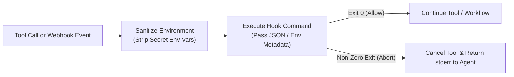

# Hooks

Hooks let external scripts observe, audit, and control TalkOps lifecycle events—across interactive TUI sessions, headless CI/CD runs, and centralized `talkops serve` webhook investigations (`src/talkops/hooks/` and `src/talkops/webhooks/dispatcher.py`).

When a matching tool call, subagent delegation, session event, or inbound webhook fires, TalkOps runs your configured shell commands in a sanitized environment (`sanitize_hook_environ`), passes structured context via JSON payloads and interpolation variables, and inspects the exit code or JSON decision to allow, modify, or abort execution.

> [!WARNING]
> Hooks execute shell commands with your user or server process permissions. Treat `.talkops/hooks.json` as executable code and only trust project hooks from repositories you have reviewed.

> [!NOTE]
> 📸 **Image Placeholder — `docs/assets/hooks-lifecycle-execution.png`**
> **What to capture:** Screenshot of TalkOps intercepting a `Write` or `Bash` tool call via a `PreToolUse` hook (e.g., running `terraform fmt` or blocking a hardcoded secret) and displaying the hook diagnostic banner in the TUI.

---

## Where hooks are configured

Declare hooks at the user-global or project-repository level:

| File Path | Scope | Trust Model |
| :--- | :--- | :--- |
| `~/.talkops/hooks.json` | User-global (applies to all workspaces and `talkops serve`) | Always trusted |
| `.talkops/hooks.json` | Project-level (checked into Git) | Prompts for interactive confirmation or requires `--trust-project-hooks` in headless mode |

---

## Supported hook events

TalkOps supports three categories of hook triggers:

### 1. Lifecycle & agent events (`Hooks v2` in `src/talkops/hooks/models/`)

| Event Name | When It Fires | Can Block / Modify Execution? |
| :--- | :--- | :--- |
| `SessionStart` | When a new interactive, headless, or remote session starts (`startup`, `resume`, `clear`, `compact`) | Can inject startup context |
| `UserPromptSubmit` | When a user submits a prompt before the orchestrator runs | Yes (can block or append context) |
| `PreToolUse` | Immediately before a tool executes (`Bash`, `Write`, `Edit`, `Read`, `Glob`, `Grep`, `LS`, `mcp__*`) | Yes (`allow`, `deny`, `ask`, or modify input) |
| `PermissionRequest` | When a tool triggers a human-in-the-loop permission interrupt | Yes (`allow` or `deny` programmatically) |
| `PostToolUse` | Immediately after a tool finishes successfully | Can append follow-up context |
| `PostToolUseFailure` | When a tool execution raises an error or non-zero exit code | Can inject diagnostic recovery hints |
| `SubagentStart` | When the orchestrator dispatches one of the 21 domain subagents | Can inject subagent instructions |
| `SubagentStop` | When a delegated subagent finishes its run | Can validate subagent output |
| `PreCompact` | Immediately before context compaction (`/compact` or auto-compact) | Can preserve custom state |
| `Stop` | When the main agent finishes responding to a turn | Can force continuation if checks fail |
| `Notification` | When TalkOps emits an operational notification | Observational |
| `SessionEnd` | When a session terminates (`exit`, `clear`, `logout`) | Observational |

### 2. Webhook ingestion events (`WebhookDispatcher` in `src/talkops/webhooks/dispatcher.py`)

When running `talkops serve` / `talkops webhooks`, the webhook dispatcher fires two dedicated lifecycle events:

| Event Name | When It Fires | Payload Fields Passed to Hook |
| :--- | :--- | :--- |
| **`webhook.received`** | Immediately when an actionable webhook is accepted (`202 Accepted`) and mapped to a LangGraph `thread_id` | `delivery_id`, `thread_id`, `provider`, `event_type`, `severity`, `title`, `incident_id`, `source_service`, `rbac_role` |
| **`webhook.completed`** | When the background LangGraph investigation finishes and outbound RCA sinks complete | `delivery_id`, `thread_id`, `provider`, `event_type`, `severity`, `title`, `incident_id`, `status` (`completed` or `failed`) |

### 3. Direct tool wire-name matchers (`src/talkops/hooks/tools.py`)

You can bind hooks directly to canonical tool wire names with `${input.<field>}` interpolation:

| Wire Tool Name | Internal Tool | Available `${input.<field>}` Variables |
| :--- | :--- | :--- |
| `Bash` | `execute` (shell command) | `command`, `timeout` |
| `Write` | `write_file` | `file_path`, `content` |
| `Edit` | `edit_file` | `file_path`, `old_string`, `new_string`, `replace_all` |
| `Read` | `read_file` | `file_path`, `offset`, `limit` |
| `Glob` | `glob` | `pattern`, `path` |
| `Grep` | `grep` | `pattern`, `path`, `glob`, `output_mode` |
| `LS` | `ls` | `path` |
| `mcp__<server>__<tool>` | External MCP tool call | Tool-specific input arguments |

---

## Execution flow & exit codes



- **Exit code `0`**: Execution proceeds normally.
- **Non-zero exit code**: For pre-execution hooks (`PreToolUse`, `Bash`, `Write`, `Edit`), TalkOps cancels the tool call, captures the hook's `stderr`, and feeds the message back to the agent so it can remediate the violation.
- **Secret Environment Sanitization (`sanitize_hook_environ`)**: TalkOps automatically strips sensitive LLM and cloud secret environment variables before spawning untrusted hook subprocesses while passing `TALKOPS_SESSION_ID`, `TALKOPS_TOOL_NAME`, `TALKOPS_TOOL_INPUT`, and `TALKOPS_TOOL_OUTPUT`.

---

## Practical DevOps examples

<details>
<summary><b>1. Auto-format Terraform and OpenTofu files on every write/edit</b></summary>

```json
{
  "hooks": {
    "Write": {
      "command": "if echo '${input.file_path}' | grep -qE '\\.(tf|tofu)$'; then tofu fmt '${input.file_path}' 2>/dev/null || terraform fmt '${input.file_path}' 2>/dev/null || true; fi"
    },
    "Edit": {
      "command": "if echo '${input.file_path}' | grep -qE '\\.(tf|tofu)$'; then tofu fmt '${input.file_path}' 2>/dev/null || terraform fmt '${input.file_path}' 2>/dev/null || true; fi"
    }
  }
}
```

</details>

<details>
<summary><b>2. Block file writes containing hardcoded AWS keys or GitHub tokens</b></summary>

```json
{
  "hooks": {
    "Write": {
      "command": "python3 -c \"import sys, re; content = open('${input.file_path}').read(); sys.exit(1) if re.search(r'(AKIA[0-9A-Z]{16}|ghp_[0-9a-zA-Z]{36})', content) else sys.exit(0)\""
    }
  }
}
```

</details>

<details>
<summary><b>3. Audit inbound production webhooks (`webhook.received` & `webhook.completed`)</b></summary>

Log every webhook-triggered incident investigation and its resulting LangGraph `thread_id` to a local SIEM file or metrics collector:

```json
{
  "hooks": {
    "webhook.received": {
      "command": "jq -c '. + {\"hook\": \"webhook.received\"}' >> /var/log/talkops/webhook-audit.jsonl"
    },
    "webhook.completed": {
      "command": "jq -c '. + {\"hook\": \"webhook.completed\"}' >> /var/log/talkops/webhook-audit.jsonl"
    }
  }
}
```

</details>

---

## Next steps

- **[Webhooks & Event-Driven Automation](webhooks.md)** — Configure `/webhooks/{provider}` and outbound RCA write-back sinks
- **[Configuration Guide](Configuration.md)** — Combine hooks with declarative `[security]` settings in `config.toml`
- **[Approval Modes & Jev Smart Mode](approval-mode.md)** — Pair deterministic hooks with `<100ms` Jev System One safety classification
