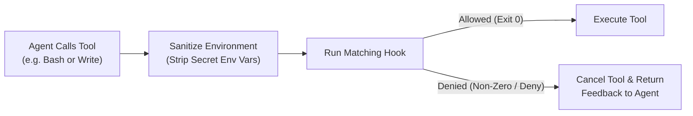

# Hooks

Hooks let you run custom shell commands or scripts automatically whenever key events happen in TalkOps—such as when a session starts, when a tool is about to run, when a deployment finishes, or when an incoming webhook investigation completes.

You can use hooks to enforce team guardrails (like auto-formatting Terraform files or blocking hardcoded secrets), stream audit logs to an external SIEM, or trigger custom notifications.

> [!WARNING]
> Hooks run shell commands on your machine using your user account permissions. Only enable hooks from scripts and repositories you trust.

---

## How Hooks Work

TalkOps supports two complementary hook styles in `~/.talkops/hooks.json` (as well as hooks bundled inside installed plugins under `<plugin>/hooks/hooks.json`):

1. **Event Notification & Audit Hooks** — Fire-and-forget or awaited scripts that receive a JSON event payload over `stdin` whenever operational events occur (such as `session.start`, `tool.use`, `terraform.apply`, or `webhook.completed`).
2. **Lifecycle & Tool Interception Hooks** — Targeted matchers that run before or after agent lifecycle steps (such as `PreToolUse`, `PostToolUse`, `UserPromptSubmit`, or `SubagentStart`) and can allow, block, or add context to a tool call.

### Built-In Environment Sanitization

Before TalkOps spawns any hook subprocess, it automatically strips environment variables whose names contain `KEY`, `TOKEN`, `SECRET`, `PASSWORD`, `APIKEY`, or `CREDENTIAL` (such as `OPENAI_API_KEY` or `AWS_SECRET_ACCESS_KEY`). This prevents external hook scripts from accidentally leaking your ambient cloud or LLM credentials.

---

## 1. Event Notification & Audit Hooks (`~/.talkops/hooks.json`)

To run a script whenever operational events occur, add a `"hooks"` array to `~/.talkops/hooks.json`. Each entry specifies:

- **`command`** — The executable and arguments as a JSON array of strings (for example, `["/usr/local/bin/audit-log.sh"]` or `["jq", "-c", "."]`).
- **`events`** — A list of event names to listen for (leave empty `[]` to run on every event).

```json
{
  "hooks": [
    {
      "command": ["/usr/local/bin/talkops-audit.sh"],
      "events": [
        "session.start",
        "session.end",
        "tool.use",
        "webhook.received",
        "webhook.completed"
      ]
    }
  ]
}
```

### How Your Script Receives Event Data

When a matching event fires, TalkOps runs your command (with a 5-second timeout) and passes:
- **`TALKOPS_HOOK_EVENT`** — An environment variable set to the event name (for example, `webhook.completed`).
- **`stdin`** — A single-line JSON object containing the event details (with `tool_output` truncated to 2,000 characters to keep payloads lightweight).

### Supported Notification Events

| Category | Event Name | When It Fires | Payload Fields Passed on `stdin` |
| :--- | :--- | :--- | :--- |
| **Session** | `session.start` | A new session starts | `session_id`, `model` |
| **Session** | `session.end` | A session ends | `session_id`, `duration_s` |
| **Session** | `user.prompt` | A user submits a prompt | Prompt metadata |
| **Session** | `context.compact` | Conversation history is compacted | Compaction summary metadata |
| **Tools & Tasks** | `tool.use` | A tool is invoked | `tool_name`, `tool_id`, `tool_args` |
| **Tools & Tasks** | `tool.result` | A tool finishes | `tool_name`, `tool_status`, `tool_output` |
| **Tools & Tasks** | `tool.error` | A tool raises an error | `tool_name`, `error` |
| **Tools & Tasks** | `permission.request` | A tool awaits human approval | Tool call details |
| **Tools & Tasks** | `task.complete` | A background or delegated task finishes | `summary` |
| **DevOps & Cloud** | `terraform.plan` / `terraform.apply` | Terraform plan or apply runs | Operation details |
| **DevOps & Cloud** | `helm.install` / `kubectl.apply` | Helm or Kubernetes rollout runs | Cluster & release details |
| **DevOps & Cloud** | `deploy.start` / `deploy.complete` | Deployment workflow starts or finishes | Deployment details |
| **DevOps & Cloud** | `aws.resource.create` / `update` / `delete` | AWS resource mutation event | Resource details |
| **Webhooks** | `webhook.received` | An incoming alert/webhook is accepted (`202 Accepted`) | `delivery_id`, `thread_id`, `provider`, `event_type`, `severity`, `title`, `incident_id` |
| **Webhooks** | `webhook.completed` | A background webhook investigation finishes | `delivery_id`, `thread_id`, `provider`, `event_type`, `severity`, `title`, `incident_id`, `status` |

---

## 2. Lifecycle & Tool Interception Hooks

For fine-grained control over agent execution, lifecycle hooks let you match specific tools and block or enrich actions before they happen.

### Lifecycle Events

| Event Name | When It Fires | What Your Hook Can Do |
| :--- | :--- | :--- |
| `SessionStart` | When a session starts, resumes, clears, or compacts | Inject initial context into the session |
| `UserPromptSubmit` | When you submit a prompt before the agent runs | Block the prompt or attach additional instructions |
| `PreToolUse` | Immediately before a tool executes | **Allow**, **deny** (cancel the tool call and return a message to the agent), or attach context |
| `PermissionRequest` | When a tool triggers an approval prompt | Programmatically **allow** or **deny** the approval request |
| `PostToolUse` | Immediately after a tool succeeds | Append follow-up notes or validation output |
| `PostToolUseFailure` | When a tool fails | Provide troubleshooting hints back to the agent |
| `SubagentStart` | When a specialized subagent is launched | Inject instructions for the subagent |
| `SubagentStop` | When a subagent completes its task | Validate the subagent's findings |
| `PreCompact` | Right before `/compact` or auto-compaction | Preserve key context |
| `Stop` | When the main agent finishes a turn | Request continuation if a required check was missed |
| `Notification` | When TalkOps sends a status notification | Observe notifications externally |
| `SessionEnd` | When the session closes or logs out | Run cleanup or logging scripts |

### Standardized Tool Names for Matchers

When writing a `matcher` pattern for `PreToolUse`, `PostToolUse`, or `PermissionRequest`, you can match against these standardized tool names (using an exact name, wildcard, or regex like `Write|Edit`):

| Matcher Name | Built-In Action | Input Fields |
| :--- | :--- | :--- |
| `Bash` | Shell command (`execute`) | `command`, `timeout` |
| `Write` | Create/overwrite file (`write_file`) | `file_path`, `content` |
| `Edit` | Edit existing file (`edit_file`) | `file_path`, `old_string`, `new_string`, `replace_all` |
| `Read` | Read file (`read_file`) | `file_path`, `offset`, `limit` |
| `Glob` | Find files by pattern (`glob`) | `pattern`, `path` |
| `Grep` | Search file contents (`grep`) | `pattern`, `path`, `glob`, `output_mode` |
| `LS` | List directory (`ls`) | `path` |
| `WebSearch` | Web search (`web_search`) | `query`, `max_results` |
| `WebFetch` | Fetch URL (`fetch_url`) | `url`, `timeout` |
| `mcp__<server>__<tool>` | External MCP server tool | Tool-specific arguments |



---

## Practical Examples

### Example 1: Log All Webhook Investigations to an Audit File

Save the following in `~/.talkops/hooks.json` to append every incoming and completed webhook investigation to a local JSON Lines log file:

```json
{
  "hooks": [
    {
      "command": [
        "sh",
        "-c",
        "cat >> ~/.talkops/webhook-audit.jsonl && echo '' >> ~/.talkops/webhook-audit.jsonl"
      ],
      "events": ["webhook.received", "webhook.completed"]
    }
  ]
}
```

### Example 2: Send a Desktop or Slack Alert When a Long Task Completes

```json
{
  "hooks": [
    {
      "command": [
        "sh",
        "-c",
        " SUMMARY=$(jq -r '.summary // \"Task finished\"'); osascript -e \"display notification \\\"$SUMMARY\\\" with title \\\"TalkOps\\\"\""
      ],
      "events": ["task.complete"]
    }
  ]
}
```

### Example 3: Lifecycle Matcher Configuration (`PreToolUse` & `PostToolUse`)

When configuring lifecycle matcher groups, group handlers under the lifecycle event name and specify a `matcher` pattern:

```json
{
  "hooks": {
    "PostToolUse": [
      {
        "matcher": "Write|Edit",
        "hooks": [
          {
            "type": "command",
            "command": "tofu fmt -recursive || true",
            "statusMessage": "Formatting Terraform files"
          }
        ]
      }
    ]
  }
}
```

---

## See Also

- **[Approval Modes](./approval-mode.md)** — Configure `manual`, `smart`, `auto`, and `yolo` approval policies and `/permissions` rules.
- **[Webhooks & Event-Driven Automation](./webhooks.md)** — Run automated incident investigations from GitHub, PagerDuty, Alertmanager, and Slack.
- **[Configuration Overview](./Configuration.md)** — Manage global and project settings.
