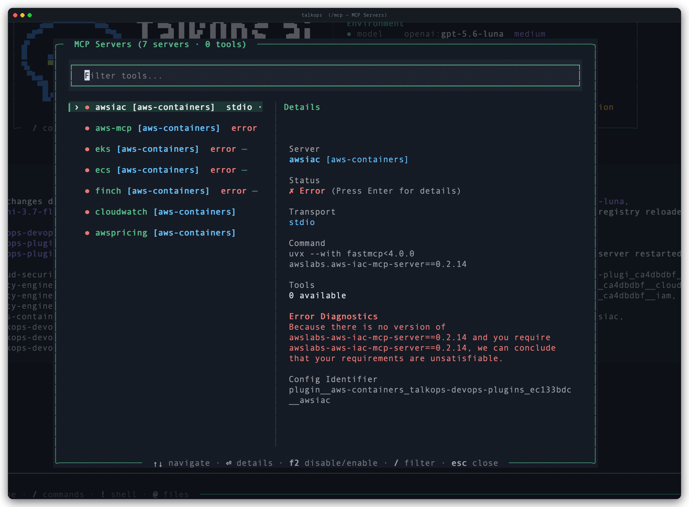

# MCP Tools

[Model Context Protocol (MCP)](https://modelcontextprotocol.io/) lets you extend TalkOps with external tool servers—such as Kubernetes cluster inspectors, AWS/GCP/Azure resource tools, GitHub/GitLab integrations, Grafana/Prometheus query servers, and internal developer platforms—without modifying TalkOps itself.

At startup, TalkOps automatically discovers your configured MCP servers, connects to them in the background, and makes their tools available to the agent alongside its built-in tools.

---

## Quickstart

### 1. Create an `.mcp.json` Configuration File

You can define MCP servers globally for all your projects in `~/.talkops/.mcp.json`, or inside a specific repository in `.mcp.json` (or `.talkops/.mcp.json`):

```bash
# User-wide MCP config (available in every directory)
mkdir -p ~/.talkops
touch ~/.talkops/.mcp.json

# Or project-scoped MCP config (shared with your team in Git)
touch .mcp.json
```

> [!TIP]
> **Claude Code & Cursor Compatible:** If your repository already has a `.mcp.json` file at the project root, TalkOps discovers and loads it automatically.

### 2. Define Your MCP Servers

Add your servers under the `mcpServers` key. TalkOps supports both local subprocess servers (`stdio`) and remote HTTP / SSE servers (`http` / `sse`), with `${VAR}` and `${VAR:-default}` environment variable expansion:

```json
{
  "mcpServers": {
    "kubernetes": {
      "command": "npx",
      "args": ["-y", "@kubernetes/mcp-server"],
      "env": {
        "KUBECONFIG": "${KUBECONFIG:-~/.kube/config}"
      }
    },
    "aws": {
      "command": "uvx",
      "args": ["awslabs.core-mcp-server@latest"],
      "env": {
        "AWS_PROFILE": "${AWS_PROFILE:-default}",
        "AWS_REGION": "${AWS_REGION:-us-east-1}"
      }
    },
    "internal-platform": {
      "transport": "http",
      "url": "https://mcp.internal.company.com/mcp",
      "headers": {
        "Authorization": "Bearer ${PLATFORM_MCP_TOKEN}"
      }
    }
  }
}
```

### 3. Inspect Your MCP Servers in TalkOps

Start an interactive session and run `/mcp` to open the two-pane **MCP Server & Tool Viewer**, where you can check connection status, browse every discovered tool, and inspect JSON input schemas:

```text
/mcp
```

Or test and list your MCP servers directly from the terminal:

```bash
# List all configured MCP servers and where they were discovered
talkops mcp list

# Actively connect to each server to verify health and count exposed tools
talkops mcp probe
```

---

## Where TalkOps Discovers MCP Configs

TalkOps merges MCP server configurations across five locations. If two files define a server with the same name, the higher-priority location wins:

| Priority | Scope | File Location(s) |
| :--- | :--- | :--- |
| **1 (Highest)** | **CLI Flag Override** | `--mcp-config <path>` passed when running `talkops` |
| **2** | **Project Configs** | `<repo>/.mcp.json`, `<repo>/mcp.json`, `<repo>/.talkops/.mcp.json`, `<repo>/.talkops/mcp.json` |
| **3** | **Plugin Configs** | `.mcp.json` / `mcp.json` bundled inside enabled plugins |
| **4** | **User TalkOps Configs** | `~/.talkops/.mcp.json`, `~/.talkops/mcp.json` |
| **5 (Lowest)** | **Global Shared Agent Configs** | `~/.agents/.mcp.json`, `~/.agents/mcp.json` |

---

## Server Configuration Options

Each server entry under `"mcpServers"` supports the following options:

| Field | Type | Applies To | Description |
| :--- | :--- | :--- | :--- |
| `command` | `string` | `stdio` | Executable to launch (`npx`, `uvx`, `python`, `docker`, or binary path). |
| `args` | `string[]` | `stdio` | Command-line arguments passed to `command`. |
| `env` | `object` | `stdio` | Environment variables passed to the server subprocess. |
| `url` | `string` | `http` / `sse` | Endpoint URL for remote HTTP or Server-Sent Events (SSE) MCP servers. |
| `transport` | `string` | All | `"stdio"`, `"http"`, or `"sse"` (inferred automatically from `command` vs. `url` if omitted). |
| `headers` | `object` | `http` / `sse` | Custom HTTP headers (such as `"Authorization": "Bearer ${TOKEN}"`). |
| `enabled` | `boolean` | All | Set to `false` (or `"disabled": true`) to temporarily disable a server without deleting its config. |
| `allowed_tools` | `string[]` | All | Optional allow-list of tool names to expose from this server. |
| `disabled_tools` | `string[]` | All | Optional block-list of tool names to hide from this server. |

### Environment Variable Expansion (`${VAR}`)

You can safely commit `.mcp.json` files to version control without hardcoding secrets or local paths by using braced environment references in `command`, `url`, `args`, `env`, and `headers`:

- **`${VAR}`** — Expands to the value of `VAR` in your environment (raises a clear configuration error if `VAR` is unset).
- **`${VAR:-default}`** — Expands to `VAR` if set and non-empty, or falls back to `default` (for example, `"${AWS_REGION:-us-east-1}"`).

### Automatic Cloud Context Synchronization

When TalkOps launches or reconnects to MCP servers, it automatically keeps your cloud environment variables in sync (`AWS_REGION`, `AWS_PROFILE`, `AZURE_SUBSCRIPTION_ID`, `GOOGLE_CLOUD_PROJECT`, `KUBECONFIG`, and `KUBE_CONTEXT`). When you switch cloud profiles mid-session using `/cloud`, your MCP tools follow your active cloud context.

---

## Managing MCP Servers in the TUI & CLI

### TUI Slash Commands (`/mcp`)

| Command | Description |
| :--- | :--- |
| `/mcp` | Opens the interactive two-pane **MCP Servers** modal. Navigate servers and tools on the left, view connection health, commands, and diagnostics on the right, press `F2` to toggle a server on or off, and press `Enter` on any item to view full details or JSON schemas. |
| `/mcp status` | Displays a quick summary of connected MCP servers and tool counts in the chat view. |
| `/mcp reconnect` *(or `/mcp reconnect --force`)* | Reconnects failed or disconnected MCP servers without restarting your session. |
| `/mcp login <server>` | Starts the authentication flow for an MCP server that requires sign-in (`▲ AUTH`). |
| `/tools` | Lists all discovered skills, built-in tools, and MCP server tools in the chat view. |
| `/reload` | Reloads `.mcp.json` changes from disk and refreshes server connections. |



### CLI Subcommands & Flags (`talkops mcp`)

| Command / Flag | Description |
| :--- | :--- |
| `talkops mcp list` *(or `talkops mcp`)* | Lists all configured MCP servers, their transport type, command/URL, and source. |
| `talkops mcp probe` *(or `talkops mcp status`)* | Connects to each configured server, verifies live health (`● OK`, `▲ AUTH`, `✗ ERR`), and counts exposed tools. |
| `talkops mcp probe --json` | Outputs the full server status and discovered tool schemas as JSON. |
| `talkops --mcp-config <path>` | Launches TalkOps with an explicit MCP configuration file. |
| `talkops --no-mcp` | Disables all MCP server connections for the current session. |
| `talkops --trust-project-mcp` | Trusts project-level `.mcp.json` files automatically (ideal for unattended CI/CD runs). |

---

## Context Efficiency & Security

### Automatic Eager vs. Lazy Tool Loading

Large cloud and DevOps MCP servers can expose dozens or even hundreds of tools. To keep your context window fast and avoid token bloat:

- **Small Tool Catalogs (Eager):** Tools are registered directly with the model so it can call them immediately.
- **Large Tool Catalogs (Lazy):** When active MCP tools exceed the inline threshold, TalkOps caches the tool schemas on disk and shows the agent a compact directory summary. The agent reads only the specific tool schema it needs and invokes it through `call_mcp_tool`.
- **Smart Argument Cleanup:** Many MCP servers strictly reject empty strings (`""`) for optional parameters. TalkOps automatically normalizes tool arguments before sending them to the MCP server.

### Project Config Trust (`SHA-256` Verification)

- **User-level configs** (`~/.talkops/.mcp.json`) are trusted automatically because they live in your home directory.
- **Project-level configs** (`<repo>/.mcp.json`) can specify arbitrary shell commands, so TalkOps verifies them using a **SHA-256 file fingerprint** stored in `~/.talkops/.state/mcp_trust.json`.
- If a repository's `.mcp.json` file is modified (for example, after `git pull`), its SHA-256 fingerprint changes and TalkOps prompts you to approve the updated configuration before running it. For unattended CI/CD pipelines, pass `--trust-project-mcp`.

### Headless Mode Protection

When running non-interactively (`talkops -n "..."`), there is no interactive UI to prompt for confirmation. TalkOps automatically checks each MCP tool's read-only and destructive annotations:
- **Read-only MCP tools** (such as listing pods, describing EC2 instances, or querying metrics) execute normally.
- **Mutating or destructive MCP tools** are blocked in headless mode unless your approval mode permits them.

---

## Troubleshooting

<details>
<summary><b>An MCP server shows <code>✗ ERR</code> or fails to start</b></summary>

1. Run `talkops mcp probe` from your terminal or open `/mcp` in the TUI and select the failed server to view the exact startup error.
2. Verify that the server's binary (`npx`, `uvx`, `python`, `docker`) is installed and on your `PATH` by running `talkops doctor`.
3. If your `.mcp.json` uses `${VAR}` placeholders, make sure those environment variables are exported in your shell or `.env` file (or provide a fallback with `${VAR:-default}`).

</details>

<details>
<summary><b>New tools don't appear after editing <code>.mcp.json</code></b></summary>

- Inside an active TUI session, run `/reload` or `/mcp reconnect --force` to re-read `.mcp.json` and refresh connections.

</details>

<details>
<summary><b>Project MCP servers are skipped during non-interactive (<code>-n</code>) runs</b></summary>

- Because non-interactive mode cannot display a trust prompt for an unapproved `.mcp.json`, either launch `talkops` interactively once in that repository to approve the file, or pass `--trust-project-mcp` on the command line.

</details>

---

## See Also

- **[Approval Modes](./approval-mode.md)** — Control how mutating tools and MCP calls are approved.
- **[Plugins & Marketplaces](./plugins.md)** — Install domain plugins that bundle pre-configured MCP servers and skills.
- **[Subagents](./subagents.md)** — Use specialized subagents with their own isolated MCP servers.
- **[Configuration Overview](./Configuration.md)** — Manage global and project settings.
