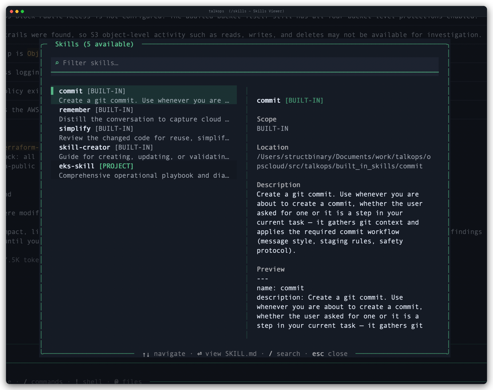

# Memory and Skills

TalkOps gives you two complementary ways to customize how the agent works in your environment and retain operational knowledge across sessions:

- **[Memory](#memory)** — Persistent `AGENTS.md` files and key-value memory entries that load automatically at the start of every session. Use memory for your team's infrastructure conventions, naming standards, preferred regions, and lessons learned.
- **[Skills](#skills)** — Reusable, on-demand playbooks (`SKILL.md` directories) that package step-by-step operational procedures, troubleshooting runbooks, reference docs, and helper scripts.

At any point during a conversation, you can run **`/remember`** to have TalkOps distill what you just solved into either persistent memory or a reusable skill.

---

## Memory

Memory ensures you never have to repeat your environment rules—such as which AWS profiles to use, how Terraform workspaces are structured, or which tags are required on every resource.

### Capturing Learnings with `/remember`

As you work with TalkOps—especially after troubleshooting a tricky incident or correcting how a command should be run—use `/remember` to save the takeaway for future sessions:

```text
# Let TalkOps review the current conversation and extract key conventions automatically
/remember

# Or tell TalkOps specifically what to remember
/remember Our S3 buckets always require KMS customer-managed keys and bucket-owner-enforced ownership
```

When you run `/remember`, TalkOps analyzes the conversation and decides the best place to store each takeaway:
- Simple preferences, rules, and environment facts are added to **`AGENTS.md`**.
- Repeatable, multi-step operational procedures are packaged into a new **Skill** (`SKILL.md`).

---

### Two Layers of Memory

TalkOps combines two types of persistent memory at session startup:

#### 1. `AGENTS.md` Files (Always-On Instructions)

[`AGENTS.md`](https://agents.md/) files are plain Markdown documents loaded directly into the agent's instructions at the start of every session:

| Scope | File Locations | Best Used For |
| :--- | :--- | :--- |
| **Project** *(shared with team)* | `.talkops/AGENTS.md` or `AGENTS.md` *(in repo root)* | Repository architecture, environment names (`dev`, `staging`, `prod`), Terraform backend conventions, required resource tags, and Kubernetes cluster rules. Commit this file to Git so your whole team benefits. |
| **User / Global** *(personal)* | `~/.talkops/AGENTS.md` or `~/.talkops/agents/talkops/AGENTS.md` | Your personal communication style, default cloud profile preferences, and cross-repository DevOps habits (for example, preferring `tofu` over `terraform` or always running dry-run diffs first). |

> [!NOTE]
> **Built-in Memory Protection:** TalkOps automatically protects your `AGENTS.md` files from accidental deletion by the agent, and preserves system-managed onboarding blocks while allowing the agent to append new preferences and operational lessons when you run `/remember`.

#### 2. Key-Value Memory Entries (`.talkops/memory/`)

In addition to `AGENTS.md`, you can store focused topic notes as individual Markdown files (`<key>.md`):

| Scope | Directory | Priority |
| :--- | :--- | :--- |
| **Project** | `<repo>/.talkops/memory/` | **Higher** — overrides a user memory entry with the same key when running inside that project. |
| **User (Global)** | `~/.talkops/memory/` | **Fallback** — loaded in every session across all directories. |

To keep your context window fast and lean, TalkOps caps injected key-value memories at **250 lines** (or **30 KB**) per session.

---

### Managing Memory in the TUI (`/memory`)

Use the `/memory` command inside an interactive session to inspect, search, or manage your stored memories:

| Command | Description |
| :--- | :--- |
| `/memory` *(or `/remember`)* | Extracts learnings from the current conversation and saves them to memory or skills. |
| `/memory show` *(or `/memory list`)* | Displays active `AGENTS.md` files and lists all saved key-value memory entries. |
| `/memory search <query>` | Searches across both your `AGENTS.md` files and `.talkops/memory/` entries for a keyword. |
| `/memory get <key>` | Displays the full content of a specific memory entry. |
| `/memory save <key> <content>` | Saves a key-value memory directly (writes to `.talkops/memory/<key>.md` in a project, or `~/.talkops/memory/<key>.md` globally). |
| `/memory delete <key>` | Deletes a stored memory entry by key. |
| `/memory clear` | Removes all stored key-value memory entries. |

---

## Skills

While memory tells the agent *what* conventions to follow, **Skills** teach the agent *how* to execute specialized workflows—such as auditing Kubernetes manifests, diagnosing ECS crash loops, or rotating IAM credentials.

### Why Skills Are Flexible & Context-Efficient

TalkOps implements the open [Agent Skills specification](https://agentskills.io/) with several capabilities designed for real-world cloud operations:

1. **Progressive Disclosure (3-Level Loading)**
   Instead of stuffing every runbook into the system prompt at startup, TalkOps loads skills in three stages:
   - **Stage 1 (Startup):** Only the compact `name` and `description` from each skill's YAML frontmatter are shown to the agent.
   - **Stage 2 (On Trigger):** When your request matches a skill's description (or you invoke `/skill:<name>`), the agent reads the full `SKILL.md` playbook.
   - **Stage 3 (On Demand):** Optional reference files (`references/`) and helper scripts (`scripts/`) inside the skill folder are only read or executed when a specific step requires them.
2. **Automatic Hot-Reloading**
   Whenever you or the agent create or edit a `SKILL.md` file mid-session—or when you run `/reload`—TalkOps automatically refreshes the active skill catalog on the very next turn without restarting.
3. **Subagent & Workspace Isolation**
   Skills bundled inside specialized subagent plugins stay scoped to that subagent so they don't clutter your main session, while project-level skills stay isolated to their repository.

---

### Skill Discovery & Precedence

TalkOps discovers skills from multiple directories. If two locations define a skill with the same name, the higher-priority location wins:

| Priority | Scope | Directory | Purpose |
| :--- | :--- | :--- | :--- |
| **1 (Highest)** | **Project Agent Skills** | `.agents/skills/` *(and `.claude/skills/`)* | Portable project skills shared across AI coding and ops assistants. |
| **2** | **Project TalkOps Skills** | `.talkops/skills/` | Project-specific runbooks and workflows committed to your repository. |
| **3** | **User Agent Skills** | `~/.agents/skills/` *(and `~/.claude/skills/`)* | Personal skills shared across tools on your machine. |
| **4** | **User TalkOps Skills** | `~/.talkops/agents/talkops/skills/` | Personal TalkOps skills created via `talkops skills create`. |
| **5** | **Plugin Skills** | Installed plugins (`~/.talkops/plugins/`, `.talkops/plugins/`) | Domain skills provided by enabled plugins (namespaced as `<plugin>:<skill>`). |
| **6 (Lowest)** | **Built-in Skills** | Bundled with TalkOps | Core utility skills (`remember`, `skill-creator`, `commit`, `simplify`). |

---

### Browsing & Invoking Skills

Skills activate automatically whenever your prompt matches their description, or you can browse and trigger them directly.

#### Inside the TUI

| Command | Description |
| :--- | :--- |
| `/skills` | Opens the interactive two-pane **Skills Viewer** modal—filter skills on the left, inspect scope, location, description, and preview on the right, and press `Enter` to read the full `SKILL.md` playbook. |
| `/tools` | Prints a summary of all discovered skills, core built-in tools, and connected MCP server tools in the chat view. |
| `/skill:<name> [args]` | Explicitly invokes a skill by name (for example, `/skill:commit`, `/skill:simplify`, or `/skill:eks-skill check node groups`). |
| `/skill-creator [args]` | Launches the built-in interactive **Skill Creator** assistant to design, scaffold, or refine a skill right from your conversation. |



#### From the CLI at Launch (`-s` / `--skill`)

You can pre-load and invoke a skill when launching an interactive or non-interactive session:

```bash
# Launch an interactive session with a skill pre-loaded
talkops -s eks-runbook

# Run a headless one-shot task using a specific skill
talkops -s eks-runbook -n "Audit all deployments in k8s/prod/ for missing resource limits"
```

---

### Creating Your Own Skill

You can create a new skill either conversationally in the TUI (by running `/skill-creator` or `/remember`) or from your terminal with `talkops skills create`.

#### 1. Scaffold a Skill Directory

```bash
# Create a personal skill (available across all your projects)
talkops skills create eks-runbook

# Or create a project skill inside the current repo (.talkops/skills/eks-runbook)
talkops skills create eks-runbook --project
```

A skill directory can include a required `SKILL.md` file along with optional supporting folders:

```text
eks-runbook/
├── SKILL.md          # Required — YAML frontmatter + step-by-step instructions
├── scripts/          # Optional — executable Python/Bash helper scripts
├── references/       # Optional — detailed docs, schemas, or cloud policies loaded on demand
└── assets/           # Optional — starter templates or manifests copied into outputs
```

#### 2. Write the `SKILL.md` Playbook

Every `SKILL.md` starts with YAML frontmatter (`name` and `description`). Because the agent uses `description` to decide when to activate the skill, make sure it clearly states **what** the skill does and **when** to trigger it:

```markdown
---
name: eks-runbook
description: "Diagnose and remediate AWS EKS node and pod issues, and audit Kubernetes manifests against production readiness standards. Use when troubleshooting EKS clusters or reviewing k8s YAML files."
---

# EKS Production Runbook

## Operational Procedure
1. Verify the active AWS profile and Kubernetes context before running cluster commands.
2. When authoring or reviewing workloads:
   - Define explicit CPU and memory `requests` and `limits`.
   - Configure `readinessProbe` and `livenessProbe` on all long-running services.
   - Enforce `runAsNonRoot: true` in the pod `securityContext`.
3. For node-level networking issues, read [VPC_CNI.md](references/VPC_CNI.md) before modifying daemonsets.
```

---

### Managing Skills from the CLI (`talkops skills`)

Use the `talkops skills` (or `talkops skill`) CLI command suite to inspect and manage skills from your terminal:

```bash
# List all discovered user, project, plugin, and built-in skills
talkops skills list

# List only project-scoped skills in the current repository
talkops skills list --project

# View metadata, path, and full instructions for a specific skill
talkops skills info eks-runbook

# Delete a skill (add --project for project skills, or --force to skip confirmation)
talkops skills delete eks-runbook
```

#### Managing Trusted External Skill Directories

To prevent untrusted symlinks inside a skill folder from reading arbitrary files outside your standard skill directories, TalkOps verifies that every `SKILL.md` resolves inside a trusted root. If a skill points to an external directory, TalkOps prompts you once for approval and records your decision in `~/.talkops/.state/skill_trust.json`.

You can inspect or revoke trusted external skill directories at any time:

```bash
# List external directories you have approved for skills
talkops skills trust list

# Revoke trust for a specific external directory
talkops skills trust revoke /path/to/external/skills

# Clear all trusted external skill directories
talkops skills trust clear
```

---

## See Also

- **[Custom Commands](./custom-commands.md)** — Define parameterized `/command` shortcuts with inline shell execution.
- **[Subagents](./subagents.md)** — Delegate isolated multi-step tasks to specialized subagents.
- **[Plugins & Marketplaces](./plugins.md)** — Install full-featured domain plugins that bundle skills, subagents, and MCP servers.
- **[Configuration Overview](./Configuration.md)** — Manage your global and project settings.
