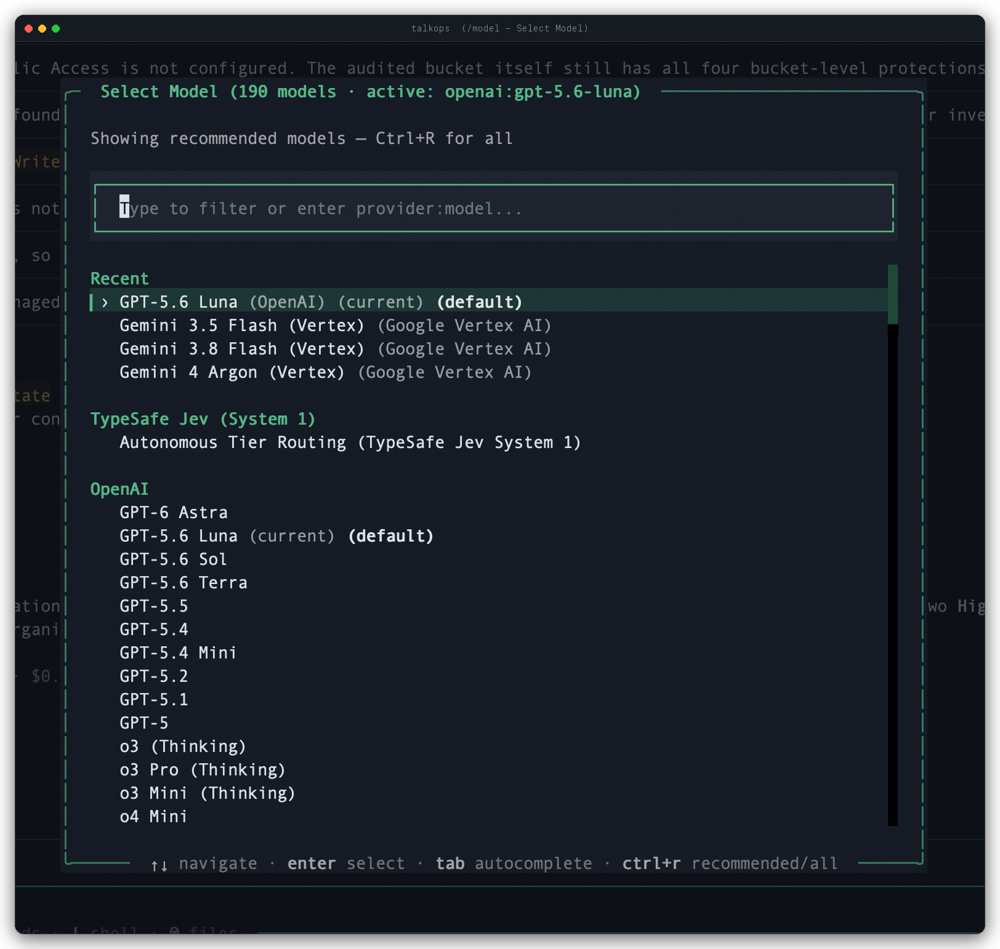
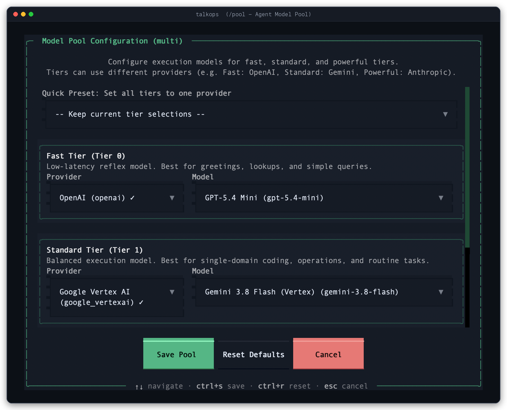

# Model Providers

TalkOps is model-agnostic and supports over 25 cloud, API, and local LLM providers out of the box. You can switch models mid-conversation, adjust reasoning depth on the fly, or let **Smart Mode** route each step across a 3-tier model pool.

All models in TalkOps use the `<provider>:<model>` naming format—for example:
- `anthropic:claude-sonnet-4-5`
- `openai:gpt-5.2`
- `google_genai:gemini-2.5-pro`
- `ollama:qwen3:8b`

---

## Supported Model Providers

| Provider | Prefix | Environment Variable / Auth Source | Example `<provider>:<model>` |
| :--- | :--- | :--- | :--- |
| **Anthropic** | `anthropic` | `ANTHROPIC_API_KEY` | `anthropic:claude-sonnet-4-5` |
| **OpenAI** | `openai` | `OPENAI_API_KEY` | `openai:gpt-5.2` |
| **OpenAI Codex (ChatGPT Subscription)** | `openai_codex` | `OPENAI_CODEX_ACCESS_TOKEN` *(or ChatGPT OAuth)* | `openai_codex:gpt-5.3-codex` |
| **Google Gemini** | `google_genai` | `GOOGLE_API_KEY` | `google_genai:gemini-2.5-pro` |
| **Google Vertex AI** | `google_vertexai` | `GOOGLE_CLOUD_PROJECT` *(or `GOOGLE_APPLICATION_CREDENTIALS`)* | `google_vertexai:gemini-2.5-pro` |
| **Anthropic on Vertex AI** | `google_anthropic_vertex` | `GOOGLE_CLOUD_PROJECT` *(or `GOOGLE_APPLICATION_CREDENTIALS`)* | `google_anthropic_vertex:claude-sonnet-4-5@20250929` |
| **AWS Bedrock** | `bedrock` | AWS Credentials (`AWS_PROFILE` / `AWS_REGION`) | `bedrock:us.anthropic.claude-sonnet-4-5-20250929-v1:0` |
| **Azure OpenAI** | `azure_openai` | `AZURE_OPENAI_API_KEY` + `AZURE_OPENAI_ENDPOINT` | `azure_openai:gpt-4.1` |
| **DeepSeek** | `deepseek` | `DEEPSEEK_API_KEY` | `deepseek:deepseek-reasoner` |
| **Groq** | `groq` | `GROQ_API_KEY` | `groq:llama-3.3-70b-versatile` |
| **OpenRouter** | `openrouter` | `OPENROUTER_API_KEY` | `openrouter:anthropic/claude-sonnet-4-5` |
| **Mistral AI** | `mistralai` | `MISTRAL_API_KEY` | `mistralai:mistral-large-latest` |
| **xAI (Grok)** | `xai` | `XAI_API_KEY` | `xai:grok-4` |
| **Fireworks AI** | `fireworks` | `FIREWORKS_API_KEY` | `fireworks:accounts/fireworks/models/deepseek-v3` |
| **Together AI** | `together` | `TOGETHER_API_KEY` | `together:meta-llama/Llama-3.3-70B-Instruct-Turbo` |
| **Cerebras** | `cerebras` | `CEREBRAS_API_KEY` | `cerebras:llama-3.3-70b` |
| **SambaNova** | `sambanova` | `SAMBANOVA_API_KEY` | `sambanova:Meta-Llama-3.3-70B-Instruct` |
| **Cohere** | `cohere` | `COHERE_API_KEY` | `cohere:command-a-03-2025` |
| **Perplexity** | `perplexity` | `PPLX_API_KEY` | `perplexity:sonar-reasoning-pro` |
| **NVIDIA NIM** | `nvidia` | `NVIDIA_API_KEY` | `nvidia:meta/llama-3.3-70b-instruct` |
| **Baseten** | `baseten` | `BASETEN_API_KEY` | `baseten:deepseek-ai/DeepSeek-R1` |
| **Hugging Face** | `huggingface` | `HUGGINGFACEHUB_API_TOKEN` | `huggingface:Qwen/Qwen2.5-Coder-32B-Instruct` |
| **IBM watsonx.ai** | `ibm` | `WATSONX_APIKEY` | `ibm:ibm/granite-3-8b-instruct` |
| **LiteLLM Proxy** | `litellm` | `LITELLM_API_KEY` | `litellm:gpt-4o` |
| **Ollama (Local)** | `ollama` | Local Ollama daemon (`OLLAMA_HOST`, default `http://localhost:11434`) | `ollama:qwen3:8b` |

---

## Switching Models & Setting a Default

### Inside the TUI (`/model`)

Use the `/model` slash command to browse or switch models without losing your current conversation history:

| Command | Description |
| :--- | :--- |
| `/model` | Opens the interactive **Select Model** modal, where you can search by keyword, press `Ctrl+R` to toggle between recommended models and the full catalog, and pick a model (or select **Autonomous Tier Routing**). |
| `/model <provider:model>` | Immediately switches your active session to the specified model (for example, `/model openai:gpt-5.2`). |
| `/model --default <provider:model>` | Saves the model as your persistent startup default in `~/.talkops/config.toml` under `[models].default`. |
| `/model --default --clear` | Clears your saved startup default from `~/.talkops/config.toml`. |



### From the CLI at Launch (`-M` / `--model`)

To start a session or run a one-shot prompt with a specific model, pass `-M` (or `--model`):

```bash
# Start an interactive TUI session with Claude Opus 4.6
talkops -M anthropic:claude-opus-4-6

# Run a single non-interactive command with Gemini 2.5 Flash
talkops -M google_genai:gemini-2.5-flash -n "Check which pods are restarting in the staging namespace"
```

---

## Reasoning Effort & Fast Mode

### Adjusting Reasoning Depth (`/effort`)

For models that support extended thinking or reasoning budgets (such as Claude 4.5/4.6, OpenAI o-series / GPT-5, Gemini 2.5, and DeepSeek R1), you can control how much reasoning effort the model spends on each turn:

| Command | Description |
| :--- | :--- |
| `/effort` | Opens the interactive **Reasoning Effort** selector modal. |
| `/effort low` | Minimal thinking time for fast, straightforward answers. |
| `/effort medium` | Balanced reasoning depth and speed (recommended for everyday work). |
| `/effort high` | Deep reasoning for complex infrastructure debugging and multi-step planning. |
| `/effort max` | Maximum extended thinking budget for the hardest architectural or root-cause analysis tasks. |
| `/effort off` *(or `/effort clear`)* | Disables custom effort overrides and uses the model's standard default. |

### Toggling Fast Mode (`/fast`)

When you need quick answers or rapid command lookups, toggle **Fast Mode** by running `/fast` (or pressing `Ctrl+F`):

- **Fast Mode ON (`⚡`)** — Temporarily switches your session to your provider's fast model (such as `claude-haiku-4-5`, `gpt-5-mini`, or `gemini-2.5-flash`) with `low` reasoning effort.
- **Fast Mode OFF** — Restores your previous primary model and reasoning effort level.

---

## Smart Mode & the 3-Tier Agent Model Pool (`/pool`)

When you enable **Smart Mode** (`/approval smart`) with a `TYPESAFE_API_KEY` configured, TalkOps can automatically route each step of your workflow across a 3-tier model pool based on task complexity:

1. **Fast (`fast`)** — Lightweight, low-latency model for quick status checks, log inspection, and simple formatting.
2. **Standard (`standard`)** — Balanced model for everyday infrastructure queries, YAML/Terraform edits, and tool calls.
3. **Powerful (`powerful`)** — Frontier reasoning model for complex root-cause analysis, multi-service architecture planning, and high-stakes changes.



### Managing Your Model Pool

You can customize the 3-tier pool interactively in the TUI or in `~/.talkops/config.toml`:

```text
# Open the interactive Configure Agent Model Pool modal
/pool

# View your active Fast, Standard, and Powerful tier assignments
/pool status

# Assign specific models (even across different providers) from the chat bar
/pool set fast=google_genai:gemini-2.5-flash standard=anthropic:claude-sonnet-4-5 powerful=openai:gpt-5.2

# Reset back to automatic tier discovery
/pool clear
```

Or define it permanently in `~/.talkops/config.toml`:

```toml
[agent_pool]
provider = "multi"
fast = "google_genai:gemini-2.5-flash"
standard = "anthropic:claude-sonnet-4-5"
powerful = "anthropic:claude-opus-4-6"
```

---

## Running Local & Custom Endpoints

### Local Models with Ollama

TalkOps works with local models running through [Ollama](https://ollama.com) without requiring an API key:

```bash
# 1. Pull a tool-capable model in Ollama
ollama pull qwen3:8b

# 2. Launch TalkOps with your local model
talkops -M ollama:qwen3:8b
```

If your Ollama server runs on another host or port, set `OLLAMA_HOST=http://your-host:11434` or save it with `talkops auth set ollama --base-url http://your-host:11434`.

### Custom OpenAI-Compatible Gateways

If your organization hosts models behind vLLM, LM Studio, or an internal OpenAI-compatible proxy, add a custom provider entry to `~/.talkops/config.toml`:

```toml
[models.providers.vllm_local]
class_path = "langchain_openai:ChatOpenAI"
base_url = "http://localhost:8000/v1"
api_key_env = "VLLM_API_KEY"
models = ["Qwen/Qwen2.5-Coder-32B-Instruct"]
```

You can then switch to it anytime with `/model vllm_local:Qwen/Qwen2.5-Coder-32B-Instruct`.
