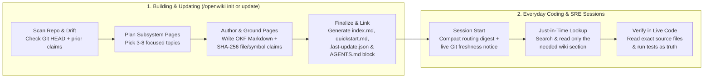

# OpenWiki: Durable Codebase Knowledge for AI Agents

> Build and maintain a living Markdown wiki (`openwiki/`) right inside your repository—so TalkOps understands your architecture in seconds instead of rediscovering it on every session.

Every time you start a new conversation in a real-world DevOps or application repository, an ordinary AI assistant starts from scratch. It runs dozens of `glob`, `grep`, and file reads just to piece together where services live, how Terraform modules wire together, which files own authentication, and what commands verify a change. On a large codebase, that repeated rediscovery burns both time and tokens before any actual work begins.

**OpenWiki** solves this by compiling a curated, Git-versioned Markdown wiki inside `openwiki/`. Humans can read the same Markdown pages, **but AI agents are the primary audience**: instead of blindly scanning your entire repo on every task, TalkOps checks a compact routing table first, reads only the exact wiki section it needs, and jumps straight to the authoritative source files.

<table>
  <tr>
    <td width="50%" valign="top">
      <h3>Faster Orientation, Fewer Tokens</h3>
      <p>Instead of running 20 searches to map your repository on every session, TalkOps loads a compact routing guide (<code>openwiki/quickstart.md</code>) and your team's standing rules (<code>openwiki/INSTRUCTIONS.md</code>), then drills straight into the right files.</p>
    </td>
    <td width="50%" valign="top">
      <h3>Self-Correcting via Grounded Claims</h3>
      <p>Traditional docs rot the week they are written. OpenWiki anchors every page to real files, line ranges, and symbols using SHA-256 hashes—automatically detecting drift whenever your codebase moves ahead.</p>
    </td>
  </tr>
  <tr>
    <td width="50%" valign="top">
      <h3>Just-in-Time Retrieval, Zero Bloat</h3>
      <p>Wiki search is local, read-only, and model-free. TalkOps pulls only the specific page sections relevant to your question, stops once grounded, and always treats live source code and tests as the final source of truth.</p>
    </td>
    <td width="50%" valign="top">
      <h3>Built Directly Into TalkOps</h3>
      <p>No separate Node CLI or external MCP daemon to install or keep running. Use <code>/openwiki</code> inside chat for rich agent-authored docs, or <code>talkops openwiki</code> from your terminal and CI pipelines for fast deterministic updates.</p>
    </td>
  </tr>
</table>

---

## Understanding the Basics

TalkOps implements the [LangChain OpenWiki](https://docs.langchain.com/oss/openwiki/overview) model natively in Python. Four core ideas make an agent wiki fundamentally different from a traditional README or static docs site:

1. **Agent-First Markdown (Open Knowledge Format v0.2)**
   Each subsystem gets its own clean Markdown page (`openwiki/<slug>.md`) with YAML frontmatter, `[[wikilink]]` cross-references, and a map of exact repository-relative source paths. An auto-generated `openwiki/quickstart.md` acts as a compact routing table pointing each subsystem to its page.
2. **Optional, Just-in-Time Context**
   Stuffing an entire wiki into every prompt would waste tokens and crowd out real code. Instead, TalkOps keeps the wiki lightweight: retrieval tools (`openwiki_search` and `openwiki_read`) stay hidden unless a wiki exists, never trigger hidden LLM calls, and fetch only the sections needed to answer an architectural question.
3. **Grounded Claims (Why the Wiki Doesn't Silently Go Stale)**
   Rather than tracking only *when* a Markdown file was written, OpenWiki records the concrete facts backing each page in machine-managed sidecar files (`openwiki/.claims/*.json`). Every claim ties back to a real file, line range, or code/IaC symbol with a SHA-256 content hash. When commits or uncommitted edits change those files, TalkOps knows **which specific claims and pages drifted**—so incremental updates only refresh what actually changed.
4. **Your Team Steers Scope & Read Boundaries**
   - **`openwiki/INSTRUCTIONS.md`** is your human-authored brief: standing conventions, architectural priorities, and build/test commands. Normal `init` and `update` runs read it without overwriting your edits.
   - **`.openwikiignore`** defines a read boundary (using standard glob rules like `.terraform/`, `*.tfstate`, `dist/`, `node_modules/`, or `secrets/`) so private or generated paths stay out of your wiki.

---

## How OpenWiki Works in TalkOps

OpenWiki cleanly separates **building the wiki** from **using the wiki day to day**:



- **When you run `/openwiki init` or `/openwiki update` in chat**: TalkOps scaffolds `.openwikiignore` and `openwiki/INSTRUCTIONS.md`, compiles an immediate deterministic baseline, and then runs the 6-step OpenWiki workflow so the agent enriches each subsystem page with clear explanations, Mermaid diagrams, exact source-file tables, and verified Grounded Claims.
- **When you run `talkops openwiki init` or `update` from the terminal**: TalkOps runs the fast, deterministic Python compiler with **zero LLM calls**—ideal for CI/CD pipelines, air-gapped environments, or quick scaffolding.
- **During normal coding and SRE work**: TalkOps hides all compilation tools so your tool list stays clean. If `openwiki/` exists, the agent sees the compact routing table from `quickstart.md`, your standing rules from `INSTRUCTIONS.md`, and a **Wiki Freshness Notice** whenever Git `HEAD` or working-tree files have changed since the last build.

---

## Getting Started

### 1. Inside the Interactive Chat (`/openwiki` or `/wiki`)

Start TalkOps inside any Git repository and run `/openwiki`:

```text
# Check whether openwiki/ is initialized and whether any pages have drifted
/openwiki status

# Compile the repository knowledge base for the first time
/openwiki init

# Optional: steer what OpenWiki should focus on
/openwiki init --brief "Prioritize Terraform AWS modules, EKS networking, and Alertmanager webhooks"

# After making commits, incrementally refresh only the drifted pages and claims
/openwiki update

# Ask an architectural question grounded in openwiki/ and verified source files
/openwiki ask How do inbound PagerDuty webhooks deduplicate alerts and bind to Slack threads?

# Add a standing team convention or test command to openwiki/INSTRUCTIONS.md
/openwiki brief Always run pytest -q tests/unit_tests/test_webhooks.py before committing webhook changes

# Repair the AGENTS.md pointer block (and safely convert CLAUDE.md symlinks)
/openwiki link
```

> [!TIP]
> **Quick questions without typing `ask`:** Any text after `/openwiki` that isn't a subcommand—such as `/openwiki how does smart mode route models?`—is automatically handled as an architectural query. You can also use the shorter `/wiki` alias.

### 2. From the Terminal & CI/CD (`talkops openwiki` or `talkops wiki`)

Use the headless CLI whenever you want deterministic compilation or machine-readable JSON output in scripts and pipelines:

```bash
# Check initialization and drift status (human-readable or JSON for CI)
talkops openwiki status
talkops openwiki status --json

# Deterministically scaffold and compile openwiki/ without calling an LLM
talkops openwiki init
talkops openwiki init --cwd ./infra --force --brief "Focus on VPC and IAM modules"

# Incrementally sync drifted pages after new commits
talkops openwiki update

# Search the compiled wiki directly from your shell
talkops openwiki ask "webhook deduplication"
talkops openwiki ask "approval modes" --json

# Append a standing rule or repair AGENTS.md / CLAUDE.md pointers
talkops openwiki brief "Validate Terraform with terraform init -backend=false && terraform validate"
talkops openwiki link
```

---

## What OpenWiki Creates in Your Repository

Commit `openwiki/`, `.openwikiignore`, and `AGENTS.md` to Git so every engineer (and every TalkOps session or subagent) benefits immediately:

```text
your-repo/
├── AGENTS.md                     # Managed <!-- OPENWIKI:START --> ... <!-- OPENWIKI:END --> pointer block
├── CLAUDE.md                     # Automatically kept as a safe @AGENTS.md pointer if previously symlinked
├── .openwikiignore               # Read boundary excluding build outputs, .terraform/, *.tfstate, .venv/, etc.
├── .openwiki-workspace.json      # Optional: links multiple related repositories into a shared workspace
└── openwiki/
    ├── INSTRUCTIONS.md           # Your standing conventions, focus priorities & verification commands
    ├── index.md                  # Auto-generated master catalog of every wiki page
    ├── quickstart.md             # Auto-generated subsystem routing table injected into sessions
    ├── <subsystem-slug>.md       # OKF v0.2 subsystem pages with frontmatter, [[wikilinks]] & file maps
    ├── .last-update.json         # Last compiled Git commit, timestamp, page list & link-check summary
    └── .claims/
        └── <subsystem-slug>.json # Machine-managed SHA-256 Grounded Claim ledgers per page
```

> [!NOTE]
> **Automatic project detection:** On first bootstrap, TalkOps scans your repository and pre-populates `openwiki/INSTRUCTIONS.md` with your native validation commands (Terraform, Crossplane, Python `pytest`/`ruff`, Node `npm test`, Go `go test`, or Rust `cargo test`) so you have useful conventions on day one.

---

## Keeping Knowledge Accurate: Grounded Claims & Drift

When OpenWiki writes a subsystem page, it records three kinds of verifiable claims in `openwiki/.claims/<slug>.json`:

| Claim Type | What It Anchors | What Happens When Code Changes |
| :--- | :--- | :--- |
| **`file_exists`** | A key file path (`src/...` or `infra/...`) | Flags the claim if the file is moved, deleted, or modified. |
| **`file_lines`** | A specific line range with its SHA-256 content hash | Reports **`verified`** if unchanged, **`fuzzy_relocated`** if the block simply shifted lines, or **`drifted`** if the logic changed. |
| **`symbol`** | A class, function, Terraform resource/module, or Kubernetes `kind:` | Confirms the symbol still exists in that file. |

At runtime, TalkOps checks freshness automatically in two places:
- **At session start**: If Git `HEAD` has moved forward or uncommitted source edits touch tracked files, TalkOps adds a **Wiki Freshness Notice** listing the changed files and affected pages so the agent double-checks live code before acting.
- **When reading a page (`openwiki_read`)**: Every read dynamically checks that page's claims against live files on disk and returns both `verified_source_files` (ready to open directly with `read_file`) and any `modified_source_files` or `drifted_claims`.

---

## Built-In Safety Guardrails

OpenWiki is designed to stay clean and reliable even during busy multi-agent coding sessions:

- **Protected machine-managed files**: TalkOps automatically blocks the agent from hand-editing or deleting `openwiki/.claims/`, `openwiki/.run.json`, or `openwiki/.last-update.json` via ordinary file tools. Those files can only be updated through the OpenWiki compilation workflow.
- **Safe `AGENTS.md` and `CLAUDE.md` handling**: If your repository has `CLAUDE.md` symlinked to `AGENTS.md`, writing managed marker blocks to both paths can corrupt the shared file. Running `/openwiki init` or `/openwiki link` automatically detects that symlink and converts `CLAUDE.md` into a clean regular file containing `@AGENTS.md`.
- **Clean subagent behavior**: Specialist subagents (such as a Security or FinOps subagent) receive the read-only routing digest and freshness notice automatically, without extra `openwiki_*` tools—so they go straight to verifying live repository files and tests.

---

## Command & Tool Reference

### Slash Commands (`/openwiki`, `/wiki`, `/skill:openwiki`)

| Command | What It Does |
| :--- | :--- |
| `/openwiki` *(or `/openwiki status`)* | Shows initialization state, compiled pages, claim count, last compiled commit vs. current Git `HEAD`, and drift status. |
| `/openwiki init [--force] [--brief "<focus>"]` | Bootstraps scaffold files, compiles a baseline, and launches the agent skill to write rich architectural pages and Grounded Claims. |
| `/openwiki update [--force] [--brief "<focus>"]` | Incrementally refreshes only pages whose source files or claims have drifted. |
| `/openwiki ask <question>` | Searches `openwiki/` via BM25 + graph expansion and answers with wiki and source-file citations. |
| `/openwiki brief <instruction>` | Appends a standing rule or verification command to `openwiki/INSTRUCTIONS.md` and refreshes session context immediately. |
| `/openwiki link` | Heals `CLAUDE.md -> AGENTS.md` symlinks and repairs the `<!-- OPENWIKI:START -->` block in `AGENTS.md`. |

<details>
<summary><b>Under the Hood: All 10 Native OpenWiki Tools &amp; Programmatic Options</b></summary>

All 10 tools live in [`src/talkops/tools/openwiki_tools.py`](../../src/talkops/tools/openwiki_tools.py) and are managed by `OpenWikiContextMiddleware` ([`src/talkops/middleware/openwiki.py`](../../src/talkops/middleware/openwiki.py)):

**Read-Only Retrieval Tools** *(exposed on normal turns only when `openwiki/` or `.openwiki-workspace.json` exists)*:
- `openwiki_search(query, max_results=8)` — BM25 keyword search with lightweight stemming, title/heading boosts, and 1-hop `[[slug]]` graph expansion.
- `openwiki_read(slug, section=None)` — Reads a full page or a single heading section along with live `verified_source_files`, `modified_source_files`, and `drifted_claims`.
- `openwiki_list_wikis()` — Lists all compiled pages, sections, links, and commit freshness.
- `openwiki_list_workspaces()` — Inspects `.openwiki-workspace.json` (federated multi-repo setups) or single-repo status.

**Compilation Lifecycle Tools** *(disclosed only during `/openwiki init` or `/openwiki update`)*:
1. `openwiki_begin(mode, brief, force)` — Initializes `.run.json`, computes Git/claim drift, and returns the Planning Packet (or `"up_to_date"`).
2. `openwiki_submit_plan(pages)` — Saves the ordered 3–8 page subsystem plan.
3. `openwiki_next_page()` — Pulls the next pending page brief (or `{"done": true}`).
4. `openwiki_inspect_page_claims(slug)` — Inspects prior claim hashes (`verified`, `fuzzy_relocated`, `drifted`).
5. `openwiki_submit_page(slug, title, description, markdown, related, claims)` — Writes OKF v0.2 Markdown and computes SHA-256 claim hashes in `.claims/<slug>.json`.
6. `openwiki_finish(quickstart_markdown="")` — Validates `[[slug]]` links, generates `index.md` and `quickstart.md`, writes `.last-update.json`, removes `.run.json`, updates `AGENTS.md`, and refreshes the session digest.

**Optional Pre-Edit Grounding Enforcement**:
When building custom programmatic agents with `OpenWikiContextMiddleware(repo_root=..., enforce_pre_edit_grounding=True)` or `build_talkops_coding_agent(..., enforce_pre_edit_grounding=True)`, source-file edits (`write_file` / `edit_file`) are blocked until the agent calls `openwiki_search` or `openwiki_read` in the current turn.

</details>

---

## Troubleshooting

| Symptom | Why It Happens | How to Fix It |
| :--- | :--- | :--- |
| Agent doesn't see any `openwiki_*` tools | The repository hasn't been initialized (`openwiki/quickstart.md` and `index.md` don't exist yet). | Run `/openwiki init` in chat or `talkops openwiki init` in your terminal. |
| Session shows a **Wiki Freshness Notice** | New Git commits or uncommitted changes modified files referenced by the wiki. | Run `/openwiki update` (or `talkops openwiki update`) to sync drifted pages and claims. |
| Agent receives `[OpenWiki Guardrail] Blocked direct modification` | The agent tried to manually edit `.claims/*.json`, `.run.json`, or `.last-update.json`. | Expected protection—run `/openwiki update` so OpenWiki updates those metadata files cleanly. |
| `CLAUDE.md` and `AGENTS.md` markers got out of sync | `CLAUDE.md` was previously a POSIX symlink pointing to `AGENTS.md`. | Run `/openwiki link` or `talkops openwiki link` to convert it to a safe `@AGENTS.md` pointer file. |
| Leftover `openwiki/.run.json` after a cancelled run | A previous compilation was interrupted before `openwiki_finish`. | Run `/openwiki init --force` or `talkops openwiki update --force` to cleanly reset and finish. |

---

## See Also

- **[Memory & Skills](memory-and-skills.md)** — How `AGENTS.md`, key-value memory, and `SKILL.md` playbooks complement OpenWiki.
- **[CLI & Slash Command Reference](cli-reference.md)** — Full list of `talkops` terminal and `/slash` commands.
- **[Specialist Subagents](subagents.md)** — How subagents inherit read-only repository context while staying grounded in live code.
