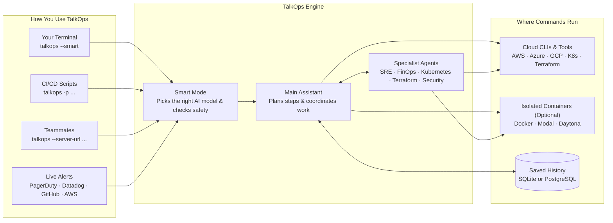
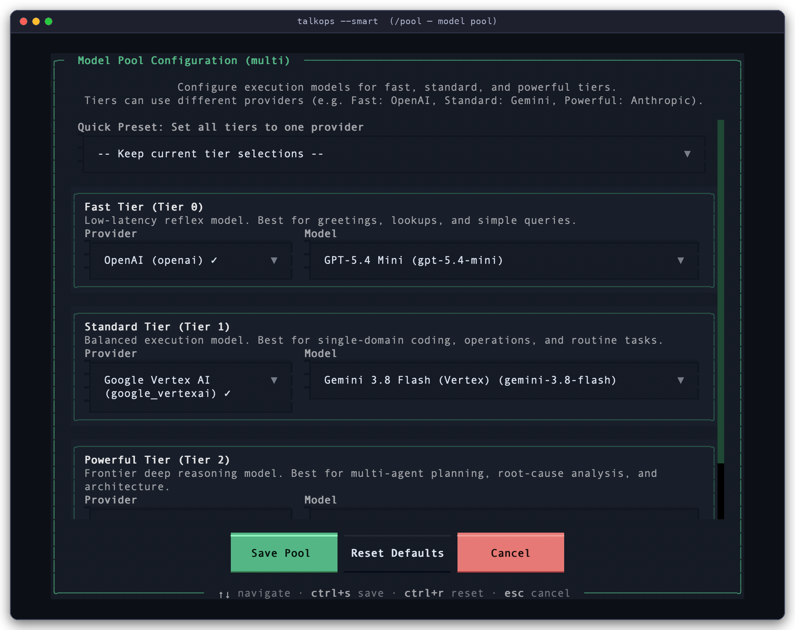
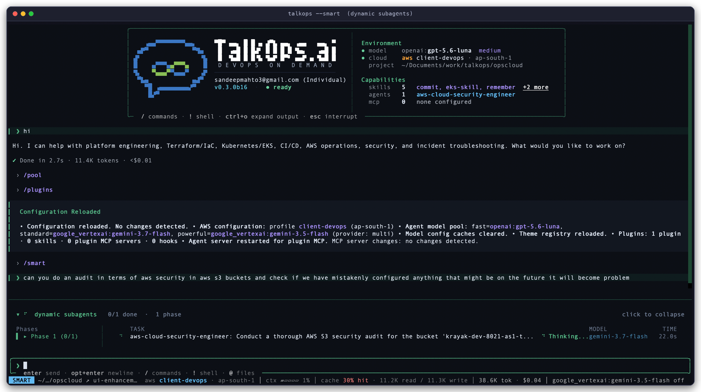

# TalkOps Overview

> Ask for any DevOps or cloud task in plain English. TalkOps plans the steps, runs them safely, and shows you what it found.

**TalkOps** is an AI assistant built for Cloud Operations, SRE, and DevOps work. It connects to **26+ AI model providers** (like Anthropic, OpenAI, Google Gemini, AWS Bedrock, and local Ollama) and works directly with the cloud tools and CLIs you already use.

You can use TalkOps in three ways:
- **In your terminal (`talkops` or `ops`)** — Chat interactively to debug Kubernetes clusters, write Terraform, review code, or check cloud costs.
- **In CI/CD scripts (`talkops -p`)** — Run one-off checks or automated verifications inside GitHub Actions, GitLab CI, or Jenkins.
- **As a shared team server (`talkops serve`)** — Host TalkOps in one place so your whole team can share investigations and automatically respond to live alerts from PagerDuty, Datadog, Prometheus, and GitHub.

  <video src="../assets/talkops-tui-finops-demo.mp4" controls autoplay loop muted playsinline width="100%">
    
  </video>

  <b>AWS Cost Audit in Smart Mode:</b> Installing the <code>aws-finops-engineer</code> plugin via <code>/plugins</code>, scanning 17 AWS regions across 32 tool calls (<b>$0.36 total AI cost</b>), and generating a clear savings report.

<table>
  <tr>
    <td width="50%" valign="top">
      <h3>Smart Mode (Fast, Affordable &amp; Safe)</h3>
      
Automatically picks a small, fast AI model for simple questions—saving 80–90% on AI costs—and switches to a stronger model only for complex problems, while checking every command for safety before it runs.

      <a href="approval-mode.md">Learn about Smart Mode →</a>
    </td>
    <td width="50%" valign="top">
      <h3>Shared Team Server</h3>
      
Run <code>talkops serve</code> so your team can share cloud access, view the same saved investigations, and pick up where a teammate left off.

      <a href="central-server.md">Set up a Central Server →</a>
    </td>
  </tr>
  <tr>
    <td width="50%" valign="top">
      <h3>Automated Alert Investigations</h3>
      
Connect PagerDuty, Alertmanager, Datadog, AWS SNS, ServiceNow, Jenkins, or GitHub so incoming alerts automatically trigger a root-cause investigation and post findings back to your tickets or chat.

      <a href="webhooks.md">Connect Webhooks →</a>
    </td>
    <td width="50%" valign="top">
      <h3>Plugins &amp; Specialist Agents</h3>
      
Install ready-made specialists for AWS, Kubernetes, FinOps, Terraform, and Security with one command (<code>/plugins</code>), or create your own team runbooks.

      <a href="subagents.md">Explore Subagents →</a> · <a href="plugins.md">Browse Plugins →</a>
    </td>
  </tr>
</table>

---

## What You Can Do with TalkOps

Day-to-day engineering usually means jumping between code editors, cloud consoles, Kubernetes terminals, CI/CD logs, and billing dashboards. TalkOps lets you handle all of those from one place:

| Area | How TalkOps Helps |
| :--- | :--- |
| **Writing & Reviewing Code** | Writes, updates, and debugs application code, scripts, and config files; runs tests; and checks git changes with `/review`. |
| **Cloud Management (AWS, Azure, GCP)** | Inspects and troubleshoots cloud resources—servers, networks/VPCs, databases, storage, and IAM permissions—using your existing cloud login (`/cloud`). |
| **Kubernetes & Containers** | Writes Dockerfiles, manages EKS/AKS/GKE clusters and Helm charts, and quickly finds why pods are crashing (`CrashLoopBackOff`, `OOMKilled`) or why networking is slow. |
| **Terraform & CI/CD Pipelines** | Writes and validates Terraform, OpenTofu, CDK, CloudFormation, and Ansible files; checks for configuration drift; and fixes broken GitHub Actions or Jenkins builds. |
| **Incident Response & Monitoring** | Searches logs and metrics across Prometheus, Loki, Datadog, and CloudWatch; investigates live alerts; and posts clear summaries back to PagerDuty, ServiceNow, Slack, Discord, or Teams. |
| **Cloud Cost (FinOps) & Security** | Finds unused disks, idle load balancers, and oversized servers to lower your cloud bill, and checks IAM permissions and security findings for risks. |

---

## How TalkOps Works

### 1. Four ways to run it

Whether you run TalkOps on your laptop, in a script, or on a team server, it uses the same tools, skills, and safety rules:

| Mode | Command | When to Use It |
| :--- | :--- | :--- |
| **Interactive Terminal (TUI)** | `talkops --smart` *(or `ops --smart`)* | Everyday work on your laptop: debugging clusters, writing Terraform, reviewing code, and exploring cloud resources. |
| **One-Off Command / CI Mode** | `talkops -p "<question>" --smart` | Running automated checks in GitHub Actions, GitLab CI, Jenkins, or shell scripts without opening an interactive window. |
| **Shared Team Server** | Server: `talkops serve --port 2024` Client: `talkops --server-url http://host:2024` | Sharing cloud credentials and conversation history across a team so multiple engineers can collaborate. |
| **Live Alert Receiver (Webhooks)** | `POST http://host:2024/webhooks/{provider}` | Automatically investigating alerts from PagerDuty, Alertmanager, Datadog, AWS SNS, ServiceNow, Jenkins, or GitHub 24/7. |

---

### 2. Smart Mode: Balancing cost, speed, and safety

Using the largest, most expensive AI model for every simple status check wastes money and time—but using a small model all the time fails when you hit a tough outage. Similarly, being asked to approve every harmless read-only command (`kubectl get pods`) slows you down, while auto-approving everything is dangerous in production.

Turning on **Smart Mode** (`talkops --smart`, `/smart`, or pressing `Shift+Tab`) solves both:

1. **Picks the right model for each question**:
   - **Fast model** for quick status checks (`git status`, `kubectl get pods`), cutting AI costs by **80–90%**.
   - **Standard model** for everyday coding and configuration tasks.
   - **Powerful model** for complex outages, multi-region audits, and architecture design.
2. **Checks every command for safety before running**:
   - **Safe, read-only checks** run automatically without interrupting you.
   - **Risky or production-changing commands** (like deleting resources or applying changes) pause and ask for your confirmation (`[y/n/e]`).

You can mix and match models from **26+ AI providers** across your **Fast**, **Standard**, and **Powerful** slots at any time by running `/pool`:

  

  <b>Choosing Your Smart Mode Models (<code>/pool</code>):</b> Assign a fast model for simple tasks, a balanced model for everyday work, and a top reasoning model for complex investigations.

---

### 3. Specialist agents, plugins, skills, and sandboxes

Instead of trying to do everything in one giant conversation, TalkOps can bring in specialized helpers and tools when needed:

- **Specialist Subagents (`/agent`, `talkops agents`)**: When a task involves a specific area—like auditing AWS S3 security or debugging an EKS cluster—TalkOps can hand that piece of work off to a specialist agent. The specialist runs the detailed checks and reports back a clean summary so your main chat stays easy to read.
- **One-Click Plugins (`/plugins`, `talkops plugin`)**: Install pre-built specialist agents (such as `aws-sre-agent`, `aws-finops-agent`, `aws-iac-engineer`, or `aws-cloud-security-engineer`) and skill packs from the official TalkOps Marketplace or your own team's Git repository.
- **Saved Memory & Runbooks (`/memory`, `/remember`, `talkops skills`)**: Tell TalkOps what to remember about your project (`AGENTS.md` or `/remember`), or save step-by-step team troubleshooting guides as reusable `SKILL.md` runbooks.
- **External MCP Tools (`/mcp`, `talkops mcp`)**: Connect external tool servers (using the Model Context Protocol) from `.mcp.json` or `config.toml` to give TalkOps access to internal APIs, docs, or databases.
- **Isolated Sandboxes (`[sandboxes]`)**: Optionally run commands inside isolated Docker, Modal, Daytona, Runloop, or cloud containers instead of directly on your machine.

  

  <b>Specialist Agent in Action:</b> Running in <code>SMART</code> mode on AWS profile <code>client-devops (ap-south-1)</code>, where TalkOps delegates an S3 security check to <code>aws-cloud-security-engineer</code> and returns a clear summary.

| Feature | How to Use It | Learn More |
| :--- | :--- | :--- |
| **Marketplace Plugins** | `/plugins` or `talkops plugin install <name>` | [Plugins & Marketplaces](plugins.md) |
| **Specialist Subagents** | `/agent` or `talkops -a <name>` | [Subagents](subagents.md) |
| **Team Runbooks & Memory** | `/skills`, `/memory`, `/remember` | [Memory & Skills](memory-and-skills.md) |
| **Custom Slash Shortcuts** | Create `.md` files in `.talkops/commands/` | [Custom Commands](custom-commands.md) |
| **External MCP Tools** | `/mcp` or `talkops mcp list` | [MCP Tools](mcp-tools.md) |
| **Server Addons** | `talkops serve addons` or `talkops addon list` | [Server Addons](server-addons.md) |
| **Automated Hooks** | Configure `[[hooks]]` in `config.toml` | [Hooks](hooks.md) |
| **Container Sandboxes** | `/config sandbox.provider docker` | [Remote Sandboxes](remote-sandboxes.md) |

---

## Where to Go Next

### Getting Started
- **[Quickstart](quickstart.md)** — Install TalkOps, connect your first AI model and cloud account, and run your first task in 5 minutes.
- **[CLI & Slash Command Reference](cli-reference.md)** — Easy lookup guide for terminal commands and in-chat `/slash` commands.

### Running TalkOps with Your Team
- **[Approval Modes & Smart Mode](approval-mode.md)** — Understand Manual, Smart, and Auto approval modes.
- **[Central Server & Team Collaboration](central-server.md)** — Set up `talkops serve` so your team can share sessions and cloud access.
- **[Webhooks & Automated Alerting](webhooks.md)** — Connect PagerDuty, Alertmanager, Datadog, AWS SNS, ServiceNow, Jenkins, and GitHub alerts.
- **[Goal Mode & Rubrics](goal-and-rubrics.md)** — Give TalkOps a multi-step goal (`/goal`) or success checklist (`--rubric`) to work through until finished.

### Configuration & Customization
- **[Configuration Guide](Configuration.md)** & **[`config.toml` Reference](config.toml.md)** — Customize your default settings, cloud profiles, and safety rules.
- **[Credentials & Authentication](credentials.md)** & **[Model Providers](model-providers.md)** — Connect any of the 26+ supported AI providers and cloud accounts.
- **[Subagents](subagents.md)**, **[Memory & Skills](memory-and-skills.md)**, & **[Plugins](plugins.md)** — Tailor TalkOps to your team's infrastructure and workflows.
