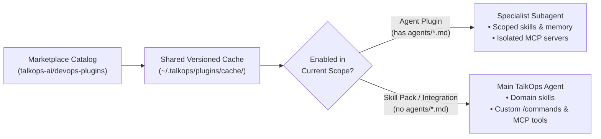
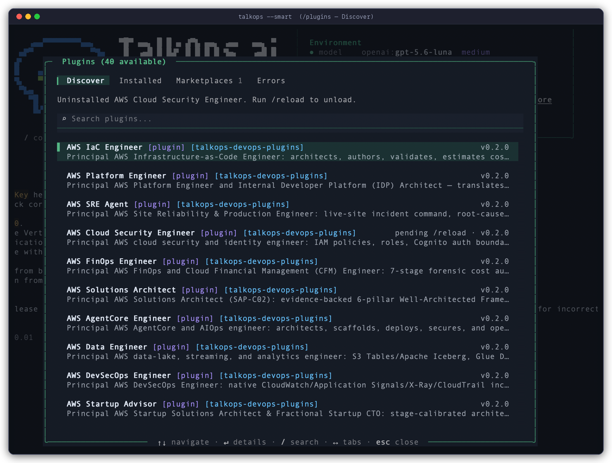
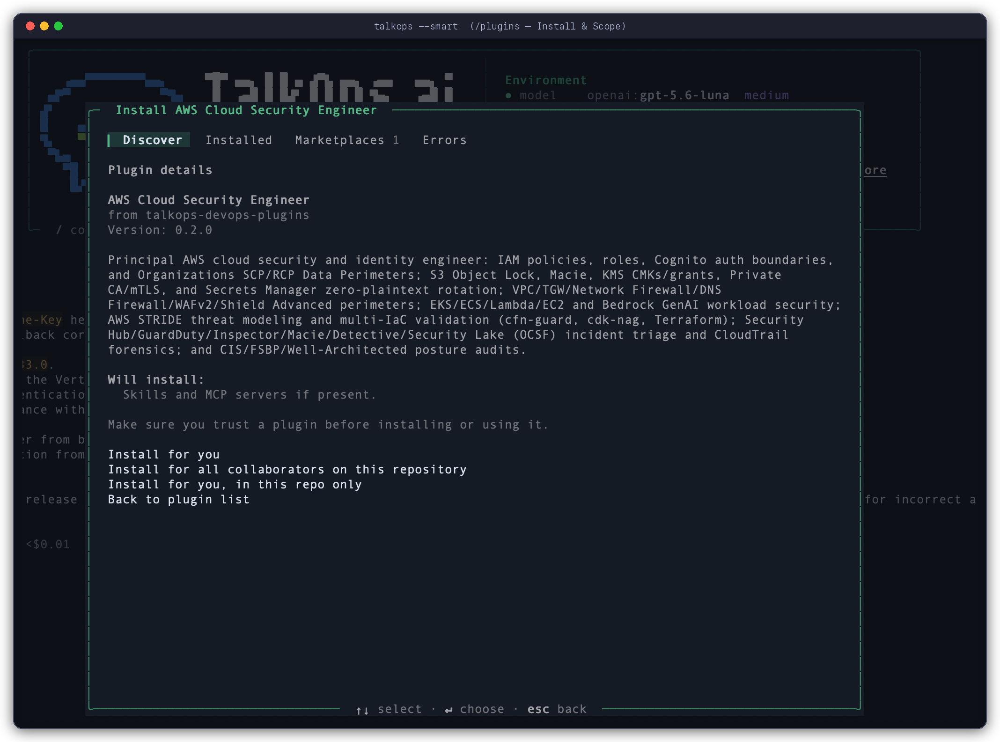

# Plugins and Marketplaces

> Extend TalkOps with specialist subagents, domain skill packs, MCP servers, and slash commands from official or private marketplaces

Plugins package reusable [subagents](./subagents.md), [skills](./memory-and-skills.md#skills), [MCP servers](./mcp-tools.md), and [custom commands](./custom-commands.md) into versioned bundles that you can install globally for your user account or scope to a specific repository.

Out of the box, TalkOps connects to the official **TalkOps DevOps Plugin Marketplace** ([`talkops-ai/devops-plugins`](https://github.com/talkops-ai/devops-plugins)) and also supports private team repositories, Git subdirectories, HTTP catalogs, and workspace-local plugin folders.

> [!WARNING]
> Only install plugins and marketplaces from sources you trust. Enabled plugins can add instructions, register custom commands, and launch MCP server processes with your local user permissions.

---

## How Plugins Work

TalkOps automatically classifies each plugin based on the components inside its package directory:

| Plugin Type | Package Contents | How It Attaches in TalkOps | Examples |
| :--- | :--- | :--- | :--- |
| **Agent Plugin** | Contains one or more subagent definitions in `agents/*.md` (plus optional `skills/` and `.mcp.json`) | Registers a dedicated specialist subagent (invocable via `/agent <name>` or automatic `task` delegation) with its own scoped skills, isolated memory, and dedicated MCP servers | `aws-sre-agent`, `aws-finops-engineer`, `aws-iac-engineer`, `aws-platform-engineer` |
| **Skill Pack (Vertical Plugin)** | Contains domain `skills/` and/or `commands/` without `agents/` or `.mcp.json` | Attaches domain skills and slash commands directly to your main TalkOps assistant | `aws-infrastructure-as-code`, `aws-observability`, `aws-security-identity`, `aws-cost-optimization` |
| **Integration (Partner Plugin)** | Bundles MCP servers (`.mcp.json` or `mcpServers`) and skills without a separate subagent | Connects external vendor tools and domain skills to the main agent | `terraform`, third-party vendor toolkits |



### Official TalkOps DevOps Plugin Marketplace

TalkOps ships with the official **`talkops-devops-plugins`** marketplace (`talkops-ai/devops-plugins`) pre-configured, providing 40+ cloud engineering subagents and domain skill packs:

* **Specialist AWS Subagents**:
  * **`aws-sre-agent`** — Investigates CloudWatch alarms, correlates X-Ray traces, filters log streams, and diagnoses incident root causes.
  * **`aws-finops-engineer`** — Audits AWS spend, identifies idle resources and unattached EBS volumes, analyzes Savings Plans, and proposes cost optimizations.
  * **`aws-iac-engineer`** — Architects, validates, and troubleshoots Terraform, OpenTofu, AWS CDK, and CloudFormation stacks.
  * **`aws-platform-engineer`** — Designs and operates EKS clusters, VPC topologies, Karpenter autoscaling, and platform CI/CD pipelines.
  * **`aws-cloud-security-engineer`** — Audits IAM policies for least privilege, triages GuardDuty and Security Hub findings, and reviews encryption controls.
  * **`aws-solutions-architect`** — Evaluates multi-AZ/multi-region resilience, Well-Architected trade-offs, and cloud migration patterns.
  * **`aws-agentcore-engineer`** — Builds, deploys, and debugs Amazon Bedrock AgentCore runtimes, gateways, and memory integrations.
  * **`aws-data-engineer`**, **`aws-devsecops-engineer`**, and **`aws-startup-advisor`**.
* **Domain Skill Packs**:
  * **`aws-infrastructure-as-code`**, **`aws-observability`**, **`aws-security-identity`**, **`aws-cost-optimization`**, **`aws-well-architected`**, **`aws-serverless-eda`**, **`aws-containers-eks`**, **`aws-networking-edge`**, and **`terraform`**.

---

## Managing Plugins Interactively (`/plugins`)

Run `/plugins` inside any interactive `talkops` session to open the full-screen **Plugins** manager modal:

<p align="center">
  
</p>

The modal is organized into four tabs (switch with `Tab`, `←`, or `→`):

1. **Discover** — Browse and search (`/` to filter) all plugins available across your registered marketplaces. Press `Enter` on any plugin to inspect its description, bundled skills, subagents, and MCP servers and choose an installation scope:
   * **Install for you (`user` scope)** — Available across all your workspaces.
   * **Install for all collaborators on this repository (`project` scope)** — Saved to `<repo>/.talkops/settings.json` for your team.
   * **Install for you, in this repo only (`local` scope)** — Saved to `<repo>/.talkops/settings.local.json` (excluded from Git).

<p align="center">
  
</p>

2. **Installed** — View plugins installed in your user, project, or local scope. Press `Space` to quick-toggle a plugin on or off, or press `Enter` to change its scope or uninstall it.
3. **Marketplaces** — Inspect registered marketplace catalogs, refresh a catalog, or add a new marketplace source (GitHub `owner/repo`, Git HTTPS URL, `marketplace.json` URL, or local directory).
4. **Errors** — Inspect diagnostic details if a plugin manifest, skill, or MCP server fails validation.

When you close the modal after installing, enabling, or disabling a plugin, TalkOps prompts you to **reload the active session immediately** (or you can run `/reload` at any time).

> [!TIP]
> You can also run CLI subcommands directly from the TUI prompt—for example, `/plugins list`, `/plugins search finops`, or `/plugins install aws-sre-agent`.

---

## Managing Plugins from the CLI

For terminal workflows, onboarding scripts, or CI setup, use `talkops plugin` (or its alias `talkops plugins`):

```bash
# List installed plugins and browse available marketplace plugins
talkops plugin list

# Search marketplace catalogs by keyword
talkops plugin search finops

# Install a plugin (defaults to --scope user)
talkops plugin install aws-sre-agent
talkops plugin install aws-iac-engineer --scope project
talkops plugin install aws-observability --scope local

# Disable or re-enable an installed plugin without deleting its cached files
talkops plugin disable aws-iac-engineer --scope project
talkops plugin enable aws-iac-engineer --scope project

# Re-sync installed plugins from their marketplace sources
talkops plugin refresh

# Uninstall a plugin from a specific scope (or omit --scope to remove from all scopes)
talkops plugin uninstall aws-iac-engineer --scope project
talkops plugin uninstall aws-sre-agent
```

<p align="center">
  
</p>

### Managing Marketplace Sources from the CLI

```bash
# Add a GitHub repository (optionally pinned to a branch or tag with @ref)
talkops plugin marketplace add talkops-ai/devops-plugins
talkops plugin marketplace add my-org/internal-talkops-plugins@main

# Add a Git URL or a local marketplace directory
talkops plugin marketplace add https://github.com/my-org/cloud-plugins.git#v1.2.0
talkops plugin marketplace add ./team-marketplace

# List, refresh, or remove marketplaces
talkops plugin marketplace list
talkops plugin marketplace refresh
talkops plugin marketplace remove internal-talkops-plugins
```

> [!NOTE]
> **Private GitHub Repositories:** When cloning or refreshing a GitHub marketplace (or a GitHub-hosted plugin source), TalkOps automatically authenticates with `GITHUB_PERSONAL_ACCESS_TOKEN` or `GITHUB_TOKEN` if present in your environment, and seamlessly falls back to unauthenticated access for public repositories.

---

## Installation Scopes and Workspace Isolation

TalkOps isolates workspace plugins so that specialist agents, MCP servers, and skills installed for one repository never leak into unrelated projects.

### Scope Comparison

| Scope | CLI Flag | Settings File | Behavior & Git Tracking |
| :--- | :--- | :--- | :--- |
| **User (Global)** | `--scope user` *(default)* | `~/.talkops/settings.json` | Active across all workspaces for your user account unless explicitly disabled in a workspace. |
| **Project (Shared)** | `--scope project` | `<repo>/.talkops/settings.json` | Active **only** inside `<repo>`. Commit `.talkops/settings.json` so teammates use the same plugin set. |
| **Local (Repo-Private)** | `--scope local` | `<repo>/.talkops/settings.local.json` | Active **only** inside `<repo>`. TalkOps automatically adds `.talkops/settings.local.json` to `<repo>/.git/info/exclude` so it stays out of Git status. |
| **Workspace Directory** | Placed in repo tree | `<repo>/.talkops/plugins/<name>`<br>`<repo>/.agents/plugins/<name>`<br>`<repo>/plugins/<name>` | Discovered automatically when running inside `<repo>`. Ideal for developing or versioning custom plugins alongside your infrastructure code. |

### Precedence and Overrides (`local > project > user`)

1. **Shared Cache, Scoped Activation**:
   Marketplace plugins are downloaded once into `~/.talkops/plugins/cache/<marketplace>/<plugin>/<version>` and tracked per scope in `~/.talkops/.state/installed_plugins.json`. Installing a plugin with `--scope project` in **Repo A** enables it only in Repo A—when you switch to **Repo B**, Repo A's project plugins remain completely inactive.
2. **Overriding a Global Plugin in a Specific Repo**:
   Because enablement merges in order `user` $\rightarrow$ `project` $\rightarrow$ `local`, you can keep a plugin installed globally for your user account while muting it in a specific repository:
   ```bash
   talkops plugin disable aws-finops-engineer --scope local
   ```
3. **Declarative Workspace `plugins.json`**:
   A repository can also load plugins from relative directory paths or exclude specific global plugins via `<repo>/.talkops/plugins.json` (or `<repo>/.agents/plugins.json`):
   ```json
   {
     "entries": [
       "../shared-ops-plugins/eks-diagnostics"
     ],
     "exclude": [
       "aws-startup-advisor"
     ]
   }
   ```

---

## Creating a Plugin

A TalkOps plugin is a directory containing a manifest file (`plugin.json`) and any combination of `agents/`, `skills/`, `commands/`, and `.mcp.json`.

### Directory Layout

TalkOps discovers components automatically by directory convention—even if you don't list every path explicitly in `plugin.json`:

```text
aws-finops-engineer/
├── .talkops-plugin/
│   └── plugin.json              # Plugin manifest (or place plugin.json at the root)
├── agents/
│   └── aws-finops-engineer.md   # Specialist subagent definition (YAML frontmatter + prompt)
├── skills/
│   ├── aws-cost-optimization/
│   │   └── SKILL.md             # Domain skill instructions
│   └── aws-billing-audit/
│       └── SKILL.md
├── commands/
│   └── cost-report.md           # Custom /cost-report slash command
└── .mcp.json                    # MCP servers bundled with the plugin
```

> [!TIP]
> **Cross-Tool Manifest Compatibility:** TalkOps checks for the plugin manifest in `.claude-plugin/plugin.json`, `.talkops-plugin/plugin.json`, `.agents-plugin/plugin.json`, `.codex-plugin/plugin.json`, and `plugin.json` at the plugin root.

### The `plugin.json` Manifest

```json
{
  "name": "aws-finops-engineer",
  "displayName": "AWS FinOps Engineer",
  "version": "1.0.0",
  "description": "Cloud financial management, idle resource discovery, and Savings Plans optimization",
  "author": {
    "name": "TalkOps AI"
  },
  "skills": "./skills",
  "agents": [
    "./agents/aws-finops-engineer.md"
  ],
  "commands": "./commands",
  "mcpServers": "./.mcp.json"
}
```

| Field | Type | Description |
| :--- | :--- | :--- |
| `name` | `string` | **Required.** Unique kebab-case identifier for the plugin. |
| `displayName` | `string` | Optional human-friendly title shown in the `/plugins` UI (also accepts `display_name`). |
| `version` | `string` | Semantic version string (used for cache directory versioning). |
| `description` | `string` | Summary shown in `/plugins` and `talkops plugin list`. |
| `author` | `string \| object` | Author name (`"Platform Team"`) or object (`{"name": "Platform Team"}`). |
| `skills` | `string \| list[str]` | Relative `./` path(s) to skill directories. Defaults to auto-discovering `./skills/` and root `./SKILL.md`. |
| `agents` | `string \| list[str]` | Relative `./` path(s) to `.md` subagent files or directories. Defaults to auto-discovering `./agents/*.md`. |
| `commands` | `string \| list[str]` | Relative `./` path(s) to `.md` command files or directories. Defaults to auto-discovering `./commands/`. |
| `mcpServers` | `string \| dict \| list` | Relative `./` path to an MCP config file (such as `./.mcp.json`) or an inline `mcpServers` object. |

### Path Variables inside Plugins

When authoring `.mcp.json` configurations, subagent prompts, or custom commands inside a plugin, use built-in environment variables instead of hardcoded paths:

| Variable | Resolves To |
| :--- | :--- |
| `${PLUGIN_ROOT}` / `${CLAUDE_PLUGIN_ROOT}` / `${TALKOPS_PLUGIN_ROOT}` | Absolute path to the installed plugin's root directory |
| `${PLUGIN_DATA}` / `${CLAUDE_PLUGIN_DATA}` / `${TALKOPS_PLUGIN_DATA}` | Persistent data directory for the plugin (`~/.talkops/plugins/data/<plugin-id>`), preserved across version updates |
| `${PROJECT_DIR}` / `${CLAUDE_PROJECT_DIR}` / `${TALKOPS_PROJECT_DIR}` | Absolute path to the active workspace root |

For example, in a plugin's `.mcp.json`:

```json
{
  "mcpServers": {
    "cost-analyzer": {
      "command": "uv",
      "args": ["run", "--directory", "${PLUGIN_ROOT}/servers/cost", "python", "server.py"],
      "env": {
        "CACHE_DIR": "${PLUGIN_DATA}/cache"
      }
    }
  }
}
```

---

## Creating a Marketplace

A marketplace is any Git repository, HTTP endpoint, or directory that provides a `marketplace.json` catalog (placed at `.claude-plugin/marketplace.json`, `.agents/plugins/marketplace.json`, or `marketplace.json` at the root).

### Example `marketplace.json`

```json
{
  "name": "acme-cloud-plugins",
  "owner": {
    "name": "Acme Platform Engineering"
  },
  "metadata": {
    "description": "Internal SRE subagents and Kubernetes runbooks",
    "version": "1.0.0",
    "pluginRoot": "./plugins"
  },
  "plugins": [
    {
      "name": "eks-sre-agent",
      "source": "./plugins/eks-sre-agent",
      "description": "Diagnoses EKS pod evictions, CoreDNS latency, and Karpenter node provisioning",
      "version": "1.2.0",
      "category": "SRE",
      "tags": ["eks", "kubernetes", "sre"]
    },
    {
      "name": "rds-audit",
      "source": {
        "source": "github",
        "repo": "acme-corp/rds-audit-plugin",
        "ref": "v1.0.0"
      },
      "description": "Audits RDS parameter groups, backups, and Performance Insights metrics"
    }
  ]
}
```

### Supported Plugin `source` Formats in `marketplace.json`

Each entry in `"plugins"` can point to a relative path inside the marketplace or an external Git repository:

* **Relative path inside the marketplace**:
  `"source": "./plugins/eks-sre-agent"` (or `{"source": "local", "path": "./plugins/eks-sre-agent"}`)
* **GitHub repository**:
  `{"source": "github", "repo": "owner/repo", "ref": "main", "path": "optional/subdir"}`
* **Git subdirectory (sparse checkout)**:
  `{"source": "git-subdir", "url": "https://github.com/owner/monorepo.git", "path": "plugins/my-plugin", "ref": "main"}`
* **Git URL**:
  `{"source": "url", "url": "https://gitlab.example.com/ops/my-plugin.git", "ref": "v1.0.0"}`

### Testing Your Marketplace Locally

```bash
# Register your local marketplace folder and install a plugin from it
talkops plugin marketplace add ./acme-cloud-plugins
talkops plugin install eks-sre-agent@acme-cloud-plugins
```

---

## Related Documentation

* [Subagents](./subagents.md) — How specialist subagents work and how to invoke or author `agents/*.md` files.
* [Memory and Skills](./memory-and-skills.md) — Authoring `SKILL.md` domain runbooks and progressive disclosure.
* [Custom Commands](./custom-commands.md) — Creating reusable `/command` Markdown templates.
* [MCP Tools](./mcp-tools.md) — Configuring `.mcp.json` servers and tool permissions.
* [CLI & TUI Reference](./cli-reference.md) — Complete flag and slash-command reference.
