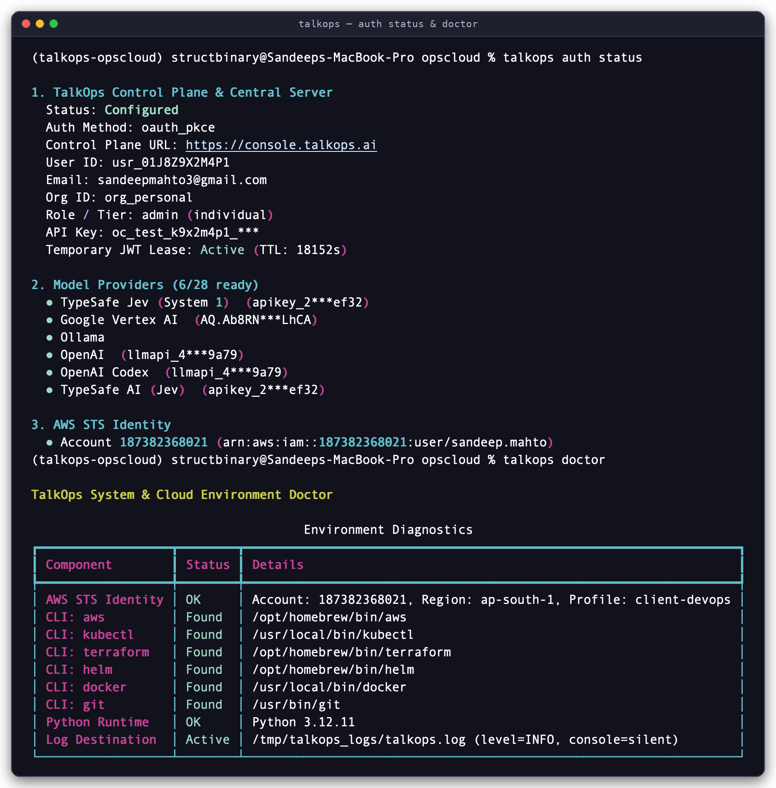
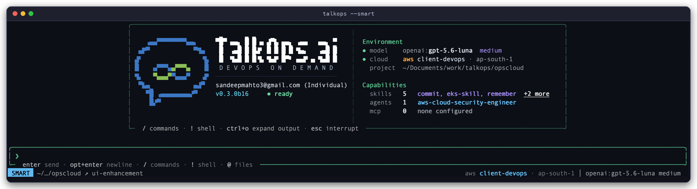
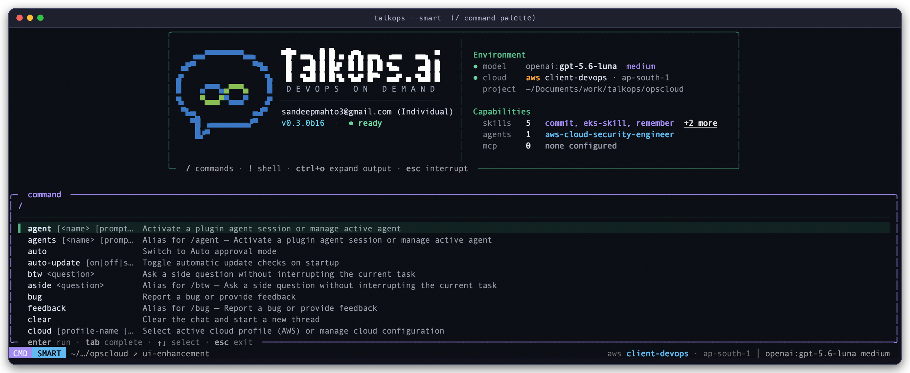
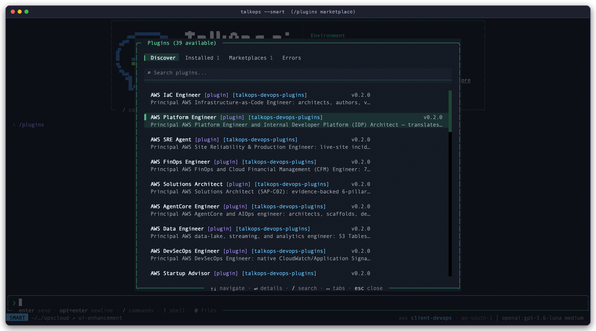
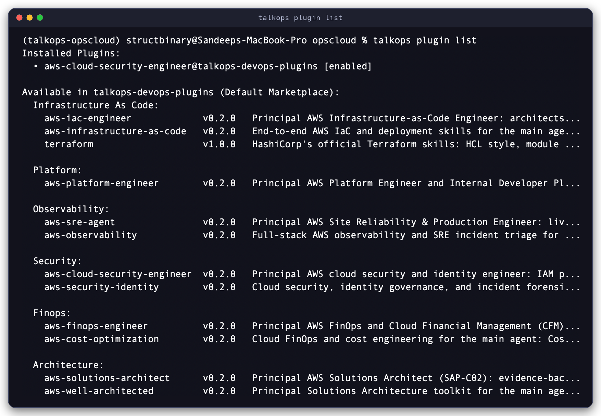

# Quickstart Guide

Get **TalkOps** installed, authenticated, verified, and running autonomous DevOps and cloud operations—interactively in your terminal, headlessly in CI/CD, or centrally as a shared team and webhook server—in under five minutes.

<p align="center">
  <video src="../assets/talkops-tui-finops-demo.mp4" controls autoplay loop muted playsinline width="100%">
    
  </video>
</p>

---

## 1. Install TalkOps

**Prerequisites:** macOS, Linux, or Windows WSL2. The standalone installer automatically provisions **Python 3.12+**, **`uv`**, and **`ripgrep`** if they are not already on your machine.

Run the installer script:

```bash
curl -LsSf https://raw.githubusercontent.com/talkops-ai/talkops/main/scripts/install.sh | bash
```

<details>
<summary><b>Alternative installation methods (<code>uv</code>, <code>pipx</code>, <code>pip</code>, pinned version, or local checkout)</b></summary>

```bash
# Using uv (recommended if you already manage Python 3.12+ with uv)
uv tool install --prerelease=allow talkops-ai

# Include optional remote sandbox SDKs (Modal, Daytona, Runloop)
uv tool install --prerelease=allow "talkops-ai[sandboxes]"

# Using pipx
pipx install --pip-args="--pre" talkops-ai

# Using pip inside a Python 3.12+ virtual environment
pip install --pre -U talkops-ai

# Install a pinned release via install.sh
curl -LsSf https://raw.githubusercontent.com/talkops-ai/talkops/main/scripts/install.sh | bash -s -- 0.3.0b17

# Upgrade an existing installation
curl -LsSf https://raw.githubusercontent.com/talkops-ai/talkops/main/scripts/install.sh | bash -s -- --upgrade
```

</details>

Verify that both `talkops` and its shorthand alias `ops` are on your `PATH`:

```bash
talkops --version
ops --version
```

---

## 2. Sign In & Configure Credentials

Setting up TalkOps takes three quick steps: authenticating your CLI session, adding at least one model provider key (plus an optional **TypeSafe AI Jev** key for Smart Mode), and pointing to your cloud environment.

### Step 2a. Authenticate with TalkOps

TalkOps requires an active Control Plane or Central Server session before launching the TUI or headless CLI. If you launch `talkops` in an interactive terminal without logging in first, it automatically opens **Browser-Loopback PKCE SSO** for you.

You can also sign in explicitly from the terminal:

```bash
# Option 1: Interactive Browser SSO (PKCE)
talkops auth login --sso

# Option 2: Authenticate with a Control Plane or Central Server API key (oc_live_...)
talkops auth login --api-key oc_live_...
```

### Step 2b. Add an LLM Provider Key & TypeSafe AI Jev Key

Configure at least one LLM provider (such as Anthropic, OpenAI, Google Gemini, OpenRouter, or AWS Bedrock) and a **TypeSafe AI Jev** key (`typesafe`) to enable `<70ms` Smart Mode model routing and `<100ms` tool safety checks.

`talkops auth set` stores credentials securely in your OS Keyring and `~/.talkops/.state/auth.json` (`0600` permissions):

```bash
# Store your primary LLM provider key (choose one or more)
talkops auth set anthropic sk-ant-...
# talkops auth set openai sk-proj-...
# talkops auth set google_genai AIza...

# Store your TypeSafe AI Jev key for <70ms Smart Mode routing & <100ms safety checks
talkops auth set typesafe ts-...
```

<details>
<summary><b>Or configure credentials via environment variables</b></summary>

```bash
export TALKOPS_API_KEY="oc_live_..."
export ANTHROPIC_API_KEY="sk-ant-..."
export TYPESAFE_API_KEY="ts-..."
```

> [!TIP]
> Inside the interactive TUI, you can also run **`/login`** (or **`/auth`**) at any time to open the interactive **Authentication Manager** modal and add or rotate keys for any of the 26+ supported model providers.

</details>

### Step 2c. Connect Your Cloud & Kubernetes Context (Optional)

TalkOps never asks you to copy cloud secrets into plain-text config files—it uses your existing native CLI and SDK credential chains (`~/.aws/credentials`, `aws sso login`, `az login`, `gcloud auth application-default login`, and `~/.kube/config`).

To verify an AWS profile and region from the CLI:

```bash
talkops auth aws --profile default --region us-east-1
```

---

## 3. Verify Your Setup

Run `talkops auth status` and `talkops doctor` to confirm your Control Plane session, LLM provider keys, AWS STS identity, local DevOps CLIs (`aws`, `kubectl`, `terraform`, `helm`, `docker`, `git`), and Python runtime are ready:

```bash
# 1. Check Control Plane JWT lease, configured LLM providers, and AWS STS identity
talkops auth status

# 2. Check installed DevOps CLIs, AWS STS connectivity, Python runtime, and log path
talkops doctor
```

<p align="center">
  
</p>
<p align="center">
  <sub><b>Environment Verification:</b> Running <code>talkops auth status</code> to inspect the active Control Plane PKCE SSO lease, configured model providers, and AWS STS caller identity, followed by <code>talkops doctor</code> to verify local DevOps CLIs (<code>aws</code>, <code>kubectl</code>, <code>terraform</code>, <code>helm</code>, <code>docker</code>, <code>git</code>) and runtime health.</sub>
</p>

---

## 4. Run Your First Workflow

You can run TalkOps in four ways depending on whether you are working interactively from your laptop, running checks in CI/CD, sharing a central server with your team, or responding to live production webhooks.

### Workflow A: Interactive TUI in Smart Mode

Launch TalkOps inside any repository or infrastructure directory with **Jev Smart Mode** enabled:

```bash
talkops --smart
# Shorthand alias:
ops --smart
```

<p align="center">
  
</p>
<p align="center">
  <sub><b>Interactive TUI in Smart Mode (<code>talkops --smart</code>):</b> The two-panel launch console displays your authenticated session and health status on the left, active model, cloud profile, and discovered skills, subagents, and MCP servers on the right, and the live <code>SMART</code> mode status bar at the bottom.</sub>
</p>

> [!TIP]
> Want to explore without any risk of modifying cloud or cluster resources? Pass **`--read-only`** (or **`--dry-run`**) to block all mutating AWS, Kubernetes, and Terraform commands at the tool boundary:
> ```bash
> talkops --smart --read-only --aws-profile prod-ro
> ```

Once inside the TUI, try two prompts to see how **Smart Mode** adapts to task complexity:

1. **Routine status check** *(routes to your **Fast** model tier with `effort="off"` in `<70ms`, cutting token costs by 80–90%, and runs read-only checks automatically after a `<100ms` safety check)*:
   ```text
   List all non-running pods across namespaces in the current Kubernetes context and check recent warning events
   ```

2. **Deep multi-agent investigation** *(automatically escalates to your **Powerful** model tier with `effort="max"` and delegates in parallel across specialist subagents)*:
   ```text
   Investigate why checkout-service pods are restarting in prod-eks, correlate with recent Terraform or Helm changes, and audit our top 3 AWS cost drivers in us-east-1
   ```

#### Essential TUI Controls & Slash Commands

Type **`/`** in the chat input to open the fuzzy-searchable command palette:

<p align="center">
  
</p>
<p align="center">
  <sub><b>Interactive <code>/</code> Command Palette:</b> Typing <code>/</code> opens the fuzzy-searchable command palette (`CMD SMART`) to switch agents, models, cloud profiles, approval modes, or invoke skills and custom commands.</sub>
</p>

| Command / Shortcut | What It Does |
| :--- | :--- |
| **`Shift+Tab`** or **`/smart`**, **`/manual`**, **`/auto`** | Cycle approval and routing modes live during a session |
| **`/model`** | Switch your active LLM (`provider:model`) or configure default models |
| **`/pool`** *(alias `/agent-pool`)* | View or customize your 3-tier (**Fast**, **Standard**, **Powerful**) Smart Mode model pool |
| **`/cloud`** *(aliases `/aws`, `/azure`, `/gcp`, `/k8s`)* | Inspect or switch active AWS profile/region, Azure subscription, GCP project, or Kubernetes context |
| **`/plugins`** | Browse and install specialist DevOps subagents, skill packs, and MCP integrations from the marketplace |
| **`/agent`** *(or `/agent:<name>`)* | Switch into a specialist persona (such as `aws-sre-agent` or `aws-finops-agent`) |
| **`/review`** | Run a security, IAM, and IaC/code quality review on your uncommitted `git diff` |
| **`/goal`** & **`/rubric`** | Set a multi-step objective and acceptance checklist that TalkOps verifies before finishing |
| **`/threads`** & **`/fork`** | Resume a previous investigation or branch the current conversation into a new thread |
| **`/cost`** & **`/context`** | Inspect token usage, cache hit rate, session spend, and context window utilization |
| **`/login`** *(alias `/auth`)* | Open the interactive Authentication Manager to add or update API keys |

---

### Workflow B: Headless CLI & CI/CD Execution (`-p`)

Use `-p` (or `--prompt`) to run TalkOps non-interactively inside shell scripts, cron jobs, GitHub Actions, GitLab CI, or Jenkins. Pair it with **`--rubric`** (literal text or `@path/to/rubric.md`) so TalkOps grades its own work against your acceptance checklist before exiting:

```bash
# Validate Terraform modules and enforce security compliance with automatic rubric verification
talkops -p "Validate all Terraform modules in ./infra and verify no security group opens port 22 to 0.0.0.0/0" \
  --smart \
  --read-only \
  --max-turns 10 \
  --timeout 180 \
  --rubric "All Terraform modules validated and a security group compliance table is printed"
```

You can also pipe logs, diffs, or command output directly into `talkops` over `stdin` and use `-q` (`--quiet`) or `--output-format json` for clean downstream parsing:

```bash
# Pipe Kubernetes logs into a headless root-cause check
kubectl logs deployment/checkout-api -n production --tail=200 \
  | talkops -p "Identify the root cause of the 5xx spike and propose a minimal fix" --smart -q

# Emit structured JSON output for CI/CD pipeline assertions
git diff origin/main...HEAD \
  | talkops -p "Review this diff for overly permissive IAM policies or exposed secrets" \
      --smart --output-format json
```

---

### Workflow C: Central Server & Multi-Client Collaboration (`talkops serve`)

Instead of running isolated sessions on individual laptops, platform teams can run `talkops serve` as a shared server backed by SQLite (default) or PostgreSQL (`--postgres-uri`), allowing multiple engineers and CI jobs to connect concurrently:

1. **Start the Central Server:**

   ```bash
   talkops serve \
     --host 0.0.0.0 \
     --port 2024 \
     --auth-mode token \
     --approval-mode smart
   ```

   *(For multi-user production deployments with PostgreSQL, pass `--postgres-uri "postgresql://ops:secret@db:5432/talkops"` or set `TALKOPS_POSTGRES_URI`.)*

2. **Log in once and connect from any operator terminal or CI runner:**

   ```bash
   # Exchange your API key for a cached, auto-refreshing JWT bound to the server
   talkops auth login \
     --server-url http://localhost:2024 \
     --api-key oc_live_... \
     --user-id alice

   # Launch the interactive TUI connected to the central server
   talkops --server-url http://localhost:2024

   # List saved threads on the central server
   talkops threads list --server-url http://localhost:2024
   ```

---

### Workflow D: Event-Driven Webhook Incident Triage

Whenever `talkops serve` is running (with the `default` or `webhook-worker` profile), it exposes `/webhooks/{provider}` for 9 built-in webhook adapters (`pagerduty`, `alertmanager`, `datadog`, `sns`, `cloudevents`, `servicenow`, `jenkins`, `github`, and `generic`).

1. **Inspect all registered webhook endpoints:**

   ```bash
   talkops serve list
   ```

   <p align="center">
     
   </p>
   <p align="center">
     <sub><b>Built-In Webhook Endpoints (<code>talkops serve list</code>):</b> Lists all 9 webhook provider adapters (<code>alertmanager</code>, <code>cloudevents</code>, <code>datadog</code>, <code>generic</code>, <code>github</code>, <code>jenkins</code>, <code>pagerduty</code>, <code>servicenow</code>, and <code>sns</code>), their endpoint URLs, aliases, and verification status.</sub>
   </p>

2. **Send a test Prometheus Alertmanager payload:**

   ```bash
   curl -X POST http://localhost:2024/webhooks/alertmanager \
     -H "Content-Type: application/json" \
     -d '{
       "status": "firing",
       "groupKey": "prod-eks:checkout-5xx",
       "alerts": [{
         "status": "firing",
         "labels": {
           "alertname": "HighCheckout5xxRate",
           "severity": "critical",
           "namespace": "production",
           "service": "checkout-api"
         },
         "annotations": {
           "summary": "5xx error rate exceeded 12% for 5 minutes on checkout-api"
         }
       }]
     }'
   ```

3. **Follow or branch the live investigation:**

   TalkOps immediately returns `202 Accepted` with a `thread_id`, deduplicates follow-up alerts for the same incident into that thread, runs an autonomous Root Cause Analysis (RCA) in the background, and posts the RCA report to your configured Slack, Discord, Microsoft Teams, PagerDuty, ServiceNow, or GitHub sink.

   Any engineer can attach to the live webhook investigation from their terminal:

   ```bash
   talkops --server-url http://localhost:2024 -r <thread_id>
   ```

---

## 5. Supercharge TalkOps with Plugins, Skills & MCP

Once your basic setup is running, you can extend TalkOps on demand from the CLI (`talkops plugin`) or interactively inside the TUI (`/plugins`) without restarting:

```bash
# Browse and install domain subagents & skill packs from the Plugin Marketplace
talkops plugin list
talkops plugin install aws-finops-engineer

# Inspect installed specialist subagents and launch directly into one
talkops agents list
talkops --smart -a aws-finops-engineer

# Probe configured Model Context Protocol (MCP) tool servers
talkops mcp list
talkops mcp probe

# Scaffold a reusable project SKILL.md runbook in .talkops/skills/
talkops skills create eks-node-drain --project
```

<p align="center">
  
</p>
<p align="center">
  <sub><b>Interactive Plugin Marketplace (<code>/plugins</code> in the TUI):</b> Browse, search, and install specialist DevOps subagents, skill packs, hooks, and MCP configs across <b>Discover</b>, <b>Installed</b>, and <b>Marketplaces</b> tabs.</sub>
</p>

<details>
<summary><b>View CLI output for <code>talkops plugin list</code></b></summary>

<br>

<p align="center">
  
</p>
<p align="center">
  <sub><b>CLI Plugin Catalog (<code>talkops plugin list</code>):</b> Displays installed plugins alongside available packages from <code>talkops-devops-plugins</code> grouped by domain (Infrastructure as Code, Platform, Observability, Security, FinOps, Architecture).</sub>
</p>

</details>

---

## Next Steps

- **[Overview](overview.md)** — Understand how the 4 operational modes, Jev Smart Mode, specialist subagents, and sandboxes fit together
- **[CLI & Slash Command Reference](cli-reference.md)** — Complete flag and command reference for every CLI subcommand and interactive `/slash` command
- **[Approval Modes & Jev Smart Mode](approval-mode.md)** — Deep dive into `<70ms` 3-tier model routing, `/pool` configuration, and `<100ms` tool safety checks
- **[Credentials & Authentication](credentials.md)** — Set up Browser SSO, Central Server JWT auth, cloud identities, and webhook secrets
- **[Model Providers](model-providers.md)** — Configure any of the 26+ built-in LLM providers and custom endpoints
- **[Central Server](central-server.md)** & **[Webhooks](webhooks.md)** — Deploy `talkops serve` for team collaboration and 24/7 automated incident triage
