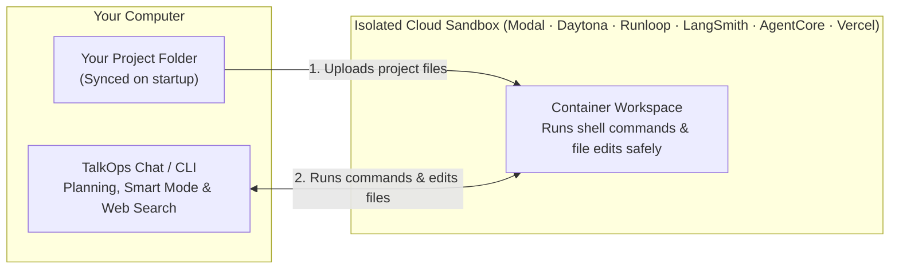

# Remote Sandboxes

By default, when TalkOps reads files, edits code, or runs terminal commands, it runs them directly on your computer. For everyday work, that is usually what you want.

Sometimes, though, you want a clean, isolated "playpen" so commands never touch your own laptop—for example, when testing unfamiliar scripts, trying out risky infrastructure changes, or running automated checks in CI/CD.

**Remote Sandboxes** let you keep the TalkOps chat window running on your computer while running all file edits and shell commands inside a temporary, isolated cloud container (**Modal**, **Daytona**, **Runloop**, **LangSmith**, **AWS Bedrock AgentCore**, or **Vercel Sandbox**).

<table>
  <tr>
    <td width="50%" valign="top">
      <h3>Protect Your Laptop</h3>
      <p>Commands run inside a disposable cloud container instead of on your local machine, keeping your personal files and local SSH keys out of reach.</p>
    </td>
    <td width="50%" valign="top">
      <h3>Automatic File Sync</h3>
      <p>When a session starts, TalkOps automatically copies your project files into the sandbox while skipping heavy folders like <code>.git</code>, <code>node_modules</code>, and <code>.terraform</code>.</p>
    </td>
  </tr>
  <tr>
    <td width="50%" valign="top">
      <h3>Clean Up Automatically</h3>
      <p>When you close TalkOps (or when a CI job finishes), TalkOps automatically shuts down and deletes the temporary sandbox container for you.</p>
    </td>
    <td width="50%" valign="top">
      <h3>Custom Startup Scripts</h3>
      <p>Automatically install extra tools (like <code>kubectl</code>, <code>terraform</code>, or <code>helm</code>) every time a new sandbox starts.</p>
    </td>
  </tr>
</table>

---

## How It Works



1. **Copies your project files**: When the session starts, TalkOps uploads your current project folder into the sandbox container (skipping large files over `10 MB` and heavy folders like `.git`, `.venv`, `node_modules`, `.terraform`, and `.talkops`).
2. **Runs commands inside the container**: All file reads, file edits, searches, and shell commands happen inside the isolated sandbox, while web searches and chat stay on your machine.
3. **Cleans up on exit**: When your session ends, TalkOps automatically stops and deletes the sandbox container (unless you connected to an already-running sandbox with `--sandbox-id`).

---

## Step 1: Choose and Set Up a Sandbox Provider

All 6 built-in sandbox providers come **pre-installed** with TalkOps—you never have to install extra sandbox packages manually. You only need to sign in or set the API key for the provider you want to use:

| Provider | Provider Name | How to Sign In / Set Up | Default Container Folder |
| :--- | :--- | :--- | :--- |
| **Local Machine** *(default)* | `local` | Ready out of the box (runs directly on your computer) | Your current folder |
| **Modal** | `modal` | Run `modal setup` in your terminal | `/workspace` |
| **Daytona** | `daytona` | `export DAYTONA_API_KEY="your-key"` | `/home/daytona` |
| **Runloop** | `runloop` | `export RUNLOOP_API_KEY="your-key"` | `/home/user` |
| **LangSmith** | `langsmith` | `export LANGSMITH_API_KEY="lsv2_..."` | `/root` |
| **AWS AgentCore** | `agentcore` | Uses your active AWS login (`AWS_PROFILE` or `AWS_REGION`) | `/workspace` |
| **Vercel Sandbox** | `vercel` | `export VERCEL_OIDC_TOKEN="..."` (or `VERCEL_TOKEN`, `VERCEL_TEAM_ID`, and `VERCEL_PROJECT_ID`) | `/vercel/sandbox` |

---

## Step 2: Turn On the Sandbox

You can switch TalkOps from `local` mode to a remote sandbox in four easy ways:

### Option A: Using the `--sandbox` CLI flag

Pass `--sandbox <provider>` when launching `talkops`:

```bash
# Start an interactive chat inside a Modal sandbox
talkops --sandbox modal

# Run a one-off check inside a Daytona sandbox
talkops --sandbox daytona -p "Run pytest and summarize any failures"

# Connect to an existing sandbox container without deleting it on exit
talkops --sandbox modal --sandbox-id sb-123456
```

> [!TIP]
> If you set a default provider in `config.toml` (see Option D below), you can pass `--sandbox` by itself with no provider name (`talkops --sandbox`) to use your saved default.

### Option B: Using an environment variable

Set `TALKOPS_SANDBOX_PROVIDER` when launching `talkops`:

```bash
TALKOPS_SANDBOX_PROVIDER=modal talkops
```

### Option C: Inside the chat window (`/config`)

Use the `/config` command inside TalkOps to change your default sandbox provider:

```text
/config set sandbox.provider modal
```

To switch back to running commands on your own computer:

```text
/config set sandbox.provider local
```

### Option D: In your `config.toml` file

To set a default sandbox provider in `~/.talkops/config.toml` (or `.talkops/config.toml` in your project):

```toml
[sandboxes]
default = "modal"          # "local", "modal", "daytona", "runloop", "langsmith", "agentcore", or "vercel"
sync_workspace = true      # Copy project files into the sandbox on startup
```

---

## Installing Tools on Startup (Setup Scripts)

Fresh cloud containers usually start with a basic Linux environment. If your tasks need DevOps tools like `terraform`, `opentofu`, `kubectl`, `helm`, or `aws` installed inside the sandbox, you can provide a startup shell script.

1. Create a simple setup script (for example, `./scripts/sandbox-init.sh`):

```bash
#!/usr/bin/env bash
set -euo pipefail

apt-get update && apt-get install -y curl unzip git kubectl helm
echo "Sandbox tools ready!"
```

2. Pass your script with `--sandbox-setup` (or `TALKOPS_SANDBOX_SETUP_SCRIPT` / `config.toml`):

```bash
talkops --sandbox modal --sandbox-setup ./scripts/sandbox-init.sh
```

Or in `config.toml`:

```toml
[sandboxes]
default = "modal"
setup_script_path = "./scripts/sandbox-init.sh"
```

---

## Using Sandboxes in CI/CD Pipelines

Combining a remote sandbox with `-p` (headless mode) and `--rubric` is a great way to test infrastructure changes or pull requests safely without giving a CI runner direct access to your host machine:

```bash
talkops --sandbox runloop \
  --sandbox-setup ./scripts/sandbox-init.sh \
  -p "Run terraform validate and check for overly permissive security group rules" \
  --rubric "Validation passes with zero errors and no 0.0.0.0/0 SSH rules exist" \
  --smart
```

---

## All Sandbox Settings (CLI Flags, `config.toml` & Environment Variables)

You can configure every sandbox setting through CLI flags, environment variables, or the `[sandboxes]` section in `config.toml`:

| CLI Flag | `config.toml` Key | Environment Variable | Default | What It Does |
| :--- | :--- | :--- | :--- | :--- |
| `--sandbox [TYPE]` | `default` *(or `provider`)* | `TALKOPS_SANDBOX_PROVIDER` *(or `SANDBOX_PROVIDER`)* | `"local"` | Which sandbox to use: `local`, `modal`, `daytona`, `runloop`, `langsmith`, `agentcore`, or `vercel`. |
| `--sandbox-id ID` | `sandbox_id` | `TALKOPS_SANDBOX_ID` | `None` | Connect to an already-running sandbox by its ID instead of creating a new one (skips auto-cleanup on exit). |
| `--sandbox-snapshot-name NAME` | `snapshot_name` | `TALKOPS_SANDBOX_SNAPSHOT` | `"talkops-aws-agent"` | Pre-built container snapshot or blueprint name (supported by **LangSmith** and **Runloop**). |
| `--sandbox-setup PATH` | `setup_script_path` | `TALKOPS_SANDBOX_SETUP_SCRIPT` | `None` | Path to a `.sh` script that runs inside the sandbox right after it starts. |
| — | `sync_workspace` | `TALKOPS_SANDBOX_SYNC_WORKSPACE` | `true` | Automatically uploads your project files to the sandbox when a session starts. |
| — | `image` | `TALKOPS_SANDBOX_IMAGE` | `"python:3.12-slim"` | Base container image to use when building a new LangSmith snapshot. |

<details>
<summary><b>Which folders are skipped during workspace upload?</b></summary>

To keep startup fast and avoid uploading secrets or huge dependency folders, TalkOps automatically skips files larger than `10 MB` and ignores the following folders when syncing your project into a sandbox:

- `.git`, `.talkops`, `.agents`, `.gemini`
- `.venv`, `__pycache__`, `.pytest_cache`, `.mypy_cache`
- `node_modules`, `dist`, `build`
- `.terraform`, `.terragrunt-cache`, `cdk.out`
- `tests`, `scratch`, and temporary `.pyc` / `.tmp` / `.bak` files

If you don't want TalkOps to upload any project files at all, set `TALKOPS_SANDBOX_SYNC_WORKSPACE=false` or `sync_workspace = false` in `config.toml`.

</details>

<details>
<summary><b>Advanced: Custom &amp; Third-Party Sandbox Providers</b></summary>

In addition to the 6 built-in providers (`modal`, `daytona`, `runloop`, `langsmith`, `agentcore`, and `vercel`), TalkOps supports LangChain's pluggable sandbox architecture:

1. **Third-party Python packages**: Any installed Python package that registers a `talkops.sandbox_providers` or `deepagents_code.sandbox_providers` entry point is discovered automatically and can be used via `talkops --sandbox <name>`.
2. **Custom `config.toml` providers**: You can connect your own `SandboxBackendProtocol` class in `~/.talkops/config.toml` without writing a plugin package:

```toml
[sandboxes]
default = "acme"

[sandboxes.providers.acme]
backend = "my_org_sandbox.backend:AcmeSandboxBackend"
working_dir = "/workspace"

[sandboxes.providers.acme.options]
region = "us-east-1"
timeout = 600
```

</details>

---

## Next Steps

- **[Approval Modes & Smart Mode](approval-mode.md)** — Combine sandboxes with Smart Mode for an extra layer of command safety
- **[Goal Mode & Rubrics](goal-and-rubrics.md)** — Run automated checks inside a sandbox with a pass/fail checklist
- **[Configuration Guide](Configuration.md)** — See how `config.toml`, `/config`, and environment variables work together
- **[CLI & Slash Command Reference](cli-reference.md)** — Full guide to terminal and in-chat commands
