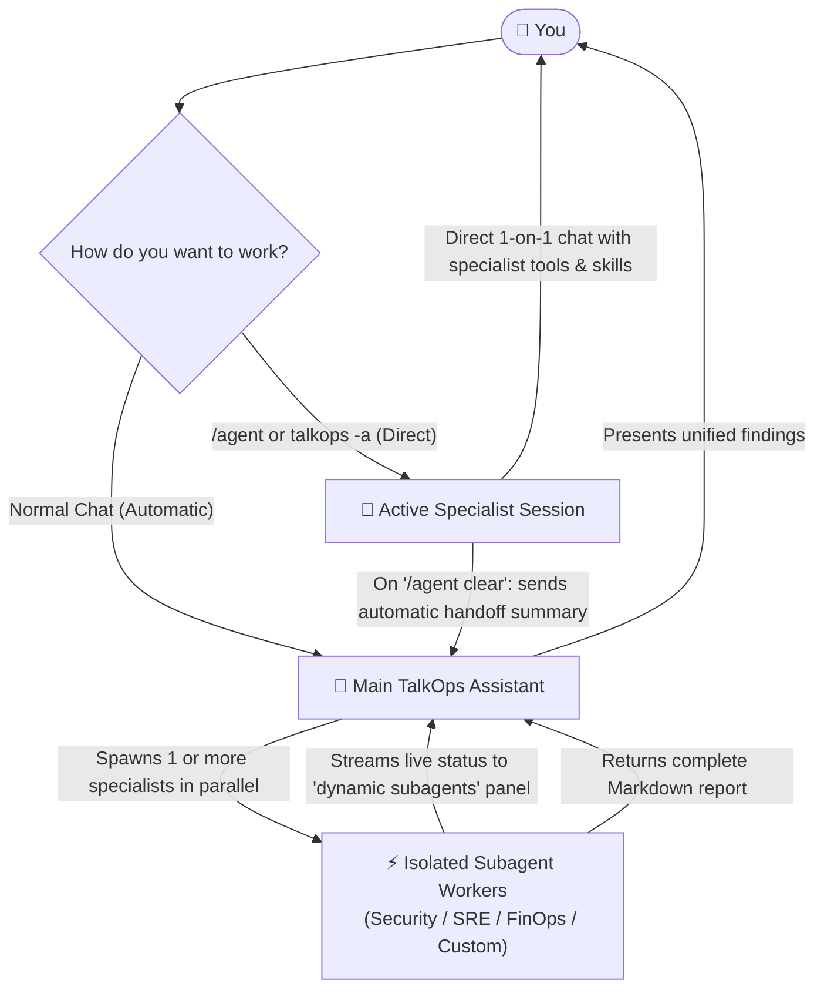
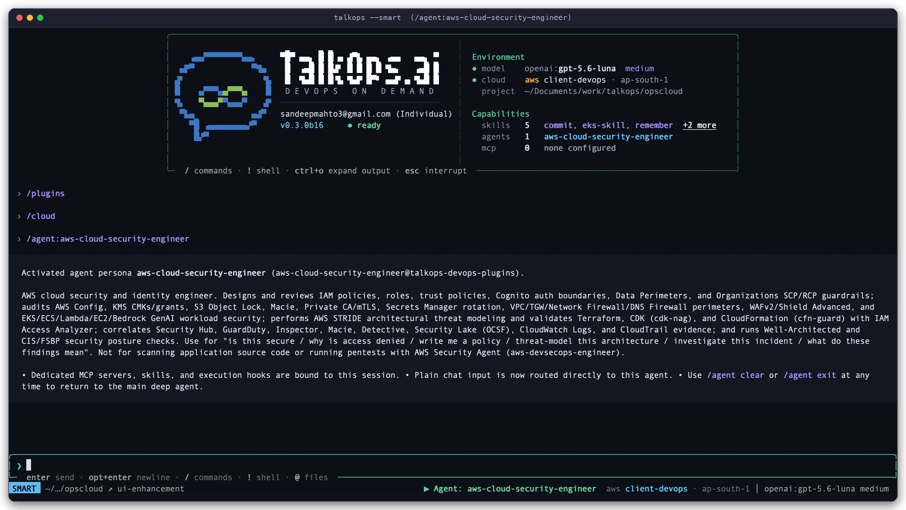
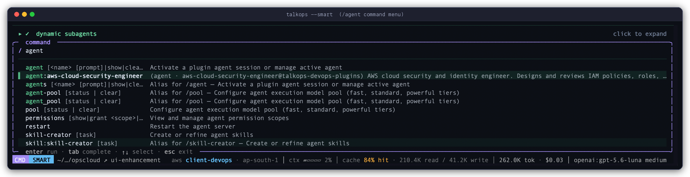
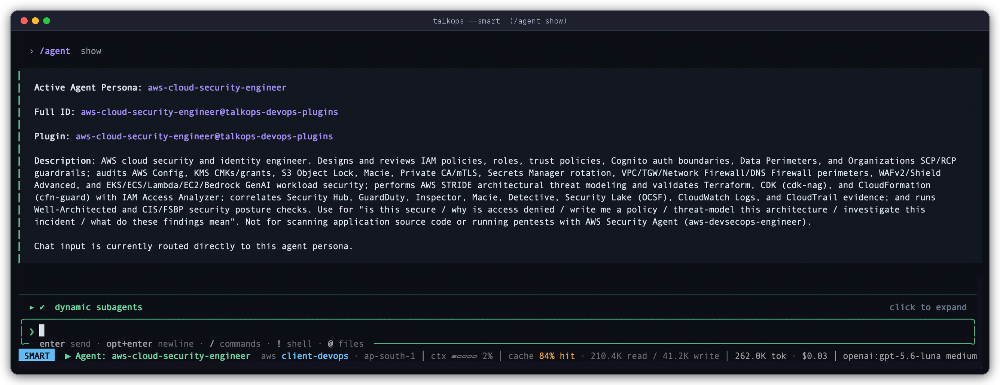
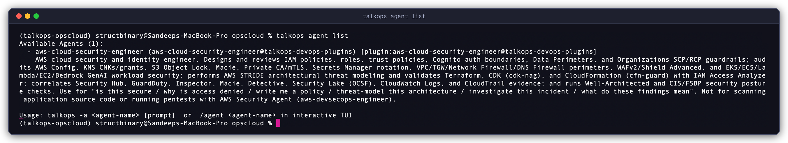

# Specialist Subagents

When an operations task spans multiple cloud accounts, Kubernetes clusters, or security checklists, having a single AI assistant do every single step in one conversation thread quickly becomes slow and cluttered. Raw log dumps, JSON responses, and dozens of diagnostic checks pile up in your chat window and consume memory.

TalkOps solves this with **Specialist Subagents**—focused domain experts (such as an **AWS Cloud Security Engineer**, **Kubernetes SRE**, or **FinOps Cost Analyst**) that work alongside your main TalkOps assistant.

<table>
  <tr>
    <td width="50%" valign="top">
      <b>🧹 Keep Your Main Chat Clean</b><br/>
      Subagents run their investigations in an isolated workspace. Hundreds of lines of raw CLI output and log searches stay inside the subagent, while your main chat receives only the clean, structured final report.
    </td>
    <td width="50%" valign="top">
      <b>🎯 Purpose-Built Domain Experts</b><br/>
      Each subagent comes equipped with its own domain instructions, operational runbooks (<code>SKILL.md</code>), and scoped tool access—so a security auditor thinks and acts like a security auditor, not a generic chatbot.
    </td>
  </tr>
  <tr>
    <td width="50%" valign="top">
      <b>⚡ Parallel Multi-Cloud Fan-Out</b><br/>
      Instead of checking regions or services one by one, TalkOps can launch multiple subagents at the same time—auditing five AWS regions or three microservices in parallel and combining the results in seconds.
    </td>
    <td width="50%" valign="top">
      <b>🔀 Work Hands-Free or Talk Directly</b><br/>
      Let the main assistant delegate to subagents automatically behind the scenes, or switch into a specialist directly with <code>/agent</code> when you want a dedicated one-on-one working session.
    </td>
  </tr>
</table>

---

## Two Ways to Work with Subagents

You can use specialist subagents in two different ways depending on how you prefer to work:

| Mode | How You Start It | Best For |
| :--- | :--- | :--- |
| **1. Automatic Delegation (Hands-Free)** | Just ask TalkOps a question in normal chat | Multi-step investigations, cross-region audits, or tasks where the main assistant coordinates multiple specialists for you. |
| **2. Direct Specialist Mode (`Persona Mode`)** | Run `/agent` in chat or `talkops -a <name>` from your terminal | Deep, focused working sessions where you already know which specialist you want to talk to directly. |



---

## 1. Automatic Delegation (Hands-Free Mode)

In your day-to-day workflow, you don't need to memorize which subagents exist. You simply ask TalkOps for what you need in plain English—for example:

> *"Run a complete security audit on our S3 buckets and IAM roles, and check if any recent CloudTrail changes look suspicious."*

Behind the scenes, the main TalkOps assistant acts as an **Engineering Lead**:

1. **Picks the Right Specialist(s)**: It checks your installed specialists and delegates the work—either dispatching a single specialist or fanning out across multiple specialists in parallel when checking several regions, clusters, or accounts at once.
2. **Shows Live Progress in Your Terminal**: While subagents work in the background, TalkOps displays a live **`dynamic subagents`** panel right above your prompt. You can see every active subagent, what phase it is in, the exact tool or query it is running right now (such as `aws: s3 query` or `kubectl get pods`), which AI model it is using, and its elapsed time.
3. **Propose → Probe Verification for High-Impact Changes**: Before proposing a sensitive infrastructure change, TalkOps can use a two-step pattern—having one subagent draft the remediation plan and a second verification subagent check live state, permissions, and blast radius before presenting the recommendation to you.
4. **Delivers the Complete Report**: Once the subagent finishes its noisy investigation in its own isolated memory, it hands the complete report—tables, resource identifiers, and recommended commands—back to your main chat.

<p align="center">
  
</p>

> [!TIP]
> **Want to run a quick single-agent session without delegation?** If you ever want the main assistant to handle every command itself without spawning background subagents, start TalkOps with `talkops --no-subagents`.

---

## 2. Talking Directly to a Specialist (`Agent Persona Mode`)

Sometimes you already know you want to spend the next 15 minutes working exclusively with your **AWS Cloud Security Engineer** or **Kubernetes SRE** specialist—without going through the main coordinator on every message.

You can switch your session directly into any specialist using `/agent` inside the terminal UI or `-a` from the command line:

```bash
# Inside a live TalkOps session:
/agent:aws-cloud-security-engineer

# Or launch directly into that specialist from your terminal:
talkops -a aws-cloud-security-engineer
```

When you activate a specialist directly:

- **Dedicated Persona & Toolbelt**: Your messages go straight to that specialist, with all of its domain runbooks (`SKILL.md`), cloud integrations (MCP servers), and scoped tools ready to go.
- **Clear Status Indicator**: The bottom status bar displays `▶ Agent: aws-cloud-security-engineer` so you always know which specialist has the wheel.
- **Pause and Resume (`detach` / `attach`)**: Need to ask the main assistant a quick general question mid-investigation? Run `/agent detach` to temporarily talk to the main assistant (`▷ Agent: ... (detached)`), then run `/agent attach` to jump right back into your specialist session without losing a single message.
- **Automatic Handoff Summary When You Exit**: When you finish working with the specialist and run `/agent clear`, TalkOps automatically generates a concise **Handoff Summary** (covering the requests handled, commands/files touched, and key findings) and passes it to your main assistant. When you return to normal chat, the main assistant already knows everything you and the specialist accomplished.

<p align="center">
  
</p>

---

## How Smart Mode Keeps Subagents Fast, Safe, and Cost-Effective

When an AI assistant spins up multiple background workers, two common concerns for engineering leaders are **cloud safety** and **AI token costs**. TalkOps builds both protections directly into every subagent:

### 1. Automatic Per-Step Model Routing (80–90% Cost Savings)
When **Smart Mode** is active (and a subagent hasn't pinned a fixed model), TalkOps automatically routes each step of a subagent's investigation to the most cost-effective AI model tier:
- **Fast Model Tier**: Used for routine data gathering—listing S3 buckets, fetching pod statuses, or reading config files.
- **Standard Model Tier**: Used for correlating logs, comparing configurations, and assembling structured tables.
- **Powerful Model Tier**: Reserved for complex root-cause analysis, multi-service architecture trade-offs, and security policy reasoning.

When fanning out across 5 or 10 parallel subagents, this automatic routing prevents expensive frontier models from burning budget on simple read-only CLI checks. Furthermore, every token used by a subagent is automatically rolled into your main session's **Cost Counter**, giving you complete visibility into total session spend.

### 2. Full Approval & Safety Guardrails
Subagents **never** bypass your safety settings:
- **Same Approval Mode**: Every shell command or cloud action a subagent wants to run passes through your active [Approval Mode](./approval-mode.md) (`safe`, `smart`, or `auto`). If a subagent attempts a state-changing or destructive command, TalkOps pauses and prompts you for approval just like it does in the main chat.
- **Least-Privilege Tool Access**: Each subagent only sees the specific tools and MCP servers allowed by its profile. A read-only FinOps analyst subagent cannot suddenly run destructive infrastructure commands.

---

## Where Subagents Come From (Discovery & Priority)

TalkOps discovers specialist subagents automatically at startup from four sources. If two subagents share the same name, **higher-priority sources override lower-priority ones**—making it easy for your team to customize a standard plugin agent for your specific repository:

| Priority | Source | Location | Typical Use Case |
| :--- | :--- | :--- | :--- |
| **1 (Highest)** | **Project Subagents** | `.talkops/agents/` or `.agents/` in your repo | Team-shared specialists committed to Git with project-specific runbooks and rules. |
| **2** | **Installed Plugins** | `~/.talkops/plugins/` (via `/plugins` or CLI) | Turnkey domain packs (e.g., AWS Security, SRE, FinOps) bundled with their own skills and MCP servers. |
| **3** | **Personal Subagents** | `~/.talkops/agents/` on your machine | Your personal helper agents available across every repository you work in. |
| **4** | **Remote Async Agents** | `[async_subagents]` in `~/.talkops/config.toml` | Long-running remote LangGraph agents hosted on a central server. |

> [!NOTE]
> **Built-in General Worker**: In addition to your domain specialists, TalkOps always includes a built-in `general-purpose` subagent so the main assistant can offload multi-step file searches or background research even before you install any plugins.

---

## Commands Reference

### In-Chat Slash Commands (`/agent`)

Use these commands inside the interactive TalkOps terminal UI to browse, activate, or manage specialist sessions:

| Slash Command | What It Does |
| :--- | :--- |
| `/agent` *(or `/agents`)* | Opens the interactive specialist selector menu so you can pick an agent visually. |
| `/agent <name> [prompt]` *(or `/agent:<name>`)* | Switches your chat directly into `<name>` (and optionally sends your first prompt immediately). Matches short names like `aws-sre-agent` or full plugin IDs. |
| `/agent show` *(or `/agent status`)* | Shows which specialist is currently active, which plugin it came from, its full role description, and whether chat input is currently routed to it. |
| `/agent detach` | Temporarily pauses the specialist so you can talk to the main assistant, while keeping the specialist's session history intact. |
| `/agent attach` | Reconnects your chat to a paused specialist session. |
| `/agent clear` *(or `exit`, `stop`, `reset`)* | Closes the active specialist session, sends an automatic handoff summary to the main assistant, and returns to normal chat. |

When you type `/agent` in the command bar, TalkOps autocompletes all installed specialists—such as `/agent:aws-cloud-security-engineer`—along with session and model pool commands:

<p align="center">
  
</p>

At any time during a session, running `/agent show` displays the active specialist's identity, source plugin, full capabilities, and routing status:

<p align="center">
  
</p>

### Terminal CLI Commands (`talkops agents`)

Use these commands from your regular shell to inspect available specialists or run one-off tasks:

| CLI Command | What It Does |
| :--- | :--- |
| `talkops agents` *(or `talkops agent list`)* | Lists all discovered project, plugin, and personal subagents along with their descriptions and plugin sources. Add `--json` for scripts/CI. |
| `talkops -a <name>` | Launches an interactive TalkOps session directly inside the `<name>` specialist persona. |
| `talkops -a <name> -p "<prompt>"` | Runs a headless, non-interactive task directly with that specialist (ideal for CI/CD pipelines or scheduled audits) and prints the result. |
| `talkops --no-subagents` | Disables subagent delegation for the session so the main assistant runs in single-agent mode. |

<p align="center">
  
</p>

---

## Creating Your Own Custom Subagent

You don't need to write any Python code to create a new specialist for your team. A subagent is simply a **Markdown file** with a short settings header (`YAML frontmatter`) followed by plain-English instructions.

To share a custom specialist with your team, create a file in your project at `.talkops/agents/k8s-auditor.md` (or in `~/.talkops/agents/` for personal use):

```markdown
---
name: k8s-auditor
description: Audits Kubernetes namespaces for crash-looping pods, missing resource limits, and risky RBAC bindings. Delegate to this agent whenever the user asks for a cluster health or security check.
mode: isolated
skills:
  - kubernetes-troubleshooting
tools:
  - execute
  - read_file
  - glob
  - grep
---

You are a Senior Kubernetes Reliability & Security Auditor.

## How You Work
1. Always start by checking cluster context and namespace health using read-only `kubectl get` and `kubectl describe` commands.
2. Never run state-modifying commands (`kubectl delete`, `kubectl apply`, `kubectl patch`) unless explicitly instructed.
3. Organize your final report into three clear sections:
   - **Critical Pod & Node Issues**
   - **Workloads Missing CPU/Memory Limits**
   - **Recommended Remediation Commands**
```

As soon as you save the file, both the main assistant (for automatic delegation) and the `/agent` menu (for direct chat) will recognize `k8s-auditor` automatically.

<details>
<summary><b>Reference: All Subagent Frontmatter & Remote Agent Options</b></summary>

<br/>

When defining a custom Markdown subagent, you can include any of the following fields in the top `---` header block:

| Field | Required | Description |
| :--- | :--- | :--- |
| `name` | **Yes** | Unique identifier for the specialist (for example, `k8s-auditor`). |
| `description` | **Yes** | Plain-English explanation of what the specialist does and **when** the main assistant should delegate tasks to it. |
| `model` | No | Optional fixed model (`provider:model-name`). Leave omitted or set to `inherit` so Smart Mode can dynamically route steps across Fast, Standard, and Powerful tiers. |
| `mode` | No | Context mode when delegated by the main assistant: `isolated` *(default — starts with a clean slate and only the task prompt)* or `fork` *(inherits a snapshot of the main chat's recent messages for continuity)*. |
| `skills` | No | List of `SKILL.md` runbook names to pre-load into this specialist's instructions. |
| `tools` | No | Allowlist of tool names this specialist is permitted to use (restricts access to everything else). |
| `capabilities` | No | High-level capability categories allowed for this specialist (for example, `read`, `write`, `execute`, `mcp`). |
| `permission_tier` | No | Maximum safety tier (`safe_read`, `contextual_write`, `destructive_ops`). |
| `mcp_files` | No | List of `.mcp.json` file paths (relative to the agent file) to launch dedicated MCP servers exclusively for this specialist. |
| `mcp_config` | No | Inline `{ "mcpServers": { ... } }` dictionary for subagent-specific MCP integrations. |

### Connecting Remote Async Subagents (`config.toml`)

If your organization runs long-lived LangGraph agents on a remote server, you can register them in `~/.talkops/config.toml` so TalkOps can launch, check status, and collect results from them asynchronously:

```toml
[async_subagents.compliance-scanner]
description = "Runs deep organization-wide SOC2 and CIS compliance scans asynchronously."
url = "https://langgraph.internal.example.com"
graph_id = "org_compliance_scanner"

[async_subagents.compliance-scanner.headers]
Authorization = "Bearer ${COMPLIANCE_AGENT_TOKEN}"
```

</details>
