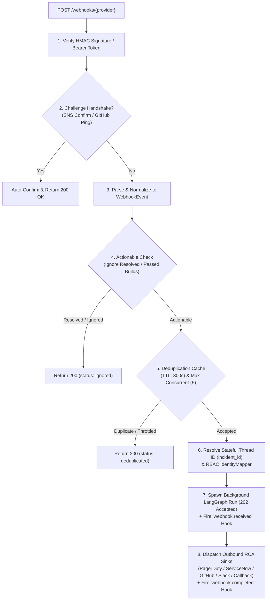

# Webhooks & Event-Driven Automation

TalkOps listens on HTTP webhooks (`/webhooks/{provider}`) to transform real-time production alerts, CI/CD pipeline failures, and ITSM tickets into autonomous LangGraph investigations—and writes structured Root Cause Analysis (RCA) findings back to your incident management tools.

When an alert fires in PagerDuty, Prometheus Alertmanager, Datadog, AWS SNS/CloudWatch, CloudEvents, ServiceNow, Jenkins, GitHub Actions, or Azure Monitor, TalkOps verifies the cryptographic signature, deduplicates alert storms, maps related events for the same incident into a stateful conversation thread, executes diagnostic subagents under Jev Smart Mode guardrails, and posts the RCA back to the originating ticket, pull request, or Slack channel.

> [!NOTE]
> 📸 **Image Placeholder — `docs/assets/webhooks-pipeline-overview.png`**
> **What to capture:** Screenshot showing `talkops serve` receiving a `POST /webhooks/pagerduty` event, dispatching the investigation in a LangGraph thread with Jev Smart Mode, and posting the formatted Root Cause Analysis back to a PagerDuty Incident Note and Slack channel.

<table>
  <tr>
    <td width="50%" valign="top">
      <h3>🔌 9 Built-in Provider Adapters</h3>
      <p>Out-of-the-box normalization for <code>sns</code>, <code>pagerduty</code>, <code>alertmanager</code>, <code>cloudevents</code>, <code>jenkins</code>, <code>github</code>, <code>datadog</code>, <code>servicenow</code>, and <code>generic</code> (including native Azure Monitor Common Alert Schema, Opsgenie, Jira, ArgoCD, and GitLab).</p>
    </td>
    <td width="50%" valign="top">
      <h3>🛡️ Storm Deduplication &amp; Throttling</h3>
      <p>Suppresses duplicate webhook bursts within a configurable TTL window (default <code>300s</code>) and bounds concurrent background agent runs (default <code>5</code>).</p>
    </td>
  </tr>
  <tr>
    <td width="50%" valign="top">
      <h3>🧵 Stateful Incident-to-Thread Mapping</h3>
      <p>Routes follow-up alerts sharing the same <code>incident_id</code> into the existing LangGraph thread via <code>ThreadStore</code> so the agent retains full historical context across an evolving outage.</p>
    </td>
    <td width="50%" valign="top">
      <h3>🔄 Bidirectional RCA Write-Backs</h3>
      <p>Automatically posts completed Root Cause Analysis reports back to PagerDuty Incident Notes, ServiceNow <code>work_notes</code>, GitHub PR/commit comments, Slack webhooks, and custom HTTP callbacks.</p>
    </td>
  </tr>
</table>

---

## Starting the webhook listener

Launch the webhook listener via `talkops serve` (or its aliases `talkops webhooks` and `talkops webhook`):

```bash
# Start central server & webhook listener on port 2024
talkops serve --host 0.0.0.0 --port 2024 --webhook-secret "$TALKOPS_WEBHOOK_SECRET"

# Or run the alias directly
talkops webhooks --port 2024 --approval-mode smart

# List all registered webhook providers and endpoint paths
talkops webhooks list
```

### Dedicated webhook port (`--webhook-port`)

If you want connected operator TUI clients on an internal port (`2024`) while exposing only `/webhooks/*` to an external API gateway on port `8080`, pass `--webhook-port`:

```bash
talkops serve \
  --host 0.0.0.0 \
  --port 2024 \
  --webhook-port 8080 \
  --postgres-uri "postgresql://ops:secret@db:5432/talkops"
```

---

## How the webhook ingestion pipeline works

Every `POST /webhooks/{provider}` request flows through the 8-stage `WebhookDispatcher` pipeline (`src/talkops/webhooks/dispatcher.py`):



1. **Cryptographic Verification**: Validates provider-specific HMAC signatures (`X-PagerDuty-Signature`, `X-Hub-Signature-256`, `X-Gitlab-Token`) or shared bearer/query tokens (`Authorization: Bearer <secret>`, `X-Webhook-Secret`, or `?token=<secret>`).
2. **Protocol Handshakes**: Automatically confirms AWS SNS `SubscriptionConfirmation` requests via HTTP `GET` (`webhooks.sns_auto_confirm = true`) and responds to GitHub `ping` events.
3. **Normalization (`WebhookEvent`)**: Extracts `event_type`, `severity` (`critical`, `high`, `warning`, `info`), `title`, `summary`, `source_service`, `incident_id`, `dedupe_key`, `repository`, `branch`, `commit_sha`, and constructs a structured DevOps investigation prompt.
4. **Actionable Filtering**: Automatically ignores `resolved`/`ok` alerts (`ignore_resolved=True`) and successful CI runs (`ignore_non_actionable_ci=True`) so agent compute is spent strictly on active incidents.
5. **Alert Storm Deduplication & Throttling**: Drops duplicate `dedupe_key` deliveries within `webhooks.dedupe_ttl_seconds` (`300s` default) and caps simultaneous webhook-triggered agent runs at `webhooks.max_concurrent_runs` (`5` default).
6. **Stateful Thread Mapping & RBAC**: `ThreadStore` maps the event's `incident_id` to a persistent LangGraph `thread_id`. If an incident triggers 5 cascading alerts over 20 minutes, all 5 alerts append to the **same** investigation thread. `IdentityMapper` assigns the appropriate RBAC role and allowed subagent capabilities.
7. **Asynchronous Execution (`202 Accepted`)**: Immediately returns `202 Accepted` with the `delivery_id` and `thread_id` while executing the LangGraph run in the background. Fires the `webhook.received` lifecycle hook.
8. **Bidirectional RCA Write-Back**: Upon completion, `dispatch_completion_sinks` posts the agent's Root Cause Analysis back to the originating platform and fires the `webhook.completed` hook.

---

## Supported webhook providers

### 1. PagerDuty (`POST /webhooks/pagerduty`)

Ingests PagerDuty v3 webhook subscriptions (`incident.triggered`, `incident.escalated`, `incident.reopened`).

- **Inbound Verification**: `TALKOPS_WEBHOOK_PAGERDUTY_SECRET` (verifies `X-PagerDuty-Signature: v1=<hmac_sha256>`).
- **Stateful Threading**: Maps `data.id` (`incident_id`) to a persistent LangGraph thread.
- **Automated Write-Back**: Set `TALKOPS_WEBHOOK_PAGERDUTY_API_KEY` and `TALKOPS_WEBHOOK_PAGERDUTY_FROM_EMAIL` to automatically post the agent's RCA as a **PagerDuty Incident Note** (`POST https://api.pagerduty.com/incidents/{id}/notes`).

```bash
curl -X POST http://localhost:2024/webhooks/pagerduty \
  -H "Content-Type: application/json" \
  -H "X-PagerDuty-Signature: v1=..." \
  -d '{
    "event": {
      "id": "01B2C3D4",
      "event_type": "incident.triggered",
      "data": {
        "id": "Q123456789",
        "title": "High 5xx Error Rate on checkout-service (prod-us-east-1)",
        "urgency": "high",
        "service": {"summary": "checkout-service"}
      }
    }
  }'
```

### 2. Prometheus Alertmanager (`POST /webhooks/alertmanager`)

Ingests Alertmanager group webhook payloads (`firing` alerts), extracting labels (`alertname`, `severity`, `namespace`, `pod`, `service`, `cluster`) and annotations (`summary`, `description`, `runbook_url`).

- **Inbound Verification**: `TALKOPS_WEBHOOK_SECRET` via `Authorization: Bearer <secret>` or `?token=<secret>`.
- **Stateful Threading**: Uses `groupKey` / `fingerprint` to correlate grouped alerts into a single thread.

### 3. AWS SNS & CloudWatch Alarms (`POST /webhooks/sns`)

Ingests AWS SNS HTTP/HTTPS notifications, automatically unwrapping embedded **CloudWatch Alarm** JSON payloads (`AlarmName`, `NewStateValue`, `NewStateReason`, `Namespace`, `MetricName`, `Dimensions`).

- **Automatic Subscription Confirmation**: When you subscribe `https://talkops.company.com/webhooks/sns` to an SNS topic, TalkOps automatically fetches the `SubscribeURL` when `Type == "SubscriptionConfirmation"` (`webhooks.sns_auto_confirm = true`).

### 4. Datadog (`POST /webhooks/datadog` or `/webhooks/dd`)

Ingests Datadog Monitor and Synthetics alert webhooks (`alert_transition: Triggered`, `No Data`), extracting monitor tags, host, query, and snapshot links.

- **Inbound Verification**: `TALKOPS_WEBHOOK_SECRET` or `TALKOPS_WEBHOOK_SECRET_DATADOG`.
- **Stateful Threading**: Correlates by `alert_id` or `event_id`.

### 5. ServiceNow ITSM (`POST /webhooks/servicenow`, `/webhooks/snow`, `/webhooks/itsm`)

Ingests ServiceNow Incident webhook payloads (`number`, `sys_id`, `priority`, `urgency`, `short_description`, `cmdb_ci`, `assignment_group`).

- **Automated Write-Back**: When the payload includes `instance_url` and `sys_id` (and `SERVICENOW_USER` / `SERVICENOW_PASSWORD` or `SERVICENOW_TOKEN` is configured), TalkOps automatically patches the incident's **`work_notes`** (`PATCH {instance_url}/api/now/table/incident/{sys_id}`) with the completed RCA.

### 6. GitHub Actions, Issues & PRs (`POST /webhooks/github`)

Ingests GitHub `workflow_run` failures, `check_suite` failures, `issues`, and `pull_request` events.

- **Inbound Verification**: `TALKOPS_WEBHOOK_GITHUB_SECRET` (verifies `X-Hub-Signature-256: sha256=<hmac_sha256>`).
- **Automated Write-Back**: Set `TALKOPS_WEBHOOK_GITHUB_TOKEN` (or `GITHUB_TOKEN`) to automatically post the RCA comment back to the originating **Pull Request** (`/issues/{pr}/comments`) or **Commit** (`/commits/{sha}/comments`).

### 7. Jenkins CI/CD (`POST /webhooks/jenkins`)

Ingests Jenkins Notification Plugin and Pipeline build webhooks (`FAILED`, `UNSTABLE`, `ABORTED`), extracting job name, build number, Git branch/commit, and console failure logs.

- **Inbound Verification**: `TALKOPS_WEBHOOK_JENKINS_TOKEN` via `Authorization: Bearer <token>` or `X-Webhook-Token`.

### 8. CNCF CloudEvents 1.0 (`POST /webhooks/cloudevents`)

Ingests standard CNCF CloudEvents (`specversion: "1.0"`) both in structured JSON mode and binary header mode (`ce-id`, `ce-type`, `ce-source`, `ce-subject`)—ideal for **Argo Events**, **Knative Eventing**, **Keptn**, and **Kubernetes Event Exporters**.

### 9. Generic & Multi-Platform Adapter (`POST /webhooks/{alias}`)

The universal adapter handles custom JSON webhooks as well as dedicated aliases:
- **`POST /webhooks/azure-monitor`**: Native parser for the **Azure Monitor Common Alert Schema** (`data.essentials.alertRule`, `severity`, `monitorCondition`, `alertTargetIDs`, `alertContext`).
- **`POST /webhooks/opsgenie`**: Opsgenie alert webhooks.
- **`POST /webhooks/argocd`**: ArgoCD Application sync/health failure notifications.
- **`POST /webhooks/gitlab`**: GitLab CI pipeline and merge request hooks (verified via `TALKOPS_WEBHOOK_GITLAB_TOKEN` / `X-Gitlab-Token`).
- **`POST /webhooks/jira`**: Jira issue/incident automation webhooks.
- **`POST /webhooks/generic`** / **`POST /webhooks/custom`**: Any custom JSON payload (automatically extracts `title`, `summary`, `message`, `severity`, `service`, `incident_id`, and `callback_url`).

---

## Outbound RCA write-back sinks

When a webhook-triggered LangGraph investigation finishes, `dispatch_completion_sinks()` (`src/talkops/webhooks/sinks.py`) delivers the formatted Root Cause Analysis to all configured sinks in parallel:

| Sink | Configuration Key / Env Var | Behavior |
| :--- | :--- | :--- |
| **PagerDuty Incident Notes** | `webhooks.pagerduty_api_key` (`TALKOPS_WEBHOOK_PAGERDUTY_API_KEY`) + `webhooks.pagerduty_from_email` (`TALKOPS_WEBHOOK_PAGERDUTY_FROM_EMAIL`) | Posts `[TalkOps Automated RCA]` directly to `POST /incidents/{incident_id}/notes` when `provider == "pagerduty"`. |
| **ServiceNow Work Notes** | `SERVICENOW_TOKEN` or `SERVICENOW_USER` + `SERVICENOW_PASSWORD` | Updates `work_notes` on `/api/now/table/incident/{sys_id}` when `provider == "servicenow"`. |
| **GitHub PR / Commit Comments** | `webhooks.github_token` (`TALKOPS_WEBHOOK_GITHUB_TOKEN` or `GITHUB_TOKEN`) | Posts `### 🤖 TalkOps Automated Root Cause Analysis` on the PR or commit when `provider == "github"`. |
| **Slack Incoming Webhook** | `webhooks.slack_url` (`TALKOPS_WEBHOOK_SLACK_URL` or `SLACK_WEBHOOK_URL`) | Posts severity-badged (`🚨 CRITICAL`, `🔥 HIGH`, `⚠️ WARNING`) RCA summary with provider, service, and `thread_id` to Slack for **any** webhook provider. |
| **Custom HTTP Callback** | `webhooks.callback_url` (`TALKOPS_WEBHOOK_CALLBACK_URL`) or per-payload `"callback_url"` | Sends a structured JSON `POST` containing `delivery_id`, `thread_id`, `provider`, `incident_id`, `severity`, `status`, and `response` to your custom endpoint. |

---

## Configuring `[webhooks]` in `config.toml`

You can configure all webhook listener settings, verification secrets, and outbound write-back sinks in `~/.talkops/config.toml` or `.talkops/config.toml`:

```toml
[webhooks]
host = "0.0.0.0"
port = 2024
dedupe_ttl_seconds = 300
max_concurrent_runs = 5
sns_auto_confirm = true

# Inbound verification secrets (prefer env vars or `talkops auth` in production)
secret = "env:TALKOPS_WEBHOOK_SECRET"
pagerduty_secret = "env:TALKOPS_WEBHOOK_PAGERDUTY_SECRET"
github_secret = "env:TALKOPS_WEBHOOK_GITHUB_SECRET"
gitlab_token = "env:TALKOPS_WEBHOOK_GITLAB_TOKEN"
jenkins_token = "env:TALKOPS_WEBHOOK_JENKINS_TOKEN"

# Outbound RCA write-back sinks
slack_url = "https://hooks.slack.com/services/T000/B000/XXXX"
pagerduty_api_key = "env:TALKOPS_WEBHOOK_PAGERDUTY_API_KEY"
pagerduty_from_email = "talkops-bot@company.com"
github_token = "env:TALKOPS_WEBHOOK_GITHUB_TOKEN"
callback_url = "https://internal-event-bus.company.com/talkops/rca"
```

---

## Inspecting deliveries & attaching to webhook threads

You can query recent webhook deliveries and attach an interactive TUI session directly to a webhook-spawned investigation thread:

1. **Query recent deliveries via HTTP**:

   ```bash
   curl -s http://localhost:2024/webhooks/deliveries | jq .
   ```

   ```json
   {
     "deliveries": [
       {
         "delivery_id": "wh_9a8b7c6d5e4f",
         "provider": "pagerduty",
         "event_type": "incident.triggered",
         "severity": "critical",
         "title": "High 5xx Error Rate on checkout-service",
         "incident_id": "Q123456789",
         "thread_id": "3f9d2a11-8c4b-4e7a-9b12-0a1b2c3d4e5f",
         "status": "completed",
         "received_at": "2026-10-16T13:20:05Z"
       }
     ],
     "count": 1
   }
   ```

2. **Attach your interactive TUI to the webhook's LangGraph thread**:

   ```bash
   talkops --server-url http://localhost:2024 -r 3f9d2a11-8c4b-4e7a-9b12-0a1b2c3d4e5f
   ```

   Once attached, you see the full webhook prompt, every diagnostic command and subagent run executed during the autonomous RCA, and can immediately issue follow-up remediation commands or `/fork` the thread.

---

## Next steps

- **[Central Server & Multi-Client Architecture](central-server.md)** — Scale `talkops serve` with PostgreSQL and multi-user authentication
- **[Hooks](hooks.md)** — Trigger local scripts on `webhook.received` and `webhook.completed` events
- **[Approval Modes & Jev Smart Mode](approval-mode.md)** — Learn how Smart Mode governs tool execution during unattended webhook runs
