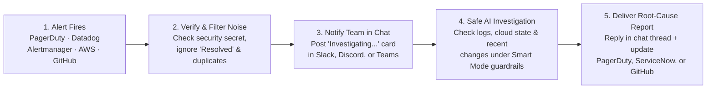
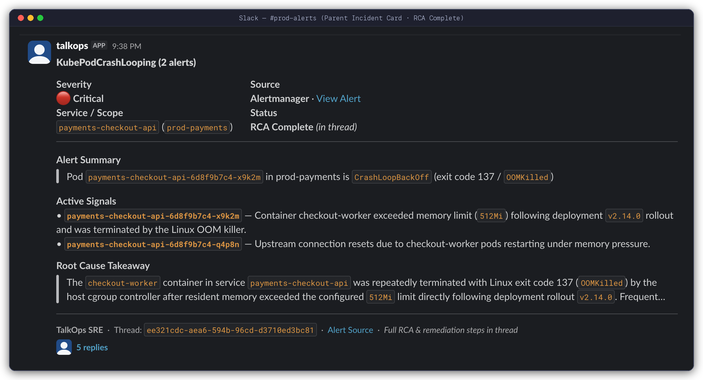
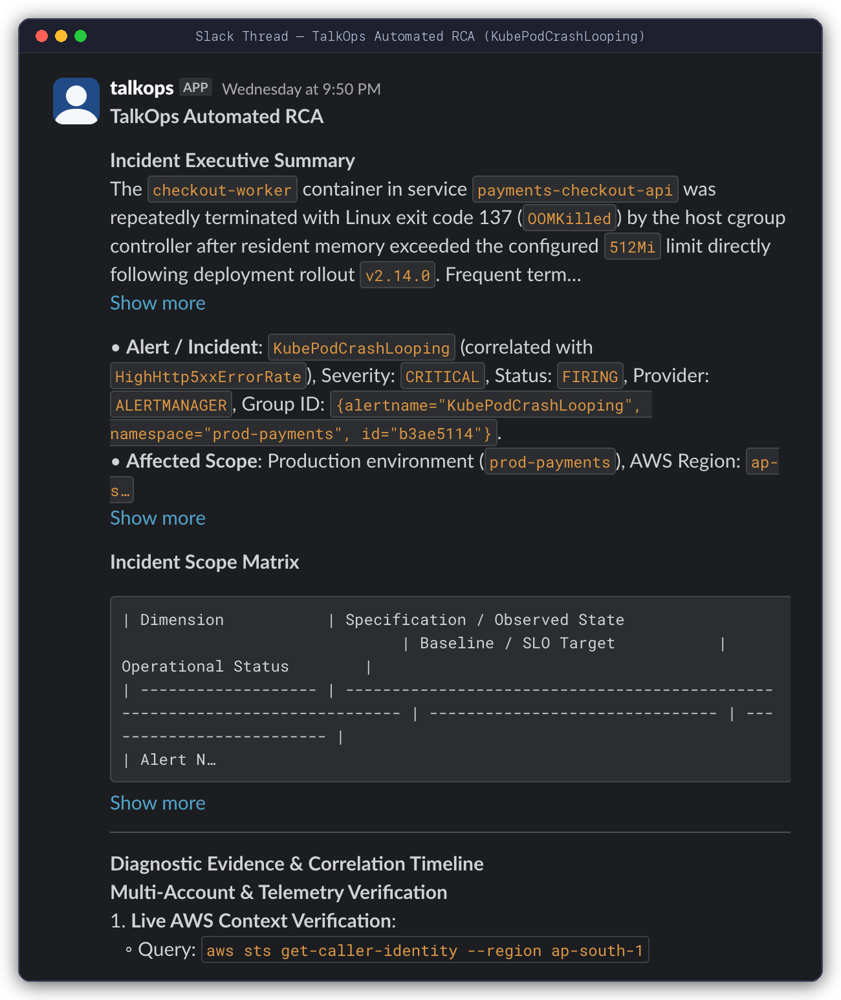

# Webhooks & Automated Incident Response

> Turn live alerts from PagerDuty, Datadog, Prometheus, AWS, ServiceNow, and GitHub into clear root-cause reports—posted automatically to your tickets and chat channels.

When a production alert goes off at 3 AM or a deployment fails, an on-call engineer usually spends the first 15 to 30 minutes just gathering facts: checking which servers or containers crashed, reading recent logs, seeing what code or configuration changed recently, and posting updates in Slack or PagerDuty.

**TalkOps Webhooks** automate that entire first-responder step. When you run TalkOps in server mode (`talkops serve`), your monitoring, ticketing, and CI/CD tools can send alerts directly to TalkOps. Within seconds, TalkOps starts a safe investigation, finds the root cause, and posts a clear **Root Cause Analysis (RCA)** report back to your team in Slack, Microsoft Teams, Discord, PagerDuty, ServiceNow, or GitHub.

<table>
  <tr>
    <td width="50%" valign="top">
      <h3>Works with Your Existing Tools</h3>
      <p>Connects out of the box with <b>PagerDuty, Prometheus Alertmanager, Grafana, AWS SNS/CloudWatch, Datadog, ServiceNow, GitHub, Jenkins, Azure Monitor, Opsgenie, Jira, Argo CD, and GitLab</b>.</p>
    </td>
    <td width="50%" valign="top">
      <h3>Stops Alert Storms &amp; Wasted Spend</h3>
      <p>If a major outage triggers dozens of identical alerts in a few minutes, TalkOps automatically groups them and runs <b>one</b> investigation instead of paying for 50 duplicate AI runs.</p>
    </td>
  </tr>
  <tr>
    <td width="50%" valign="top">
      <h3>One Continuous Thread per Incident</h3>
      <p>If an outage evolves—or if an engineer adds a note in PagerDuty—TalkOps routes the new information into the <b>same</b> ongoing investigation so full context is preserved.</p>
    </td>
    <td width="50%" valign="top">
      <h3>Updates Chat &amp; Tickets Automatically</h3>
      <p>Posts an immediate <code>Investigating...</code> card in Slack, Discord, or Teams, replies in the same thread with the full root-cause report, and writes findings straight into PagerDuty notes, ServiceNow tickets, or GitHub PRs.</p>
    </td>
  </tr>
</table>

---

## How Automated Incident Triage Works

When an alert is sent to TalkOps (`/webhooks/{provider}`), it goes through five simple steps:



1. **Verifies the sender**: Checks the security secret or signature from PagerDuty, GitHub, Datadog, or your monitoring tool to make sure the alert is genuine.
2. **Filters out noise and duplicates**:
   - **Ignores recovery messages**: When an alert flips back to `"OK"` or `"Resolved"`, or when a CI build passes, TalkOps skips it so you only spend AI budget on actual problems.
   - **Blocks alert storms**: Repeated alerts for the same issue within 5 minutes (`300s` by default) are automatically deduplicated, and TalkOps caps how many investigations can run at the exact same time (`5` by default).
3. **Keeps related events together**: Every incident ID is linked to a saved conversation thread. If 5 cascading alerts fire for the same outage, TalkOps adds them to the existing investigation instead of starting over from scratch.
4. **Runs a safe investigation**: TalkOps inspects logs, metrics, Kubernetes pods, cloud resources, and recent deployments using your configured safety mode (**Smart Mode** or **Read-Only Mode**).
5. **Posts the findings where your team works**: As soon as the investigation finishes, TalkOps writes a clean summary and remediation plan back to your chat channel and incident ticket.

---

## What Your Team Sees in Slack, Discord, or Teams

When you connect a chat channel (`TALKOPS_WEBHOOK_NOTIFY_CHANNELS`), your team gets a clean, two-step update without cluttering the main channel:

1. **Stage 1 (Main Channel Card)**: As soon as the alert arrives, TalkOps posts an incident summary card showing `Status: Investigating...`. When the investigation finishes, TalkOps updates that same card in place to **`RCA Complete (in thread)`** and adds a **Root Cause Takeaway** summary.
2. **Stage 2 (Detailed Thread Reply)**: Inside the message thread, TalkOps posts the complete **Automated RCA** report—including the executive summary, affected scope matrix, diagnostic evidence, and recommended fix.

<p align="center">
  
</p>
<p align="center">
  <sub><b>Stage 1 — Incident Card in the Main Channel:</b> TalkOps summarizes the incoming alert, lists the active failure signals, updates the status to <code>RCA Complete (in thread)</code>, and highlights the <b>Root Cause Takeaway</b> right on the main card.</sub>
</p>

<p align="center">
  
</p>
<p align="center">
  <sub><b>Stage 2 — Full Root Cause Analysis Inside the Thread:</b> Clicking into the thread shows the full executive summary, incident scope table, and step-by-step diagnostic evidence gathered from your cloud and Kubernetes environment.</sub>
</p>

---

## Starting the Webhook Server

Your platform or SRE team can start the webhook server with a single command (`talkops serve` or `talkops webhooks`):

```bash
# 1. Start the server on port 2024 in Smart Mode
export TALKOPS_WEBHOOK_SECRET="your-shared-webhook-secret"
talkops serve --host 0.0.0.0 --port 2024 --approval-mode smart

# 2. Or run in strict Read-Only Mode (guarantees the AI can only inspect, never modify, cloud resources)
talkops webhooks --port 2024 --smart --read-only

# 3. View all supported webhook URLs and their security status
talkops serve list
```

<p align="center">
  
</p>
<p align="center">
  <sub><b>Launching the Webhook Server (<code>talkops serve</code>):</b> Starting the server on port <code>2024</code> in Smart Mode and displaying the ready-to-use webhook URLs for all 9 built-in integrations.</sub>
</p>

> [!TIP]
> **Keeping internal team traffic separate from external alerts:** If you want your engineers to connect on a private internal port (`2024`) while opening a separate port (`8080`) on your firewall solely for incoming webhooks, add `--webhook-port 8080`:
> ```bash
> talkops serve --host 0.0.0.0 --port 2024 --webhook-port 8080 --smart
> ```

---

## Supported Alert & CI/CD Integrations

TalkOps includes **9 built-in webhook adapters** (plus **22 shorthand URL aliases**) so you can point almost any monitoring, ticketing, or CI/CD tool straight at your server:

| Integration | Webhook URL Path | Shorthand Aliases | What Triggers an Investigation | Where TalkOps Replies Automatically |
| :--- | :--- | :--- | :--- | :--- |
| **PagerDuty** | `/webhooks/pagerduty` | `/webhooks/pd` | Triggered, escalated, or reopened incidents + human notes added to an incident | **PagerDuty Incident Notes** + Slack / Discord / Teams |
| **Prometheus & Grafana** | `/webhooks/alertmanager` | `/webhooks/prometheus`, `/webhooks/grafana`, `/webhooks/mimir`, `/webhooks/loki`, `/webhooks/vmalert` | Firing alert groups | Slack / Discord / Teams + Custom Callback URL |
| **AWS SNS, CloudWatch & EventBridge** | `/webhooks/sns` | `/webhooks/cloudwatch`, `/webhooks/eventbridge`, `/webhooks/aws-sns`, `/webhooks/aws` | CloudWatch `ALARM` states, EventBridge failure events, and SNS notifications (auto-confirms AWS topic subscriptions) | Slack / Discord / Teams + Custom Callback URL |
| **Datadog** | `/webhooks/datadog` | `/webhooks/dd` | Triggered Datadog Monitor and Synthetics alerts | Slack / Discord / Teams + Custom Callback URL |
| **ServiceNow ITSM** | `/webhooks/servicenow` | `/webhooks/snow`, `/webhooks/itsm` | New or active ServiceNow incidents | **ServiceNow Incident `work_notes`** + Slack / Discord / Teams |
| **GitHub** | `/webhooks/github` | `/webhooks/gh`, `/webhooks/github-actions` | Failed GitHub Actions runs, failed deployments, new issues, or any PR/issue comment mentioning `@talkops` | **GitHub Issue / PR Comments** + Slack / Discord / Teams |
| **Jenkins** | `/webhooks/jenkins` | `/webhooks/ci`, `/webhooks/jenkins-ci` | Failed, unstable, or aborted pipeline builds | Slack / Discord / Teams + Custom Callback URL |
| **CloudEvents (Kubernetes / GitOps)** | `/webhooks/cloudevents` | `/webhooks/argo-events`, `/webhooks/flux`, `/webhooks/tekton`, `/webhooks/knative` | Flux CD, Argo Events, Tekton, and Knative failure events | Slack / Discord / Teams + Custom Callback URL |
| **Azure Monitor, Opsgenie, Jira, Argo CD & GitLab** | `/webhooks/generic` | `/webhooks/azure-monitor`, `/webhooks/opsgenie`, `/webhooks/jira`, `/webhooks/argocd`, `/webhooks/gitlab`, `/webhooks/custom` | Fired Azure Monitor alerts, Opsgenie alerts, Jira incidents, Argo CD sync failures, GitLab hooks, or custom JSON | Slack / Discord / Teams + Custom Callback URL |

---

## Setup Guide by Tool

### 1. PagerDuty (`/webhooks/pagerduty` or `/webhooks/pd`)

Connects to **PagerDuty v3 Webhooks** (and legacy v2 webhooks).

- **How it works**: Starts an investigation when an incident is triggered, escalated, or reopened. If a responder types a note on the PagerDuty incident (for example, *"Check the recent payment-service deployment"*), PagerDuty sends that note to TalkOps and TalkOps continues the investigation in the same thread—while automatically ignoring its own `[TalkOps Automated RCA]` notes so it never loops.
- **Automatic PagerDuty Note write-back**: Set `TALKOPS_WEBHOOK_PAGERDUTY_API_KEY` and `TALKOPS_WEBHOOK_PAGERDUTY_FROM_EMAIL` to have TalkOps post the finished RCA directly onto the PagerDuty incident timeline.

<details>
<summary><b>Example PagerDuty test command (<code>curl</code>)</b></summary>

```bash
curl -X POST http://localhost:2024/webhooks/pagerduty \
  -H "Content-Type: application/json" \
  -H "X-PagerDuty-Signature: v1=..." \
  -d '{
    "event": {
      "id": "01H8X9Z2A3B4C5D6E7",
      "event_type": "incident.triggered",
      "data": {
        "id": "Q1A2B3C4D5E6F7",
        "number": 4821,
        "title": "High 5xx Error Rate on checkout-service (prod-us-east-1)",
        "urgency": "high",
        "status": "triggered",
        "service": {"summary": "checkout-service"},
        "priority": {"summary": "P1"}
      }
    }
  }'
```

</details>

### 2. Prometheus Alertmanager & Grafana (`/webhooks/alertmanager` or `/webhooks/grafana`)

Connects to Prometheus Alertmanager, Grafana Unified Alerting, VictoriaMetrics, Mimir, and Loki.

- **How it works**: Groups related firing alerts (such as multiple crashing pods in the same Kubernetes namespace) into a single investigation thread and ignores `"resolved"` notifications automatically.

<details>
<summary><b>Example Alertmanager test command (<code>curl</code>)</b></summary>

```bash
curl -X POST http://localhost:2024/webhooks/alertmanager \
  -H "Content-Type: application/json" \
  -H "Authorization: Bearer $TALKOPS_WEBHOOK_SECRET" \
  -d '{
    "status": "firing",
    "groupKey": "{}:{alertname=\"KubePodCrashLooping\", namespace=\"prod-payments\"}",
    "commonLabels": {
      "alertname": "KubePodCrashLooping",
      "severity": "critical",
      "namespace": "prod-payments",
      "service": "payments-checkout-api"
    },
    "commonAnnotations": {
      "summary": "Pod payments-checkout-api-6d8f9b7c4-x9k2m in prod-payments is CrashLoopBackOff (exit code 137 / OOMKilled)"
    },
    "alerts": [
      {
        "status": "firing",
        "labels": {"pod": "payments-checkout-api-6d8f9b7c4-x9k2m", "severity": "critical"},
        "annotations": {"description": "Container checkout-worker exceeded memory limit (512Mi)"}
      }
    ]
  }'
```

</details>

### 3. AWS SNS, CloudWatch Alarms & EventBridge (`/webhooks/sns` or `/webhooks/cloudwatch`)

Connects to Amazon SNS topics, CloudWatch Alarms, and Amazon EventBridge rules.

- **Zero-touch AWS setup**: When you add `https://your-server/webhooks/sns` as an HTTPS subscriber in AWS SNS, TalkOps automatically verifies that the confirmation link belongs to AWS (`amazonaws.com`) and confirms the subscription for you.
- **How it works**: Unwraps CloudWatch Alarm details (metric name, dimensions, account, region, and threshold reason) and EventBridge events, and automatically ignores `"OK"` recovery states.

<details>
<summary><b>Example AWS CloudWatch / SNS test command (<code>curl</code>)</b></summary>

```bash
curl -X POST http://localhost:2024/webhooks/cloudwatch \
  -H "Content-Type: application/json" \
  -d '{
    "Type": "Notification",
    "MessageId": "a1b2c3d4-5678-90ab-cdef-111122223333",
    "TopicArn": "arn:aws:sns:us-east-1:123456789012:prod-cloudwatch-alarms",
    "Message": "{\"AlarmName\":\"prod-rds-high-cpu\",\"NewStateValue\":\"ALARM\",\"NewStateReason\":\"CPUUtilization exceeded 85%\",\"Region\":\"us-east-1\",\"AWSAccountId\":\"123456789012\",\"Trigger\":{\"Namespace\":\"AWS/RDS\",\"MetricName\":\"CPUUtilization\"}}"
  }'
```

</details>

### 4. Datadog (`/webhooks/datadog` or `/webhooks/dd`)

Connects to Datadog Monitors and Synthetics tests.

- **How it works**: Reads the monitor title, priority (`P1`–`P5`), metric query, affected host/service scope, and Datadog alert link. Automatically ignores `"Recovered"` transitions.

### 5. ServiceNow ITSM (`/webhooks/servicenow` or `/webhooks/snow`)

Connects to ServiceNow Incident webhooks.

- **How it works**: Reads the incident number (`INC...`), priority, affected service (`cmdb_ci`),assignment group, and description.
- **Automatic `work_notes` write-back**: Set `SERVICENOW_URL` and `SERVICENOW_TOKEN` so TalkOps automatically writes the completed `[TalkOps Automated RCA]` back into the ServiceNow ticket's **`work_notes`**.

### 6. GitHub Actions, Deployments & `@talkops` Mentions (`/webhooks/github`)

Connects to GitHub repository and organization webhooks.

- **What it handles**:
  1. **Failed CI/CD workflows & deployments**: Automatically investigates failed GitHub Actions runs (`workflow_run`, `check_run`, `check_suite`) and failed `deployment_status` events.
  2. **`@talkops` on Pull Requests & Issues**: Developers can comment `@talkops why did the staging Terraform plan fail?` on any PR or Issue to trigger an investigation.
- **Automatic PR/Issue comment write-back**: Set `TALKOPS_WEBHOOK_GITHUB_TOKEN` (or `GITHUB_TOKEN`) and TalkOps replies directly on the GitHub Pull Request or Issue with `### [TalkOps Automated Analysis]`.

### 7. Jenkins CI/CD (`/webhooks/jenkins` or `/webhooks/ci`)

Connects to the Jenkins Notification Plugin or Pipeline `httpRequest` steps.

- **How it works**: Investigates failed, unstable, or aborted builds using the job name, build number, Git branch/commit, and failure log excerpt, while ignoring queued or passing builds.

### 8. Kubernetes & GitOps CloudEvents (`/webhooks/cloudevents`, `/webhooks/flux`, `/webhooks/argo-events`)

Connects to any tool that sends **CNCF CloudEvents 1.0**—including Flux CD, Argo Events, Tekton, and Knative.

### 9. Azure Monitor, Opsgenie, Jira, Argo CD, GitLab & Custom Webhooks (`/webhooks/generic`)

- **Azure Monitor (`/webhooks/azure-monitor`)**: Built-in support for the **Azure Monitor Common Alert Schema**.
- **Opsgenie, Jira, Argo CD, GitLab & Custom JSON**: Point any internal script or tool to `/webhooks/custom` (or `/webhooks/opsgenie`, `/webhooks/jira`, `/webhooks/argocd`, `/webhooks/gitlab`) with a simple JSON body containing `title`, `summary`, and `severity`.

---

## Setting Up Chat & Ticket Notifications

### 1. Sending threaded updates to Slack, Discord, or Microsoft Teams

To get the two-stage threaded chat experience shown above (`Investigating...` card $\rightarrow$ threaded RCA reply + updated `RCA Complete` card), set `TALKOPS_WEBHOOK_NOTIFY_CHANNELS` along with your chat bot token:

```bash
# Send webhook alerts and RCA reports to a Slack channel, Discord channel, or Microsoft Teams thread
export TALKOPS_WEBHOOK_NOTIFY_CHANNELS="slack:C0123456789,discord:112233445566778899,teams:19:ops_alerts@thread.tacv2"

# Add the token for the chat platform(s) you use:
export SLACK_BOT_TOKEN="xoxb-..."
export DISCORD_BOT_TOKEN="..."
export TEAMS_APP_ID="..."
export TEAMS_APP_PASSWORD="..."
```

> [!TIP]
> **Want a simple Slack Incoming Webhook URL instead of a Bot Token?**
> If you don't want to set up a Slack Bot Token, you can simply set `TALKOPS_WEBHOOK_SLACK_URL="https://hooks.slack.com/services/..."` (or `slack_url` in `config.toml`) and TalkOps will post a single Block Kit RCA card when each investigation finishes.

<details>
<summary><b>Advanced: Route critical alerts to one channel and CI failures to another (<code>.talkops/addons.json</code>)</b></summary>

You can route different alert sources or severities to separate chat channels in `.talkops/addons.json`:

```json
{
  "addons": {
    "webhooks": {
      "enabled": true,
      "max_concurrent_runs": 10,
      "dedup_ttl_seconds": 300,
      "outbound_channels": [
        {
          "channel": "slack",
          "conversation_id": "C0123456789",
          "providers": ["pagerduty", "alertmanager", "sns", "datadog"],
          "severities": ["critical", "high"],
          "notify_on": ["received", "completed"]
        },
        {
          "channel": "discord",
          "conversation_id": "112233445566778899",
          "providers": ["github", "jenkins"],
          "severities": ["*"],
          "notify_on": ["completed"]
        }
      ]
    }
  }
}
```

</details>

### 2. Sending RCA reports back to tickets, PRs, or custom webhooks

| Destination | What to Configure | What Happens When the Investigation Finishes |
| :--- | :--- | :--- |
| **PagerDuty Incident Notes** | `TALKOPS_WEBHOOK_PAGERDUTY_API_KEY` + `TALKOPS_WEBHOOK_PAGERDUTY_FROM_EMAIL` | Adds `[TalkOps Automated RCA]` as a note on the PagerDuty incident. |
| **ServiceNow Work Notes** | `SERVICENOW_URL` + `SERVICENOW_TOKEN` | Adds `[TalkOps Automated RCA]` to the ServiceNow incident's `work_notes`. |
| **GitHub Pull Requests & Issues** | `TALKOPS_WEBHOOK_GITHUB_TOKEN` (or `GITHUB_TOKEN`) | Posts `### [TalkOps Automated Analysis]` as a comment on the Issue or PR. |
| **Custom HTTP Callback** | `TALKOPS_WEBHOOK_CALLBACK_URL` (or `"callback_url"` in the webhook payload) | Sends a JSON `POST` with the `incident_id`, `thread_id`, `status`, and `analysis` to your internal portal or event bus. |

---

## How Engineers Can Jump Into an Alert Thread

Every Slack card, ticket note, and webhook response includes a **Thread ID** (for example, `ee321cdc-aea6-594b-96cd-d3710ed3bc81`).

If an on-call engineer reads the automated RCA in Slack and wants to ask follow-up questions or apply the fix, they don't have to start over. They can open that exact investigation in their terminal with one command:

```bash
# Open the webhook's investigation thread in the interactive terminal UI
talkops --server-url http://talkops.internal:2024 -r ee321cdc
```

Inside the terminal, the engineer sees every log query and command TalkOps already ran, and can either continue chatting or type **`/fork`** to branch the investigation into their own private workspace.

You can also check recent webhook deliveries at any time over HTTP:

```bash
curl -s http://localhost:2024/webhooks/deliveries | jq .
```

---

## Configuration Reference (`config.toml` & Environment Variables)

You can store your webhook settings in `~/.talkops/config.toml` (or `.talkops/config.toml`) instead of passing environment variables on every run:

```toml
[webhooks]
host = "0.0.0.0"
port = 2024
dedupe_ttl_seconds = 300       # Ignore duplicate alert bursts within 5 minutes
max_concurrent_runs = 5        # Max simultaneous background investigations
sns_auto_confirm = true        # Automatically confirm AWS SNS subscriptions

# Inbound security secrets (verifies webhook senders)
secret = "env:TALKOPS_WEBHOOK_SECRET"
pagerduty_secret = "env:TALKOPS_WEBHOOK_PAGERDUTY_SECRET"
github_secret = "env:TALKOPS_WEBHOOK_GITHUB_SECRET"
gitlab_token = "env:TALKOPS_WEBHOOK_GITLAB_TOKEN"
jenkins_token = "env:TALKOPS_WEBHOOK_JENKINS_TOKEN"

# Outbound write-back credentials
slack_url = "env:TALKOPS_WEBHOOK_SLACK_URL"
pagerduty_api_key = "env:TALKOPS_WEBHOOK_PAGERDUTY_API_KEY"
pagerduty_from_email = "talkops-bot@company.com"
github_token = "env:TALKOPS_WEBHOOK_GITHUB_TOKEN"
callback_url = "https://internal-portal.company.com/api/talkops-rca"
```

<details>
<summary><b>Complete list of webhook settings and environment variables</b></summary>

| Setting (`config.toml`) | Environment Variable | Default | Purpose |
| :--- | :--- | :--- | :--- |
| `webhooks.host` | `TALKOPS_WEBHOOK_HOST` | `"0.0.0.0"` | Network address the server listens on. |
| `webhooks.port` | `TALKOPS_WEBHOOK_PORT` | `2024` | Port the server listens on. |
| `webhooks.secret` | `TALKOPS_WEBHOOK_SECRET` | `None` | Default shared secret (`Authorization: Bearer <secret>`, `X-Webhook-Token`, or `?token=`). |
| `webhooks.pagerduty_secret` | `TALKOPS_WEBHOOK_PAGERDUTY_SECRET` | `None` | PagerDuty webhook signing secret (`X-PagerDuty-Signature`). |
| `webhooks.github_secret` | `TALKOPS_WEBHOOK_GITHUB_SECRET` | `None` | GitHub webhook signing secret (`X-Hub-Signature-256`). |
| `webhooks.gitlab_token` | `TALKOPS_WEBHOOK_GITLAB_TOKEN` | `None` | GitLab webhook token (`X-Gitlab-Token`). |
| `webhooks.jenkins_token` | `TALKOPS_WEBHOOK_JENKINS_TOKEN` | `None` | Jenkins webhook token (`X-Jenkins-Token` or Bearer). |
| — | `TALKOPS_WEBHOOK_SECRET_<PROVIDER>` | `None` | Custom secret for any specific provider (e.g., `TALKOPS_WEBHOOK_SECRET_DATADOG`). |
| `webhooks.dedupe_ttl_seconds` | `TALKOPS_WEBHOOK_DEDUPE_TTL_SECONDS` | `300` | Window (in seconds) to ignore duplicate alerts during an alert storm. |
| `webhooks.max_concurrent_runs` | `TALKOPS_WEBHOOK_MAX_CONCURRENT_RUNS` | `5` | Maximum number of webhook investigations allowed to run at the same time. |
| `webhooks.sns_auto_confirm` | `TALKOPS_WEBHOOK_SNS_AUTO_CONFIRM` | `true` | Automatically confirm new AWS SNS topic subscriptions. |
| — | `TALKOPS_WEBHOOK_IGNORE_RESOLVED` | `true` | Skip `"Resolved"` / `"OK"` alerts and passing CI builds. |
| — | `TALKOPS_WEBHOOK_INSTRUCTIONS` | Built-in SRE prompt | Custom instructions added to every webhook investigation prompt. |
| — | `TALKOPS_WEBHOOK_NOTIFY_CHANNELS` | `None` | Threaded chat targets (`slack:<channel>,discord:<channel>,teams:<conv>`). |
| `webhooks.slack_url` | `TALKOPS_WEBHOOK_SLACK_URL` | `None` | One-step Slack Incoming Webhook URL. |
| `webhooks.pagerduty_api_key` | `TALKOPS_WEBHOOK_PAGERDUTY_API_KEY` | `None` | PagerDuty API key for posting incident notes. |
| `webhooks.pagerduty_from_email` | `TALKOPS_WEBHOOK_PAGERDUTY_FROM_EMAIL` | `None` | PagerDuty user email required when posting incident notes. |
| — | `SERVICENOW_URL` & `SERVICENOW_TOKEN` | `None` | ServiceNow instance URL and token for updating incident `work_notes`. |
| `webhooks.github_token` | `TALKOPS_WEBHOOK_GITHUB_TOKEN` | `None` | GitHub token for commenting on Issues and Pull Requests. |
| `webhooks.callback_url` | `TALKOPS_WEBHOOK_CALLBACK_URL` | `None` | Custom URL to receive completed JSON RCA reports. |

</details>

---

## Next Steps

- **[Central Server & Team Collaboration](central-server.md)** — Learn how multiple engineers share `talkops serve` with PostgreSQL and single sign-on
- **[Approval Modes & Smart Mode](approval-mode.md)** — See how Smart Mode keeps automated investigations fast, affordable, and safe in production
- **[Hooks](hooks.md)** — Run custom local scripts whenever `webhook.received` or `webhook.completed` fires
