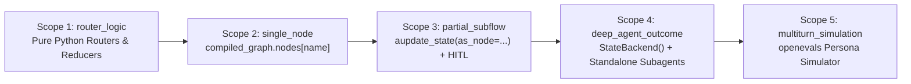

# TalkOps Testing & Scenario Evaluation Guide (`tests/`)

This directory houses all automated verification for TalkOps, organized into three distinct layers so fast deterministic checks stay instantaneous while scenario-driven LLM evaluations remain isolated, reproducible, and local-only.

---

## 1. Directory Layout & Execution Policy

```text
tests/
├── conftest.py                  # Root environment sandboxing & automatic path-based marker tagging
├── unit_tests/                  # Fast, zero-network Python unit tests (default `uv run pytest`, CI, & PyPI release gate)
├── integration_tests/           # Live external integration / adapter smoke checks
└── evals/                       # Scenario-Driven Five-Scope Agent Evaluation Framework (LOCAL-ONLY)
    ├── conftest.py              # LangSmith metadata, CLI filters, VCR scrubbing, & clean executor shutdown
    ├── framework/               # Reusable generic evaluation engine for ALL TalkOps use cases
    │   ├── scopes.py            # Primitives for Scopes 1–5 (nodes, checkpoint seeding, StateBackend, personas)
    │   ├── graders.py           # Swiss-Cheese 3-layer graders (Outcome, Agentevals Trajectory, Binary Judges)
    │   ├── reliability.py       # pass@k vs. pass^k (p^k) consistency, efficiency metrics, & EvalTelemetry
    │   ├── calibration.py       # Binary judge TPR / TNR calculation & `judgy` Rogan-Gladen bias correction
    │   └── serve_harness.py     # Ephemeral tmp_path ASGI + Gateway + SQLite harness for `talkops serve`
    ├── fixtures/                # Shared mock cloud/K8s tools, seeded topologies, & realistic webhook payloads
    ├── flows/                   # Scopes 1–4 flow isolation suites (routers, single nodes, subflows, StateBackend)
    ├── serve_profiles/          # End-to-end `talkops serve` 5-profile isolation & autonomous SRE suites
    ├── multiturn/               # Scope 5 multi-turn persona simulations & `pass_power_k_runner.py`
    ├── calibration/             # Human-labeled gold traces (`*.json`) & judge TPR/TNR calibration checks
    └── cassettes/               # Local disk-cached HTTP responses (`LANGSMITH_TEST_CACHE=tests/evals/cassettes`)
```

### Strict Local-Only Policy for `tests/evals/`
- **Never wire `tests/evals/` into GitHub Actions or PyPI release workflows.**
- Default `uv run pytest` (`testpaths = ["tests/unit_tests"]` in `pyproject.toml`), `.github/workflows/ci.yml`, and `.github/workflows/release-pypi.yml` execute **only** `tests/unit_tests/`.
- `tests/evals/` is excluded from `sdist`/wheel builds and includes a hard `GITHUB_ACTIONS=true` skip guard in `tests/evals/conftest.py`.

---

## 2. Core Standards for Writing Agent Evals

Whenever adding evaluations for a new TalkOps capability (e.g., Marketplace Plugins, FinOps, Terraform/IaC, CLI/TUI flows, MCP servers, Browser automation, or OpenWiki), follow these six standards:

1. **Behavior-Descriptive Naming (Never `tier1` / `tier2` / `t1_01`)**
   - File and function names must immediately state *what scenario and outcome* is under test.
   - Good: `test_readonly_server_ceiling_blocks_urgent_pod_deletion_request`
   - Bad: `test_tier1_03` or `test_case_4`

2. **Authentic Natural Human Prompts**
   - Write user prompts, incident tickets, and webhook payloads in natural operational language.
   - Never spoon-feed internal tool or subagent names in the prompt (unless testing explicit human approval of a specific named action). Let the model organically select the right tool, skill, or subagent from its schemas.

3. **Grade Environment Outcomes Over Rigid Paths (Swiss-Cheese Model)**
   - **Layer 1 (Default — $0 Deterministic Outcome Graders)**: Verify actual state mutations first — virtual files in `result["files"]`, task statuses in `result["todos"]`, SQLite/OperationalStore rows, or HTTP status codes. Never trust the agent's final `AIMessage` prose alone.
   - **Layer 2 ($0 Flexible Trajectory Matchers)**: Use `trajectory_match_mode="superset"` (tolerating optional `ls`, `glob`, or `write_todos` steps) rather than brittle `strict` checks, reserving `strict` or `subset` only for security/ordering rules.
   - **Layer 3 (Calibrated Binary LLM Judges)**: Use `openevals` binary (`True`/`False`) judges **only** for open-ended semantic synthesis that deterministic Python code cannot check.

4. **Unambiguous Specification Hygiene**
   - Never grade an implicit file path, branch name, or threshold that wasn't either stated in the prompt or seeded into the test workspace/environment. If a test expects `/reports/finops_audit.md`, state that path in the prompt and seed any input manifests the agent needs to read.

5. **Separate Regression vs. Capability Suites**
   - `@pytest.mark.eval_regression`: Protects solved behaviors and past bug fixes (~100% expected pass rate). Every escaped runtime bug should become an `eval_regression` test.
   - `@pytest.mark.eval_capability`: Hill-climbing benchmark for hard multi-step reasoning or new experimental flows. Graduate a scenario to `eval_regression` once its pass rate saturates near 100%.

6. **Measure Consistency with `pass^k` (`p^k`), Not Single Trials**
   - Single-run pass rates ($k=1$) hide flakiness: an agent with a $75\%$ per-trial success rate drops to $0.75^3 = 42.2\%$ on `pass^3` and $5.6\%$ on `pass^10`.
   - Use **`pass^k`** (all $k$ trials succeed consecutively) via `run_multi_trial_consistency` for production operations and safety guardrails. Use **`pass@k`** ($\ge 1$ trial succeeds) only for candidate-drafting workflows.

---

## 3. The Five-Scope Isolation Architecture & Decision Matrix

Do **not** spin up the full end-to-end Deep Agent coordinator when testing a single routing rule, middleware state patch, or isolated subagent. Pick the narrowest scope from `tests.evals.framework`:



| Scenario You Want to Test | Target Scope (`@pytest.mark.eval_scope`) | Framework Primitive (`tests.evals.framework`) | Recommended Grader |
|---|---|---|---|
| Conditional edge truth tables, policy regexes, state reducers, deterministic tool loop | `router_logic` | `@pytest.mark.parametrize` + `BindableFakeChatModel` (function-scoped) | Plain `assert` ($0, <50ms) |
| Single node state-diff or first-step tool selection without running downstream tools | `single_node` | `ainvoke_single_node(graph, "node_name", state)` or `interrupt_before=["tools"]` | `extract_tool_calls` + state-diff `assert` |
| Mid-graph 2–3 node transition or `__interrupt__` + `Command(resume=...)` slice | `partial_subflow` | `run_checkpoint_seeded_subflow(..., as_node=..., resume_commands=[...])` | `evaluate_strict_graph_steps` + final state `assert` |
| Custom subagent internal tool accuracy (avoiding Deep Agents context quarantine) | `deep_agent_outcome` | `create_standalone_subagent_runnable(model=..., tools=..., system_prompt=...)` | Tool call log + groundedness check |
| Coordinator `task()` delegation, virtual file generation, & `write_todos` completion | `deep_agent_outcome` | `create_ephemeral_deep_agent` (`StateBackend()`) | `verify_virtual_files_outcome` + `verify_todos_outcome` + `build_trajectory_matcher(mode="superset")` |
| Multi-turn clarification, context retention, or operator handoff | `multiturn_simulation` | `run_persona_multiturn_simulation` | DB/state outcome check + binary `openevals` judge |

---

## 4. How to Add Evals for a New Use Case (Step-by-Step Templates)

Suppose you are adding evals for a new domain — for example **FinOps cost optimization** (`tests/evals/finops/test_finops_rightsizing_flows.py`) or **Terraform drift remediation** (`tests/evals/terraform/test_terraform_plan_and_pr_flows.py`).

### Step 1: Create Mocked Domain Tools with `readOnlyHint` / `destructiveHint`
Keep external cloud/HTTP calls deterministically mocked via `@tool` fixtures so tests never mutate real cloud accounts and work identically with `ExecutionProfileGuardMiddleware`:

```python
from typing import Annotated, Any
from langchain_core.tools import tool
from pydantic import Field


def build_mock_finops_tools(call_log: list[dict[str, Any]]) -> list[Any]:
    @tool
    def aws_ce_get_cost_anomalies(
        account_id: Annotated[str, Field(default="123456789012", description="AWS account ID.")] = "123456789012",
    ) -> str:
        """Fetch recent AWS Cost Explorer spend anomalies by service and usage type."""
        call_log.append({"name": "aws_ce_get_cost_anomalies", "args": {"account_id": account_id}})
        return '{"service": "AmazonRDS", "resource": "orders-rds", "daily_delta_usd": 1420.0, "driver": "ProvisionedIOPS"}'

    aws_ce_get_cost_anomalies.metadata = {"readOnlyHint": True}
    return [aws_ce_get_cost_anomalies]
```

### Step 2: Write Scoped Scenarios Using `tests.evals.framework`

#### Example A — Scope 2: Single-Node Middleware / First-Decision Eval
```python
import pytest
from langchain_core.messages import HumanMessage
from tests.evals.framework import EvalTelemetry, ainvoke_single_node, extract_tool_calls


@pytest.mark.langsmith
@pytest.mark.eval_regression
@pytest.mark.eval_scope("single_node")
@pytest.mark.eval_category("tool_use")
async def test_finops_cost_spike_question_selects_cost_explorer_before_resizing(
    serve_harness_factory,
    eval_telemetry: EvalTelemetry,
) -> None:
    call_log = []
    harness = await serve_harness_factory(
        profile="sre",
        no_subagents=True,
        extra_tools=build_mock_finops_tools(call_log),
    )
    prompt = "Our AWS bill jumped by $1,400/day yesterday—can you check what caused the spike?"
    eval_telemetry.log_inputs({"prompt": prompt})

    paused = await harness.agent.ainvoke(
        {"messages": [HumanMessage(content=prompt)]},
        config={"configurable": {"thread_id": "eval-finops-001"}},
        interrupt_before=["tools"],
    )
    called = {tc["name"] for tc in extract_tool_calls([paused["messages"][-1]])}
    assert "aws_ce_get_cost_anomalies" in called
    eval_telemetry.log_feedback(key="selected_cost_explorer_first", score=True)
```

#### Example B — Scope 3: Checkpoint-Seeded Sub-Flow & HITL Resume
```python
import pytest
from langgraph.checkpoint.memory import MemorySaver
from langgraph.types import Command
from tests.evals.framework import (
    EvalTelemetry,
    evaluate_strict_graph_steps,
    run_checkpoint_seeded_subflow,
)


@pytest.mark.eval_regression
@pytest.mark.eval_scope("partial_subflow")
@pytest.mark.eval_category("graph_routing")
async def test_checkpoint_seeded_approval_slice_visits_expected_nodes(
    my_workflow_builder,
    eval_telemetry: EvalTelemetry,
) -> None:
    compiled = my_workflow_builder.compile(checkpointer=MemorySaver())

    subflow = await run_checkpoint_seeded_subflow(
        compiled,
        seed_state={"resource_id": "orders-rds", "savings_usd": 1420.0},
        as_node="analyze_spend_node",
        resume_commands=[Command(resume={"approved": True, "reviewer": "finops_lead"})],
    )
    grade = evaluate_strict_graph_steps(
        subflow.extracted_trajectory,
        expected_steps=[
            ["approval_gate_node", "__interrupt__"],
            ["apply_rightsizing_node", "record_savings_node"],
        ],
    )
    eval_telemetry.log_feedback(key="strict_graph_steps", score=bool(grade["score"]))
    assert grade["score"] is True
```

#### Example C — Scope 4: Deep Agent `StateBackend()` Virtual Filesystem + Subagents
Test custom subagents standalone first (so context quarantine doesn't hide internal tool calls), then verify parent coordinator delegation + `result["files"]` + `result["todos"]`:

```python
import pytest
from langchain_core.messages import AIMessage, HumanMessage, ToolMessage
from tests.evals.framework import (
    EvalTelemetry,
    build_trajectory_matcher,
    create_ephemeral_deep_agent,
    verify_todos_outcome,
    verify_virtual_files_outcome,
)
from talkops.model.factory import create_model


@pytest.mark.langsmith
@pytest.mark.eval_regression
@pytest.mark.eval_scope("deep_agent_outcome")
@pytest.mark.eval_category("file_operations")
async def test_finops_coordinator_delegates_audit_and_writes_virtual_markdown_report(
    eval_model_spec: str,
    eval_telemetry: EvalTelemetry,
) -> None:
    call_log = []
    finops_subagent = {
        "name": "aws_cost_analyst",
        "description": "Investigates AWS Cost Explorer anomalies and IOPS spend drivers.",
        "system_prompt": "Query AWS cost anomalies and summarize root spend drivers.",
        "tools": build_mock_finops_tools(call_log),
    }
    agent = create_ephemeral_deep_agent(
        model=create_model(eval_model_spec).model,
        system_prompt=(
            "1. Track work with write_todos. "
            "2. Delegate AWS spend analysis via task to aws_cost_analyst. "
            "3. Write the final report to /reports/rds_cost_audit.md using write_file."
        ),
        subagents=[finops_subagent],
        enable_todos=True,
    )

    prompt = "Audit yesterday's AWS spend spike and save a summary to /reports/rds_cost_audit.md."
    result = await agent.ainvoke({"messages": [HumanMessage(content=prompt)]})

    files_ok = verify_virtual_files_outcome(
        result,
        expected_files={"/reports/rds_cost_audit.md": ["orders-rds", "1420"]},
    )
    todos_ok = verify_todos_outcome(result, require_completed=True)
    matcher = build_trajectory_matcher(
        mode="superset",
        tool_args_match_overrides={"write_file": ["file_path"]},
    )
    traj_ok = matcher(
        outputs=result["messages"],
        reference_outputs=[
            HumanMessage(content=prompt),
            AIMessage(content="", tool_calls=[{"id": "1", "name": "write_file", "args": {"file_path": "/reports/rds_cost_audit.md"}}]),
            ToolMessage(content="ok", tool_call_id="1"),
            AIMessage(content="Done."),
        ],
    )
    eval_telemetry.log_feedback(key="virtual_file_verified", score=files_ok["passed"])
    assert files_ok["passed"] and todos_ok["passed"] and traj_ok["score"]
```

#### Example D — Calibrating Any New Binary LLM Judge (`TPR`, `TNR` & `judgy`)
Whenever you introduce a new `create_llm_as_judge` rubric in `tests/evals/framework/graders.py`:
1. Add at least 10–30 human-labeled PASS (`1`) and FAIL (`0`) examples under `tests/evals/calibration/<domain>_gold_labels.json`.
2. Verify both `TPR >= 0.80` and `TNR >= 0.80` (`TPR + TNR > 1.0`) using `compute_binary_judge_tpr_tnr` and `estimate_bias_corrected_pass_rate` in `tests/evals/calibration/`.

---

## 5. Running Tests & Evals Locally

Always activate the project virtual environment first and run via `uv run`:

```bash
source .venv/bin/activate

# ── 1. Fast Deterministic Unit Tests (Default, CI, & Release Gate) ──────────
uv run pytest

# ── 2. Run Scenario Evals by Isolation Scope ────────────────────────────────
uv run pytest tests/evals/ --eval-scope=router_logic -v
uv run pytest tests/evals/ --eval-scope=single_node -v
uv run pytest tests/evals/ --eval-scope=partial_subflow -v
uv run pytest tests/evals/ --eval-scope=deep_agent_outcome -v
uv run pytest tests/evals/ --eval-scope=multiturn_simulation -v

# ── 3. Filter by Capability Category or `talkops serve` Profile ─────────────
uv run pytest tests/evals/ --eval-category=guardrails -v
uv run pytest tests/evals/ --serve-profile=sre -m eval_regression -v
uv run pytest tests/evals/serve_profiles/ -v
uv run pytest tests/evals/flows/test_channels_exposure_and_sink_routing.py -v
uv run pytest tests/evals/serve_profiles/test_channels_chatops_and_webhook_handoff.py -v

# ── 4. Multi-Trial Consistency (`pass^k`) & Judge Calibration (`judgy`) ─────
uv run pytest tests/evals/flows/test_single_node_decisions.py -k "readonly_server_ceiling" --eval-trials=3 -v
uv run python -m tests.evals.multiturn.pass_power_k_runner --trials 3
uv run pytest tests/evals/calibration/ -v

# ── 5. Override Subject Model or Replay from Disk Cache ─────────────────────
uv run pytest tests/evals/flows/ --eval-model="google_vertexai:gemini-3.8-flash" -v
LANGSMITH_TEST_CACHE=tests/evals/cassettes uv run pytest tests/evals/flows/ -v

# ── 6. Sync Experiment Results & Feedback Scores to LangSmith UI ────────────
uv run pytest tests/evals/serve_profiles/ --langsmith-output -v
```
